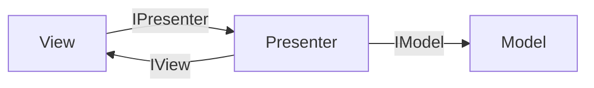
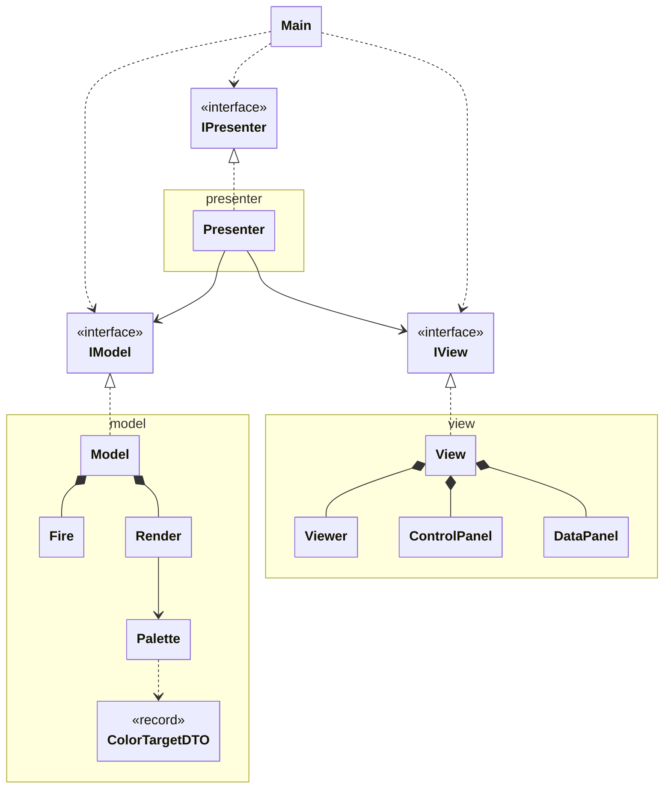
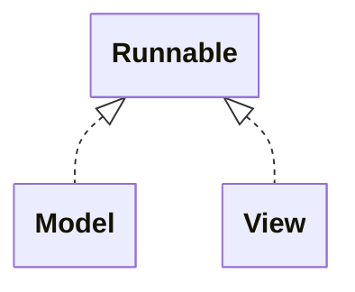

# Unidad 1: Ejercicio 1 - Fire Animation (Java Swing + MVP)

Esta práctica involucra la arquitectura MVP para calcular la simulación de un fuego y representarlo utilizando las herramientas de AWT y Swing.
En este documento se repasa la arquitectura MVP, el UML que aplica este programa, se comenta el uso de hilos y, finalmente, dicta paso a paso la construcción del programa:
- Arquitectura MVP
- Fire Animation UML
- Hilos aplicados
- Funcionamiento
- Recorrido por clases
- Versión mejorada

## Arquitectura MVP

**MVP (Model-View-Presenter)** separa el programa en tres partes:

- **Model**: los datos y la lógica (la simulación del fuego).
- **View**: la pantalla (ventana, botones, sliders).
- **Presenter**: el intermediario; recibe las acciones de la vista y se las pasa al modelo.

**Regla principal:** la vista y el modelo nunca se hablan directamente; todo pasa por el presenter.

Se comunican mediante interfaces (`IModel`, `IView`, `IPresenter`). Una **interfaz** es una lista de métodos sin implementar: cada parte solo conoce lo que la otra *promete hacer*, no cómo lo hace, así que se puede cambiar una implementación sin tocar las demás.



Esta estructura nos propone la siguiente organización de carpetas, dejando el `Main.java` como única clase libre en la carpeta `src`:
```
fire-animation/
└── src/
    ├── Main.java → punto de entrada: crea modelo, vista y presenter y los conecta
    ├── model/ → simulación del fuego, paletas, render a imagen e IModel
    ├── presenter/ → Presenter e IPresenter: el intermediario
    └── view/ → ventana Swing, paneles de controles, lienzo e IView
```

## Fire Animation UML
En el UML podemos observar la estructura completa del programa y las conexiones que se han planteado anteriormente:


## Hilos aplicados
En este proyecto hay que tener en cuenta cuatro hilos, el primero es el `main`, el principal; el segundo depende de Swing, es el EDT (Event-Dispatching Thread); y finalmente tanto Model como View tendrán el suyo propio, creado para esta estructura.

| Hilo | Qué hace |
|---|---|
| **main** | Solo llama a `SwingUtilities.invokeLater` y termina. |
| **EDT** (hilo de Swing) | Crea la ventana, pinta los componentes y ejecuta todos los listeners (clics, sliders). |
| **Model** (`Model.run`) | Unas 30 veces por segundo actualiza las temperaturas y pinta el fotograma nuevo. |
| **View** (`View.run`) | Cada 16 ms pide la imagen al presenter y se la pasa al `Viewer` para que se repinte. |



Gracias a implementar Runnable pueden crear y ejecutar hilos a su parecer y permite separar los cálculos que realiza el modelo del renderizado que ejecuta la vista.

## Funcionamiento

### Los tres hilos

```
Hilo del modelo (Model-Fire):  calcula el fuego → espera → repite
Hilo de la vista (View-Fire):  presenter.getImage() → viewer.setImage() → espera → repite
Hilo de Swing: dibuja el canvas cuando le toca (paint)
```

### El viaje de un fotograma

```
Fire (temperaturas)
  → Render + Palette (imagen)
    → Model.getImage()
      → Presenter.getImage()
        → View (hilo) → Viewer.setImage() → repaint()
          → Swing → Viewer.paint() → pantalla
```

### Las reglas de MVP que se cumplen

- La **vista y el modelo nunca se hablan**: todo pasa por el Presenter.
- Cada pieza conoce a las demás **por su interfaz**, no por su clase.
- Las clases concretas solo aparecen en `Main`.

## Recorrido por clases

El programa se construye **de abajo hacia arriba**, siguiendo el UML. Las clases de arriba dependen por completo de las de abajo para funcionar.

Para saber por qué rama empezar basta una pregunta: ¿puede la vista enseñar algo sin una imagen? No. Así que se empieza por la rama del **modelo**, que es la que genera la imagen.

Orden completo:

```
Modelo:     ColorTargetDTO → Palette → Fire → Render → IModel → Model
Vista y
Presenter:  Viewer → IPresenter → IView → View → Presenter
Arranque:   Main
```

Cada clase solo usa las que ya se han explicado antes.

---

### ColorTargetDTO

Guarda un **punto de referencia** de la paleta: una temperatura y el color que le corresponde, separado en sus cuatro componentes ARGB (alfa, rojo, verde y azul).

Solo se usa dentro de `Palette`, para definir los colores de los que parte.

```java
public class ColorTargetDTO {
    private final int temperature;
    private final int alpha;
    private final int red;
    private final int green;
    private final int blue;

    public ColorTargetDTO(int temperature, int alpha, int red, int green, int blue) {
        this.temperature = temperature;
        this.alpha = alpha;
        this.red = red;
        this.green = green;
        this.blue = blue;
    }

    public int getTemperature() { return temperature; }
    public int getAlpha() { return alpha; }
    public int getRed()   { return red; }
    public int getGreen() { return green; }
    public int getBlue()  { return blue; }
}
```

- **Constructor**: recibe los cinco valores y los guarda.
- **Getters**: devuelven cada valor. No hay setters porque los atributos son `final`: un punto de la paleta no cambia una vez creado.
- **DTO** (_Data Transfer Object_): una clase que solo transporta datos, sin lógica.

---

### Palette

Convierte una **temperatura** (de 0 a 255) en un **color**.

Recibe unos pocos colores de referencia y calcula todos los intermedios. Los guarda en un array de 256 posiciones: una por temperatura.

```java
public class Palette {
    private final int[] colors = new int[256];

    public Palette(List<ColorTargetDTO> targets) {
        for (int i = 0; i < targets.size() - 1; i++) {
            ColorTargetDTO from = targets.get(i);
            ColorTargetDTO to = targets.get(i + 1);

            int range = to.getTemperature() - from.getTemperature();

            for (int t = from.getTemperature(); t <= to.getTemperature(); t++) {
                double ratio = (double) (t - from.getTemperature()) / range;

                int alpha = mix(from.getAlpha(), to.getAlpha(), ratio);
                int red   = mix(from.getRed(),   to.getRed(),   ratio);
                int green = mix(from.getGreen(), to.getGreen(), ratio);
                int blue  = mix(from.getBlue(),  to.getBlue(),  ratio);

                colors[t] = new Color(red, green, blue, alpha).getRGB();
            }
        }
    }

    public int color(int temperatura) {
        return colors[temperatura];
    }

    private int mix(int v1, int v2, double ratio) {
        return (int) Math.round(v1 + (v2 - v1) * ratio);
    }

    public static Palette createPalette() {
        List<ColorTargetDTO> targets = new ArrayList<>();
        targets.add(new ColorTargetDTO(  0, 255,   0,   0,   0)); // negro
        targets.add(new ColorTargetDTO( 20, 255, 224,  58,   0)); // rojo
        targets.add(new ColorTargetDTO( 80, 255, 255, 208,  32)); // amarillo
        targets.add(new ColorTargetDTO(255, 255, 255, 255, 255)); // blanco
        return new Palette(targets);
    }
}
```

#### `colors` (atributo)

- Array de 256 colores, de la temperatura 0 a la 255.
- Se rellena **una sola vez**, al crear la paleta.
- Así, pedir un color después es solo leer una posición del array, sin hacer cuentas.

#### Constructor — la función clave

Rellena el array `colors` mezclando los colores de referencia.

1. **Recorre los puntos de dos en dos** (`from` y `to`). Con 4 puntos hay 3 tramos: negro→rojo, rojo→amarillo, amarillo→blanco.
2. **`range`**: cuántas temperaturas hay en el tramo. De 20 a 80, son 60.
3. **Recorre cada temperatura `t` del tramo.**
4. **`ratio`**: qué parte del tramo se ha recorrido, de 0 a 1. En `from` vale 0; en `to`, 1; a mitad, 0,5.
5. **Mezcla cada canal** por separado con `mix`. Se hace canal a canal para que no se mezclen entre ellos.
6. **`new Color(...).getRGB()`** junta los cuatro canales en un solo `int`, que es el formato que usa la imagen.

El `(double)` es imprescindible: sin él, la división sería entera y `ratio` valdría siempre 0 (o 1 al final).

#### `color(temperatura)`

- Devuelve el color ya calculado para esa temperatura.
- Es la función que usa `Render` para pintar cada píxel.

#### `mix(v1, v2, ratio)` — interpolación lineal

Calcula un valor intermedio entre `v1` y `v2`.

```
v1 + (v2 - v1) * ratio
```

- `(v2 - v1)` es la distancia entre los dos valores.
- Multiplicada por `ratio`, es la parte de la distancia que ya se ha recorrido.
- Sumada a `v1`, da el valor intermedio.

Ejemplo: rojo de 224 a 255 con `ratio` 0,5 → `224 + 31 · 0,5 = 239,5` → 240.

`Math.round` redondea, y `(int)` lo convierte a entero, porque un canal de color va de 0 a 255 sin decimales.

#### `createPalette()`

- Crea la paleta de fuego: **negro → rojo → amarillo → blanco**.
- Es `static`: se llama sin tener una paleta creada, `Palette.createPalette()`.
- El primer punto tiene que estar en 0 y el último en 255, para cubrir todas las temperaturas.
- El alfa es 255 en todos los puntos: colores opacos.

---

### Fire

Es la **simulación** del fuego. Guarda una matriz de temperaturas y, en cada fotograma, enciende la base y hace subir el calor.

```java
public class Fire {
    private final int sparksPercentage = 40;
    private final int coolPointsPercentage = 30;
    private final int randomizer = 1;

    private final int width;
    private final int height;
    private final int[][] temperatures;

    private final Random random = new Random();

    public Fire(int width, int height) {
        this.width = width;
        this.height = height;
        this.temperatures = new int[height][width];
    }

    public void sparksGeneration() {
        int base = height - 1;
        for (int x = 0; x < width; x++) {
            if (random.nextInt(100) < sparksPercentage) {
                temperatures[base][x] = 255;
            }
        }
    }

    public void coolPointsGeneration() {
        int base = height - 1;
        for (int x = 0; x < width; x++) {
            if (random.nextInt(100) < coolPointsPercentage) {
                temperatures[base][x] = 0;
            }
        }
    }

    public void updateFlames() {
        for (int y = height - 2; y >= 0; y--) {
            for (int x = 0; x < width; x++) {
                int actual = temperatures[y][x];
                int left   = temperatures[y + 1][Math.max(x - 1, 0)];
                int center = temperatures[y + 1][x];
                int right  = temperatures[y + 1][Math.min(x + 1, width - 1)];

                int t = (actual + left + center + right) / 4 - random.nextInt(randomizer + 1);

                temperatures[y][x] = Math.max(t, 0);
            }
        }
    }

    public int[][] getTemperature() { return temperatures; }
    public int getWidth()  { return width; }
    public int getHeight() { return height; }
}
```

#### Constantes

- `sparksPercentage`: porcentaje de celdas de la base que se encienden.
- `coolPointsPercentage`: porcentaje que se apagan. Crean huecos para que la llama no sea un bloque.
- `randomizer`: cuánto puede enfriarse una celda al subir. Más alto, llama más baja.

#### Constructor

- Guarda el tamaño y crea la matriz `temperatures[alto][ancho]`.
- Java la inicializa toda a 0: al principio no hay fuego.
- El orden es `[fila][columna]`, es decir, `[y][x]`.

#### `sparksGeneration()` y `coolPointsGeneration()`

Las dos trabajan solo sobre la **fila de abajo** (`height - 1`), que es la base del fuego.

- Recorren cada celda de la base.
- `random.nextInt(100) < porcentaje` es como tirar un dado de 100 caras: con 40, se cumple el 40 % de las veces.
- Las chispas ponen la celda a 255 (máximo calor); los vacíos, a 0.
- Se llaman en este orden: primero se enciende y después se apaga una parte.

#### `updateFlames()` — la función clave

Hace **subir el calor**: cada celda toma la media de ella misma y de las tres de debajo, un poco enfriada.

```
fila y      ·      [actual]      ·
fila y+1  [left]  [center]  [right]
```

- **Recorre de abajo hacia arriba** (`y--`). Así, la fila de debajo ya está actualizada cuando se calcula la de arriba.
- **Empieza en `height - 2`**, justo encima de la base. La base no se calcula: la rellenan chispas y vacíos.
- **Lee `y + 1`, la fila de debajo**, porque el calor sube. Leer `y - 1` haría bajar el fuego.
- **`Math.max(x - 1, 0)` y `Math.min(x + 1, width - 1)`** evitan salirse del array en los bordes: en la primera y la última columna, la vecina que falta es la propia celda.
- **`/ 4`**: la media de las cuatro celdas. Es una división entera: los decimales se pierden, y eso también enfría un poco.
- **`- random.nextInt(randomizer + 1)`** resta un enfriamiento aleatorio entre 0 y `randomizer`. El `+ 1` hace falta porque `nextInt(n)` nunca devuelve `n`.
- **`Math.max(t, 0)`** evita temperaturas negativas, que no existen en la paleta.

#### Getters

- Los usa `Render` para leer las temperaturas y el tamaño.

---

### Render

Convierte las **temperaturas** en una **imagen**, usando la paleta.

```java
public class Render {
    private final Palette palette;
    private final BufferedImage image;

    public Render(int width, int height, Palette palette) {
        this.palette = palette;
        this.image = new BufferedImage(width, height, BufferedImage.TYPE_INT_ARGB);
    }

    public BufferedImage getImage(Fire fire) {
        int[][] temperatures = fire.getTemperature();

        for (int y = 0; y < fire.getHeight(); y++) {
            for (int x = 0; x < fire.getWidth(); x++) {
                image.setRGB(x, y, palette.color(temperatures[y][x]));
            }
        }
        return image;
    }
}
```

#### Constructor

- Guarda la paleta.
- Crea la imagen **una sola vez**, del mismo tamaño que el fuego.
- `TYPE_INT_ARGB`: cada píxel es un `int` con alfa, rojo, verde y azul, el mismo formato que devuelve la paleta.

#### `getImage(fire)`

- Recorre todas las celdas del fuego.
- Para cada una, pide a la paleta el color de su temperatura y lo pone en el píxel `(x, y)` con `setRGB`.
- Devuelve siempre la **misma** imagen, repintada con el estado actual.
- Recibe el fuego como parámetro: `Render` no lo guarda, solo lo lee cuando pinta.

---

### IModel

Es el **contrato** del modelo: lo que el Presenter puede pedirle, sin saber cómo está hecho por dentro.

```java
public interface IModel {
    void start();
    BufferedImage getImage();
}
```

- `start()`: pone el fuego en marcha.
- `getImage()`: devuelve el fotograma actual.

El Presenter guarda un `IModel`, no un `Model`. Así depende del contrato y no de la clase concreta.

---

### Model

Junta todas las piezas y las pone en marcha con un **hilo propio**, que actualiza el fuego unas 30 veces por segundo.

```java
public class Model implements IModel, Runnable {
    private final int width = 600;
    private final int height = 600;
    private final int frameMS = 33; // ~30 FPS

    private final Fire fire;
    private final Render render;

    public Model() {
        fire = new Fire(width, height);
        render = new Render(fire.getWidth(), fire.getHeight(), Palette.createPalette());
    }

    @Override
    public void start() {
        Thread thread = new Thread(this, "Model-Fire");
        thread.setDaemon(true);
        thread.start();
    }

    @Override
    public void run() {
        while (true) {
            update();
            try {
                Thread.sleep(frameMS);
            } catch (InterruptedException e) {
                return;
            }
        }
    }

    private synchronized void update() {
        fire.sparksGeneration();
        fire.coolPointsGeneration();
        fire.updateFlames();
    }

    @Override
    public synchronized BufferedImage getImage() {
        return render.getImage(fire);
    }
}
```

#### Constantes

- `width` y `height`: resolución del fuego, en celdas (= píxeles de la imagen).
- `frameMS`: espera entre actualizaciones. 33 ms ≈ 30 fotogramas por segundo.

#### Constructor

- Crea el `Fire` y el `Render`, este último con la paleta de fuego.
- El modelo es el **dueño** de estas piezas: las crea y nadie más las conoce.

#### `start()` — arrancar el hilo

- `new Thread(this, "Model-Fire")`: crea un hilo que ejecutará el `run()` de esta clase. El nombre sirve para identificarlo en los errores.
- `setDaemon(true)`: hilo "de fondo". No impide que el programa se cierre.
- `thread.start()`: lanza el hilo. **No** hay que llamar a `run()` directamente: eso ejecutaría el bucle en el hilo actual y lo bloquearía.

#### `run()` — el bucle del hilo

- Existe porque la clase implementa `Runnable`: es el trabajo que hace el hilo.
- Repite para siempre: actualizar el fuego y esperar `frameMS`.
- `Thread.sleep` puede lanzar `InterruptedException`; Java obliga a capturarla. Si alguien interrumpe el hilo, `return` lo termina.

#### `update()` — un paso de la simulación

- Llama a las tres funciones del fuego, **en este orden**: encender la base, apagar huecos, subir el calor.
- Es `private`: solo la llama el propio hilo. Por eso no está en `IModel`.

#### `getImage()`

- Pinta el estado actual del fuego y devuelve la imagen.
- La llama **otro hilo** (el de la vista, a través del Presenter).

#### `synchronized` — por qué está en `update()` y `getImage()`

- Hay dos hilos trabajando sobre el mismo fuego: uno lo actualiza y otro lo pinta.
- Sin protección, se podría pintar mientras las temperaturas están a medio calcular.
- `synchronized` impide que los dos métodos se ejecuten a la vez: si uno está en marcha, el otro espera a que termine.

---

### Vista y Presenter: por dónde seguir

Con el modelo terminado ya hay imagen. Ahora falta enseñarla.

Aquí aparece un problema: la `View` necesita al Presenter (para pedirle la imagen) y el `Presenter` necesita a la `View` (para arrancarla). Se necesitan mutuamente.

Las **interfaces** rompen ese círculo. Se escriben primero `IPresenter` e `IView`, que no dependen de ninguna clase concreta. Después, cada clase usa la interfaz de la otra.

Antes de todo eso va `Viewer`, que no depende de nada.

---

### Viewer

Es el **lienzo** donde se dibuja el fuego. Recibe una imagen y la pinta ocupando todo su tamaño.

```java
public class Viewer extends Canvas {
    private volatile BufferedImage image;

    public void setImage(BufferedImage image) {
        this.image = image;
        repaint();
    }

    @Override
    public void paint(Graphics g) {
        if (image != null) {
            g.drawImage(image, 0, 0, getWidth(), getHeight(), null);
        }
    }

    @Override
    public void update(Graphics g) {
        paint(g);
    }
}
```

#### `extends Canvas`

- `Canvas` es un componente de Java pensado para dibujar a mano.
- `Viewer` **es** un canvas: se puede añadir directamente a una ventana.

#### `image` y `volatile`

- Guarda el último fotograma recibido.
- La escribe el hilo de la vista y la lee el hilo de Swing al dibujar.
- `volatile` asegura que el hilo de Swing vea siempre la imagen más reciente.

#### `setImage(image)`

- Guarda la imagen nueva.
- `repaint()` **no dibuja**: avisa a Java de que el canvas tiene que redibujarse. Java lo hará en su hilo cuando le toque.

#### `paint(g)`

- Java lo llama cuando toca dibujar: al abrir la ventana, al cambiar su tamaño o después de un `repaint()`.
- `g` es el "pincel" que Java prepara para la zona del canvas. Su punto (0, 0) es la esquina de arriba a la izquierda del canvas.
- `drawImage(image, x, y, ancho, alto, null)`: pinta la imagen en (0, 0), estirada al tamaño del canvas. El último parámetro solo sirve para imágenes que se cargan poco a poco; aquí es `null`.
- El `if` evita dibujar antes de tener la primera imagen.

#### `update(g)`

- Por defecto, `Canvas` **borra el fondo** antes de cada `paint`. En una animación eso produce parpadeo.
- Sobrescribirlo para que llame directamente a `paint` elimina el borrado.

---

### IPresenter

Lo que la vista y el `Main` pueden pedirle al Presenter.

```java
public interface IPresenter {
    void start();
    BufferedImage getImage();
}
```

- `start()`: arranca la aplicación.
- `getImage()`: la vista pide aquí cada fotograma.

---

### IView

Lo que el Presenter puede pedirle a la vista.

```java
public interface IView {
    void setPresenter(IPresenter presenter);
    void start();
}
```

- `setPresenter(...)`: le da a la vista el Presenter al que pedir imágenes.
- `start()`: muestra la ventana y empieza a pintar.

---

### View

Crea la **ventana** y tiene un **hilo propio** que pide fotogramas al Presenter y se los pasa al `Viewer`.

```java
public class View implements IView, Runnable {
    private final int FRAME_MS = 16; // ~60 FPS

    private IPresenter presenter;
    private final JFrame frame;
    private final Viewer viewer;

    public View() {
        viewer = new Viewer();

        frame = new JFrame("Fire Animation");
        frame.setDefaultCloseOperation(JFrame.EXIT_ON_CLOSE);
        frame.add(viewer);
    }

    @Override
    public void setPresenter(IPresenter presenter) {
        this.presenter = presenter;
    }

    @Override
    public void start() {
        BufferedImage first = presenter.getImage();
        viewer.setPreferredSize(new Dimension(first.getWidth(), first.getHeight()));
        viewer.setImage(first);

        frame.pack();
        frame.setVisible(true);

        Thread thread = new Thread(this, "View-Fire");
        thread.setDaemon(true);
        thread.start();
    }

    @Override
    public void run() {
        while (true) {
            viewer.setImage(presenter.getImage());
            try {
                Thread.sleep(FRAME_MS);
            } catch (InterruptedException e) {
                return;
            }
        }
    }
}
```

#### Constructor

- Crea el `Viewer` y la ventana (`JFrame`).
- `EXIT_ON_CLOSE`: al cerrar la ventana, se cierra el programa.
- `frame.add(viewer)` mete el canvas dentro de la ventana.
- La ventana **todavía no se muestra**: falta saber su tamaño.

#### `setPresenter(presenter)`

- Guarda el Presenter en el atributo.
- Sin esto, `presenter` sería `null` y la vista fallaría al pedir la primera imagen.

#### `start()`

1. Pide la **primera imagen** al Presenter.
2. Le da al canvas el **tamaño de esa imagen** con `setPreferredSize`. Así la ventana se ajusta al fuego.
3. `frame.pack()` ajusta la ventana al tamaño de su contenido. Tiene que ir después de fijar el tamaño del canvas.
4. `frame.setVisible(true)` muestra la ventana.
5. Arranca el hilo de pintado, igual que en `Model.start()`.

#### `run()` — el bucle de pintado

- Repite para siempre: pedir la imagen al Presenter, pasársela al `Viewer` y esperar 16 ms.
- 16 ms ≈ 60 fotogramas por segundo. Va más rápido que el modelo (30) para enseñar cada fotograma nuevo en cuanto existe.
- La vista **no conoce al modelo**: solo habla con `IPresenter`.

---

### Presenter

Es el **intermediario**: conoce al modelo y a la vista, y es la única pieza que habla con los dos. No tiene hilo propio.

```java
public class Presenter implements IPresenter {
    private final IModel model;
    private final IView view;

    public Presenter(IModel model, IView view) {
        this.model = model;
        this.view = view;
    }

    @Override
    public void start() {
        view.setPresenter(this);
        model.start();
        view.start();
    }

    @Override
    public BufferedImage getImage() {
        return model.getImage();
    }
}
```

#### Atributos

- Son de tipo `IModel` e `IView`, no `Model` y `View`. El Presenter depende de los **contratos**, no de las clases concretas.

#### Constructor

- Recibe el modelo y la vista ya creados, y los guarda.

#### `start()` — el orden importa

1. `view.setPresenter(this)`: la vista recibe al Presenter. `this` es el propio Presenter.
2. `model.start()`: arranca el hilo del fuego.
3. `view.start()`: muestra la ventana y arranca el hilo de pintado.

El paso 1 va antes del 3: en cuanto la vista arranca, empieza a pedir imágenes y necesita tener ya el Presenter.

#### `getImage()`

- La vista lo llama en cada fotograma.
- El Presenter se lo pide al modelo y devuelve la imagen.
- Así la vista nunca habla directamente con el modelo.

---

### Main

Crea las tres piezas, las conecta y arranca la aplicación.

```java
public class Main {
    public static void main(String[] args) {
        SwingUtilities.invokeLater(() -> {
            IModel model = new Model();
            IView view = new View();
            IPresenter presenter = new Presenter(model, view);
            presenter.start();
        });
    }
}
```

- **Variables de tipo interfaz**, objetos de clase concreta: `IModel model = new Model()`. Es el único sitio donde aparecen las clases concretas.
- **`SwingUtilities.invokeLater(...)`** ejecuta el código en el **hilo de Swing**, que es el único que debería crear ventanas.
- **`() -> { ... }`** es una _lambda_: una forma corta de pasar un bloque de código para ejecutarlo después.
- `presenter.start()` termina enseguida: solo arranca los hilos. Así el hilo de Swing queda libre para dibujar.

---
---

## Versión mejorada

La versión completa del proyecto está en [GitHub](https://github.com/MythicProjects/proyectos-dam2/tree/main/desarrollo-de-software/introduccion-a-los-videojuegos/02-fire-animation).
Parte de la misma base y añade control, configuración y optimizaciones.

### Interfaz

- **Botones Play, Pause y Stop** para controlar la animación.
- **Paletas predefinidas**: Fuego, Azul, Verde, Violeta, Cian y Arcoíris.
- **Rejilla de 16 colores**: genera una paleta de fuego a partir del color elegido.
- **Resolución configurable**: a mano o con presets de pantallas reales, de la Atari 2600 a Full HD.
- **Sliders** para chispas, puntos fríos, variación y enfriamiento, con efecto en tiempo real.
- **Tema oscuro** con la librería FlatLaf.
- **Avisos** al usuario, por ejemplo si la resolución es demasiado pequeña.

### Modelo

- **Máquina de estados**: un `enum` (`STOPPED`, `RUNNING`, `PAUSED`, `EXTINGUISHING`) decide qué hace el hilo en cada vuelta.
- **Apagado progresivo**: Stop reduce las chispas poco a poco; el hilo se detiene solo cuando el fuego se ha enfriado.
- **Parámetros en tiempo real**: los valores del fuego son `volatile`, así el hilo ve los cambios de los sliders al momento.
- **Variación y altura separadas**: el ruido es proporcional a la temperatura y puede sumar o restar. La variación cambia la forma de la llama, y el enfriamiento, su altura.
- **Cambio de resolución en caliente**, sin reiniciar la aplicación.

### Render

- **Doble búfer**: se pinta en una imagen trasera y se intercambia con la delantera. Evita ver medio fotograma de uno y medio de otro.
- **Se pinta una vez por actualización**, en el hilo del modelo. La vista solo recoge la última imagen terminada.
- **Escritura directa en memoria** (`DataBufferInt`) en vez de `setRGB`, mucho más rápida.

### Paleta

- **Colores ARGB en un solo `int`**, separados y unidos con máscaras (`& 0xFF`) y desplazamientos (`>>`, `<<`).
- **`ColorTargetDTO` como `record`**, la forma corta de Java para clases que solo guardan datos.
- **Validación**: la paleta comprueba que empieza en 0, acaba en 255 y va en aumento.
- **Paleta desde un color**: lo mezcla con negro para las temperaturas bajas y con blanco para las altas.

### Arquitectura

- **Paquete `common`** con el `enum PaletteType`, compartido por vista y modelo, para que la vista no importe nada del modelo.
- **El Presenter valida** lo que introduce el usuario (mínimos de resolución, porcentajes entre 0 y 100).
- **El modelo es la fuente de verdad**: al arrancar, la vista muestra los valores que le pasa el Presenter desde el modelo.
