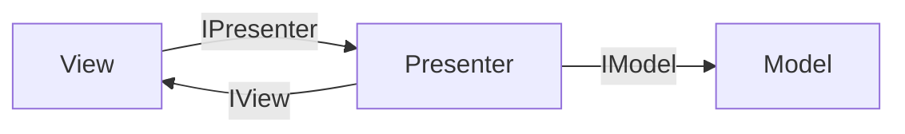
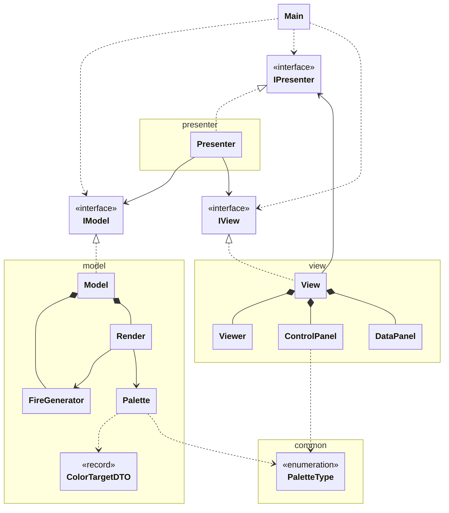
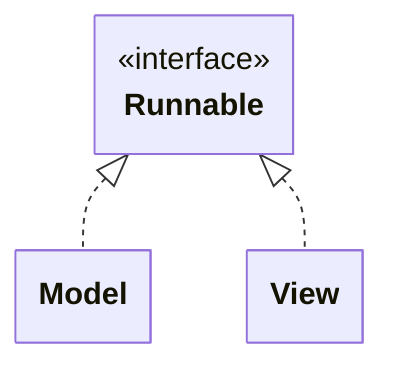
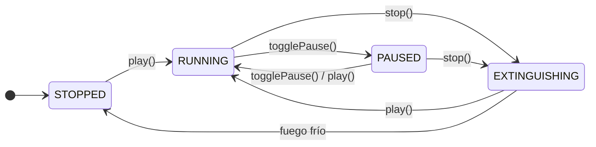

# Unidad 1: Ejercicio 1 - Fire Animation (Java Swing + MVP)

Esta práctica usa la arquitectura MVP para calcular la simulación de un fuego y representarlo con las herramientas de AWT y Swing. En este documento se repasa la arquitectura MVP y el UML del programa, se comenta el uso de hilos y, finalmente, se recorre el código clase a clase y función a función:

- Qué hace el programa
- Arquitectura MVP
- Fire Animation UML
- Hilos aplicados
- Funcionamiento
- Recorrido por clases

El código completo está en [GitHub](https://github.com/MythicProjects/proyectos-dam2/tree/main/desarrollo-de-software/introduccion-a-los-videojuegos/02-fire-animation).

## Qué hace el programa

- **Botones Play, Pause y Stop**. Stop apaga el fuego poco a poco, no de golpe.
- **Paletas predefinidas**: Fuego, Azul, Verde, Violeta, Cian y Arcoíris.
- **Rejilla de 16 colores**: genera una paleta de fuego a partir del color elegido.
- **Resolución configurable**: a mano o con presets de pantallas reales, de la Atari 2600 a Full HD.
- **Sliders** para chispas, puntos fríos, variación y enfriamiento, con efecto en tiempo real.
- **Tema oscuro** con la librería FlatLaf.
- **Avisos** al usuario, por ejemplo si la resolución es demasiado pequeña.

## Arquitectura MVP

**MVP (Model-View-Presenter)** separa el programa en tres partes:

- **Model**: los datos y la lógica (la simulación del fuego).
- **View**: la pantalla (ventana, botones, sliders).
- **Presenter**: el intermediario; recibe las acciones de la vista y se las pasa al modelo.

**Regla principal:** la vista y el modelo nunca se hablan directamente; todo pasa por el presenter.

Se comunican mediante interfaces (`IModel`, `IView`, `IPresenter`). Una **interfaz** es una lista de métodos sin implementar: cada parte solo conoce lo que la otra _promete hacer_, no cómo lo hace. Así se puede cambiar una implementación sin tocar las demás.



Esta estructura da la siguiente organización de carpetas, con `Main.java` como única clase suelta en `src`:

```
02-fire-animation/
├── lib/            → librerías FlatLaf (.jar)
└── src/
    ├── Main.java   → punto de entrada: crea modelo, vista y presenter y los conecta
    ├── common/     → PaletteType: lo usan varias capas, así que no pertenece a ninguna
    ├── model/      → simulación del fuego, paletas, render a imagen e IModel
    ├── presenter/  → Presenter e IPresenter: el intermediario
    └── view/       → ventana Swing, paneles de controles, lienzo e IView
```

**¿Por qué `common`?** La vista necesita `PaletteType` para dibujar los botones de paleta, y el modelo para crear la paleta. Si estuviera en `model`, la vista importaría algo del modelo y rompería la regla de MVP.

## Fire Animation UML

En el UML se ve la estructura completa del programa y las conexiones planteadas antes:



|Flecha|Significado|Ejemplo|
|---|---|---|
|`<\|..`|**Implementa** una interfaz|`Model` implementa `IModel`|
|`-->`|**Guarda una referencia** a otra pieza|`Presenter` guarda un `IModel`|
|`*--`|**Composición**: la crea y es su dueña|`Model` crea su `FireGenerator`|
|`..>`|**Usa**, pero no la guarda|`Main` crea las piezas y las suelta|

`ControlPanel` y `DataPanel` también guardan el `IPresenter`; no se dibuja para no cargar el diagrama.

## Hilos aplicados

En este proyecto trabajan cuatro hilos. El primero es `main`, el principal. El segundo es de Swing: el EDT (_Event-Dispatching Thread_). Y, finalmente, Model y View tienen el suyo propio, creado para esta estructura.

|Hilo|Qué hace|
|---|---|
|**main**|Solo llama a `SwingUtilities.invokeLater` y termina.|
|**EDT** (hilo de Swing)|Crea la ventana, pinta los componentes y ejecuta los listeners (clics, sliders). Desde ahí llama al presenter, y este al modelo.|
|**Model** (`fire-model`)|Cada 33 ms mira el estado; si toca, actualiza las temperaturas y pinta el fotograma nuevo.|
|**View** (`View.run`)|Cada 16 ms pide la imagen al presenter y se la pasa al `Viewer` para que se repinte.|



Al implementar `Runnable`, cada clase puede lanzar su propio hilo. Así los cálculos del modelo van separados del refresco de la vista, y ninguno bloquea al EDT.

### Quién toca el modelo

Tres hilos llegan al modelo, cada uno por un camino distinto:

|Hilo|Entra por|Protección|
|---|---|---|
|Model|`run()`|bloque `synchronized (this)`|
|EDT|botones y setters|métodos `synchronized`|
|View|`getImage()`|no hace falta: lee `front`, que es `volatile` y siempre es una imagen terminada|

- **`synchronized`**: si un hilo está dentro, el otro espera. Así un slider no cambia el fuego a mitad de fotograma.
- **`volatile`**: obliga a leer el valor real de memoria. Sin él, un hilo podría seguir viendo un valor antiguo.

## Funcionamiento

### Los hilos en marcha

```
Hilo del modelo (fire-model):  mira el estado → calcula el fuego → pinta en la imagen trasera → intercambia → espera 33 ms
Hilo de la vista:              presenter.getImage() → viewer.updateRender() → espera 16 ms
EDT (Swing):                   dibuja el canvas cuando le toca (paint) y atiende los clics
```

### El viaje de un fotograma

```
Hilo del modelo
  FireGenerator (temperaturas)
    → Render.renderFrame(): Palette convierte cada temperatura en color
      → pinta en la imagen trasera → la intercambia con la delantera

Hilo de la vista
  Presenter.getImage() → Model.getImage() → Render.getFrontImage()
    → Viewer.updateRender() → repaint()

EDT
  Viewer.paint() → pantalla
```

### El viaje de un clic

```
Clic en "Stop" (EDT)
  → ControlPanel: presenter.stop()
    → Presenter: model.stop()
      → Model.stop() [synchronized]: estado = EXTINGUISHING
        → el hilo del modelo lo ve en su siguiente vuelta
```

### Estados del modelo

El hilo del modelo decide qué hacer en cada vuelta según su estado:



- **STOPPED**: no hay hilo. `play()` crea uno nuevo.
- **RUNNING**: actualiza el fuego en cada vuelta.
- **PAUSED**: el hilo sigue vivo, pero no hace nada.
- **EXTINGUISHING**: baja las chispas poco a poco hasta que el fuego se enfría.

### Las reglas de MVP que se cumplen

- La **vista y el modelo nunca se hablan**: todo pasa por el Presenter.
- Cada pieza conoce a las demás **por su interfaz**, no por su clase.
- Las clases concretas solo aparecen en `Main`.
- La vista solo recibe datos simples (`int`, `String`, `BufferedImage`), nunca objetos del modelo.

## Recorrido por clases

El programa se construye **de abajo hacia arriba**, siguiendo el UML. Las clases de arriba dependen por completo de las de abajo para funcionar.

Para saber por qué rama empezar basta una pregunta: ¿puede la vista enseñar algo sin una imagen? No. Así que se empieza por la rama del **modelo**, que es la que genera la imagen. Antes va `PaletteType`, porque la usan las dos ramas.

Orden completo:

```
Común:      PaletteType
Modelo:     ColorTargetDTO → Palette → FireGenerator → Render → IModel → Model
Vista y
Presenter:  Viewer → IPresenter → IView → ControlPanel → DataPanel → View → Presenter
Arranque:   Main
```

Cada clase solo usa las que ya se han explicado antes. Las funciones obvias, como getters y setters, se agrupan en un único bloque.

> **Correcciones respecto a GitHub.** El código de este documento incluye tres arreglos que todavía no están subidos. Cada uno se marca con un aviso como este en su función: `Palette.createWithColor`, `FireGenerator.updateTemperatures` y `Render.renderFrame`.

---

### PaletteType

Lista cerrada de las **paletas predefinidas**. Cada una tiene un nombre para el botón y un color de muestra.

```java
public enum PaletteType {
    FIRE("Fuego", 0xE03A00),
    BLUE_FIRE("Azul", 0x1040E0),
    GREEN_FIRE("Verde", 0x10B020),
    PURPLE_FIRE("Violeta", 0x8000FF),
    CYAN_FIRE("Cian", 0x00DCC8),
    RAINBOW_FIRE("Arcoíris", 0xFF00D0);

    private final String label;
    private final int previewColor;

    PaletteType(String label, int previewColor) {
        this.label = label;
        this.previewColor = previewColor;
    }

    // ---------------------- Getters
    public String getLabel() { return label; }
    public int getPreviewColor() { return previewColor; }
}
```

- **`enum`**: un tipo con un número fijo de valores. No se puede hacer `new PaletteType(...)`.
- **`FIRE("Fuego", 0xE03A00)`**: crea el valor `FIRE` llamando al constructor con esos datos.
- **Constructor**: siempre es privado en un `enum`; solo lo usan los valores de arriba.
- **`label`**: el texto del botón.
- **`previewColor`**: el color de fondo del botón. Va sin alfa porque `new Color(int)` lo ignora y lo pone opaco.
- **Getters**: los usa `ControlPanel` para crear los botones.

---

### ColorTargetDTO

Guarda un **punto de referencia** de la paleta: una temperatura y el color que le corresponde.

```java
public record ColorTargetDTO(int temperature, int color) {}
```

- **`record`**: la forma corta de Java para clases que solo guardan datos. Con una línea, Java genera:
    - los atributos `private final`;
    - el constructor con los dos valores;
    - los métodos de acceso `temperature()` y `color()` (sin `get`);
    - `equals`, `hashCode` y `toString`.
- **`color`**: un solo `int` con los cuatro canales ARGB (alfa, rojo, verde, azul). Por ejemplo, `0xFFE03A00`.
- **DTO** (_Data Transfer Object_): solo transporta datos, sin lógica. Lo usa `Palette` para definir sus colores de partida.

---

### Palette

Convierte una **temperatura** (de 0 a 255) en un **color**.

Recibe unos pocos colores de referencia y calcula todos los intermedios. Los guarda en un array de 256 posiciones: una por temperatura.

#### Atributos y constantes

```java
public class Palette {
    private final int[] colors = new int[MAX_TEMPERATURE + 1];

    public static final int MAX_TEMPERATURE = 255;

    private static final int BLACK = 0xFF000000;
    private static final int WHITE = 0xFFFFFFFF;
```

- **`colors`**: 256 colores, de la temperatura 0 a la 255. Se rellena una sola vez, al crear la paleta. Después, pedir un color es solo leer una posición.
- **`MAX_TEMPERATURE`**: `public` porque también la usa `FireGenerator`. El `+ 1` es porque de 0 a 255 hay 256 valores.
- **`BLACK` y `WHITE`**: colores en hexadecimal ARGB. Los dos primeros dígitos (`FF`) son el alfa: opaco.

#### Constructor — validar y rellenar

```java
public Palette(List<ColorTargetDTO> targets) {
    if (targets.size() < 2
        || targets.get(0).temperature() != 0
        || targets.get(targets.size() - 1).temperature() != MAX_TEMPERATURE) {
            throw new IllegalArgumentException("Palette must be between 0 and " + MAX_TEMPERATURE);
    }

    for (int i = 0; i < targets.size() - 1; i++) {
        ColorTargetDTO from = targets.get(i);
        ColorTargetDTO to = targets.get(i + 1);

        if (to.temperature() <= from.temperature()) {
            throw new IllegalArgumentException("Palette must be between 0 and " + MAX_TEMPERATURE);
        }

        int range = to.temperature() - from.temperature();

        for (int t = from.temperature(); t <= to.temperature(); t++) {
            double ratio = (double) (t - from.temperature()) / range;
            colors[t] = interpolate(from.color(), to.color(), ratio);
        }
    }
}
```

**Primero valida.** Si la lista está mal, lanza `IllegalArgumentException` y la paleta no se crea.

- Hacen falta **al menos 2 puntos**: con uno solo no hay tramo que mezclar.
- El **primero en 0** y el **último en 255**: así se cubren todas las temperaturas y no quedan huecos.
- Cada punto **mayor que el anterior**: si dos fueran iguales, `range` valdría 0 y se dividiría entre 0.

**Después rellena** el array `colors`:

1. **Recorre los puntos de dos en dos** (`from` y `to`). Con 7 puntos hay 6 tramos.
2. **`range`**: cuántas temperaturas hay en el tramo. De 20 a 60, son 40.
3. **Recorre cada temperatura `t` del tramo.**
4. **`ratio`**: qué parte del tramo se ha recorrido, de 0 a 1. En `from` vale 0; en `to`, 1; a mitad, 0,5.
5. **`interpolate`** calcula el color intermedio y lo guarda en `colors[t]`.

El `(double)` es imprescindible: sin él, la división sería entera y `ratio` valdría siempre 0 (o 1 al final).

#### `color(temperature)`

```java
public int color(int temperature) {
    return colors[temperature];
}
```

- Devuelve el color ya calculado para esa temperatura.
- Es la función que usa `Render` para pintar cada píxel. Por eso tiene que ser rápida: solo lee el array.

#### `interpolate(c1, c2, ratio)` — mezclar dos colores

```java
private static int interpolate(int c1, int c2, double ratio) {
    int a = mix((c1 >> 24) & 0xFF, (c2 >> 24) & 0xFF, ratio);
    int r = mix((c1 >> 16) & 0xFF, (c2 >> 16) & 0xFF, ratio);
    int g = mix((c1 >> 8)  & 0xFF, (c2 >> 8)  & 0xFF, ratio);
    int b = mix( c1        & 0xFF,  c2        & 0xFF, ratio);

    return (a << 24) | (r << 16) | (g << 8) | b;
}
```

Un color ARGB es un `int` de 32 bits con cuatro canales de 8 bits:

```
color:   0x  FF       E0       3A       00
canal:       alfa     rojo     verde    azul
bits:        31-24    23-16    15-8     7-0
```

Para mezclar dos colores hay que **separar los canales**, mezclarlos uno a uno y **volver a juntarlos**.

**Separar: `>>` y `& 0xFF`**

- `c1 >> 16` desplaza el `int` 16 bits a la derecha: el rojo queda en los 8 bits finales.
- `& 0xFF` se queda solo con esos 8 bits y pone el resto a 0.

Ejemplo con el rojo de `0xFFE03A00`:

```
c1              = FF E0 3A 00
c1 >> 16        = FF FF FF E0   ← el bit de signo rellena por la izquierda
(c1 >> 16) & FF = 00 00 00 E0   → rojo = 224
```

Por eso hace falta `& 0xFF` incluso en el alfa: `>>` copia el bit de signo, y sin la máscara saldrían números negativos.

**Juntar: `<<` y `|`**

- `a << 24` devuelve el alfa a su sitio, en los 8 bits de la izquierda. Igual con `r << 16` y `g << 8`.
- `|` (OR) une los cuatro trozos: cada uno ocupa una zona distinta, así que no se pisan.

Es `static` porque no usa el array `colors`. Así también la puede usar `createWithColor`, que es `static`.

#### `mix(v1, v2, ratio)` — interpolación lineal

```java
private static int mix(int v1, int v2, double ratio) {
    return (int) Math.round(v1 + (v2 - v1) * ratio);
}
```

Calcula un valor intermedio entre `v1` y `v2`.

- `(v2 - v1)` es la distancia entre los dos valores.
- Multiplicada por `ratio`, es la parte de la distancia que ya se ha recorrido.
- Sumada a `v1`, da el valor intermedio.

Ejemplo: rojo de 224 a 255 con `ratio` 0,5 → `224 + 31 · 0,5 = 239,5` → 240.

`Math.round` redondea, y `(int)` lo convierte a entero: un canal va de 0 a 255, sin decimales.

#### `createWithType(type)` — paleta predefinida

```java
public static Palette createWithType(PaletteType type) {
    return switch (type) {
        case FIRE         -> createRedFirePalette();
        case BLUE_FIRE    -> createBlueFirePalette();
        case GREEN_FIRE   -> createGreenFirePalette();
        case PURPLE_FIRE  -> createPurpleFirePalette();
        case CYAN_FIRE    -> createCyanFirePalette();
        case RAINBOW_FIRE -> createRainbowFirePalette();
    };
}
```

- Traduce el valor del `enum` a la paleta correspondiente.
- **`switch` con `->`**: cada caso devuelve un valor, y `return` devuelve el resultado del `switch`.
- No hace falta `default`: el compilador comprueba que estén todos los valores del `enum`.
- Es `static`: se llama sin tener una paleta, `Palette.createWithType(PaletteType.FIRE)`.

#### `createWithColor(baseColor)` — paleta desde un color

```java
public static Palette createWithColor(int baseColor) {
    int base = baseColor | 0xFF000000; // fuerza el alfa a FF (opaco)

    List<ColorTargetDTO> targets = new ArrayList<>();
    targets.add(new ColorTargetDTO(0,   BLACK));
    targets.add(new ColorTargetDTO(20,  interpolate(BLACK, base, 0.6)));
    targets.add(new ColorTargetDTO(80,  base));
    targets.add(new ColorTargetDTO(150, interpolate(base, WHITE, 0.7)));
    targets.add(new ColorTargetDTO(255, WHITE));
    return new Palette(targets);
}
```

Crea un fuego a partir del color elegido en la rejilla.

- **`| 0xFF000000`**: pone el alfa a `FF` sin tocar el resto. Así el color es opaco aunque llegue sin alfa.
- **0 → negro**: lo más frío.
- **20 → color oscurecido**: un 60 % del camino de negro al color.
- **80 → el color puro.**
- **150 → color aclarado**: un 70 % del camino del color al blanco.
- **255 → blanco**: lo más caliente.

> **Corrección:** en GitHub pone `baseColor | 0x00000000`. Hacer OR con 0 no cambia nada, así que el alfa no se forzaba. Funcionaba porque los colores de la rejilla ya llevan `FF`, pero un color sin alfa daría una paleta transparente.

#### Paletas predefinidas

```java
public static Palette createRedFirePalette() {
    List<ColorTargetDTO> targets = new ArrayList<>();
    targets.add(new ColorTargetDTO(0,   0xFF120000)); // negro rojizo
    targets.add(new ColorTargetDTO(20,  0xFF8B0000)); // rojo oscuro
    targets.add(new ColorTargetDTO(60,  0xFFFF1800)); // rojo fuego
    targets.add(new ColorTargetDTO(110, 0xFFFF6500)); // naranja intenso
    targets.add(new ColorTargetDTO(170, 0xFFFFC020)); // amarillo dorado
    targets.add(new ColorTargetDTO(220, 0xFFFFF0A0)); // amarillo pálido
    targets.add(new ColorTargetDTO(255, 0xFFFFFFFF)); // blanco incandescente
    return new Palette(targets);
}
```

- Cada paleta es una lista de puntos que se pasa al constructor.
- Todas siguen el mismo patrón: casi negro → color oscuro → color intenso → color claro → blanco.
- Las otras cuatro (`Blue`, `Green`, `Purple`, `Cyan`) usan las mismas temperaturas y solo cambian los colores.
- `createRainbowFirePalette` usa 11 puntos, uno por color del arcoíris, para que se vean todos.

---

### FireGenerator

Es la **simulación** del fuego. Guarda una matriz de temperaturas y, en cada fotograma, enciende la base y hace subir el calor.

#### Atributos

```java
public class FireGenerator {
    private int width;
    private int height;
    private int[][] temperatures;

    private volatile double sparksPercentage;
    private volatile double coolPointPercentage;
    private volatile int randomization;
    private volatile double cooling = 0.1; // enfriamiento por fila: controla la altura

    private final SplittableRandom random = new SplittableRandom();
```

- **`temperatures`**: la matriz del fuego, `[fila][columna]`, es decir, `[y][x]`. Cada celda va de 0 a 255.
- **`sparksPercentage`**: porcentaje de celdas de la base que se encienden.
- **`coolPointPercentage`**: porcentaje que se apagan. Crean huecos para que la llama no sea un bloque.
- **`randomization`**: cuánto varía cada celda, en porcentaje. Cambia la **forma** de la llama.
- **`cooling`**: cuánto se enfría cada fila al subir. Cambia la **altura** de la llama.
- **`volatile`**: los parámetros los cambia el EDT (sliders) y los lee el hilo del modelo. Así el hilo ve el valor nuevo al momento.
- **`SplittableRandom`**: hace lo mismo que `Random` pero más rápido. Solo lo usa el hilo del modelo.

#### Constructor y `setResolution(width, height)`

```java
public FireGenerator(int width, int height) { setResolution(width, height); }

public void setResolution(int width, int height) {
    this.width = width;
    this.height = height;
    this.temperatures = new int[height][width];
}
```

- El constructor reutiliza `setResolution`, así no se repite código.
- **`new int[height][width]`**: crea la matriz nueva. Java la llena de 0: el fuego empieza apagado.
- Cambiar la resolución reinicia el fuego desde cero.

#### `setSparkPoints()` y `setCoolPoints()`

```java
public void setSparkPoints() {
    int base = height - 1;
    for (int x = 0; x < width; x++) {
        if (random.nextDouble() * 100 < sparksPercentage) {
            temperatures[base][x] = Palette.MAX_TEMPERATURE;
        }
    }
}

public void setCoolPoints() {
    int base = height - 1;
    for (int x = 0; x < width; x++) {
        if (random.nextDouble() * 100 < coolPointPercentage) {
            temperatures[base][x] = 0;
        }
    }
}
```

Las dos trabajan solo sobre la **fila de abajo** (`height - 1`), que es la base del fuego.

- Recorren cada celda de la base.
- **`random.nextDouble() * 100`**: un número aleatorio entre 0 y 100. Si es menor que el porcentaje, se cumple. Con 40, se cumple el 40 % de las veces.
- Se usa `double` porque el porcentaje puede tener decimales: al apagar el fuego, las chispas bajan poco a poco.
- Las chispas ponen la celda a 255 (máximo calor); los puntos fríos, a 0.
- Se llaman en este orden: primero se enciende y después se apaga una parte.

#### `updateTemperatures()` — la función clave

```java
public void updateTemperatures() {
    double variation = randomization / 100.0;
    int lastX = width - 1;

    for (int y = height - 2; y >= 0; y--) {
        int[] row = temperatures[y];
        int[] below = temperatures[y + 1];

        for (int x = 0; x <= lastX; x++) {
            int sum =
                row[x] +
                below[x == 0 ? 0 : x - 1] +           // left
                below[x] +                            // center
                below[x == lastX ? lastX : x + 1];    // right

            double avg = sum / 4.0;
            double noise = (random.nextDouble() * 2 - 1) * variation;
            int t = (int) Math.round(avg * (1 + noise) - cooling);

            row[x] = t < 0 ? 0 : Math.min(t, Palette.MAX_TEMPERATURE);
        }
    }
}
```

Hace **subir el calor**: cada celda toma la media de ella misma y de las tres de debajo, con algo de variación y un poco enfriada.

```
fila y      ·      [actual]      ·
fila y+1  [left]  [center]  [right]
```

**El recorrido**

- **`variation`**: el slider va de 0 a 60; dividido entre `100.0` queda de 0 a 0,6. Con 50, cada celda puede variar un ±50 %.
- **Recorre de abajo hacia arriba** (`y--`). Así, la fila de debajo ya está actualizada cuando se calcula la de arriba.
- **Empieza en `height - 2`**, justo encima de la base. La base no se calcula: la rellenan chispas y puntos fríos.
- **`row` y `below`**: guardan las dos filas en variables. Así no se busca `temperatures[y]` cuatro veces por celda.
- **Lee `y + 1`, la fila de debajo**, porque el calor sube. Leer `y - 1` haría bajar el fuego.

**Los bordes**

- **`x == 0 ? 0 : x - 1`**: en la primera columna no hay vecina izquierda, así que usa la propia celda.
- **`x == lastX ? lastX : x + 1`**: lo mismo con la vecina derecha en la última columna.
- Sin esto, `x - 1` valdría -1 y daría `ArrayIndexOutOfBoundsException`.

**El cálculo**

- **`sum / 4.0`**: la media de las cuatro celdas, con decimales.
- **`noise`**: un número aleatorio entre `-variation` y `+variation`:
    - `nextDouble()` da de 0 a 1;
    - `* 2` da de 0 a 2;
    - `- 1` da de -1 a 1;
    - `* variation` lo ajusta al slider.
- **`avg * (1 + noise)`**: aplica la variación **en proporción** a la temperatura. Una celda caliente varía mucho; una casi fría, casi nada. Como el ruido puede sumar o restar, de media el fuego ni crece ni se apaga: solo cambia de forma.
- **`- cooling`**: enfriamiento fijo en cada fila. Cuanto más alto, antes se apaga la llama al subir, y más baja queda.
- **`Math.round` y `(int)`**: redondea y pasa a entero.

**El límite**

- **`t < 0 ? 0 : Math.min(t, 255)`**: deja la temperatura entre 0 y 255. Con la variación podría salirse por los dos lados, y la paleta solo tiene esas 256 posiciones.

> **Corrección:** en GitHub pone `sum / 4`. Con dos enteros, la división es entera y pierde los decimales; eso enfría a escondidas hasta 0,75 por fila. Con `4.0`, la altura depende solo del slider de enfriamiento. Al cambiarlo, las llamas suben más: sube un poco el _Cooling constant_ para compensar.

#### `isCold()`

```java
public boolean isCold() {
    for (int[] row : temperatures) {
        for (int t : row) {
            if (t > 0) return false;
        }
    }
    return true;
}
```

- Comprueba si **todo el fuego está apagado**.
- En cuanto encuentra una celda caliente, devuelve `false` sin mirar el resto.
- La usa el `Model` al apagar: el hilo no se detiene hasta que el fuego está frío del todo.

#### `clearTemperatures()` y `clearBaseRow()`

```java
public void clearTemperatures() { temperatures = new int[height][width]; }
public void clearBaseRow() { Arrays.fill(temperatures[height - 1], 0); }
```

- **`clearBaseRow`**: pone a 0 toda la base. Se usa al final del apagado, para que no quede ninguna brasa.
- **`Arrays.fill`**: rellena un array entero con el mismo valor, sin escribir el bucle.
- **`clearTemperatures`**: borra todo el fuego. Ahora mismo no se usa; serviría para reiniciar.

#### Getters y setters

```java
public int[][] getTemperatures() { return temperatures; }
public int getWidth() { return width; }
public int getHeight() { return height; }

public double getSparksPercentage() { return sparksPercentage; }
public double getCoolPointsPercentage() { return coolPointPercentage; }
public int getRandomization() { return randomization; }
public double getCooling() { return cooling; }

public void setSparksPercentage(double p) { this.sparksPercentage = p; }
public void setCoolPointsPercentage(double p) { this.coolPointPercentage = p; }
public void setRandomization(int r) { this.randomization = r; }
public void setCooling(double c) { this.cooling = c; }
```

- **Getters**: `Render` lee las temperaturas y el tamaño; `Model` lee los parámetros para enseñarlos en la vista.
- **Setters**: `Model` los llama cuando el usuario mueve un slider.

---

### Render

Convierte las **temperaturas** en una **imagen**, usando la paleta. Usa **doble búfer**: pinta en una imagen escondida y, al terminar, la intercambia con la visible.

#### Atributos

```java
public class Render {
    private final FireGenerator fire;
    private volatile Palette palette;
    private volatile BufferedImage front;
    private BufferedImage back;
```

- **`fire`**: el fuego del que lee las temperaturas.
- **`palette`**: `volatile` porque la cambia el EDT (botones de paleta) y la lee el hilo del modelo.
- **`front`**: la imagen **delantera**, la que se enseña. `volatile` porque la lee el hilo de la vista.
- **`back`**: la imagen **trasera**, donde se pinta. Solo la toca el hilo del modelo.

#### Constructor, `setPalette(palette)` y `createImage()`

```java
public Render(FireGenerator fire, Palette palette) {
    this.fire = fire;
    this.palette = palette;
    createImage();
}

public void setPalette(Palette palette) { this.palette = palette; }

private void createImage() {
    front = new BufferedImage(fire.getWidth(), fire.getHeight(), BufferedImage.TYPE_INT_ARGB);
    back  = new BufferedImage(fire.getWidth(), fire.getHeight(), BufferedImage.TYPE_INT_ARGB);
}
```

- El constructor guarda el fuego y la paleta y crea las dos imágenes.
- **`setPalette`**: cambia la paleta. Se nota en el siguiente fotograma.
- **`createImage`**: crea las dos imágenes del mismo tamaño que el fuego: una celda = un píxel.
- **`TYPE_INT_ARGB`**: cada píxel es un `int` ARGB, el mismo formato que devuelve la paleta.

#### `renderFrame()` — pintar e intercambiar

```java
public BufferedImage renderFrame() {
    if (back.getWidth() != fire.getWidth() || back.getHeight() != fire.getHeight()) { createImage(); }

    // 1. Pintar el fotograma nuevo en la imagen trasera
    int[][] temperatures = fire.getTemperatures();
    Palette p = palette;
    int width = fire.getWidth();

    synchronized (back) {
        int[] pixels = ((DataBufferInt) back.getRaster().getDataBuffer()).getData();
        for (int y = 0; y < fire.getHeight(); y++) {
            int[] row = temperatures[y];
            int offset = y * width;
            for (int x = 0; x < width; x++) {
                pixels[offset + x] = p.color(row[x]);
            }
        }
    }

    // 2. Intercambiar: la trasera pasa a ser la delantera
    BufferedImage temp = front;
    front = back;
    back = temp;

    return front;
}
```

**Comprobar el tamaño**

- Si el usuario ha cambiado la resolución, las imágenes ya no miden lo mismo que el fuego. En ese caso se crean de nuevo.

**Copias locales**

- **`Palette p = palette`**: lee la paleta una sola vez. Si el usuario la cambia a mitad, este fotograma sigue entero con la anterior.

**Escritura directa en memoria**

- Una `BufferedImage` guarda sus píxeles en un `int[]` de una sola fila, uno detrás de otro.
- **`getRaster().getDataBuffer()`** da acceso a ese array, y **`(DataBufferInt)`** indica que es de `int`.
- Escribir en el array es mucho más rápido que llamar a `setRGB` píxel a píxel.
- El píxel `(x, y)` está en la posición `y * width + x`:

```
imagen 4 × 3          array pixels
fila 0:  0 1 2 3      [ 0 1 2 3 | 4 5 6 7 | 8 9 10 11 ]
fila 1:  4 5 6 7         fila 0    fila 1     fila 2
fila 2:  8 9 10 11
```

- **`offset`**: dónde empieza la fila `y`. Se calcula una vez por fila, no una por píxel.
- **`synchronized (back)`**: bloquea la imagen trasera mientras se pinta. Ningún otro código se sincroniza con ella, así que ahora mismo no protege nada; se podría quitar.

**Intercambiar**

```
antes:    front = imagen A (visible)    back = imagen B (recién pintada)
después:  front = imagen B (visible)    back = imagen A (para el siguiente)
```

- Tres líneas, como al intercambiar dos variables: hace falta `temp` para no perder una.
- Así la vista **nunca ve una imagen a medio pintar**: solo recibe `front`, que ya está terminada.

> **Corrección:** en GitHub pone `y < fire.getHeight() - 1`. Así no se pintaba la última fila, la base del fuego, y quedaba una línea transparente abajo.

#### `getFrontImage()`

```java
public BufferedImage getFrontImage() { return front; }
```

- Devuelve la última imagen terminada. No pinta nada: solo la entrega.

---

### IModel

El **contrato** del modelo: lo que el Presenter puede pedirle, sin saber cómo está hecho por dentro.

```java
public interface IModel {
    // Buttons behaviour
    void play();
    void stop();
    void togglePause();

    // Getters
    BufferedImage getImage();
    int getWidth();
    int getHeight();
    double getSparksPercentage();
    double getCoolPointsPercentage();
    int getRandomization();

    // Color settings
    void setPaletteType(PaletteType type);
    void setPaletteColor(int color);

    // Resolution settings
    void setResolution(int w, int h);

    // Fire settings
    void setSparksPercentage(double p);
    void setCoolPointsPercentage(double p);
    void setRandomization(int r);
    void setCoolingConstant(double c);
}
```

- **Botones**: arrancar, apagar y pausar.
- **Getters**: la imagen, y los valores iniciales que la vista pone en los sliders.
- **Color, resolución y fuego**: un método por cada control de la vista.
- No están `run()` ni `updateModel()`: son cosas internas del modelo.
- Solo importa `common.PaletteType`, nada de la vista.

---

### Model

Junta todas las piezas del modelo y las pone en marcha con **un hilo propio**. Además, decide qué hace ese hilo según su **estado**.

#### Estado, atributos y constantes

```java
public class Model implements IModel, Runnable {
    private enum State { STOPPED, RUNNING, PAUSED, EXTINGUISHING }
    private volatile State state = State.STOPPED;

    private volatile Thread thread;

    private final Render render;

    private final FireGenerator fire;
    private double currentSparks;
    private volatile double sparksPercentage = 100;
    private double extinguishingDecrement;

    private static final int DEFAULT_WIDTH = 720;
    private static final int DEFAULT_HEIGHT = 180;

    private static final int TARGET_FPS = 30;
    private static final long FRAME_MS = 1000 / TARGET_FPS;
    private static final int EXTINGUISH_FRAMES = 2 * TARGET_FPS;
```

- **`State`**: los cuatro estados posibles. Es `private`: nadie de fuera necesita conocerlos.
- **`state`**: el estado actual. Lo cambia el EDT (botones) y lo lee el hilo: por eso es `volatile`.
- **`thread`**: el hilo del modelo, o `null` si no hay ninguno.
- **`sparksPercentage`**: el valor de chispas que **eligió el usuario**.
- **`currentSparks`**: el valor que se va bajando **durante el apagado**. Son dos variables para no perder el del usuario.
- **`extinguishingDecrement`**: cuánto bajan las chispas en cada fotograma del apagado.
- **`DEFAULT_WIDTH` y `DEFAULT_HEIGHT`**: resolución inicial, 720 × 180.
- **`FRAME_MS`**: `1000 / 30` = 33 ms entre fotogramas, unos 30 por segundo.
- **`EXTINGUISH_FRAMES`**: `2 * 30` = 60 fotogramas. El apagado dura 2 segundos.

#### Constructor

```java
public Model() {
    fire = new FireGenerator(DEFAULT_WIDTH, DEFAULT_HEIGHT);
    fire.setSparksPercentage(100);
    fire.setCoolPointsPercentage(70);
    fire.setRandomization(50);

    render = new Render(fire, Palette.createWithType(PaletteType.FIRE));
    render.renderFrame();
}
```

- Crea el fuego con sus valores iniciales.
- Crea el `Render` con la paleta de fuego.
- **`renderFrame()`**: pinta un primer fotograma. Así hay imagen desde el principio, antes de que la vista la pida.
- El modelo es el **dueño** de estas piezas: las crea y nadie más las conoce.

#### `run()` — el bucle del hilo

```java
@Override
public void run() {
    while (true) {
        synchronized (this) {
            switch (state) {
                case STOPPED -> { thread = null; return; }
                case PAUSED -> { }
                case RUNNING -> updateModel();
                case EXTINGUISHING -> {
                    extinguishingStep();
                    updateModel();
                }
            }
        }
        try {
            Thread.sleep(FRAME_MS);
        } catch (InterruptedException e) {
            synchronized (this) {
                state = State.STOPPED;
            }
        }
    }
}
```

Existe porque la clase implementa `Runnable`: es el trabajo que hace el hilo. En cada vuelta mira el estado:

- **`STOPPED`**: pone `thread` a `null` y hace `return`. El hilo termina.
- **`PAUSED`**: no hace nada. El hilo sigue vivo, esperando.
- **`RUNNING`**: actualiza el fuego.
- **`EXTINGUISHING`**: baja un poco las chispas y actualiza el fuego.

Detalles importantes:

- **`synchronized (this)`** rodea solo el trabajo, **no el `sleep`**. Si el `sleep` estuviera dentro, cada clic del usuario esperaría hasta 33 ms a que el hilo soltara el modelo.
- **`InterruptedException`**: si alguien interrumpe el hilo, pasa a `STOPPED` y termina en la siguiente vuelta.

#### `updateModel()` — un paso de la simulación

```java
private void updateModel() {
    fire.setSparkPoints();
    fire.setCoolPoints();
    fire.updateTemperatures();

    render.renderFrame();
}
```

- Llama a las tres funciones del fuego, **en este orden**: encender la base, apagar huecos, subir el calor.
- Después pinta el fotograma. Se pinta **una vez por actualización**, aquí, en el hilo del modelo. La vista solo recoge la imagen ya hecha.
- Es `private`: solo la llama el propio hilo. Por eso no está en `IModel`.

#### `play()` — arrancar

```java
@Override
public synchronized void play() {
    state = State.RUNNING;
    fire.setSparksPercentage(sparksPercentage);

    if (thread == null) {
        thread = new Thread(this, "fire-model");
        thread.setDaemon(true);
        thread.start();
    }
}
```

- Pasa a `RUNNING`.
- **Recupera las chispas del usuario**: si venía de un apagado, el fuego tenía las chispas a 0.
- **Solo crea el hilo si no hay ninguno.** Si estaba en pausa o apagándose, el hilo sigue vivo y basta con cambiar el estado. Así nunca hay dos hilos a la vez.
- **`new Thread(this, "fire-model")`**: el hilo ejecutará el `run()` de esta clase. El nombre sirve para identificarlo en los errores.
- **`setDaemon(true)`**: hilo "de fondo". No impide que el programa se cierre.
- **`thread.start()`**: lanza el hilo. **No** hay que llamar a `run()` directamente: ejecutaría el bucle en el EDT y congelaría la ventana.

#### `stop()` y `extinguishingStep()` — apagado progresivo

```java
@Override
public synchronized void stop() {
    if (state != State.RUNNING && state != State.PAUSED) return;
    currentSparks = sparksPercentage;
    extinguishingDecrement = Math.max(sparksPercentage, 1.0) / EXTINGUISH_FRAMES;
    state = State.EXTINGUISHING;
}

private void extinguishingStep() {
    currentSparks = Math.max(0, currentSparks - extinguishingDecrement);
    fire.setSparksPercentage(currentSparks);

    if (currentSparks == 0) {
        fire.clearBaseRow();
        if (fire.isCold()) state = State.STOPPED;
    }
}
```

**`stop()`** prepara el apagado, pero no apaga nada todavía:

- Si ya está parado o apagándose, no hace nada.
- **`currentSparks`** empieza en el valor del usuario.
- **`extinguishingDecrement`**: reparte las chispas entre 60 fotogramas. Con 100 %, baja 1,67 en cada uno. Así el apagado dura siempre 2 segundos, sea cual sea el valor.
- **`Math.max(..., 1.0)`**: si las chispas estaban a 0, evita un decremento de 0, que nunca avanzaría.
- Pasa a `EXTINGUISHING`. El resto lo hace el hilo.

**`extinguishingStep()`** se ejecuta en cada vuelta del hilo mientras se apaga:

- Baja las chispas un paso. `Math.max(0, ...)` evita que queden negativas.
- Cuando llegan a 0, **borra la base** para que no quede ninguna brasa.
- Cuando **todo el fuego está frío**, pasa a `STOPPED`, y el hilo termina en la siguiente vuelta.

Va en `Model` y no en `FireGenerator` porque controla el **estado y el tiempo** del programa. `FireGenerator` solo sabe de temperaturas.

#### `togglePause()`

```java
@Override
public synchronized void togglePause() {
    if (state == State.RUNNING) {
        state = State.PAUSED;
    } else if (state == State.PAUSED) {
        state = State.RUNNING;
    }
}
```

- Un solo botón para pausar y reanudar: alterna entre `RUNNING` y `PAUSED`.
- En los demás estados no hace nada: no se puede pausar un fuego parado o que se está apagando.

#### Getters

```java
@Override public BufferedImage getImage() { return render.getFrontImage(); }
@Override public int getWidth() { return fire.getWidth(); }
@Override public int getHeight() { return fire.getHeight(); }
@Override public double getSparksPercentage() { return sparksPercentage; }
@Override public double getCoolPointsPercentage() { return fire.getCoolPointsPercentage(); }
@Override public int getRandomization() { return fire.getRandomization(); }
```

- Casi todos piden el dato al `FireGenerator` o al `Render`.
- **`getImage()`** no es `synchronized`: solo entrega la última imagen terminada. Así el hilo de la vista nunca espera.
- **`getSparksPercentage()`** devuelve el valor del usuario, no el que va bajando durante el apagado.

#### `setPaletteType(type)` y `setPaletteColor(color)`

```java
@Override
public synchronized void setPaletteType(PaletteType type) {
    render.setPalette(Palette.createWithType(type));
    render.renderFrame();
}

@Override
public synchronized void setPaletteColor(int color) {
    render.setPalette(Palette.createWithColor(color));
    render.renderFrame(); // para que se vea al momento, aunque esté en pausa
}
```

- Crean la paleta nueva y se la pasan al `Render`.
- **`renderFrame()`**: repinta enseguida. Si el fuego está en pausa, el cambio de color también se ve.
- **`synchronized`**: `renderFrame()` también lo llama el hilo del modelo. Así nunca se ejecutan los dos a la vez.

#### Setters de resolución y de fuego

```java
@Override public synchronized void setResolution(int w, int h) { fire.setResolution(w, h); }

@Override
public synchronized void setSparksPercentage(double p) {
    sparksPercentage = p;
    if (state != State.EXTINGUISHING) fire.setSparksPercentage(p);
}
@Override public synchronized void setCoolPointsPercentage(double p) { fire.setCoolPointsPercentage(p); }
@Override public synchronized void setRandomization(int r) { fire.setRandomization(r); }
@Override public synchronized void setCoolingConstant(double c) { fire.setCooling(c); }
```

- Pasan el valor al `FireGenerator`.
- Son `synchronized` para no cambiar nada mientras el hilo calcula un fotograma. Por ejemplo, cambiar la resolución a mitad de `updateTemperatures` haría que se saliera del array.
- **`setSparksPercentage`** es la excepción: siempre guarda el valor del usuario, pero **durante el apagado no lo aplica**, para no volver a encender el fuego.

---

### Vista y Presenter: por dónde seguir

Con el modelo terminado ya hay imagen. Ahora falta enseñarla.

Aquí aparece un problema: la `View` necesita al Presenter (para pedirle la imagen y avisarle de los clics) y el `Presenter` necesita a la `View` (para arrancarla y enseñar mensajes). Se necesitan mutuamente.

Las **interfaces** rompen ese círculo. Se escriben primero `IPresenter` e `IView`, que no dependen de ninguna clase concreta. Después, cada clase usa la interfaz de la otra.

Antes de todo eso va `Viewer`, que no depende de nada.

---

### Viewer

Es el **lienzo** donde se dibuja el fuego. Recibe una imagen y la pinta ocupando todo su tamaño.

```java
public class Viewer extends Canvas {
    private volatile BufferedImage render;

    public void updateRender(BufferedImage render) {
        this.render = render;
        repaint();
    }

    @Override
    public void paint(Graphics g) {
        if (render != null) { g.drawImage(render, 0, 0, getWidth(), getHeight(), null); }
    }

    @Override public void update(Graphics g) { paint(g); }
}
```

#### `extends Canvas`

- `Canvas` es un componente de AWT pensado para dibujar a mano.
- `Viewer` es un canvas: se puede añadir directamente a una ventana.

#### `render` y `volatile`

- Guarda la última imagen recibida.
- La escribe el hilo de la vista y la lee el EDT al dibujar.
- `volatile` asegura que el EDT ve siempre la imagen más reciente.

#### `updateRender(render)`

- Guarda la imagen nueva.
- **`repaint()`** no dibuja: avisa a Swing de que el canvas tiene que redibujarse. El EDT lo hará en cuanto pueda.

#### `paint(g)`

- Swing la llama cuando toca dibujar: al abrir la ventana, al cambiar su tamaño o después de un `repaint()`.
- **`g`** es el "pincel" que Java prepara para dibujar en el canvas.
- **`drawImage(imagen, x, y, ancho, alto, null)`** pinta la imagen desde la esquina `(0, 0)`, estirada al tamaño del canvas. El fuego es de 720 × 180, pero se ve a todo el lienzo.
- El último parámetro solo sirve para imágenes que se cargan poco a poco; aquí es `null`.
- El `if` evita dibujar antes de tener la primera imagen.

#### `update(g)`

- Por defecto, `Canvas` **borra el fondo** antes de cada `paint`. En una animación eso produce parpadeo.
- Sobrescribirlo para que llame directamente a `paint` elimina el borrado.

---

### IPresenter

Lo que la vista y el `Main` pueden pedirle al Presenter.

```java
public interface IPresenter {
    // Initialize
    void start();

    // Buttons behaviour
    void play();
    void togglePause();
    void stop();

    // Get render
    BufferedImage getImage();

    // Color settings
    void setPaletteType(PaletteType type);   // paleta predefinida
    void setPaletteColor(int color);         // paleta generada desde un color

    // Resolution settings
    void setResolution(int w, int h);

    // Fire settings
    void setSparksPercentage(double p);
    void setCoolPointsPrecentage(double p);
    void setRandomization(int r);
    void setCoolingConstant(double c);
}
```

- **`start()`**: arranca la aplicación. Lo llama `Main`.
- **`getImage()`**: la vista pide aquí cada fotograma.
- **El resto**: un método por cada botón o control de la vista.
- Casi es una copia de `IModel`, y es normal: el Presenter recibe lo que pide la vista y se lo pasa al modelo.
- `setCoolPointsPrecentage` tiene una errata (_Precentage_). Si se corrige, hay que cambiarlo también en `Presenter` y `DataPanel`.

---

### IView

Lo que el Presenter puede pedirle a la vista.

```java
public interface IView {
    void setPresenter(IPresenter presenter);
    void startView();
    void showValues(int width, int height, int sparks, int coolPoints, int randomization);
    void showMessage(String message);
}
```

- **`setPresenter(...)`**: le da a la vista el Presenter al que avisar.
- **`startView()`**: muestra la ventana y empieza a pintar.
- **`showValues(...)`**: pone en los controles los valores iniciales del modelo.
- **`showMessage(...)`**: enseña un aviso al usuario.
- Solo recibe datos simples: la vista no sabe nada del modelo.

---

### ControlPanel

Panel con los **botones** Play, Pause y Stop, los **presets de paleta** y la **rejilla de colores**.

#### Atributos y constantes

```java
public class ControlPanel extends JPanel {
    private IPresenter presenter;

    private JLabel selected; // selected swatch
    private static final int COLUMNS = 8;
    private static final int SWATCH_SIZE = 48;
    private static final int PRESET_HEIGHT = 48;
    private static final Border NORMAL_BORDER = BorderFactory.createLineBorder(Color.DARK_GRAY, 1);
    private static final Border SELECTED_BORDER = BorderFactory.createLineBorder(Color.WHITE, 3);

    private static final int[] SWATCH_COLORS = {
        0xFFFF0000, 0xFFFF4000, 0xFFFF8000, 0xFFFFC000, 0xFFFFFF00, 0xFF80FF00, 0xFF00FF00, 0xFF00FF80,
        0xFF00FFFF, 0xFF0080FF, 0xFF0040FF, 0xFF4000FF, 0xFF8000FF, 0xFFBF00FF, 0xFFFF00FF, 0xFFFF0080
    };
```

- **`selected`**: la casilla marcada ahora mismo, sea un preset o un color.
- **`COLUMNS`, `SWATCH_SIZE`, `PRESET_HEIGHT`**: medidas de la rejilla, en columnas y píxeles.
- **`NORMAL_BORDER` y `SELECTED_BORDER`**: borde gris fino para las casillas normales y blanco grueso para la elegida.
- **`SWATCH_COLORS`**: los 16 colores de la rejilla. Dan la vuelta al círculo cromático: rojo → amarillo → verde → cian → azul → violeta → rosa.

#### Constructor y `setPresenter(presenter)`

```java
public ControlPanel() {
    setLayout(new BorderLayout(0, 8));
    add(createActionButtons(), BorderLayout.NORTH);
    add(createPaletteSelector(), BorderLayout.CENTER);
}

public void setPresenter(IPresenter presenter) { this.presenter = presenter; }
```

- **`BorderLayout(0, 8)`**: zonas norte, centro, sur…, con 8 píxeles de separación vertical.
- Arriba los botones; en el centro, el selector de paleta.
- **`setPresenter`**: el panel se crea antes que el Presenter, así que lo recibe después, a través de `View`.

#### `createActionButtons()`

```java
private JPanel createActionButtons() {
    JPanel panel = new JPanel(new FlowLayout());

    JButton playButton = new JButton("Play");
    JButton pauseButton = new JButton("Pause");
    JButton stopButton = new JButton("Stop");

    playButton.addActionListener(e -> presenter.play());
    pauseButton.addActionListener(e -> presenter.togglePause());
    stopButton.addActionListener(e -> presenter.stop());

    panel.add(playButton);
    panel.add(pauseButton);
    panel.add(stopButton);

    return panel;
}
```

- **`FlowLayout`**: coloca los botones en fila, uno detrás de otro.
- **`addActionListener(e -> ...)`**: lo que pasa al pulsar. Es una _lambda_: `e` es el evento del clic, que aquí no se usa.
- Cada botón solo **avisa al Presenter**. La vista no decide nada.

#### `createPaletteSelector()`

```java
private JPanel createPaletteSelector() {
    JPanel selector = new JPanel(new BorderLayout(0, 6));
    selector.add(createPresetRow(), BorderLayout.NORTH);
    selector.add(createColorGrid(), BorderLayout.CENTER);
    return selector;
}
```

- Junta las dos partes del selector: los presets arriba y la rejilla debajo.

#### `createPresetRow()` — paletas predefinidas

```java
private JPanel createPresetRow() {
    PaletteType[] types = PaletteType.values();
    JPanel row = new JPanel(new GridLayout(1, types.length, 3, 3));

    for (PaletteType type : types) {
        JLabel preset = createTile(type.getPreviewColor());
        preset.setText(type.getLabel());
        preset.setHorizontalAlignment(SwingConstants.CENTER);
        preset.setForeground(Color.WHITE);
        preset.setPreferredSize(new Dimension(0, PRESET_HEIGHT));

        preset.addMouseListener(new MouseAdapter() {
            @Override
            public void mousePressed(MouseEvent e) {
                markSelected(preset);
                presenter.setPaletteType(type);
            }
        });
        row.add(preset);

        if (type == PaletteType.FIRE) {
            markSelected(preset);
        }
    }
    return row;
}
```

- **`PaletteType.values()`**: todos los valores del `enum`. Si se añade una paleta nueva, aparece su botón sin tocar este código.
- **`GridLayout(1, n, 3, 3)`**: una fila con `n` columnas iguales y 3 píxeles de separación.
- Cada preset es una casilla con el color y el nombre de la paleta, en blanco y centrado.
- **`new Dimension(0, PRESET_HEIGHT)`**: el ancho da igual porque `GridLayout` lo reparte; solo importa el alto.
- **`MouseAdapter`**: permite sobrescribir solo `mousePressed`, sin escribir los demás métodos del ratón.
- Al pulsar: marca la casilla y avisa al Presenter.
- **`FIRE` empieza marcado**, porque es la paleta con la que arranca el modelo.

#### `createColorGrid()` — rejilla de colores

```java
private JPanel createColorGrid() {
    JPanel grid = new JPanel(new GridLayout(0, COLUMNS, 3, 3));

    for (int color : SWATCH_COLORS) {
        JLabel swatch = createTile(color);
        swatch.setPreferredSize(new Dimension(SWATCH_SIZE, SWATCH_SIZE));

        swatch.addMouseListener(new MouseAdapter() {
            @Override
            public void mousePressed(MouseEvent e) {
                markSelected(swatch);
                presenter.setPaletteColor(color);
            }
        });
        grid.add(swatch);
    }
    return grid;
}
```

- **`GridLayout(0, COLUMNS, ...)`**: el `0` en filas significa "las que hagan falta". Con 16 colores y 8 columnas salen 2 filas.
- Cada color es una casilla cuadrada de 48 px.
- Al pulsar: marca la casilla y pide al Presenter una paleta creada desde ese color.

#### `createTile(color)` y `markSelected(tile)`

```java
private JLabel createTile(int color) {
    JLabel tile = new JLabel();
    tile.setOpaque(true); // needed to fill the bg
    tile.setBackground(new Color(color));
    tile.setBorder(NORMAL_BORDER);
    tile.setCursor(Cursor.getPredefinedCursor(Cursor.HAND_CURSOR));
    return tile;
}

private void markSelected(JLabel tile) {
    if (selected != null) {
        selected.setBorder(NORMAL_BORDER); // unselect the last
    }
    selected = tile;
    tile.setBorder(SELECTED_BORDER); // selects the new one
}
```

**`createTile`** crea una casilla de color. La usan los presets y la rejilla.

- **`setOpaque(true)`**: un `JLabel` es transparente por defecto. Sin esto, el color de fondo no se ve.
- **`HAND_CURSOR`**: el cursor de manita, para que se note que se puede pulsar.

**`markSelected`** marca la casilla elegida:

- Quita el borde blanco a la anterior y se lo pone a la nueva.
- Como `selected` es uno solo para presets y rejilla, nunca hay dos casillas marcadas a la vez.

---

### DataPanel

Panel con los **controles numéricos**: resolución y sliders del fuego.

#### Atributos

```java
public class DataPanel extends JPanel {
    private IPresenter presenter;
    private boolean updating = false;

    private final JComboBox<ResolutionPreset> resolutionBox;
    private final JSpinner widthJSpinner;
    private final JSpinner heightJSpinner;
    private final JSlider sparkSlider;
    private final JSlider coolPointsSlider;
    private final JSlider randomizeSlider;
    private final JSlider coolingConstant;
```

- **`updating`**: una bandera para evitar avisos repetidos al cambiar el desplegable desde el código. Se explica en `selectPresetFor`.
- **`JComboBox`**: desplegable de resoluciones.
- **`JSpinner`**: casilla numérica con flechas, para el ancho y el alto.
- **`JSlider`**: una barra por cada parámetro del fuego.

#### `ResolutionPreset` y la lista de presets

```java
private record ResolutionPreset(String name, int width, int height) {
    @Override
    public String toString() {
        return width == 0 ? name : name + "  " + width + "×" + height;
    }
}
private static final ResolutionPreset CUSTOM = new ResolutionPreset("Personalizada", 0, 0);
private static final ResolutionPreset[] RESOLUTION_PRESETS = {
    CUSTOM,
    new ResolutionPreset("Atari 2600",        160, 192),
    new ResolutionPreset("Game Boy",          160, 144),
    new ResolutionPreset("NES",               256, 240),
    // ... Master System, SNES, Mega Drive, GBA, PlayStation, DS, PSP, VGA, 720p
    new ResolutionPreset("Full HD 1080p",    1920, 1080),
};
```

- **`ResolutionPreset`**: un `record` con el nombre y el tamaño de una pantalla. Es `private` porque solo lo usa este panel.
- **`toString()`**: el desplegable enseña lo que devuelve este método. Por ejemplo, `NES 256×240`.
- **`CUSTOM`**: la opción "Personalizada". Con ancho 0, solo enseña el nombre.

#### Constructor

```java
public DataPanel() {
    setLayout(new GridLayout(0, 2, 8, 8)); // filas automáticas, 2 columnas: etiqueta | control

    resolutionBox = new JComboBox<>(RESOLUTION_PRESETS);
    widthJSpinner  = new JSpinner(new SpinnerNumberModel(720, 16, 4096, 10));
    heightJSpinner = new JSpinner(new SpinnerNumberModel(180, 16, 2160, 10));
    JButton applyButton = new JButton("Apply resolution");

    sparkSlider = new JSlider(0, 100, 100);
    coolPointsSlider = new JSlider(0, 100, 70);
    randomizeSlider = new JSlider(0, 60, 10);
    coolingConstant = new JSlider(0, 10000, 200);

    add(new JLabel("Screen"));           add(resolutionBox);
    add(new JLabel("Widht"));            add(widthJSpinner);
    add(new JLabel("Height"));           add(heightJSpinner);
    add(new JLabel(""));                 add(applyButton);
    add(new JLabel("Sparks %"));         add(sparkSlider);
    add(new JLabel("Cool %"));           add(coolPointsSlider);
    add(new JLabel("Randomization"));    add(randomizeSlider);
    add(new JLabel("Cooling constant")); add(coolingConstant);

    resolutionBox.addActionListener(e -> applyPreset());
    applyButton.addActionListener(e -> {
        sendResolution();
        selectPresetFor((int) widthJSpinner.getValue(), (int) heightJSpinner.getValue());
    });
    sparkSlider.addChangeListener(e -> presenter.setSparksPercentage(sparkSlider.getValue()));
    coolPointsSlider.addChangeListener(e -> presenter.setCoolPointsPrecentage(coolPointsSlider.getValue()));
    randomizeSlider.addChangeListener(e -> presenter.setRandomization(randomizeSlider.getValue()));
    coolingConstant.addChangeListener(e -> presenter.setCoolingConstant(coolingConstant.getValue() / 1000.0));
}
```

**Diseño**

- **`GridLayout(0, 2, 8, 8)`**: dos columnas, etiqueta a la izquierda y control a la derecha. Las filas salen solas.
- Los componentes se añaden **por parejas**, en orden de lectura. La etiqueta vacía `""` deja hueco para que el botón quede en la columna de los controles.

**Componentes**

- **`SpinnerNumberModel(valor, mínimo, máximo, paso)`**: 720 de inicio, entre 16 y 4096, de 10 en 10.
- **`JSlider(mínimo, máximo, valor)`**: el rango de cada barra.

**Listeners**

- **Desplegable**: al elegir un preset, aplica su resolución.
- **Botón Apply**: envía lo escrito en los spinners y busca si coincide con algún preset.
- **Sliders**: `addChangeListener` avisa en cuanto se mueve la barra. Por eso los cambios se ven en tiempo real.
- **`/ 1000.0`**: un `JSlider` solo trabaja con enteros. Con un rango de 0 a 10 000 y dividiendo entre 1000, se obtiene un decimal de 0,000 a 10,000. El `.0` es imprescindible: sin él, la división sería entera.

#### `setPresenter(presenter)` y `showValues(...)`

```java
public void setPresenter(IPresenter presenter) { this.presenter = presenter; }

public void showValues(int width, int height, int sparks, int coolPoints, int randomization) {
    widthJSpinner.setValue(width);
    heightJSpinner.setValue(height);
    sparkSlider.setValue(sparks);
    coolPointsSlider.setValue(coolPoints);
    randomizeSlider.setValue(randomization);
}
```

- **`showValues`**: pone en los controles los valores que tiene el modelo al arrancar. Así lo que se ve coincide con lo que se simula.
- Mover un slider desde el código también dispara su listener: el valor vuelve al Presenter. No pasa nada, porque es el mismo valor. Pero por eso el Presenter tiene que estar puesto **antes** de llamar a `showValues`; si no, `presenter` sería `null`.

#### `applyPreset()`, `selectPresetFor(...)` y `sendResolution()`

```java
private void applyPreset() {
    if (updating) return;

    ResolutionPreset preset = (ResolutionPreset) resolutionBox.getSelectedItem();
    if (preset == null || preset == CUSTOM) return;

    widthJSpinner.setValue(preset.width());
    heightJSpinner.setValue(preset.height());
    sendResolution();
}

private void selectPresetFor(int width, int height) {
    ResolutionPreset match = CUSTOM;
    for (ResolutionPreset preset : RESOLUTION_PRESETS) {
        if (preset.width() == width && preset.height() == height) {
            match = preset;
            break;
        }
    }
    updating = true;
    resolutionBox.setSelectedItem(match);
    updating = false;
}

private void sendResolution() {
    presenter.setResolution((int) widthJSpinner.getValue(), (int) heightJSpinner.getValue());
}
```

**`applyPreset`**, al elegir en el desplegable:

- Si es "Personalizada", no hace nada: el usuario escribirá el tamaño a mano.
- Si es un preset, copia su tamaño a los spinners y lo envía.

**`selectPresetFor`**, al pulsar Apply:

- Busca si el tamaño escrito coincide con algún preset. Si no, marca "Personalizada".
- **La bandera `updating`**: cambiar el desplegable desde el código dispara su listener, que llamaría a `applyPreset` y enviaría la resolución otra vez. Con `updating = true`, `applyPreset` sale nada más entrar.

**`sendResolution`** envía al Presenter el tamaño de los spinners. El `(int)` hace falta porque `getValue()` devuelve un `Object`.

---

### View

La **ventana**. Junta los paneles y el lienzo, y tiene **un hilo propio** que pide fotogramas al Presenter y se los pasa al `Viewer`.

#### Atributos

```java
public class View implements IView, Runnable {
    private IPresenter presenter;

    private final Viewer viewer;
    private static final Dimension VIEWER_SIZE = new Dimension(960, 540);

    private final DataPanel dataPanel;
    private final ControlPanel controlPanel;

    private final JFrame frame;

    private Thread thread;
    private volatile boolean running = false;
```

- **`presenter`**: se guarda como `IPresenter`. La vista no conoce la clase concreta.
- **`VIEWER_SIZE`**: el tamaño inicial del lienzo, 960 × 540. La imagen se estira a ese tamaño.
- **`frame`**: la ventana.
- **`running`**: controla el bucle del hilo. Es `volatile` porque se puede cambiar desde otro hilo.

#### Constructor

```java
public View() {
    viewer = new Viewer();
    controlPanel = new ControlPanel();
    dataPanel = new DataPanel();

    JPanel lefJPanel = new JPanel(new BorderLayout());
    lefJPanel.add(controlPanel, BorderLayout.NORTH);
    lefJPanel.add(dataPanel, BorderLayout.SOUTH);

    frame = new JFrame("Fire Simulation");
    frame.setDefaultCloseOperation(JFrame.EXIT_ON_CLOSE);
    frame.setLayout(new BorderLayout());
    frame.add(lefJPanel, BorderLayout.WEST);
    frame.add(viewer, BorderLayout.CENTER);
}
```

- Crea el lienzo y los dos paneles.
- **Columna izquierda**: los controles arriba (`NORTH`) y los datos abajo (`SOUTH`).
- **Ventana**: la columna a la izquierda (`WEST`) y el lienzo en el centro (`CENTER`). El centro ocupa todo el espacio que sobra.
- **`EXIT_ON_CLOSE`**: al cerrar la ventana, se cierra el programa.
- La ventana todavía **no se muestra**: falta el Presenter.

```
┌──────────────────┬──────────────────────────────┐
│ ControlPanel                         │                                                                             │
│  Play Pause Stop                  │                                                                             │
│  [presets]                               │                                                                             │
│  [rejilla]                                  │           Viewer                                                        │
│                                               │          (CENTER)                                                  │
│ DataPanel                             │                                                                             │
│  resolución                            │                                                                              │
│  sliders                                  │                                                                             │
└──────────────────┴──────────────────────────────┘
       WEST
```

#### `setPresenter(presenter)`

```java
@Override
public void setPresenter(IPresenter presenter) {
    this.presenter = presenter;
    controlPanel.setPresenter(presenter);
    dataPanel.setPresenter(presenter);
}
```

- Guarda el Presenter y **se lo pasa a los dos paneles**, que lo necesitan para avisar de los clics.

#### `startView()`

```java
@Override
public void startView() {
    viewer.setPreferredSize(VIEWER_SIZE);
    frame.pack();
    frame.setVisible(true);

    running = true;
    if (thread != null) return;
    thread = new Thread(this);
    thread.setDaemon(true);
    thread.start();
}
```

1. **`setPreferredSize`**: le dice al lienzo qué tamaño quiere tener.
2. **`frame.pack()`**: ajusta la ventana al tamaño que piden sus componentes. Va antes de `setVisible`.
3. **`frame.setVisible(true)`**: muestra la ventana.
4. **Arranca el hilo de pintado**, solo si no existía ya. Es `daemon`, igual que el del modelo.

#### `run()` — el bucle de pintado

```java
@Override
public void run() {
    while (running) {
        viewer.updateRender(presenter.getImage());
        try {
            Thread.sleep(16);
        } catch (InterruptedException e) {
            Thread.currentThread().interrupt(); // restaura el flag
            running = false;
        }
    }
}
```

- Repite mientras `running` sea `true`: pide la imagen al Presenter, se la pasa al `Viewer` y espera 16 ms.
- **16 ms ≈ 60 veces por segundo.** Va más rápido que el modelo (30), así nunca se pierde un fotograma.
- **La vista no conoce al modelo**: solo habla con `IPresenter`.
- **`interrupt()`**: al capturar la excepción, Java borra la marca de "interrumpido". Esta línea la vuelve a poner, por si otro código la necesita. Después, `running = false` termina el bucle.

#### `showValues(...)` y `showMessage(message)`

```java
@Override
public void showValues(int width, int height, int sparks, int coolPoints, int randomization) {
    dataPanel.showValues(width, height, sparks, coolPoints, randomization);
}

@Override
public void showMessage(String message) {
    SwingUtilities.invokeLater(() -> JOptionPane.showMessageDialog(frame, message));
}
```

- **`showValues`**: la vista no los pinta ella misma; se los pasa a `DataPanel`, que es quien tiene los controles.
- **`showMessage`**: muestra una ventanita de aviso encima de la principal.
- **`invokeLater`**: asegura que el aviso se crea en el EDT, desde cualquier hilo que lo pida.

---

### Presenter

Es el **intermediario**: conoce al modelo y a la vista, y es la única pieza que habla con los dos. No tiene hilo propio.

#### Atributos y constructor

```java
public class Presenter implements IPresenter {
    private final IModel model;
    private final IView view;

    private final int MIN_WIDTH = 16;
    private final int MIN_HEIGHT = 16;

    public Presenter(IModel model, IView view) {
        this.model = model;
        this.view = view;
    }
```

- **`model` y `view`**: de tipo `IModel` e `IView`, no `Model` y `View`. El Presenter depende de los **contratos**, no de las clases concretas.
- **`MIN_WIDTH` y `MIN_HEIGHT`**: resolución mínima que se acepta.
- **Constructor**: recibe el modelo y la vista ya creados y los guarda.

#### `start()` — el orden importa

```java
@Override
public void start() {
    view.setPresenter(this);
    view.showValues(model.getWidth(), model.getHeight(),
        (int) model.getSparksPercentage(),
        (int) model.getCoolPointsPercentage(),
        model.getRandomization());
    view.startView();
    model.play();
}
```

1. **`view.setPresenter(this)`**: la vista recibe al Presenter. `this` es el propio Presenter.
2. **`view.showValues(...)`**: la vista enseña los valores del modelo. El **modelo es la fuente de verdad**.
3. **`view.startView()`**: muestra la ventana y arranca el hilo de pintado.
4. **`model.play()`**: arranca el hilo del fuego.

El paso 1 va antes que el 2: `showValues` mueve los sliders, sus listeners llaman al Presenter, y la vista ya tiene que tenerlo.

**`(int)`**: el modelo guarda los porcentajes como `double`, pero un slider solo acepta `int`.

#### Métodos que solo pasan el aviso

```java
@Override public void play() { model.play(); }
@Override public void togglePause() { model.togglePause(); }
@Override public void stop() { model.stop(); }

@Override public BufferedImage getImage() { return model.getImage(); }

@Override public void setPaletteType(PaletteType t) { model.setPaletteType(t); }
@Override public void setPaletteColor(int c) { model.setPaletteColor(c); }

@Override public void setRandomization(int r) { model.setRandomization(r); }
@Override public void setCoolingConstant(double c) { model.setCoolingConstant(c); }
```

- Reciben la petición de la vista y se la pasan al modelo, sin cambiar nada.
- **`getImage()`**: la vista la llama en cada fotograma; el Presenter se la pide al modelo y la devuelve. Así la vista nunca habla directamente con el modelo.

#### `setResolution(w, h)` — validar antes de pasar

```java
@Override
public void setResolution(int w, int h) {
    if (w < MIN_WIDTH || h < MIN_HEIGHT) {
        view.showMessage("Resolución mínima: " + MIN_WIDTH + "×" + MIN_HEIGHT);
        return;
    }
    model.setResolution(w, h);
}
```

- Si la resolución es demasiado pequeña, **avisa al usuario** y no la envía.
- Si es válida, la pasa al modelo.
- Validar es trabajo del Presenter: la vista solo recoge datos y el modelo solo simula.

#### `setSparksPercentage(p)`, `setCoolPointsPrecentage(p)` y `clamp(...)`

```java
@Override public void setSparksPercentage(double p) { model.setSparksPercentage(clamp(p, 0, 100)); }
@Override public void setCoolPointsPrecentage(double p) { model.setCoolPointsPercentage(clamp(p, 0, 100)); }

private static double clamp(double v, double min, double max) {
    return Math.max(min, Math.min(max, v));
}
```

- Antes de pasar el porcentaje, se asegura de que está **entre 0 y 100**.
- **`clamp`**: "recortar". `Math.min(max, v)` corta por arriba y `Math.max(min, ...)` corta por abajo.
- Con 150 da 100; con -5 da 0; con 40 da 40.

---

### Main

Crea las tres piezas, las conecta y arranca la aplicación.

```java
public class Main {
    public static void main(String[] args) {
        SwingUtilities.invokeLater(() -> {
            setLookAndFeel();

            IModel model = new Model();
            IView view = new View();
            IPresenter presenter = new Presenter(model, view);
            presenter.start();
        });
    }

    private static void setLookAndFeel() {
        try {
            FlatDarkFlatIJTheme.setup();
        } catch (Exception e) {}
    }
}
```

#### `main(args)`

- **`SwingUtilities.invokeLater(...)`** ejecuta el código en el **EDT**, que es el único hilo que debería crear ventanas.
- **`() -> { ... }`** es una _lambda_: una forma corta de pasar un bloque de código para ejecutarlo después.
- **Variables de tipo interfaz**, objetos de clase concreta: `IModel model = new Model()`. Es el único sitio donde aparecen las clases concretas.
- **`presenter.start()`** termina enseguida: solo arranca los hilos. Así el EDT queda libre para dibujar.

#### `setLookAndFeel()`

- Aplica el tema oscuro de **FlatLaf** (`FlatDarkFlatIJTheme`).
- Va **antes de crear la vista**: los componentes toman el aspecto que haya en el momento de crearse.
- Necesita los dos `.jar` de la carpeta `lib`: `flatlaf` y `flatlaf-intellij-themes`. Los temas están en el paquete `com.formdev.flatlaf.intellijthemes`.
- Si falla, el `catch` vacío deja el aspecto por defecto de Java y el programa sigue funcionando.
- Al final de `Main.java` hay un comentario con la lista de temas probados, oscuros y claros, para cambiarlo fácilmente.