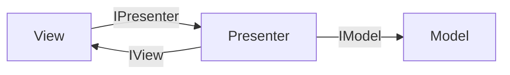
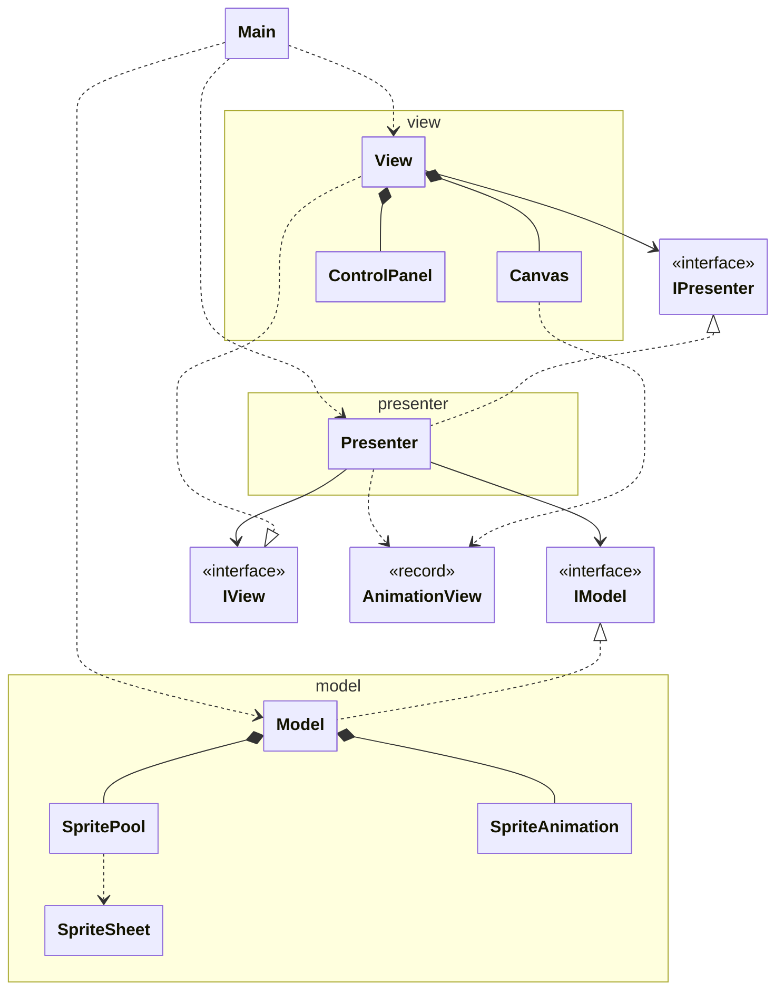
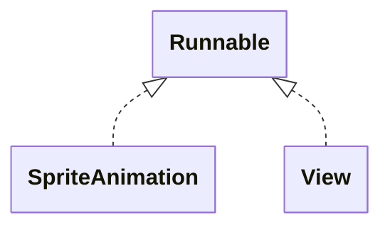

# Unidad 1: Ejercicio 2 - Sprite Animation (Java Swing + MVP)

Esta práctica recorta hojas de sprites, guarda sus fotogramas en un pool compartido y reproduce varias animaciones a la vez, cada una en su propio hilo. Todo se organiza con la arquitectura MVP y se dibuja con AWT y Swing.

En este documento se explica lo necesario para entender el ejercicio y después se construye el programa paso a paso:
- Requisitos
- Arquitectura MVP
- Sprite Animation UML
- Del spritesheet al fotograma
- Hilos aplicados
- Funcionamiento
- Recorrido por clases
- Versión mejorada
![[Pasted image 20261111221020.png]]

## Requisitos

- Cada **spritesheet** contiene **una sola animación**, aunque tenga varias filas.
- Las hojas se cargan **una vez** y se guardan en un **pool**.
- Hay **4 animaciones** distintas y **10 elementos** animados en pantalla, que comparten esas 4 hojas.
- **Cada elemento tiene su hilo**, que avanza sus fotogramas.
- Se puede regular la **velocidad de render**.
- Cada elemento tiene un slider de **tamaño** y otro de **fotogramas por segundo**.

## Arquitectura MVP

**MVP (Model-View-Presenter)** separa el programa en tres partes:

- **Model**: los datos y la lógica (las hojas, el pool y las animaciones).
- **View**: la pantalla (ventana, lienzo y sliders).
- **Presenter**: el intermediario; pasa a la vista lo que tiene que dibujar y al modelo lo que ha pedido el usuario.

**Regla principal:** la vista y el modelo nunca se hablan directamente; todo pasa por el presenter.

Se comunican mediante interfaces (`IModel`, `IView`, `IPresenter`). Cada parte solo conoce lo que la otra *promete hacer*, no cómo lo hace.



Las interfaces y los datos que viajan entre capas van en su propio paquete, `contract`. Así ni la vista ni el modelo dependen el uno del otro:

```
03-SpriteAnimation/
├── run.sh
└── src/main/
    ├── java/
    │   ├── main/        → Main: crea las piezas, las conecta y arranca
    │   ├── contract/    → IModel, IView, IPresenter y AnimationView
    │   ├── model/       → SpriteSheet, SpritePool, SpriteAnimation y Model
    │   ├── presenter/   → Presenter
    │   └── view/        → View, Canvas y ControlPanel
    └── resources/
        └── sprites/     → gold.png, npc1.png, npc5.png, npc6.png
```

## Sprite Animation UML



## Del spritesheet al fotograma

Un spritesheet es una imagen con todos los fotogramas de una animación colocados en rejilla, de izquierda a derecha y de arriba abajo. Todos los fotogramas miden lo mismo:

```
ancho del fotograma = ancho de la hoja / columnas
alto del fotograma  = alto de la hoja / filas
```

Los fotogramas se numeran con un único índice `n`, empezando en 0. Para saber en qué celda está cada uno:

```
fila    = n / columnas     (división entera: cuántas filas completas hay antes)
columna = n % columnas     (resto: posición dentro de su fila)
```

Y la esquina de esa celda, en píxeles:

```
x = columna * ancho del fotograma
y = fila    * alto del fotograma
```

Ejemplo con una hoja de 3 columnas, 2 filas y 4 fotogramas (la última fila queda incompleta):

```
      col 0   col 1   col 2
fila 0 [ 0 ]   [ 1 ]   [ 2 ]
fila 1 [ 3 ]   [   ]   [   ]
```

| n | fila = n / 3 | columna = n % 3 |
|---|---|---|
| 0 | 0 | 0 |
| 2 | 0 | 2 |
| 3 | 1 | 0 |

Por eso, además de columnas y filas, hace falta saber **cuántos fotogramas hay de verdad**: así el recorte se detiene antes de las celdas vacías.

## Hilos aplicados

| Hilo | Qué hace |
|---|---|
| **main** | Construye las piezas, las conecta y llama a `presenter.start()`. |
| **EDT** (hilo de Swing) | Crea la ventana, pinta los componentes y ejecuta los listeners de los sliders. |
| **Animation** (×10, `SpriteAnimation.run`) | Cada uno espera lo que dura un fotograma y avanza al siguiente. |
| **Render** (`View.run`) | Pide al presenter qué dibujar, se lo pasa al lienzo y espera. |



Las animaciones y el render van **separados**: cada animación decide **cuándo cambia de fotograma** según sus fps, y el render decide **cada cuánto se pinta** la pantalla.

Cuando un hilo escribe un valor y otro lo lee (el fotograma actual, los fps, el tamaño, la lista que se pinta), el atributo se marca `volatile`. Así el hilo que lee siempre ve el último valor escrito.

## Funcionamiento

### El viaje de un fotograma

```
SpriteSheet.cut (fotogramas recortados)
  → SpritePool (guardados una vez, compartidos)
    → SpriteAnimation (su hilo avanza frameIndex)
      → Model.frame(i)
        → Presenter.animationViews() → AnimationView
          → View (hilo Render) → Canvas.setViews() → repaint()
            → Swing → Canvas.paintComponent() → pantalla
```

### El viaje de un slider

```
Slider (EDT) → ControlPanel → IPresenter.setFps(i, fps)
  → IModel.setFps(i, fps) → SpriteAnimation.setFps(fps)
    → su hilo usa el nuevo valor en la siguiente espera
```

## Recorrido por clases

El programa se construye **de abajo hacia arriba**: cada clase solo usa las que ya se han visto.

```
Modelo:     SpriteSheet → SpritePool → SpriteAnimation → IModel → Model
Contrato:   AnimationView → IPresenter → IView
Vista:      Canvas → ControlPanel → View
Presenter:  Presenter
Arranque:   Main → run.sh
```

---

### SpriteSheet

Carga una hoja y la **recorta** en fotogramas. Es la pieza que aplica la fórmula de la división y el módulo.

```java
package model;

import java.awt.image.BufferedImage;
import java.io.IOException;
import java.io.InputStream;

import javax.imageio.ImageIO;

final class SpriteSheet {

    private SpriteSheet() {}

    static BufferedImage[] cut(String resource, int columns, int rows, int frameCount) {
        if (frameCount < 1 || frameCount > columns * rows) {
            throw new IllegalArgumentException(resource + ": frameCount must be 1.." + columns * rows);
        }
        BufferedImage sheet = load(resource);
        int frameWidth = sheet.getWidth() / columns;
        int frameHeight = sheet.getHeight() / rows;

        BufferedImage[] frames = new BufferedImage[frameCount];
        for (int n = 0; n < frameCount; n++) {
            int row = n / columns;
            int column = n % columns;
            frames[n] = sheet.getSubimage(column * frameWidth, row * frameHeight, frameWidth, frameHeight);
        }
        return frames;
    }

    private static BufferedImage load(String resource) {
        try (InputStream in = SpriteSheet.class.getResourceAsStream(resource)) {
            if (in == null) {
                throw new IllegalArgumentException("Resource not found: " + resource);
            }
            return ImageIO.read(in);
        } catch (IOException e) {
            throw new IllegalStateException("Cannot read " + resource, e);
        }
    }
}
```

#### `final class` sin `public` y constructor privado

- Solo la usa el paquete `model`: desde la vista ni siquiera se puede nombrar.
- No guarda estado, así que no tiene sentido crear objetos de ella. Se usa como `SpriteSheet.cut(...)`.

#### `cut(...)` — la función clave

1. **Comprueba `frameCount`**: tiene que haber al menos un fotograma y no más que celdas.
2. **Calcula el tamaño de un fotograma** dividiendo la hoja entre columnas y filas.
3. **Un solo bucle sobre `n`**: para cada fotograma calcula su fila (`n / columns`) y su columna (`n % columns`).
4. **`getSubimage(x, y, ancho, alto)`** devuelve ese trozo de la hoja. No copia píxeles: es una "ventana" sobre la imagen original.

Con un solo índice basta con parar en `frameCount` para ignorar las celdas vacías de la última fila.

#### `load(resource)`

- **`getResourceAsStream`** busca el archivo dentro del **classpath**, no en el disco. La ruta empieza por `/` y parte de `src/main/resources`: `/sprites/gold.png`.
- **`try (...)`** (*try-with-resources*) cierra el archivo al terminar, aunque falle.
- Si el archivo no existe, `in` vale `null`: se lanza un error que dice qué ruta falla.

---

### SpritePool

Guarda los fotogramas de cada animación **una sola vez**, con un nombre. Todos los elementos que usan la misma hoja comparten sus imágenes.

```java
package model;

import java.awt.image.BufferedImage;
import java.util.HashMap;
import java.util.Map;

final class SpritePool {

    private final Map<String, BufferedImage[]> animations = new HashMap<>();

    void load(String name, String resource, int columns, int rows, int frameCount) {
        this.animations.put(name, SpriteSheet.cut(resource, columns, rows, frameCount));
    }

    BufferedImage[] get(String name) {
        BufferedImage[] frames = this.animations.get(name);
        if (frames == null) {
            throw new IllegalArgumentException("Unknown animation: " + name);
        }
        return frames;
    }
}
```

- **`Map<String, BufferedImage[]>`**: a cada nombre (`"gold"`) le corresponde su array de fotogramas.
- **`load`**: recorta la hoja y la guarda. Se llama una vez por hoja.
- **`get`**: devuelve los fotogramas de un nombre. Si no existe, avisa en vez de devolver `null`.

Con 10 elementos y 4 hojas, en memoria solo hay **4** arrays de fotogramas.

---

### SpriteAnimation

Es **un elemento en pantalla**. Usa los fotogramas del pool, pero tiene su propia posición, tamaño, velocidad y **su propio hilo**.

```java
package model;

import java.awt.image.BufferedImage;

final class SpriteAnimation implements Runnable {

    private final String name;
    private final BufferedImage[] frames;
    private final int x;
    private final int y;

    private volatile int frameIndex;
    private volatile int fps;
    private volatile int scale;

    SpriteAnimation(String name, BufferedImage[] frames, int x, int y, int fps, int scale) {
        this.name = name;
        this.frames = frames;
        this.x = x;
        this.y = y;
        this.fps = fps;
        this.scale = scale;
    }

    void start() {
        Thread thread = new Thread(this, "Animation " + this.name);
        thread.setDaemon(true);
        thread.start();
    }

    @Override
    public void run() {
        while (true) {
            try {
                Thread.sleep(1000 / this.fps);
            } catch (InterruptedException e) {
                return;
            }
            this.frameIndex = (this.frameIndex + 1) % this.frames.length;
        }
    }

    String name() { return this.name; }
    BufferedImage frame() { return this.frames[this.frameIndex]; }
    int x() { return this.x; }
    int y() { return this.y; }
    int fps() { return this.fps; }
    int scale() { return this.scale; }

    void setFps(int fps) { this.fps = Math.max(1, fps); }
    void setScale(int scale) { this.scale = Math.max(1, scale); }
}
```

#### Atributos

- **`final`**: nombre, fotogramas y posición no cambian.
- **`volatile`**: `frameIndex` lo escribe el hilo de la animación y lo lee el de render; `fps` y `scale` los escribe el hilo de Swing (sliders) y los lee la animación o el render.

#### `start()`

- `new Thread(this, "Animation gold #1")` crea un hilo que ejecutará el `run()` de este objeto. El nombre sirve para reconocerlo al depurar.
- `setDaemon(true)`: hilo de fondo; no impide que el programa se cierre.
- `thread.start()` lanza el hilo. Llamar a `run()` directamente ejecutaría el bucle en el hilo actual y lo bloquearía.

#### `run()` — el bucle de la animación

- **`Thread.sleep(1000 / fps)`**: un fotograma dura `1000 / fps` milisegundos. A 4 fps, 250 ms.
- **`(frameIndex + 1) % frames.length`**: avanza al siguiente fotograma y, al pasar del último, el módulo lo devuelve a 0. Así la animación se repite.
- Como `fps` se lee en cada vuelta, un cambio del slider se nota en la siguiente espera.

#### `setFps` y `setScale`

- **`Math.max(1, ...)`** impide valores menores que 1. Con `fps = 0`, `1000 / fps` dividiría entre cero.

---

### IModel

El **contrato** del modelo: lo que el presenter puede pedirle.

```java
package contract;

import java.awt.image.BufferedImage;

public interface IModel {
    void start();

    int count();
    String name(int index);
    BufferedImage frame(int index);
    int x(int index);
    int y(int index);
    int scale(int index);
    int fps(int index);

    void setScale(int index, int scale);
    void setFps(int index, int fps);
}
```

- **`start()`**: arranca un hilo por animación.
- **Datos por índice**: el presenter pregunta por la animación `i`, pero nunca recibe el objeto `SpriteAnimation`. Así ninguna pieza del modelo sale de él.
- **`setScale` y `setFps`**: los cambios que llegan desde los sliders.

---

### Model

Junta el pool y las animaciones, e implementa `IModel`.

```java
package model;

import java.awt.image.BufferedImage;
import java.util.ArrayList;
import java.util.List;

import contract.IModel;

public class Model implements IModel {

    private final SpritePool pool = new SpritePool();
    private final List<SpriteAnimation> animations = new ArrayList<>();

    // ---- Setup ----

    public void loadSheet(String name, String resource, int columns, int rows, int frameCount) {
        this.pool.load(name, resource, columns, rows, frameCount);
    }

    public void addAnimation(String sheet, int x, int y, int fps, int scale) {
        String name = sheet + " #" + (this.animations.size() + 1);
        this.animations.add(new SpriteAnimation(name, this.pool.get(sheet), x, y, fps, scale));
    }

    // ---- Contract ----

    @Override
    public void start() {
        for (SpriteAnimation animation : this.animations) {
            animation.start();
        }
    }

    @Override public int count() { return this.animations.size(); }
    @Override public String name(int i) { return this.animations.get(i).name(); }
    @Override public BufferedImage frame(int i) { return this.animations.get(i).frame(); }
    @Override public int x(int i) { return this.animations.get(i).x(); }
    @Override public int y(int i) { return this.animations.get(i).y(); }
    @Override public int scale(int i) { return this.animations.get(i).scale(); }
    @Override public int fps(int i) { return this.animations.get(i).fps(); }

    @Override public void setScale(int i, int scale) { this.animations.get(i).setScale(scale); }
    @Override public void setFps(int i, int fps) { this.animations.get(i).setFps(fps); }
}
```

#### Setup: `loadSheet` y `addAnimation`

- Son `public` pero **no están en `IModel`**: solo los usa `Main`, para preparar el modelo antes de arrancarlo. El presenter, que solo ve `IModel`, no puede crear animaciones.
- **`addAnimation`** pide al pool los fotogramas de la hoja y crea una `SpriteAnimation` nueva con ellos. Varias animaciones pueden usar la misma hoja: comparten imágenes, pero cada una tiene su `frameIndex`, sus fps y su tamaño.
- El nombre (`"gold #1"`) se forma con la hoja y la posición en la lista.

#### Contract

- **`start()`** arranca el hilo de cada animación.
- Los demás métodos **delegan**: buscan la animación `i` y le pasan la pregunta o la orden.
- La lista es un `ArrayList` normal: se llena en `Main` antes de arrancar ningún hilo y después solo se lee.

---

### AnimationView

Los datos que viajan **hacia la vista**: todo lo necesario para dibujar un elemento.

```java
package contract;

import java.awt.image.BufferedImage;

public record AnimationView(String name, BufferedImage image, int x, int y, int scale, int fps) {}
```

- Un **`record`** es una clase que solo guarda datos. Java genera el constructor y los métodos de acceso (`view.x()`, `view.image()`...).
- Es **inmutable**: la vista puede leerlo, pero no cambiarlo.
- Va en `contract` porque lo conocen el presenter, que lo crea, y la vista, que lo usa.

---

### IPresenter

Lo que la vista y `Main` pueden pedirle al presenter.

```java
package contract;

import java.util.List;

public interface IPresenter {
    void start();

    List<AnimationView> animationViews();

    void setRenderFps(int fps);
    void setScale(int index, int scale);
    void setFps(int index, int fps);
}
```

- **`animationViews()`**: la vista pide aquí, en cada vuelta, qué tiene que dibujar.
- **`setRenderFps`, `setScale`, `setFps`**: lo que el usuario ha cambiado con los sliders.

---

### IView

Lo que el presenter puede pedirle a la vista.

```java
package contract;

public interface IView {
    void setPresenter(IPresenter presenter);
    void start();
    void setRenderFps(int fps);
}
```

- **`setPresenter`**: la vista necesita al presenter para pedirle datos, y el presenter necesita a la vista. La interfaz rompe ese círculo.
- **`start()`**: muestra la ventana y arranca el hilo de render.
- **`setRenderFps`**: la velocidad de pintado es cosa de la vista.

---

### Canvas

El **lienzo**: dibuja la última lista de elementos que ha recibido.

```java
package view;

import java.awt.Color;
import java.awt.Dimension;
import java.awt.Graphics;
import java.awt.Graphics2D;
import java.awt.RenderingHints;
import java.awt.image.BufferedImage;
import java.util.List;

import javax.swing.JPanel;

import contract.AnimationView;

final class Canvas extends JPanel {

    private volatile List<AnimationView> views = List.of();

    Canvas(int width, int height) {
        setPreferredSize(new Dimension(width, height));
        setBackground(Color.DARK_GRAY);
    }

    void setViews(List<AnimationView> views) {
        this.views = views;
        repaint();
    }

    @Override
    protected void paintComponent(Graphics g) {
        super.paintComponent(g);
        Graphics2D g2 = (Graphics2D) g;
        g2.setRenderingHint(RenderingHints.KEY_INTERPOLATION,
                RenderingHints.VALUE_INTERPOLATION_NEAREST_NEIGHBOR);
        g2.setColor(Color.WHITE);

        for (AnimationView view : this.views) {
            BufferedImage image = view.image();
            int width = image.getWidth() * view.scale();
            int height = image.getHeight() * view.scale();
            g2.drawImage(image, view.x(), view.y(), width, height, null);
            g2.drawString(view.name() + "  " + view.fps() + " fps", view.x(), view.y() - 4);
        }
    }
}
```

#### `extends JPanel`

- Un `JPanel` es un componente de Swing en el que se puede dibujar. Swing lo pinta con **doble búfer**: dibuja en una imagen oculta y la muestra entera, así que no parpadea.

#### `views` y `volatile`

- La escribe el hilo **Render** (`setViews`) y la lee el hilo de **Swing** (`paintComponent`).

#### `setViews(views)`

- Guarda la lista nueva y llama a **`repaint()`**, que no dibuja: avisa a Swing de que el panel tiene que redibujarse.

#### `paintComponent(g)`

- Swing lo llama cuando toca dibujar.
- **`super.paintComponent(g)`** rellena el panel con el color de fondo. Sin esta línea, cada fotograma se dibujaría encima del anterior.
- **`VALUE_INTERPOLATION_NEAREST_NEIGHBOR`**: al ampliar sprites pequeños, mantiene los píxeles nítidos en vez de difuminarlos.
- Para cada elemento: calcula su tamaño multiplicando por `scale`, lo dibuja en su posición y escribe su nombre y sus fps encima.

---

### ControlPanel

Una columna de **sliders** con su etiqueta.

```java
package view;

import java.awt.Component;
import java.util.function.IntConsumer;

import javax.swing.BorderFactory;
import javax.swing.BoxLayout;
import javax.swing.JLabel;
import javax.swing.JPanel;
import javax.swing.JSlider;

final class ControlPanel extends JPanel {

    ControlPanel() {
        setLayout(new BoxLayout(this, BoxLayout.Y_AXIS));
        setBorder(BorderFactory.createEmptyBorder(8, 8, 8, 8));
    }

    void addTitle(String text) {
        JLabel title = new JLabel(text);
        title.setBorder(BorderFactory.createEmptyBorder(10, 0, 2, 0));
        title.setAlignmentX(Component.LEFT_ALIGNMENT);
        add(title);
    }

    void addSlider(String label, int min, int max, int value, IntConsumer onChange) {
        JLabel text = new JLabel(label + ": " + value);
        JSlider slider = new JSlider(min, max, value);
        slider.addChangeListener(e -> {
            text.setText(label + ": " + slider.getValue());
            onChange.accept(slider.getValue());
        });
        text.setAlignmentX(Component.LEFT_ALIGNMENT);
        slider.setAlignmentX(Component.LEFT_ALIGNMENT);
        add(text);
        add(slider);
    }
}
```

- **`BoxLayout.Y_AXIS`**: coloca los componentes uno debajo de otro.
- **`addTitle`**: el encabezado de cada grupo ("Render", "gold #1"...).
- **`addSlider`**: una etiqueta con el valor y un slider con su rango.
    - **`IntConsumer onChange`**: *qué hacer* con el valor nuevo. `ControlPanel` no conoce al presenter; quien crea el slider decide a dónde va el valor.
    - **`addChangeListener(e -> { ... })`**: el código que se ejecuta cada vez que el slider se mueve. Actualiza la etiqueta y pasa el valor a `onChange`.

---

### View

La **ventana**: une el lienzo y los sliders, y tiene el **hilo de render**.

```java
package view;

import java.awt.BorderLayout;
import java.awt.Dimension;
import java.util.List;

import javax.swing.JFrame;
import javax.swing.JScrollPane;
import javax.swing.SwingUtilities;

import contract.AnimationView;
import contract.IPresenter;
import contract.IView;

public class View extends JFrame implements IView, Runnable {

    private final Canvas canvas = new Canvas(820, 460);
    private final ControlPanel controls = new ControlPanel();
    private IPresenter presenter;
    private volatile int renderFps = 30;

    public View() {
        super("Sprite Animation");
        setDefaultCloseOperation(JFrame.EXIT_ON_CLOSE);
        add(this.canvas, BorderLayout.CENTER);
        JScrollPane scroll = new JScrollPane(this.controls);
        scroll.setPreferredSize(new Dimension(240, 460));
        scroll.getVerticalScrollBar().setUnitIncrement(16);
        add(scroll, BorderLayout.EAST);
    }

    @Override
    public void setPresenter(IPresenter presenter) {
        this.presenter = presenter;
    }

    @Override
    public void start() {
        SwingUtilities.invokeLater(() -> {
            buildControls();
            pack();
            setLocationRelativeTo(null);
            setVisible(true);
        });
        Thread render = new Thread(this, "Render");
        render.setDaemon(true);
        render.start();
    }

    @Override
    public void setRenderFps(int fps) {
        this.renderFps = Math.max(1, fps);
    }

    @Override
    public void run() {
        while (true) {
            this.canvas.setViews(this.presenter.animationViews());
            try {
                Thread.sleep(1000 / this.renderFps);
            } catch (InterruptedException e) {
                return;
            }
        }
    }

    private void buildControls() {
        this.controls.addTitle("Render");
        this.controls.addSlider("fps", 1, 60, this.renderFps, fps -> this.presenter.setRenderFps(fps));

        List<AnimationView> views = this.presenter.animationViews();
        for (int i = 0; i < views.size(); i++) {
            int index = i;
            AnimationView view = views.get(i);
            this.controls.addTitle(view.name());
            this.controls.addSlider("size", 1, 8, view.scale(), s -> this.presenter.setScale(index, s));
            this.controls.addSlider("fps", 1, 30, view.fps(), f -> this.presenter.setFps(index, f));
        }
    }
}
```

#### Constructor

- **`BorderLayout`** (el layout por defecto de un `JFrame`): el lienzo va en `CENTER` y los controles en `EAST`.
- **`JScrollPane`**: son 21 sliders y no caben; el panel lleva barra de desplazamiento. `setPreferredSize` lo hace tan alto como el lienzo, y `setUnitIncrement` acelera la rueda del ratón.

#### `start()`

- **`SwingUtilities.invokeLater(...)`** ejecuta el bloque en el **hilo de Swing**, que es el único que debe crear y mostrar componentes.
- Dentro: crea los sliders, ajusta la ventana a su contenido (`pack`), la centra y la muestra.
- Fuera: arranca el hilo **Render**.

#### `run()` — el bucle de render

- Pide al presenter la lista de elementos, se la pasa al lienzo y espera `1000 / renderFps` ms.
- La vista **no conoce al modelo**: solo habla con `IPresenter`.

#### `buildControls()`

- Un slider para el render y, por cada elemento, uno de tamaño (1 a 8) y otro de fps (1 a 30). Los valores iniciales salen de `animationViews()`.
- **`int index = i`**: una lambda solo puede usar variables que no cambian. `i` cambia en cada vuelta, así que se copia en `index`.
- Cada slider llama al presenter con el índice de su elemento.

---

### Presenter

El **intermediario**: es la única pieza que conoce al modelo y a la vista.

```java
package presenter;

import java.util.ArrayList;
import java.util.List;

import contract.AnimationView;
import contract.IModel;
import contract.IPresenter;
import contract.IView;

public class Presenter implements IPresenter {

    private final IModel model;
    private final IView view;

    public Presenter(IModel model, IView view) {
        this.model = model;
        this.view = view;
        view.setPresenter(this);
    }

    @Override
    public void start() {
        this.model.start();
        this.view.start();
    }

    @Override
    public List<AnimationView> animationViews() {
        List<AnimationView> views = new ArrayList<>();
        for (int i = 0; i < this.model.count(); i++) {
            views.add(new AnimationView(this.model.name(i), this.model.frame(i),
                    this.model.x(i), this.model.y(i), this.model.scale(i), this.model.fps(i)));
        }
        return views;
    }

    @Override public void setRenderFps(int fps) { this.view.setRenderFps(fps); }
    @Override public void setScale(int index, int scale) { this.model.setScale(index, scale); }
    @Override public void setFps(int index, int fps) { this.model.setFps(index, fps); }
}
```

#### Constructor

- Recibe el modelo y la vista **como interfaces** y los guarda.
- **`view.setPresenter(this)`** conecta la vista con el presenter en cuanto existe. Cuando la vista arranque, ya tendrá a quién pedir datos.

#### `start()`

- Primero el modelo (las animaciones empiezan a avanzar) y después la vista (la ventana y el render).

#### `animationViews()`

- **Traduce** el modelo para la vista: por cada animación, pregunta sus datos y crea un `AnimationView`.

#### Los tres `set...`

- El render es de la vista; el tamaño y los fps, del modelo. El presenter envía cada orden a quien corresponde.

---

### Main

Prepara el modelo, crea las piezas, las conecta y arranca.

```java
package main;

import model.Model;
import presenter.Presenter;
import view.View;

public class Main {
    public static void main(String[] args) {
        // ---- Model ----
        Model model = new Model();
        model.loadSheet("gold", "/sprites/gold.png", 2, 2, 4);
        model.loadSheet("npc1", "/sprites/npc1.png", 2, 2, 4);
        model.loadSheet("npc5", "/sprites/npc5.png", 4, 1, 4);
        model.loadSheet("npc6", "/sprites/npc6.png", 3, 2, 4);

        String[] sheets = { "gold", "npc1", "npc5", "npc6" };
        for (int i = 0; i < 10; i++) {
            int x = 30 + (i % 5) * 160;
            int y = 40 + (i / 5) * 210;
            model.addAnimation(sheets[i % 4], x, y, 4 + i, 4);
        }

        // ---- View and presenter ----
        View view = new View();
        Presenter presenter = new Presenter(model, view);
        presenter.start();
    }
}
```

- **4 hojas** de formas distintas: 2×2, 4×1 y 3×2 con la última fila incompleta. El mismo recorte sirve para todas.
- **10 elementos** en una rejilla de 5 × 2. Para colocarlos se usa la misma idea que para recortar: `i % 5` es la columna e `i / 5`, la fila.
- **`sheets[i % 4]`** reparte las 4 hojas entre los 10 elementos, y **`4 + i`** da a cada uno unos fps distintos (de 4 a 13).
- `model` es de tipo `Model` y no `IModel`, porque `Main` necesita `loadSheet` y `addAnimation`, que no están en el contrato.

---

### run.sh

Compila y ejecuta desde la raíz del proyecto.

```bash
#!/usr/bin/env bash
set -euo pipefail
cd "$(dirname "$0")"
rm -rf out
javac -d out $(find src/main/java -name '*.java')
java -cp out:src/main/resources main.Main
```

- **`set -euo pipefail`**: si algo falla (por ejemplo, la compilación), el script se para en vez de ejecutar una versión antigua.
- **`rm -rf out`**: borra las clases compiladas anteriores.
- **`-cp out:src/main/resources`**: el classpath incluye las clases y los recursos. Es lo que permite que `/sprites/gold.png` se encuentre.

```bash
chmod +x run.sh
./run.sh
```

---
---

## Versión mejorada

La versión completa del proyecto está en [GitHub](ENLACE).
Parte de esta misma base y la convierte en una pequeña escena jugable.
![[Pasted image 20261111230357.png]]

### Animaciones

- **Una tira por animación**, cargada por convención de nombres (`sprites/<personaje>/<estado>-<dirección>.png`). El número de fotogramas se deduce del tamaño de la imagen.
- **8 animaciones por personaje**: quieto y caminando, en cuatro direcciones.
- **Avance por tiempo**: el fotograma depende del tiempo transcurrido, no de cuántas veces se espera.

### Escena

- **Mapa por tiles**: una matriz de índices recortada con la misma fórmula de división y módulo, pintada una sola vez como fondo.
- **Colisiones por tile**: cada tile puede ser sólido; las entidades se deslizan por las paredes comprobando X e Y por separado.

### Entidades

- **Jugador** controlado con las flechas: la última tecla pulsada manda.
- **NPC** con su propia animación y velocidad.

### Audio

- **Música de fondo** en bucle y **efecto al chocar**, con `javax.sound.sampled`.
- El choque viaja del modelo al presenter por una interfaz propia (`IModelListener`), sin que el modelo conozca el audio.

### Arquitectura

- **El presenter aplica las reglas**: límites de velocidad de animación, de render y de movimiento.
- **Los datos del modelo nunca salen como objetos**: la vista recibe registros inmutables y copias de las imágenes.
