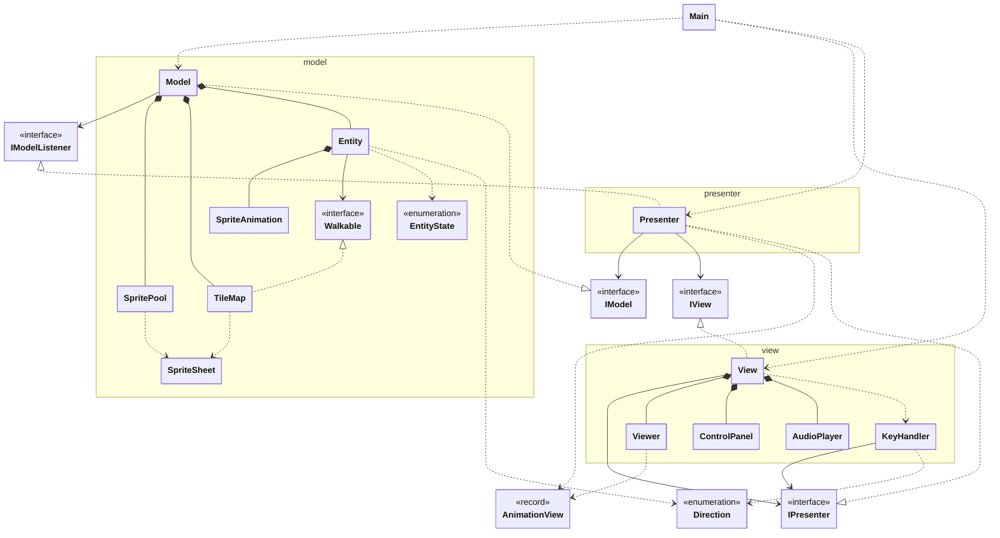
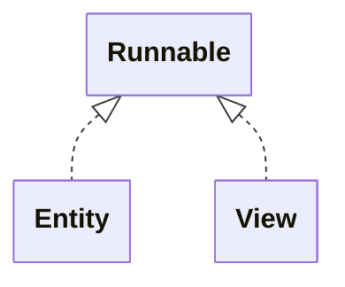

# Unidad 1: Ejercicio 3 - Sprite Renderer Advanced (Java Swing + MVP)

Esta práctica parte del ejercicio 2 (Sprite Animation) y lo convierte en una pequeña escena jugable: un mapa de tiles, un jugador que se mueve con las flechas, varios NPC animados, colisiones con las paredes, música y un sonido al chocar.

Aquí solo se explica lo que cambia respecto a la versión base. Lo que no cambia está en la guía del ejercicio 2.

- Qué añade respecto a la base
- Arquitectura
- Sprite Renderer UML
- Conceptos nuevos
- Hilos aplicados
- Funcionamiento
- Recorrido por clases
- Versión base
![[Pasted image 20261111230357.png]]

## Qué añade respecto a la base

- **Carga por convención**: cada animación es una tira en `sprites/<entidad>/<estado>-<dirección>.png`. Los fotogramas se cuentan con `ancho / alto`.
- **Animación por tiempo**: el fotograma avanza según el tiempo transcurrido, no con `sleep(1000 / fps)`.
- **Entidades**: cada personaje tiene 8 animaciones (quieto y caminando × 4 direcciones), un hilo propio y posición en `double`.
- **Jugador y NPC**: el jugador se mueve con las flechas; los NPC caminan sin moverse del sitio.
- **Mapa de tiles** pintado una sola vez como fondo.
- **Colisiones** por tile con una caja en los pies.
- **Teclado** con `KeyHandler`: la última flecha pulsada manda.
- **Audio** con `Clip`: música en bucle y un sonido por choque.
- **Eventos del modelo** (`IModelListener`): el modelo avisa de un choque sin conocer la vista.
- **Panel de control** con unidades y límites que impone el presenter.
- **Tema FlatLaf** cargado desde `lib/`.

## Arquitectura

La regla MVP es la misma: vista y modelo no se hablan, todo pasa por el presenter. Cambia el contenido de los paquetes:

```
e02-advanced-sprite-anim/
├── run.sh                 → compila y ejecuta con lib/* en el classpath
├── .vscode/settings.json  → fuentes, salida y librerías para VS Code
├── lib/                   → flatlaf-3.7.2.jar, flatlaf-intellij-themes-3.7.2.jar
└── src/main/
    ├── java/
    │   ├── main/        → Main: tema, mapa, entidades, conexión y arranque
    │   ├── contract/    → IModel, IView, IPresenter, IModelListener, AnimationView, Direction
    │   ├── model/       → SpriteSheet, SpritePool, SpriteAnimation, EntityState,
    │   │                  Entity, Walkable, TileMap, Model
    │   ├── presenter/   → Presenter
    │   └── view/        → View, Viewer, ControlPanel, KeyHandler, AudioPlayer
    └── resources/
        ├── sprites/     → gold/, npc1/ … npc6/, cada una con idle-*.png y walk-*.png
        ├── tiles/       → tileset.png (8 × 6 tiles de 16 px)
        └── audio/       → dp-league.wav (música), bump.wav (choque)
```

Cambios en el contrato:

| Tipo | Qué cambia |
|---|---|
| `IModel` | Nuevos: `setListener`, `background`, `playerFps`/`setPlayerFps`, `playerMoveSpeed`/`setPlayerMoveSpeed`, `movePlayer`, `stopPlayer`. `count` pasa a `entityCount`. Desaparecen `scale`, `setScale` y `setFps(i)`. |
| `IPresenter` | Nuevos: `background`, `entityCount`, los cuatro límites (`minFps`, `maxFps`, `minMoveSpeed`, `maxMoveSpeed`), las velocidades del jugador, `movePlayer` y `stopPlayer`. `setRenderFps` pasa a `setRenderSpeed`. |
| `IView` | Nuevos: `renderFps()` y `playBumpSound()`. |
| `IModelListener` | Interfaz nueva: el modelo avisa al presenter con `onPlayerBlocked()`. |
| `AnimationView` | Pierde `scale`: la escala ahora es de toda la escena y la pone la vista. |
| `Direction` | Enum nuevo. Va en `contract` porque lo usan la vista (teclas) y el modelo (movimiento). |

## Sprite Renderer UML



## Conceptos nuevos

### Carga por convención

En la base, `Main` indicaba columnas, filas y fotogramas de cada hoja. Ahora cada animación es **una tira de una fila** con fotogramas **cuadrados**, y su ruta sigue un patrón fijo:

```
/sprites/<entidad>/<estado>-<dirección>.png

estado    = idle | walk                 (EntityState)
dirección = up | down | left | right    (Direction)
```

Con eso, para cargar un personaje solo hace falta su nombre (`"gold"`). El número de fotogramas sale del tamaño:

```
fotogramas = ancho / alto

walk-down.png  64 × 16  →  4 fotogramas
walk-left.png  32 × 16  →  2 fotogramas
idle-down.png  16 × 16  →  1 fotograma
```

La tira se recorta con el mismo `SpriteSheet` de la base: `count` columnas, 1 fila.

### Animación por tiempo

En la base, el hilo dormía `1000 / fps` ms y avanzaba un fotograma. Ahora el hilo da vueltas cortas (5 ms) y en cada una **suma el tiempo transcurrido** convertido en fotogramas:

```
pendingFrames += segundos transcurridos × fps
steps          = parte entera de pendingFrames
pendingFrames -= steps
frameIndex     = (frameIndex + steps) % fotogramas
```

Ejemplo a 8 fps: cada vuelta de 5 ms suma `0.005 × 8 = 0.04`. Tras 25 vueltas (125 ms) se llega a 1 y se avanza un fotograma. La parte decimal que sobra se guarda para la siguiente.

Por qué así:
- **Un solo hilo hace dos cosas**: anima y mueve. Mover necesita vueltas cortas; la animación no puede depender de ellas.
- **No se pierde tiempo**: si una vuelta tarda más (el sistema va cargado), `steps` puede ser 2 y la animación se pone al día.
- **`fps = 0` es válido**: congela la animación sin dividir entre cero.

El movimiento usa la misma idea: `distancia = velocidad × segundos`. A 48 px/s y 5 ms salen 0.24 px por vuelta. Con `int` se redondearía a 0 y el jugador no se movería nunca: por eso la posición es `double`.

### Mapa de tiles

Un tileset es un spritesheet de baldosas. Se recorta con la fórmula de la base y el mapa es una matriz de índices:

```
tileset.png (128 × 96, 8 × 6 tiles de 16 px)    layout[fila][columna] = índice del tile

[ 0][ 1][ 2] … [ 7]                              { 1,  1, 11, 12, … }
[ 8][ 9][10] … [15]                              { 1, 13, 14,  1, … }
 …                                                …
```

Cada celda se dibuja en:

```
x = columna × tileSize
y = fila    × tileSize
```

El mapa de `Main` tiene 34 × 20 tiles. Se pinta **una sola vez** en una imagen de 544 × 320 px que se usa como fondo. Así la vista dibuja una imagen por fotograma en vez de 680.

### Colisión

**1. Tiles sólidos → matriz de booleanos.** `Main` dice qué índices de tile son sólidos. `TileMap` recorre el layout y marca cada celda:

```
solid[fila][columna] = el tile de esa celda está en la lista de sólidos
```

**2. Caja de los pies.** No choca todo el sprite, solo la parte de abajo. Así el personaje puede acercarse a una pared por arriba y parecer que está delante de ella:

```
x        x+3        x+13  x+16
┌────────────────────────┐  y
│                      cabeza                            │
│       ┌────────────────┐         │  y + 8    (FEET_TOP)
│        │      pies                             │        │
└───┴────────────────┴───┘  y + 16

ancho = 16 − 2 × 3 = 10      alto = 16 − 8 = 8
```

**3. De píxeles a filas y columnas.** Se dividen los bordes de la caja entre el tamaño del tile:

```
primera columna = (int) ( x               / tileSize)
última columna  = (int) ((x + ancho − 0.001) / tileSize)
primera fila    = (int) ( y               / tileSize)
última fila     = (int) ((y + alto  − 0.001) / tileSize)
```

El `− 0.001` evita que una caja que acaba justo en el borde de un tile cuente el tile siguiente. Ejemplo con tiles de 16 px y una caja de ancho 10:

| x | columnas que toca |
|---|---|
| 32 | 32 / 16 = 2 … 41.999 / 16 = 2 → solo la 2 |
| 40 | 40 / 16 = 2 … 49.999 / 16 = 3 → la 2 y la 3 |
| 38 | 38 / 16 = 2 … 47.999 / 16 = 2 → solo la 2 (acaba justo en el borde) |

Si alguna de esas celdas es sólida, o la caja sale del mapa, el paso no se da.

**4. X e Y por separado.** El paso se prueba primero en horizontal y después en vertical, cada uno con su propia comprobación. Si un eje choca, el otro puede avanzar igualmente. Con cuatro direcciones solo uno de los dos es distinto de 0 en cada paso, pero el código ya sirve para movimiento en diagonal.

**5. `Walkable`.** La entidad no conoce el mapa: recibe una interfaz con un solo método, `isFree(x, y, ancho, alto)`. Quien la crea decide qué significa "libre".

### Entrada de teclado

`KeyHandler` guarda las flechas pulsadas en una pila (`Deque`). La última pulsada está arriba y es la que manda:

```
acción       held             orden al presenter
pulsa ←      [LEFT]           movePlayer(LEFT)
pulsa ↑      [UP, LEFT]       movePlayer(UP)
suelta ↑     [LEFT]           movePlayer(LEFT)
suelta ←     []               stopPlayer()
```

- Al mantener una tecla, el sistema repite `keyPressed`. Si la dirección ya está en la pila, se ignora.
- Si la ventana pierde el foco, Swing no envía los `keyReleased` pendientes. `focusLost` vacía la pila y para al jugador; si no, seguiría andando solo.

### Eventos del modelo

Hasta ahora el presenter siempre **preguntaba** al modelo. Un choque, en cambio, lo detecta el modelo y tiene que **avisar**. Pero el modelo no puede conocer al presenter ni a la vista.

La solución es una interfaz en `contract`:

```
contract.IModelListener { onPlayerBlocked() }

Model   guarda un IModelListener (no sabe quién es)
Presenter implements IModelListener y se registra con model.setListener(this)
```

El modelo solo depende del contrato, igual que antes.

## Hilos aplicados

| Hilo | Qué hace |
|---|---|
| **main** | Aplica el tema, prepara el modelo (carga imágenes y mapa), crea la vista (carga el audio y empieza la música) y llama a `presenter.start()`. |
| **EDT** (hilo de Swing) | Crea la ventana, recibe las teclas, ejecuta los listeners de los sliders y pinta. |
| **Entity** (×10, `Entity.run`) | Cada 5 ms avanza su animación y, si se mueve, da un paso. El hilo del jugador también lanza el aviso de choque. |
| **Render** (`View.run`) | Pide al presenter qué dibujar, se lo pasa al `Viewer` y espera lo que falte del fotograma. |



Datos compartidos entre hilos:
- **`volatile`** en lo que escribe un hilo y lee otro: dirección, estado, posición, velocidad y `moving` de `Entity`; `frameIndex` y `fps` de `SpriteAnimation`; el listener de `Model`; la lista de `Viewer`.
- **`CopyOnWriteArrayList`** para las entidades: se llena desde `main` y la leen los hilos Render y Entity.
- `pendingFrames` y `wasBlocked` no son `volatile`: solo los usa el hilo de su entidad.

## Funcionamiento

### El viaje de un fotograma

```
Entity.run (hilo Entity, cada 5 ms)
  → current(): animación según state y facing
    → SpriteAnimation.advance(segundos) → frameIndex
      → Model.frame(i) → copia de la imagen
        → Presenter.animationViews() → AnimationView inmutables
          → View.run (hilo Render) → Viewer.setViews() → repaint()
            → Swing → Viewer.paintComponent(): fondo + sprites × 3
```

### De una flecha al movimiento

```
Tecla ← (EDT) → KeyHandler.keyPressed → held.push(LEFT) → report()
  → IPresenter.movePlayer(LEFT) → IModel.movePlayer(LEFT)
    → Entity.walk(LEFT): facing = LEFT, state = WALK, moving = true
      → hilo Entity, siguiente vuelta:
          current() cambia → reset() de la animación nueva
          step(): x − velocidad × segundos, si los pies caben
        → hilo Render lee x, y → pantalla
```

### De un choque al sonido

```
Entity.step (hilo del jugador): isFree(...) = false → blocked
  → solo si antes no estaba bloqueado: onBlocked.run()
    → Model.playerBlocked() → IModelListener.onPlayerBlocked()
      → Presenter → IView.playBumpSound()
        → AudioPlayer.playBump() → Clip desde el principio
```

## Recorrido por clases

De abajo hacia arriba: cada clase solo usa las que ya se han visto.

```
Contrato básico: Direction
Modelo:          EntityState → SpriteSheet → SpritePool → SpriteAnimation
                 → Walkable → TileMap → Entity → IModelListener → IModel → Model
Contrato:        AnimationView → IPresenter → IView
Vista:           Viewer → ControlPanel → KeyHandler → AudioPlayer → View
Presenter:       Presenter
Arranque:        Main → run.sh → .vscode/settings.json
```

---

### Direction

Las cuatro direcciones. Nueva.

```java
package contract;

public enum Direction { UP, DOWN, LEFT, RIGHT }
```

- Va en `contract` porque la vista la usa para traducir teclas y el modelo para mover y elegir animación.
- Un `enum` evita errores de texto (`"lfet"`) y permite usar `EnumMap` y `switch`.

---

### EntityState

Los dos estados de una entidad. Nueva.

```java
package model;

public enum EntityState { IDLE, WALK }
```

- Solo lo usa el modelo, por eso va en `model`.
- Su nombre en minúsculas es la primera parte del archivo: `IDLE` → `idle-…png`.

---

### SpriteSheet

Cambia poco: el recorte es el mismo, pero ahora es un objeto y valida más.

```java
package model;

import java.awt.image.BufferedImage;
import java.io.IOException;
import java.io.InputStream;

import javax.imageio.ImageIO;

final class SpriteSheet {
    private final BufferedImage[] frames;

    // ---- Construction ----

    SpriteSheet(String resource, int columns, int rows, int frameCount){
        if (columns <= 0 || rows <= 0){
            throw new IllegalArgumentException("Columns and rows must be positive: " + resource);
        }

        if(frameCount <= 0 || frameCount > columns * rows) {
            throw new IllegalArgumentException("frameCount must be between 1 and " + columns * rows + ": " + resource);
        }

        BufferedImage sheet = loadImage(resource);

        if(sheet.getWidth() % columns != 0 || sheet.getHeight() % rows != 0){
            throw new IllegalArgumentException(
                    "Sheet " + sheet.getWidth() + "x" + sheet.getHeight()
                    + " does not divide into " + columns + "x" + rows + ": " + resource);
        }

        int frameWidth = sheet.getWidth() / columns;
        int frameHeight = sheet.getHeight() / rows;

        this.frames = new BufferedImage[frameCount];
        for (int n = 0; n < frameCount; n++) {
            int row = n / columns;
            int column = n % columns;
            this.frames[n] = sheet.getSubimage(column * frameWidth, row * frameHeight, frameWidth, frameHeight);
        }
    }

    // ---- Queries ----

    BufferedImage[] frames(){
        return this.frames.clone();
    }

    // ---- Image loading ----

    static BufferedImage peek(String resource) {
        return loadImage(resource);
    }

    private static BufferedImage loadImage(String resource){
        try (InputStream in = SpriteSheet.class.getResourceAsStream(resource)) {
            if(in == null){
                throw new IllegalArgumentException("Resource not found: " + resource);
            }

            BufferedImage image = ImageIO.read(in);
            if(image == null){
                throw new IllegalArgumentException("Unsupported image format: " + resource);
            }

            return image;

        } catch (IOException e) {
            throw new IllegalStateException("Cannot read " + resource, e);
        }
    }
}
```

- **Constructor en vez de `cut` estático**: recorta al crearse y guarda los fotogramas. `frames()` devuelve una **copia del array** (`clone()`), así nadie puede cambiar los fotogramas guardados.
- **Comprueba que la hoja se divide exacta** entre columnas y filas. Si sobran píxeles, el error dice la ruta y las medidas en vez de recortar mal.
- **`ImageIO.read` puede devolver `null`** si el formato no es una imagen soportada. Se convierte en un error claro.
- **`peek(resource)`**: carga la imagen sin recortarla. `SpritePool` la usa para medir una tira antes de saber cuántas columnas tiene.

---

### SpritePool

Sigue guardando cada secuencia de fotogramas una sola vez, pero ahora sabe cargar un personaje entero por convención.

```java
package model;

import java.awt.Graphics2D;
import java.awt.geom.AffineTransform;
import java.awt.image.BufferedImage;
import java.util.HashMap;
import java.util.Map;

import contract.Direction;


public class SpritePool {
    private final Map<String, BufferedImage[]> sequence = new HashMap<>();

    // ---- Loading ----

    void loadEntity(String entity) {
        if (contains(entity + "/idle-down")) {
            return;
        }
        for (EntityState state : EntityState.values()) {
            for (Direction direction : Direction.values()) {
                String file = state.name().toLowerCase() + "-" + direction.name().toLowerCase();
                loadStrip(entity + "/" + file, "/sprites/" + entity + "/" + file + ".png");
            }
        }
    }

    void loadStrip(String name, String resource){
        requireNew(name);
        BufferedImage probe = SpriteSheet.peek(resource);
        if(probe.getWidth() % probe.getHeight() != 0){
            throw new IllegalArgumentException("Strip frames are not square: " + resource);
        }

        int count = probe.getWidth() / probe.getHeight();
        this.sequence.put(name, new SpriteSheet(resource, count, 1, count).frames());
    }

    void load(String name, String resource, int columns, int rows, int frameCount){
        requireNew(name);
        SpriteSheet sheet = new SpriteSheet(resource, columns, rows, frameCount);
        this.sequence.put(name, sheet.frames());
    }

    void loadMirrored(String name, String sourceName){
        requireNew(name);
        BufferedImage[] source = get(sourceName);
        BufferedImage[] mirrored = new BufferedImage[source.length];
        for (int i = 0; i < source.length; i++) {
            mirrored[i] = mirror(source[i]);
        }

        this.sequence.put(name, mirrored);
    }

    // ---- Queries ----

    BufferedImage[] get(String name){
        BufferedImage[] frames = this.sequence.get(name);
        if (frames == null){
            throw new IllegalArgumentException("Unknown sequence: " + name);
        }
        return frames.clone();
    }

    boolean contains(String name){
        return this.sequence.containsKey(name);
    }

    // ---- Internals ----

    private void requireNew(String name){
        if (this.sequence.containsKey(name)){
            throw new IllegalArgumentException("Sequence already loaded: " + name);
        }
    }

    private static BufferedImage mirror(BufferedImage image){
        int width = image.getWidth();
        BufferedImage copy = new BufferedImage(width, image.getHeight(), BufferedImage.TYPE_INT_ARGB);
        Graphics2D g = copy.createGraphics();
        try{
            AffineTransform file = new AffineTransform(-1, 0, 0, 1, width, 0);
            g.drawImage(image, file, null);
        } finally {
            g.dispose();
        }

        return copy;
    }
}
```

#### `loadEntity(entity)`

- Recorre `EntityState × Direction` (2 × 4) y forma el nombre de cada archivo: `idle-down`, `walk-left`…
- Guarda cada secuencia con la clave `"<entidad>/<archivo>"`: `"gold/walk-up"`.
- **Si ya existe `idle-down`, no hace nada**: `npc1` aparece dos veces en la escena y solo se carga una.

#### `loadStrip(name, resource)`

- Mide la tira con `peek` y exige fotogramas cuadrados (`ancho % alto == 0`).
- `ancho / alto` da el número de fotogramas, y la tira se recorta como una hoja de `count × 1`.

#### `load` y `loadMirrored`

- `load` es la carga de la base (columnas, filas, fotogramas). `loadMirrored` crea una secuencia volteando otra en horizontal: `AffineTransform(-1, 0, 0, 1, width, 0)` convierte cada `x` en `width − x`.
- En este proyecto no se usan: todas las direcciones tienen su propia tira.

#### `get`, `contains` y `requireNew`

- **`get` devuelve una copia del array**: cada `SpriteAnimation` tiene el suyo, pero las imágenes siguen siendo las mismas.
- **`requireNew`** impide cargar dos veces la misma clave por error.

---

### SpriteAnimation

Ya no es un elemento en pantalla ni tiene hilo: es **una secuencia que avanza por tiempo**. El hilo y la posición pasan a `Entity`.

```java
package model;

import java.awt.image.BufferedImage;

public class SpriteAnimation {
    private final BufferedImage[] frames;

    private volatile int frameIndex;
    private volatile int fps;

    private double pendingFrames;

    // ---- Construction ----

    SpriteAnimation(BufferedImage[] frames, int fps){
        if (frames == null || frames.length == 0){
            throw new IllegalArgumentException("An animation needs at least one frame");
        }

        if (fps < 0) {
            throw new IllegalArgumentException("fps cannot be negative: " + fps);
        }
        this.frames = frames;
        this.fps = fps;
    }

    // ---- Playback ----

    void advance(double elapsedSeconds){
        if (this.frames.length == 1){
            return;
        }

        this.pendingFrames += elapsedSeconds * this.fps;
        int steps = (int) this.pendingFrames;
        if (steps > 0){
            this.pendingFrames -= steps;
            this.frameIndex = (this.frameIndex + steps) % this.frames.length;
        }
    }

    void reset(){
        this.frameIndex = 0;
        this.pendingFrames = 0;
    }

    // ---- Frame and speed ----

    BufferedImage currentFrame(){
        return this.frames[this.frameIndex];
    }

    int fps(){
        return this.fps;
    }

    void setFps(int fps){
        if (fps < 0){
            throw new IllegalArgumentException("fps cannot be negative: " + fps);
        }

        this.fps = fps;
    }
}
```

- **No implementa `Runnable`**: la avanza el hilo de su entidad con `advance(segundos)`.
- **`advance`** aplica la fórmula de [Animación por tiempo](#animación-por-tiempo). Con un solo fotograma (las tiras `idle`) sale enseguida.
- **`reset()`**: al cambiar de animación (de `walk-left` a `walk-up`, por ejemplo) se empieza desde el primer fotograma, no desde donde se quedó.
- **`fps` admite 0** y rechaza negativos. Ya no hace falta `Math.max(1, fps)`: no se divide entre fps.
- **`pendingFrames` no es `volatile`**: solo lo toca el hilo de la entidad.

---

### Walkable

La pregunta que una entidad hace antes de moverse. Nueva.

```java
package model;

public interface Walkable {
    boolean isFree(double x, double y, int width, int height);
}
```

- Un solo método: ¿cabe una caja de este tamaño en esta posición?
- `Entity` depende de esta interfaz y no de `TileMap`. Se puede probar con cualquier lambda, por ejemplo `(x, y, w, h) -> true`.

---

### TileMap

El mapa: recorta el tileset, pinta el fondo una vez y responde a `isFree`. Nueva.

```java
package model;

import java.awt.Graphics2D;
import java.awt.image.BufferedImage;

final class TileMap implements Walkable{
    private final int[][] layout;
    private boolean[][] solid;
    private final int tileSize;
    private final BufferedImage background;

    // ---- Construction ----

    TileMap(String resource, int sheetColumns, int sheetRows, int[][] layout){
        BufferedImage[] tiles =
            new SpriteSheet(resource, sheetColumns, sheetRows, sheetColumns * sheetRows).frames();
        this.tileSize = tiles[0].getWidth();
        this.layout = validateCopy(layout, tiles.length);
        this.background = render(tiles);
    }

    // ---- Queries ----

    int rows() { return this.layout.length; }
    int columns() { return this.layout[0].length; }
    int tileSize() { return this.tileSize; }

    BufferedImage background(){ return this.background; }

    // ---- Collisions ----

    void setSolidTiles(int... solidTiles) {
        boolean[][] grid = new boolean[rows()][columns()];
        for (int row = 0; row < rows(); row++) {
            for (int column = 0; column < columns(); column++) {
                grid[row][column] = contains(solidTiles, this.layout[row][column]);
            }
        }
        this.solid = grid;
    }

    void setObstacles(String[] rows) {
        if (rows.length != rows()) {
            throw new IllegalArgumentException("Obstacles have " + rows.length + " rows, map has " + rows());
        }
        boolean[][] grid = new boolean[rows()][columns()];
        for (int row = 0; row < rows(); row++) {
            if (rows[row].length() != columns()) {
                throw new IllegalArgumentException("Obstacle row " + row + " has " + rows[row].length()
                        + " columns, map has " + columns());
            }
            for (int column = 0; column < columns(); column++) {
                char cell = rows[row].charAt(column);
                if (cell != '#' && cell != '.') {
                    throw new IllegalArgumentException("Unknown obstacle '" + cell + "' at (" + row + ", " + column + ")");
                }
                grid[row][column] = cell == '#';
            }
        }
        this.solid = grid;
    }

    @Override
    public boolean isFree(double x, double y, int width, int height) {
        if (x < 0 || y < 0 || x + width > columns() * this.tileSize || y + height > rows() * this.tileSize) {
            return false;
        }
        if (this.solid == null) {
            return true;
        }
        int firstColumn = (int) (x / this.tileSize);
        int lastColumn = (int) ((x + width - 0.001) / this.tileSize);
        int firstRow = (int) (y / this.tileSize);
        int lastRow = (int) ((y + height - 0.001) / this.tileSize);

        for (int row = firstRow; row <= lastRow; row++) {
            for (int column = firstColumn; column <= lastColumn; column++) {
                if (this.solid[row][column]) {
                    return false;
                }
            }
        }
        return true;
    }

    // ---- Internals ----

    private BufferedImage render(BufferedImage[] tiles){
        BufferedImage image = new BufferedImage(
           columns() * this.tileSize, rows() * this.tileSize, BufferedImage.TYPE_INT_ARGB);
        Graphics2D g = image.createGraphics();

        try {
            for (int row = 0; row < rows(); row++) {
                for (int column = 0; column < columns(); column++) {
                    g.drawImage(tiles[this.layout[row][column]],
                        column * this.tileSize, row * this.tileSize, null
                    );
                }
            }
        } finally {
            g.dispose();
        }
        return image;
    }

    private static int[][] validateCopy(int[][] layout, int tileCount){
        if (layout == null || layout.length == 0 || layout[0].length == 0){
            throw new IllegalArgumentException("Layout must have at least one row and one column");
        }

        int columns = layout[0].length;
        int[][] copy = new int[layout.length][];

        for (int row = 0; row < layout.length; row++) {
            if (layout[row].length != columns){
                throw new IllegalArgumentException("Row " + row + " has " + layout[row].length
                        + " columns, expected " + columns);
            }
            for (int column = 0; column < columns; column++) {
                int tile = layout[row][column];
                if (tile < 0 || tile >= tileCount){
                    throw new IllegalArgumentException("Tile " + tile + " at (" + row + ", " + column
                        + ") is outside 0.." + (tileCount - 1));
                }
            }
            copy[row] = layout[row].clone();
        }

        return copy;
    }

    private static boolean contains(int[] values, int value) {
        for (int candidate : values) {
            if (candidate == value) {
                return true;
            }
        }
        return false;
    }
}
```

#### Constructor

- Recorta el tileset entero con `SpriteSheet` (8 × 6 = 48 tiles) y toma el ancho del primero como `tileSize`.
- **`validateCopy`** comprueba que todas las filas miden lo mismo y que cada índice existe en el tileset. Guarda una **copia**: si `Main` cambia su array después, el mapa no cambia.
- **`render`** dibuja todas las celdas en una imagen nueva, una sola vez. `g.dispose()` va en `finally` para liberar el `Graphics2D` aunque algo falle.

#### `setSolidTiles(int... solidTiles)`

- `int...` permite pasar los índices separados por comas.
- Construye la matriz `solid[fila][columna]` y la asigna al final, ya completa.

#### `setObstacles(String[] rows)`

- Otra forma de marcar sólidos, dibujando el mapa con `'#'` y `'.'`. Está implementada pero `Main` no la usa.

#### `isFree(x, y, width, height)`

- Primero, **fuera del mapa es no libre**: nadie puede salir de la pantalla.
- Sin `solid`, todo lo de dentro es libre.
- Después aplica la conversión de [Colisión](#colisión) y recorre solo las celdas que toca la caja.

---

### Entity

Un personaje en pantalla: sus 8 animaciones, su posición y **su hilo**. Ocupa el papel que tenía `SpriteAnimation` en la base.

```java
package model;

import java.awt.image.BufferedImage;
import java.util.EnumMap;
import java.util.Map;

import contract.Direction;

final class Entity implements Runnable{
    private static final long TICK_MS = 5;
    private static final int FEET_INSET_X = 3;
    private static final int FEET_TOP = 8;

    private final String name;

    private final Map<Direction, SpriteAnimation> idle;
    private final Map<Direction, SpriteAnimation> walk;

    private volatile Direction facing;
    private volatile EntityState state;
    private final Walkable terrain;

    private volatile double px;
    private volatile double py;
    private volatile boolean moving;
    private volatile double speed;

    private final Runnable onBlocked;
    private boolean wasBlocked;

    // ---- Construction ----

    Entity(String name,
        Map<Direction, SpriteAnimation> idle,
        Map<Direction, SpriteAnimation> walk,
        int x, int y, Direction facing, EntityState state,
        Walkable terrain, double speed, Runnable onBlocked ) {
        requireAllDirections(name, "idle", idle);
        requireAllDirections(name, "walk", walk);
        this.name = name;
        this.idle = new EnumMap<>(idle);
        this.walk = new EnumMap<>(walk);
        this.px = x;
        this.py = y;
        this.facing = facing;
        this.state = state;
        this.terrain = terrain;
        this.speed = speed;

        this.onBlocked = onBlocked;
    }

    // ---- Lifecycle ----

    void start(){
        Thread thread = new Thread(this, "Entity " + this.name);
        thread.setDaemon(true);
        thread.start();
    }

    @Override
    public void run(){
        SpriteAnimation playing = current();
        long previous = System.nanoTime();

        while (!Thread.currentThread().isInterrupted()) {
            long now = System.nanoTime();
            double elapsedSecond = (now - previous) / 1_000_000_000.0;
            previous = now;

            SpriteAnimation next = current();
            if (next != playing) {
                next.reset();
                playing = next;
            }
            playing.advance(elapsedSecond);

            if (this.moving) {
                step(elapsedSecond);
            } else {
                this.wasBlocked = false;
            }

            try{
                Thread.sleep(TICK_MS);
            } catch (InterruptedException e){
                Thread.currentThread().interrupt();
                return;
            }
        }
    }

    // ---- Queries ----

    String name() { return this.name; }
    int x() { return (int) this.px; }
    int y() { return (int) this.py; }
    double speed() { return this.speed; }

    BufferedImage currentFrame(){
        return current().currentFrame();
    }

    int fps(){
        return this.walk.get(Direction.DOWN).fps();
    }

    // ---- Commands ----

    void walk(Direction direction){
        this.facing = direction;
        this.state = EntityState.WALK;
        this.moving = true;
    }

    void stop() {
        this.moving = false;
        this.state = EntityState.IDLE;
    }

    void setSpeed(double speed) { this.speed = speed; }

    void setFps(int fps){
        for (SpriteAnimation animation : this.walk.values()){
            animation.setFps(fps);
        }
    }

    void setFacing(Direction facing) { this.facing = facing; }
    void setState(EntityState state) { this.state = state; }

    void moveTo(int x, int y) {
        this.px = x;
        this.py = y;
    }

    // ---- Internals ----

    private SpriteAnimation current(){
        Map<Direction, SpriteAnimation> set = (this.state == EntityState.WALK) ? this.walk : this.idle;
        return set.get(this.facing);
    }

    private void step(double elapsedSeconds) {
        double distance = this.speed * elapsedSeconds;
        double dx = 0;
        double dy = 0;
        switch (this.facing) {
            case UP -> dy = -distance;
            case DOWN -> dy = distance;
            case LEFT -> dx = -distance;
            case RIGHT -> dx = distance;
        }

        BufferedImage frame = currentFrame();
        int feetWidth = frame.getWidth() - 2 * FEET_INSET_X;
        int feetHeight = frame.getHeight() - FEET_TOP;

        boolean blocked = false;
        if (dx != 0) {
            if (this.terrain.isFree(this.px + dx + FEET_INSET_X, this.py + FEET_TOP, feetWidth, feetHeight)) {
                this.px += dx;
            } else {
                blocked = true;
            }
        }
        if (dy != 0) {
            if (this.terrain.isFree(this.px + FEET_INSET_X, this.py + dy + FEET_TOP, feetWidth, feetHeight)) {
                this.py += dy;
            } else {
                blocked = true;
            }
        }

        if (blocked && !this.wasBlocked) {
            this.onBlocked.run();
        }
        this.wasBlocked = blocked;
    }

    private static void requireAllDirections(String name, String kind, Map<Direction, SpriteAnimation> map) {
        for (Direction direction : Direction.values()){
            if (!map.containsKey(direction)){
                throw new IllegalArgumentException(name + " has no " + kind + " animation for " + direction);
            }
        }
    }
}
```

#### Atributos

- **`idle` y `walk`**: un `EnumMap<Direction, SpriteAnimation>` cada uno. El constructor exige las 4 direcciones (`requireAllDirections`) y copia los mapas.
- **`px`, `py` en `double`**: el movimiento por vuelta es de décimas de píxel. `x()` e `y()` los truncan a `int` para dibujar.
- **`volatile`** en lo que cambian las teclas o los sliders (EDT) y lee el hilo de la entidad, o al revés.
- **`onBlocked`** es un `Runnable`: la entidad avisa de un choque sin saber quién escucha.
- **`TICK_MS = 5`**: vueltas cortas para que el movimiento sea suave.

#### `run()`

- Mide el tiempo con `System.nanoTime()`, que sirve para medir intervalos (no es la hora del reloj).
- **`current()`** elige la animación según `state` y `facing`. Si es distinta de la que sonaba, la reinicia.
- Avanza la animación y, si `moving`, da un paso.
- Al parar, `wasBlocked = false`: el siguiente choque volverá a sonar.
- **`Thread.currentThread().interrupt()`** en el `catch`: vuelve a marcar la interrupción, que `sleep` borra al lanzar la excepción, y sale del bucle.

#### `walk` y `stop`

- Las llaman las teclas. Solo cambian tres atributos; el hilo de la entidad los recoge en su siguiente vuelta.

#### `step(elapsedSeconds)`

- Calcula `distancia = speed × segundos` y la convierte en `dx` o `dy` según `facing`.
- La caja de los pies sale del fotograma actual con `FEET_INSET_X` y `FEET_TOP`.
- Prueba X y después Y, cada uno con su `isFree`. El eje que choca no se mueve y marca `blocked`.
- **`blocked && !wasBlocked`**: avisa solo en el primer paso bloqueado. Si el jugador sigue empujando la pared, no se repite el sonido.

#### `fps()` y `setFps`

- `setFps` solo cambia las animaciones `walk`: las `idle` tienen un fotograma y fps 0.
- `fps()` devuelve el de `walk-down`; como todas las `walk` tienen el mismo, sirve de muestra.

#### `setFacing`, `setState`, `moveTo`

- Órdenes directas para colocar o girar una entidad. Están implementadas, pero no se usan en este proyecto.

---

### IModelListener

Lo que el modelo puede avisar. Nueva.

```java
package contract;

public interface IModelListener {
    void onPlayerBlocked();
}
```

- Ver [Eventos del modelo](#eventos-del-modelo). Por ahora solo hay un evento: el jugador ha chocado.

---

### IModel

```java
package contract;

import java.awt.image.BufferedImage;

public interface IModel {

    // ---- Lifecycle ----

    void setListener(IModelListener listener);
    void start();

    // ---- Scene ----

    BufferedImage background();

    // ---- Entities (read-only, by index) ----

    int entityCount();
    BufferedImage frame(int index);
    int x(int index);
    int y(int index);
    String name(int index);
    int fps(int index);

    // ---- Player ----

    int playerFps();
    void setPlayerFps(int fps);
    int playerMoveSpeed();
    void setPlayerMoveSpeed(int pixelsPerSecond);
    void movePlayer(Direction direction);
    void stopPlayer();
}
```

- **`setListener`**: el presenter se registra para recibir eventos.
- **`background()`**: el fondo ya pintado, se pide una vez.
- **Entidades por índice**, como en la base. Ya no hay escala ni fps por entidad: solo se controla al jugador.
- **Jugador**: velocidad de animación (fps), velocidad de movimiento (px/s) y las órdenes de las flechas.

---

### Model

Junta pool, mapa y entidades, e implementa `IModel`.

```java
package model;

import java.awt.Graphics2D;
import java.awt.image.BufferedImage;
import java.util.EnumMap;
import java.util.List;
import java.util.Map;
import java.util.concurrent.CopyOnWriteArrayList;

import contract.Direction;
import contract.IModel;
import contract.IModelListener;

public class Model implements IModel {

    private static final double DEFAULT_PLAYER_SPEED = 48;

    private final SpritePool pool = new SpritePool();
    private final List<Entity> entities = new CopyOnWriteArrayList<>();

    private Entity player;
    private TileMap map;
    private volatile IModelListener listener;

    // ---- Construction ----

    public Model() {}

    // ---- Configuration (not in the contract) ----

    public void setTileMap(String resource, int sheetColumns, int sheetRows, int[][] layout) {
        this.map = new TileMap(resource, sheetColumns, sheetRows, layout);
    }

    public void setSolidTiles(int... tiles) {
        if (this.map == null) {
            throw new IllegalStateException("Call setTileMap() before setSolidTiles()");
        }
        this.map.setSolidTiles(tiles);
    }

    public void addPlayer(String sprite, int x, int y, int fps) {
        if (this.player != null) {
            throw new IllegalStateException("There is already a player");
        }
        this.player = createEntity("Player", sprite, x, y, fps,
                EntityState.IDLE, DEFAULT_PLAYER_SPEED, this::playerBlocked);
        this.entities.add(0, this.player);
    }

    public void addNpc(String sprite, int x, int y, int fps) {
        this.entities.add(createEntity(sprite + " #" + this.entities.size(), sprite, x, y, fps,
                EntityState.WALK, 0, () -> {}));
    }

    // ---- Lifecycle ----

    @Override
    public void setListener(IModelListener listener) {
        this.listener = listener;
    }

    @Override
    public void start() {
        for (Entity entity : this.entities) {
            entity.start();
        }
    }

    // ---- Scene ----

    @Override
    public BufferedImage background() {
        if (this.map == null) {
            throw new IllegalStateException("No tile map: call setTileMap() in main");
        }
        return copyOf(this.map.background());
    }

    // ---- Entities ----

    @Override
    public int entityCount() {
        return this.entities.size();
    }

    @Override
    public BufferedImage frame(int index) {
        return copyOf(this.entities.get(index).currentFrame());
    }

    @Override public int x(int index) { return this.entities.get(index).x(); }
    @Override public int y(int index) { return this.entities.get(index).y(); }
    @Override public String name(int index) { return this.entities.get(index).name(); }
    @Override public int fps(int index) { return this.entities.get(index).fps(); }

    // ---- Player ----

    @Override public int playerFps() { return requirePlayer().fps(); }
    @Override public void setPlayerFps(int fps) { requirePlayer().setFps(fps); }

    @Override public int playerMoveSpeed() { return (int) requirePlayer().speed(); }
    @Override public void setPlayerMoveSpeed(int speed) { requirePlayer().setSpeed(speed); }

    @Override public void movePlayer(Direction direction) { requirePlayer().walk(direction); }
    @Override public void stopPlayer() { requirePlayer().stop(); }

    // ---- Internals ----

    private Entity createEntity(String name, String sprite, int x, int y, int fps,
                                EntityState state, double speed, Runnable onBlocked) {
        this.pool.loadEntity(sprite);
        Map<Direction, SpriteAnimation> idle = new EnumMap<>(Direction.class);
        Map<Direction, SpriteAnimation> walk = new EnumMap<>(Direction.class);
        for (Direction direction : Direction.values()) {
            String dir = direction.name().toLowerCase();
            idle.put(direction, new SpriteAnimation(this.pool.get(sprite + "/idle-" + dir), 0));
            walk.put(direction, new SpriteAnimation(this.pool.get(sprite + "/walk-" + dir), fps));
        }
        return new Entity(name, idle, walk, x, y, Direction.DOWN, state,
                this::isFree, speed, onBlocked);
    }

    private Entity requirePlayer() {
        if (this.player == null) {
            throw new IllegalStateException("No player: call addPlayer() in main");
        }
        return this.player;
    }

    private boolean isFree(double x, double y, int width, int height) {
        return this.map == null || this.map.isFree(x, y, width, height);
    }

    private void playerBlocked() {
        IModelListener current = this.listener;
        if (current != null) {
            current.onPlayerBlocked();
        }
    }

    private static BufferedImage copyOf(BufferedImage source) {
        BufferedImage copy = new BufferedImage(
                source.getWidth(), source.getHeight(), BufferedImage.TYPE_INT_ARGB);
        Graphics2D g = copy.createGraphics();
        try {
            g.drawImage(source, 0, 0, null);
        } finally {
            g.dispose();
        }
        return copy;
    }
}
```

#### Configuración (solo `Main`)

- **`setTileMap`** crea el mapa; **`setSolidTiles`** exige que el mapa exista antes.
- **`addPlayer`** solo permite un jugador. Lo crea en `IDLE`, con 48 px/s (3 tiles por segundo) y con `this::playerBlocked` como aviso de choque. Lo pone en la **posición 0** de la lista.
- **`addNpc`** crea la entidad en `WALK` pero con **velocidad 0** y un aviso vacío (`() -> {}`): anda sin moverse del sitio y sus choques no hacen nada.

#### `createEntity`

- Carga el personaje en el pool (una vez) y crea las 8 `SpriteAnimation`: `idle` con 0 fps, `walk` con los fps indicados.
- Cada entidad tiene sus propias `SpriteAnimation`, aunque compartan imágenes: cada una lleva su fotograma.
- Pasa **`this::isFree`** como `Walkable`. Es una referencia a método: la entidad recibe "algo que responde a `isFree`" sin conocer `Model` ni `TileMap`. Además, `Model.isFree` lee `map` en cada llamada y acepta que no haya mapa.

#### `playerBlocked()`

- Copia `listener` en una variable local antes de comprobar `null`. Si otro hilo lo cambiara entre la comprobación y la llamada, se usaría el valor ya comprobado.

#### `copyOf`

- `background()` y `frame(i)` devuelven **copias** de las imágenes. La vista nunca recibe un objeto del modelo que pueda modificar.

---

### AnimationView

Cambia poco: pierde `scale` y cambia el orden.

```java
package contract;

import java.awt.image.BufferedImage;

public record AnimationView(BufferedImage image, int x, int y, String name, int fps) {}
```

- La escala ya no es de cada sprite: toda la escena se amplía igual, y eso lo decide la vista.

---

### IPresenter

```java
package contract;

import java.awt.image.BufferedImage;
import java.util.List;

public interface IPresenter {

    // ---- Lifecycle ----

    void start();

    // ---- Drawing ----

    BufferedImage background();
    List<AnimationView> animationViews();
    int entityCount();

    // ---- Speed limits ----

    int minFps();
    int maxFps();
    int minMoveSpeed();
    int maxMoveSpeed();

    // ---- Speeds ----

    void setRenderSpeed(int fps);
    int playerSpeed();
    void setPlayerSpeed(int fps);
    int playerMoveSpeed();
    void setPlayerMoveSpeed(int pixelsPerSecond);

    // ---- Player input ----

    void movePlayer(Direction direction);
    void stopPlayer();
}
```

- **`background()`**: la vista lo pide una vez, al construir la ventana.
- **Límites**: la vista los usa como rango de los sliders. Así el rango lo decide el presenter, no la vista.
- **`setRenderSpeed`, `setPlayerSpeed`, `setPlayerMoveSpeed`**: valores de los sliders.
- **`movePlayer` y `stopPlayer`**: lo que llega desde el teclado.

---

### IView

Cambia poco: dos métodos nuevos.

```java
package contract;

public interface IView {

    // ---- Lifecycle ----

    void setPresenter(IPresenter presenter);
    void start();

    // ---- Render speed ----

    int renderFps();
    void setRenderFps(int fps);

    // ---- Sound ----

    void playBumpSound();
}
```

- **`renderFps()`**: consulta la velocidad de render actual.
- **`playBumpSound()`**: el sonido es cosa de la vista; el presenter solo dice cuándo.

---

### Viewer

Sustituye al `Canvas` de la base: dibuja el fondo y los sprites, todo ampliado.

```java
package view;

import java.awt.Color;
import java.awt.Dimension;
import java.awt.Graphics;
import java.awt.Graphics2D;
import java.awt.RenderingHints;
import java.awt.image.BufferedImage;
import java.util.List;

import javax.swing.JPanel;
import contract.AnimationView;

final class Viewer extends JPanel {
    private final int scale;
    private BufferedImage background;

    private volatile List<AnimationView> views = List.of();

    // ---- Construction ----

    Viewer(int scale){
        this.scale = scale;
        setBackground(Color.DARK_GRAY);
    }

    // ---- Scene data ----

    public  void setBackgroundImage(BufferedImage background){
        this.background = background;
        setPreferredSize(new Dimension(
            background.getWidth() * this.scale, background.getHeight() * this.scale));
    }

    void setViews(List<AnimationView> views){
        this.views = views;
        repaint();
    }

    // ---- Painting ----

    @Override
    protected void paintComponent(Graphics g){
        super.paintComponent(g);
        Graphics2D g2 = (Graphics2D) g;

        g2.setRenderingHint(RenderingHints.KEY_INTERPOLATION,
            RenderingHints.VALUE_INTERPOLATION_NEAREST_NEIGHBOR);

        if(this.background !=null) {
            g2.drawImage(this.background, 0, 0,
                this.background.getWidth() * this.scale, this.background.getHeight() * this.scale, null);
        }
        List<AnimationView> current = this.views;
        for (AnimationView view : current) {
            BufferedImage image = view.image();
            g2.drawImage(image,
                view.x() * this.scale, view.y()*this.scale,
                image.getWidth() * this.scale, image.getHeight() * this.scale,
                null);
            g2.setColor(Color.MAGENTA);
            g2.drawString(view.fps() + " fps",
                view.x() * this.scale,
                view.y() * this.scale - 4);
        }
    }
}
```

- **`scale` única para toda la escena** (3 en `View`). Las coordenadas del modelo están en píxeles del mapa; el `Viewer` multiplica posición y tamaño al dibujar.
- **`setBackgroundImage`** guarda el fondo y ajusta el tamaño preferido del panel al del mapa ampliado (544 × 320 por 3 = 1632 × 960). Se llama una vez en el hilo de Swing, por eso `background` no es `volatile`.
- **`paintComponent`**: primero el fondo, después los sprites encima, y sobre cada uno sus fps en magenta.
- Copia `views` en una variable local antes del bucle: si el hilo Render la cambia a mitad, el bucle sigue con la lista que empezó.

---

### ControlPanel

Cambia poco: los sliders muestran su unidad y no roban el foco.

```java
package view;

import java.awt.Component;
import java.awt.Dimension;
import java.util.function.IntConsumer;

import javax.swing.BorderFactory;
import javax.swing.Box;
import javax.swing.BoxLayout;
import javax.swing.JLabel;
import javax.swing.JPanel;
import javax.swing.JSlider;

final class ControlPanel extends JPanel {

    // ---- Construction ----

    ControlPanel() {
        setLayout(new BoxLayout(this, BoxLayout.Y_AXIS));
        setBorder(BorderFactory.createEmptyBorder(12, 12, 12, 12));
        setPreferredSize(new Dimension(200, 0));
    }

    // ---- Sliders ----

    void addSlider(String title, int min, int max, int value, String unit, IntConsumer onChange) {
        JLabel label = new JLabel(text(title, value, unit));
        JSlider slider = new JSlider(min, max, value);
        slider.setFocusable(false);

        slider.addChangeListener(e -> {
            int current = slider.getValue();
            label.setText(text(title, current, unit));
            onChange.accept(current);
        });

        label.setAlignmentX(Component.LEFT_ALIGNMENT);
        slider.setAlignmentX(Component.LEFT_ALIGNMENT);
        add(label);
        add(slider);
        add(Box.createVerticalStrut(16));
    }

    // ---- Internals ----

    private static String text(String title, int value, String unit) {
        return title + ": " + value + " " + unit;
    }
}
```

- **`unit`**: la etiqueta muestra `Render: 60 fps` o `Player walk: 48 px/s`.
- **`slider.setFocusable(false)`**: si el slider tuviera el foco, las flechas moverían el slider y no al jugador.
- **`Box.createVerticalStrut(16)`**: espacio fijo entre sliders.
- **`setPreferredSize(200, 0)`**: ancho fijo; el alto lo pone la ventana. Ya no hay `addTitle` ni `JScrollPane`: solo hay 3 sliders.

---

### KeyHandler

Traduce las flechas en órdenes para el presenter. Nueva.

```java
package view;

import java.awt.event.FocusEvent;
import java.awt.event.FocusListener;
import java.awt.event.KeyAdapter;
import java.awt.event.KeyEvent;
import java.util.ArrayDeque;
import java.util.Deque;

import contract.Direction;
import contract.IPresenter;

final class KeyHandler extends KeyAdapter implements FocusListener {
    private final IPresenter presenter;
    private final Deque<Direction> held = new ArrayDeque<>();

    // ---- Construction ----

    KeyHandler(IPresenter presenter){
        this.presenter = presenter;
    }

    // ---- Keyboard ----

    @Override
    public void keyPressed(KeyEvent e) {
        Direction direction = toDirection(e.getKeyCode());
        if (direction == null || this.held.contains(direction)) {
            return;
        }
        this.held.push(direction);
        report();
    }

    @Override public void keyReleased(KeyEvent e){
        Direction direction = toDirection(e.getKeyCode());
        if (direction != null && this.held.remove(direction)){
            report();
        }
    }

    // ---- Focus ----

    @Override public void focusGained(FocusEvent e) {}

    @Override
    public void focusLost(FocusEvent e){
        if (!this.held.isEmpty()) {
            this.held.clear();
            report();
        }
    }

    // ---- Internals ----

    private void report(){
        if(this.held.isEmpty()) { this.presenter.stopPlayer();}
        else { this.presenter.movePlayer(this.held.peek()); }
    }

    private static Direction toDirection(int keyCode){
        return switch (keyCode){
            case KeyEvent.VK_UP -> Direction.UP;
            case KeyEvent.VK_DOWN -> Direction.DOWN;
            case KeyEvent.VK_LEFT -> Direction.LEFT;
            case KeyEvent.VK_RIGHT -> Direction.RIGHT;
            default -> null;
        };
    }
}
```

- **`extends KeyAdapter`**: `KeyAdapter` implementa `KeyListener` con métodos vacíos; solo se sobrescriben los que hacen falta.
- **`implements FocusListener`**: para enterarse de `focusLost`.
- **`push` / `peek`**: añade y consulta la cima de la pila. **`remove(direction)`** quita esa tecla esté donde esté; si era la de arriba, manda la anterior.
- **`report()`** es el único sitio que habla con el presenter: pila vacía → `stopPlayer`, si no → `movePlayer(cima)`.
- **`toDirection`** devuelve `null` para cualquier tecla que no sea una flecha.

---

### AudioPlayer

Carga y reproduce los sonidos. Nueva.

```java
package view;

import java.io.IOException;
import java.net.URL;

import javax.sound.sampled.AudioSystem;
import javax.sound.sampled.Clip;
import javax.sound.sampled.FloatControl;
import javax.sound.sampled.LineUnavailableException;
import javax.sound.sampled.UnsupportedAudioFileException;

final class AudioPlayer {
    private static final float MUSIC_VOLUME_DB = 8f;

    private final Clip bump;
    private final Clip music;

    // ---- Construction ----

    AudioPlayer() {
        this.bump = load("/audio/bump.wav");
        this.music = load("/audio/dp-league.wav");
        setVolume(this.music, MUSIC_VOLUME_DB);
    }

    // ---- Playback ----

    void playBump() {
        if (this.bump == null) {
            return;
        }
        this.bump.stop();
        this.bump.setFramePosition(0);
        this.bump.start();
    }

    void startMusic() {
        if (this.music == null) {
            return;
        }
        this.music.setFramePosition(0);
        this.music.loop(Clip.LOOP_CONTINUOUSLY);
    }

    // ---- Internals ----

    private static Clip load(String resource) {
        URL url = AudioPlayer.class.getResource(resource);
        if (url == null) {
            throw new IllegalArgumentException("Sound not found: " + resource);
        }
        try {
            Clip clip = AudioSystem.getClip();
            clip.open(AudioSystem.getAudioInputStream(url));
            return clip;
        } catch (LineUnavailableException e) {
            System.err.println("No audio device, sound disabled: " + e.getMessage());
            return null;
        } catch (UnsupportedAudioFileException | IOException e) {
            throw new IllegalStateException("Cannot load " + resource, e);
        }
    }

    private static void setVolume(Clip clip, float decibels) {
        if (clip == null || !clip.isControlSupported(FloatControl.Type.MASTER_GAIN)) {
            return;
        }
        FloatControl gain = (FloatControl) clip.getControl(FloatControl.Type.MASTER_GAIN);
        gain.setValue(Math.max(gain.getMinimum(), Math.min(gain.getMaximum(), decibels)));
    }
}
```

- **`Clip`** carga el sonido entero en memoria. Es lo adecuado para efectos cortos y para una música que se repite.
- **`getResource`** devuelve una `URL` del classpath, igual que las imágenes: `/audio/bump.wav`.
- **Sin dispositivo de audio** (`LineUnavailableException`), `load` devuelve `null` y el programa sigue en silencio. Un archivo que falta o no se puede leer sí es un error.
- **`playBump`**: `stop` + `setFramePosition(0)` + `start`. Si el sonido anterior aún suena, vuelve a empezar en vez de ignorar el choque.
- **`startMusic`**: `loop(Clip.LOOP_CONTINUOUSLY)` repite sin fin.
- **`setVolume`**: `MASTER_GAIN` se mide en decibelios. El valor se limita al rango que admite el dispositivo, porque fuera de él `setValue` lanza una excepción.

---

### View

La ventana: une `Viewer`, `ControlPanel`, `KeyHandler` y `AudioPlayer`, y tiene el hilo de render.

```java
package view;

import java.awt.BorderLayout;

import javax.swing.JFrame;
import javax.swing.SwingUtilities;

import contract.IPresenter;
import contract.IView;

public class View extends JFrame implements IView, Runnable {

    private static final int DEFAULT_RENDER_FPS = 60;
    private static final int DEFAULT_SCALE = 3;

    private final Viewer viewer;
    private final ControlPanel controls;
    private final AudioPlayer audio;
    private IPresenter presenter;
    private volatile int renderFps = DEFAULT_RENDER_FPS;

    // ---- Construction ----

    public View() {
        super("Sprite Renderer");
        this.viewer = new Viewer(DEFAULT_SCALE);
        this.controls = new ControlPanel();
        this.audio = new AudioPlayer();
        this.audio.startMusic();
        setDefaultCloseOperation(JFrame.EXIT_ON_CLOSE);
        setLayout(new BorderLayout());
        add(this.viewer, BorderLayout.CENTER);
        add(this.controls, BorderLayout.EAST);
    }

    // ---- Lifecycle ----

    @Override
    public void setPresenter(IPresenter presenter) {
        this.presenter = presenter;
    }

    @Override
    public void start() {
        if (this.presenter == null) {
            throw new IllegalStateException("start() called before setPresenter()");
        }
        SwingUtilities.invokeLater(() -> {
            KeyHandler keys = new KeyHandler(this.presenter);
            this.viewer.setFocusable(true);
            this.viewer.addKeyListener(keys);
            this.viewer.addFocusListener(keys);

            this.viewer.setBackgroundImage(this.presenter.background());
            buildControls();
            pack();
            setLocationRelativeTo(null);
            setVisible(true);
            this.viewer.requestFocusInWindow();
        });

        Thread thread = new Thread(this, "Render");
        thread.setDaemon(true);
        thread.start();
    }

    // ---- Render loop ----

    @Override
    public void run() {
        while (!Thread.currentThread().isInterrupted()) {
            long frameStart = System.nanoTime();
            this.viewer.setViews(this.presenter.animationViews());

            long frameNanos = 1_000_000_000L / this.renderFps;
            long sleepMillis = (frameNanos - (System.nanoTime() - frameStart)) / 1_000_000;
            if (sleepMillis > 0) {
                try {
                    Thread.sleep(sleepMillis);
                } catch (InterruptedException e) {
                    Thread.currentThread().interrupt();
                    return;
                }
            }
        }
    }

    @Override
    public int renderFps() {
        return this.renderFps;
    }

    @Override
    public void setRenderFps(int fps) {
        if (fps <= 0) {
            throw new IllegalArgumentException("Render fps must be positive: " + fps);
        }
        this.renderFps = fps;
    }

    // ---- Sound ----

    @Override
    public void playBumpSound() {
        this.audio.playBump();
    }

    // ---- Internals ----

    private void buildControls() {
        int min = this.presenter.minFps();
        int max = this.presenter.maxFps();

        this.controls.addSlider("Render", min, max, this.renderFps, "fps",
                fps -> this.presenter.setRenderSpeed(fps));

        this.controls.addSlider("Player anim", min, max, this.presenter.playerSpeed(), "fps",
                fps -> this.presenter.setPlayerSpeed(fps));

        this.controls.addSlider("Player walk", this.presenter.minMoveSpeed(), this.presenter.maxMoveSpeed(),
                this.presenter.playerMoveSpeed(), "px/s",
                speed -> this.presenter.setPlayerMoveSpeed(speed));
    }
}
```

#### Constructor

- Crea el `AudioPlayer` y **empieza la música** ya aquí, en el hilo `main`.
- Sin `JScrollPane`: los controles caben.

#### `start()`

- Exige que exista el presenter: sin él no hay nada que dibujar.
- En el hilo de Swing: crea el `KeyHandler` y lo registra **en el `Viewer`** (teclas y foco). El `Viewer` tiene que ser `setFocusable(true)` para recibir teclas, y `requestFocusInWindow()` le da el foco al abrir la ventana.
- Pide el fondo **una vez** y monta los sliders antes de `pack()`, que ajusta la ventana al tamaño del `Viewer`.

#### `run()`

- Mide cuánto ha tardado el fotograma y duerme solo lo que falta: `frameNanos − tiempo usado`. En la base dormía siempre `1000 / fps` y los fps reales salían algo más bajos.
- Si el fotograma se ha pasado de tiempo, no duerme.

#### `setRenderFps`

- Rechaza valores no positivos con una excepción. El presenter ya los limita antes, así que nunca debería pasar.

#### `buildControls()`

- Tres sliders: render (fps), animación del jugador (fps) y movimiento del jugador (px/s). Rangos y valores iniciales salen del presenter.

---

### Presenter

Sigue siendo el único que conoce modelo y vista. Ahora además escucha al modelo y aplica los límites.

```java
package presenter;

import java.awt.image.BufferedImage;
import java.util.ArrayList;
import java.util.List;

import contract.AnimationView;
import contract.Direction;
import contract.IModel;
import contract.IModelListener;
import contract.IPresenter;
import contract.IView;

public class Presenter implements IPresenter, IModelListener {

    private final IModel model;
    private final IView view;

    private int minFps = 1;
    private int maxFps = 120;
    private int minMoveSpeed = 16;
    private int maxMoveSpeed = 160;

    // ---- Construction ----

    public Presenter(IModel model, IView view) {
        this.model = model;
        this.view = view;
        model.setListener(this);
        view.setPresenter(this);
    }

    // ---- Configuration (not in the contract) ----

    public void setFpsLimits(int min, int max) {
        if (min <= 0 || max < min) {
            throw new IllegalArgumentException("Invalid fps limits: " + min + ".." + max);
        }
        this.minFps = min;
        this.maxFps = max;
    }

    public void setMoveSpeedLimits(int min, int max) {
        if (min <= 0 || max < min) {
            throw new IllegalArgumentException("Invalid speed limits: " + min + ".." + max);
        }
        this.minMoveSpeed = min;
        this.maxMoveSpeed = max;
    }

    // ---- Lifecycle ----

    @Override
    public void start() {
        this.model.start();
        this.view.start();
    }

    // ---- Drawing ----

    @Override
    public BufferedImage background() {
        return this.model.background();
    }

    @Override
    public List<AnimationView> animationViews() {
        int count = this.model.entityCount();
        List<AnimationView> views = new ArrayList<>(count);
        for (int i = 0; i < count; i++) {
            views.add(new AnimationView(
                    this.model.frame(i),
                    this.model.x(i),
                    this.model.y(i),
                    this.model.name(i),
                    this.model.fps(i)));
        }
        return List.copyOf(views);
    }

    @Override
    public int entityCount() {
        return this.model.entityCount();
    }

    // ---- Speed limits ----

    @Override public int minFps() { return this.minFps; }
    @Override public int maxFps() { return this.maxFps; }
    @Override public int minMoveSpeed() { return this.minMoveSpeed; }
    @Override public int maxMoveSpeed() { return this.maxMoveSpeed; }

    // ---- Speeds ----

    @Override
    public void setRenderSpeed(int fps) {
        this.view.setRenderFps(clamp(fps, this.minFps, this.maxFps));
    }

    @Override
    public int playerSpeed() {
        return this.model.playerFps();
    }

    @Override
    public void setPlayerSpeed(int fps) {
        this.model.setPlayerFps(clamp(fps, this.minFps, this.maxFps));
    }

    @Override
    public int playerMoveSpeed() {
        return this.model.playerMoveSpeed();
    }

    @Override
    public void setPlayerMoveSpeed(int pixelsPerSecond) {
        this.model.setPlayerMoveSpeed(clamp(pixelsPerSecond, this.minMoveSpeed, this.maxMoveSpeed));
    }

    // ---- Player input ----

    @Override
    public void movePlayer(Direction direction) {
        this.model.movePlayer(direction);
    }

    @Override
    public void stopPlayer() {
        this.model.stopPlayer();
    }

    // ---- Model events ----

    @Override
    public void onPlayerBlocked() {
        this.view.playBumpSound();
    }

    // ---- Internals ----

    private static int clamp(int value, int min, int max) {
        return Math.max(min, Math.min(max, value));
    }
}
```

#### Constructor

- Se registra en los dos lados: `model.setListener(this)` y `view.setPresenter(this)`.

#### Configuración (solo `Main`)

- **`setFpsLimits` y `setMoveSpeedLimits`** cambian los límites por defecto (1..120 fps, 16..160 px/s) y rechazan rangos imposibles.

#### `animationViews()`

- Igual que en la base, pero devuelve **`List.copyOf`**: una lista inmutable que el hilo Render y el de Swing pueden leer sin miedo a que cambie.

#### Velocidades y `clamp`

- Todo valor que llega de un slider pasa por **`clamp(valor, min, max)`** antes de ir al modelo o a la vista. Los sliders ya respetan el rango, pero la regla vive en el presenter: cualquier otra entrada futura también quedaría limitada.

#### `onPlayerBlocked()`

- Lo ejecuta **el hilo del jugador**. Solo reenvía el aviso a la vista; el modelo nunca sabe que hay un sonido.

---

### Main

Aplica el tema, prepara la escena, crea las piezas y arranca.

```java
package main;

import com.formdev.flatlaf.intellijthemes.FlatDarkFlatIJTheme;

import model.Model;
import presenter.Presenter;
import view.View;

public class Main {

    // ---- Entry point ----

    public static void main(String[] args) throws InterruptedException {
        FlatDarkFlatIJTheme.setup();

        // ---- Model ----
        Model model = new Model();
        int[][] layout = {
            {  1,  1,  1,  1,  1,  1,  1,  1,  1,  1,  1,  1,  1,  1,  1,  1,  1,  1,  1,  1,  1,  1,  1,  1,  1,  1,  1,  1,  1,  1,  1,  1,  1,  1 },
            {  1,  1,  1, 11, 12, 11, 11, 12,  1,  1,  1,  1,  1,  1,  1,  1,  1,  1,  1,  1,  1,  1,  1,  1,  1,  1,  1,  1,  1,  1,  1,  1,  1,  1 },
            {  1,  1,  1, 13, 14, 13, 13, 14,  1,  1,  1,  1,  1,  1,  1,  1,  1,  1,  1,  1,  1,  1,  1,  1,  1,  1,  1,  1,  1,  1,  1,  1,  1,  1 },
            {  1,  1,  1,  5, 10, 10, 10,  8,  4,  4,  4,  4,  4,  4,  4,  1,  1,  1,  4,  4,  4,  4,  4,  4,  4,  4,  4,  4,  4,  4,  4,  1,  1,  1 },
            {  1,  1,  1,  6, 10,  7, 10,  9, 26, 27, 27, 26, 26, 25, 17,  1,  1,  1, 18, 19, 29, 30, 30, 30, 30, 30, 30, 29, 24, 24, 24,  1,  1,  1 },
            {  1,  1,  1, 28, 16, 33, 24, 24, 26, 26, 26, 29, 29, 29, 25,  1,  1,  1, 20, 21, 30, 30, 30, 30, 16, 30, 30, 11, 12, 11, 12,  1,  1,  1 },
            {  1,  1,  1, 25,  0, 33,  0, 31,  0,  0,  0,  0,  0,  0,  0,  4,  1,  1, 28, 30,  0,  0,  0, 30, 30, 30, 30, 13, 14, 13, 14,  1,  1,  1 },
            {  1,  1,  1, 25,  0, 33, 33, 33, 33, 33, 33, 33, 33, 33,  0, 25,  1,  4, 25,  0,  0,  0, 33, 33, 33, 33,  0,  5, 10, 10,  8,  1,  1,  1 },
            {  1,  1,  1, 36,  0,  0, 33, 33, 33,  0,  0,  0, 32, 33,  0,  0,  4, 25, 40,  0, 33, 33, 33,  0,  0, 33, 33,  6,  7, 10,  9,  1,  1,  1 },
            {  1,  1,  1, 17,  0,  0, 33, 33, 33,  0,  0, 15,  0, 33, 33, 33, 33, 33, 33, 33, 33,  0,  0,  0, 15, 15, 33, 33, 33, 33,  0,  1,  1,  1 },
            {  1,  1,  1, 28, 25,  0, 34, 33, 34,  0, 15,  1,  0, 33, 33, 33, 33, 39, 33, 33, 33,  0, 17, 15,  1,  1, 28, 28, 33, 33,  0,  1,  1,  1 },
            {  1,  1,  1, 25, 30, 30,  0, 35,  0, 25,  1,  1, 30, 30, 30,  0,  0,  0,  0,  0, 33, 33,  0,  1,  1,  1, 28, 40,  0,  0, 25,  1,  1,  1 },
            {  1,  1,  1, 30, 30,  0,  0,  0,  0, 15,  1,  4, 30, 30, 30, 18, 19, 18, 19, 25,  0, 33,  0,  4,  1,  1,  0, 33, 33,  0, 25,  1,  1,  1 },
            {  1,  1,  1, 29, 29,  0,  0,  0,  0,  1,  4, 29, 30, 30, 30, 20, 21, 20, 21, 25,  0, 33,  0, 25,  4,  4,  0, 33,  0,  0, 25,  1,  1,  1 },
            {  1,  1,  1, 18, 19, 33, 33, 37,  0,  4, 17,  0, 38,  0,  0, 24, 24, 24, 24,  0,  0, 33, 16,  0,  0,  0,  0,  0,  0, 18, 19,  1,  1,  1 },
            {  4,  4,  4, 20, 21, 33,  0,  0,  0,  0,  0,  0,  0, 33, 33, 33, 33, 33, 33, 33,  0, 33,  0,  0, 24, 24, 24, 24, 24, 20, 21,  4,  4,  4 },
            {  3,  3,  3,  3,  3,  3,  3,  3,  3,  3,  3,  3,  3,  3,  3,  3,  3,  3,  3,  3,  3,  3,  3,  3,  3,  3,  3,  3,  3,  3,  3,  3,  3,  3 },
            { 22, 23,  2,  2,  2,  2,  2,  2,  2,  2,  2,  2,  2,  2,  2,  2,  2, 23,  2,  2,  2,  2,  2,  2,  2,  2,  2,  2,  2,  2,  2,  2, 23, 22 },
            { 22, 23, 23,  2,  2,  2,  2,  2,  2,  2,  2,  2,  2,  2,  2,  2,  2,  2,  2,  2,  2,  2,  2,  2,  2,  2,  2,  2,  2,  2,  2, 23, 23, 22 },
            { 22, 22, 22, 22, 22, 22, 22, 22, 22, 22, 22, 22, 22, 22, 22, 22, 22, 22, 22, 22, 22, 22, 22, 22, 22, 22, 22, 22, 22, 22, 22, 22, 22, 22 },
        };
        model.setTileMap("/tiles/tileset.png", 8, 6, layout);
        model.setSolidTiles(
            1, 2, 3, 4, 5, 6, 7, 8, 9, 10, 11, 12, 13, 14, 15, 16, 17, 18, 19, 20, 21, 22, 23, 24, 25, 28, 29, 40);

        model.addPlayer("gold", 19 * 16, 10 * 16, 8);

        int[][] npcTiles = {
            { 5, 7 }, { 27, 13 }, { 12, 7 }, { 21, 7 }, { 8, 8 },
            { 14, 9 }, { 21, 12 }, { 10, 7 }, { 6, 8 },
        };

        String[] npcSprites = { "npc1", "npc2", "npc3", "npc4", "npc5", "npc6", "npc1", "npc2", "npc3" };
        int[] npcFps = { 3, 5, 6, 7, 9, 10, 11, 12, 14 };
        for (int i = 0; i < npcTiles.length; i++) {
            model.addNpc(npcSprites[i], npcTiles[i][0] * 16, npcTiles[i][1] * 16, npcFps[i]);
        }

        // ---- View ----
        View view = new View();

        view.setRenderFps(60);

        // ---- Presenter ----
        Presenter presenter = new Presenter(model, view);
        presenter.setFpsLimits(1, 60);

        // ---- Start ----
        presenter.start();
    }
}
```

- **`FlatDarkFlatIJTheme.setup()`** va lo primero: el tema tiene que estar activo antes de crear cualquier componente de Swing. La clase viene del jar `flatlaf-intellij-themes`, que a su vez necesita el jar base `flatlaf`.
- **`layout`**: 34 columnas × 20 filas de índices del tileset de 8 × 6.
- **`setSolidTiles(...)`**: los índices de tile que bloquean. Los que no aparecen (0, 26, 27, 30 a 39) se pueden pisar.
- **Posiciones en tiles × 16**: `19 * 16, 10 * 16` coloca al jugador en la columna 19, fila 10. Pensar en tiles es más fácil que en píxeles.
- **9 NPC** con sprites y fps distintos (3 a 14). `npc1`, `npc2` y `npc3` se repiten: el pool los carga una vez.
- **`setFpsLimits(1, 60)`** baja el máximo por defecto de 120 a 60 para los sliders de fps.
- Los hilos nacen solo en `presenter.start()`, cuando todo está conectado.

---

### run.sh

Cambia poco: añade las librerías y permite elegir la clase principal.

```bash
#!/usr/bin/env bash
set -euo pipefail

cd "$(dirname "$0")"

MAIN_CLASS="${1:-main.Main}"
OUT_DIR="out"
LIBS="lib/*"

rm -rf "$OUT_DIR"
javac -cp "$LIBS" -d "$OUT_DIR" $(find src/main/java -name '*.java')
java -cp "$OUT_DIR:src/main/resources:$LIBS" "$MAIN_CLASS"
```

- **`LIBS="lib/*"`** entre comillas: el comodín no lo expande la shell sino `javac` y `java`, que añaden todos los `.jar` de `lib/`.
- `javac -cp "$LIBS"`: compilar necesita el jar de FlatLaf. `java -cp "out:src/main/resources:$LIBS"`: ejecutar también.
- **`MAIN_CLASS="${1:-main.Main}"`**: sin argumentos ejecuta `main.Main`; con uno (`./run.sh model.SomeCheck`), esa clase.

---

### .vscode/settings.json

Para ejecutar desde VS Code sin Maven ni Gradle.

```json
{
    "java.project.sourcePaths": ["src/main/java", "src/main/resources"],
    "java.project.outputPath": "bin",
    "java.project.referencedLibraries": [
        "lib/flatlaf-3.7.2.jar",
        "lib/flatlaf-intellij-themes-3.7.2.jar"
    ]
}
```

- **`sourcePaths`** incluye `src/main/resources`: VS Code copia los recursos a `bin/` y `getResourceAsStream("/sprites/...")` los encuentra.
- **`outputPath`**: las clases compiladas van a `bin/`, separadas del `out/` de `run.sh`.
- **`referencedLibraries`**: los dos jars de FlatLaf. Sin ellos, el editor marca `FlatDarkFlatIJTheme` como error.

---
---

## Versión base

La guía del ejercicio 2 explica la base de este proyecto: el recorte con división y módulo, el `SpritePool`, un hilo por animación y los sliders de render, tamaño y fps. Está en [GitHub](ENLACE).
