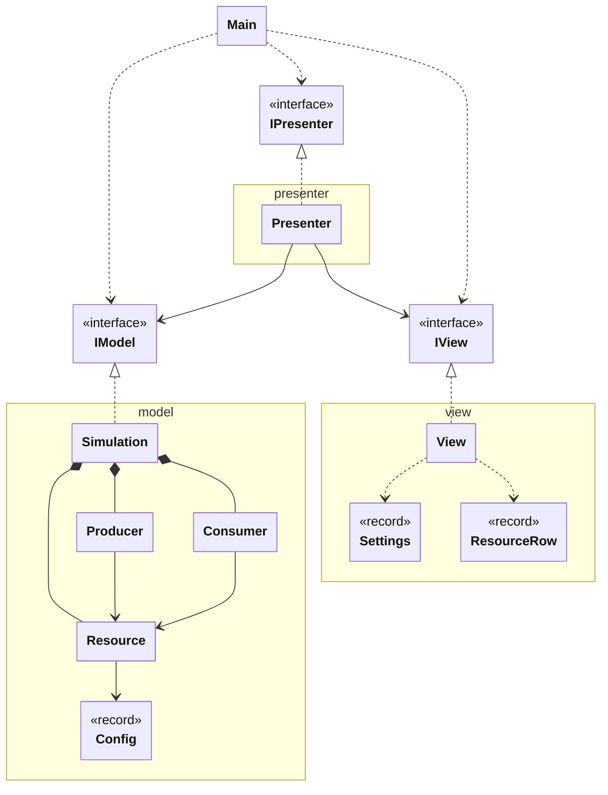
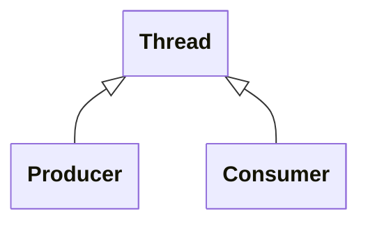

# Unidad 1: Ejercicio 2 - Productor-consumidor (Java Swing + MVP)

Esta práctica simula el problema clásico del **productor-consumidor**: varios hilos producen unidades de un recurso compartido y otros las consumen. Una ventana Swing permite configurar todas las variables y observar el stock en tiempo real.

En este documento se repasan los conceptos necesarios, el UML del programa y los hilos que intervienen. Después se construye el programa paso a paso:
- Conceptos previos
- Productor-consumidor UML
- Hilos aplicados
- Funcionamiento
- Recorrido por clases
- Versión mejorada
![[Pasted image 20261111221418.png]]

## Conceptos previos

### Arquitectura MVP

Igual que en el ejercicio del fuego, el programa se divide en **Model**, **View** y **Presenter**, comunicados por interfaces (`IModel`, `IView`, `IPresenter`).

**Regla principal:** la vista y el modelo nunca se hablan directamente; todo pasa por el presenter.

```
productor-consumidor/
└── src/
    ├── Main.java → crea modelo, vista y presenter y los conecta
    ├── model/ → recurso compartido, hilos productor y consumidor, IModel
    ├── presenter/ → Presenter e IPresenter
    └── view/ → ventana, IView y los DTO que intercambia con el presenter
```

### Recurso compartido y condición de carrera

Un **recurso compartido** es un dato que varios hilos leen y modifican a la vez; aquí, el stock.

Sumar al stock parece una sola operación, pero son tres: **leer** el valor, **calcular** el nuevo y **escribirlo**. Si dos hilos hacen esto a la vez, uno puede pisar el resultado del otro:

```
Hilo A lee 5        Hilo B lee 5
Hilo A escribe 6    Hilo B escribe 4   → el +1 de A se ha perdido
```

Esto es una **condición de carrera**: el resultado depende del orden en que se ejecuten los hilos.

### synchronized

`synchronized` convierte un bloque de código en **sección crítica**: solo un hilo puede estar dentro a la vez. El resto espera a que salga.

Cada objeto Java tiene un **cerrojo** (*lock*). Un método `synchronized` lo coge al entrar y lo suelta al salir.

### Dos formas de esperar: sleep y wait/notify

Cuando un productor encuentra el stock lleno (o un consumidor vacío), tiene que esperar. Hay dos formas:

| | `sleep` | `wait` / `notify` |
|---|---|---|
| Cómo espera | Comprueba, duerme unos ms y vuelve a comprobar | Se bloquea hasta que otro hilo lo avisa |
| Gasto de CPU | Se despierta aunque nada haya cambiado (**espera activa**) | Ninguno mientras espera |
| Necesita `synchronized` | No | Sí: `wait()` y `notifyAll()` solo se pueden llamar con el cerrojo cogido |
| Cerrojo | Hay que soltarlo antes de dormir | `wait()` lo suelta solo y lo recupera al despertar |

`wait()` siempre va dentro de un `while`, no de un `if`: al despertar, otro hilo puede haberse adelantado y la condición puede seguir sin cumplirse.

### Control de stock

Con el control activo, el stock se mantiene entre un **mínimo** y un **máximo**: el productor no supera el máximo y el consumidor no baja del mínimo. Desactivado, los hilos ignoran los límites.

## Productor-consumidor UML



## Hilos aplicados

| Hilo | Qué hace |
|---|---|
| **main** | Solo llama a `SwingUtilities.invokeLater` y termina. |
| **EDT** (hilo de Swing) | Crea la ventana, atiende los botones y ejecuta el `Timer` del presenter, que refresca la tabla cada 200 ms. |
| **Producer** (uno por productor) | Espera un tiempo aleatorio y añade unidades al recurso. |
| **Consumer** (uno por consumidor) | Espera un tiempo aleatorio y retira unidades del recurso. |



`Producer` y `Consumer` **heredan de `Thread`**: cada objeto es un hilo. A diferencia del fuego, aquí la vista no tiene hilo propio: un `javax.swing.Timer` ya se ejecuta en el EDT, que es el único que puede tocar componentes Swing.

## Funcionamiento

### El viaje de una unidad

```
Producer (sleep aleatorio)
  → Resource.produce() → stock + n
    → Consumer (sleep aleatorio)
      → Resource.consume() → stock - n

Timer (EDT, cada 200 ms)
  → Presenter lee cada Resource
    → View.showResources() → tabla
```

### Cómo se detecta una condición de carrera

Cada recurso guarda, además del stock, cuánto se ha **producido** y **consumido** en total. Con eso se calcula el stock **esperado**:

```
esperado = stock inicial + producido - consumido
```

Si el stock real no coincide con el esperado, alguna operación se ha perdido por una condición de carrera. La tabla lo marca en la columna **OK**.

### Los tres modos de `Resource`

| Sincronizado | Modo | Qué ocurre |
|---|---|---|
| Sí | wait/notify | Correcto. Los hilos que no pueden actuar se bloquean sin gastar CPU. |
| Sí | sleep | Correcto. Los hilos comprueban cada 10 ms. |
| No | (siempre sleep) | Aparecen condiciones de carrera: el stock real deja de coincidir con el esperado. |

Sin sincronización solo se puede usar `sleep`, porque `wait()` necesita el cerrojo. Por eso la vista desactiva el selector de modo cuando se desmarca *Synchronized*.

## Recorrido por clases

El programa se construye **de abajo hacia arriba**. Primero el modelo, que es quien hace el trabajo; después la vista y el presenter, que lo muestran y lo controlan.

```
Modelo:     Config → Resource → Producer → Consumer → IModel → Simulation
Vista y
Presenter:  Settings → ResourceRow → IPresenter → IView → View → Presenter
Arranque:   Main
```

---

### Config

Guarda **todos los parámetros** de una simulación. Se crea al pulsar *Start* y no cambia mientras los hilos trabajan.

```java
package model;

public record Config(
        int producers,
        int consumers,
        int resourceTypes,
        int minProduceMs,
        int maxProduceMs,
        int minConsumeMs,
        int maxConsumeMs,
        int produceAmount,
        int consumeAmount,
        int minStock,
        int maxStock,
        boolean stockControl,
        boolean synchronize,
        boolean waitNotify) {
}
```

- **`record`**: la forma corta de Java para una clase que solo guarda datos. Genera el constructor y un getter por campo (`config.maxStock()`).
- **Inmutable**: los hilos la leen a la vez sin peligro, porque nadie la modifica.
- `stockControl`, `synchronize` y `waitNotify` son los tres interruptores de la práctica.

---

### Resource

Es el **recurso compartido**: el stock que productores y consumidores modifican a la vez. Contiene toda la lógica de sincronización.

```java
package model;

public class Resource {
    private static final int RETRY_MS = 10;

    private final int id;
    private final Config config;

    private volatile int stock;
    private volatile long produced;
    private volatile long consumed;

    public Resource(int id, Config config) {
        this.id = id;
        this.config = config;
        this.stock = config.minStock();
    }

    // ---------------------------- Produce ----------------------------

    public void produce(int amount) throws InterruptedException {
        if (!config.synchronize()) {
            produceUnsynchronized(amount);
        } else if (config.waitNotify()) {
            produceWaitNotify(amount);
        } else {
            produceSleep(amount);
        }
    }

    private synchronized void produceWaitNotify(int amount) throws InterruptedException {
        while (!canProduce(amount)) {
            wait();
        }
        add(amount);
        notifyAll();
    }

    private void produceSleep(int amount) throws InterruptedException {
        while (true) {
            synchronized (this) {
                if (canProduce(amount)) {
                    add(amount);
                    return;
                }
            }
            Thread.sleep(RETRY_MS);
        }
    }

    private void produceUnsynchronized(int amount) throws InterruptedException {
        while (!canProduce(amount)) {
            Thread.sleep(RETRY_MS);
        }
        add(amount);
    }

    // ---------------------------- Consume ----------------------------

    public void consume(int amount) throws InterruptedException {
        if (!config.synchronize()) {
            consumeUnsynchronized(amount);
        } else if (config.waitNotify()) {
            consumeWaitNotify(amount);
        } else {
            consumeSleep(amount);
        }
    }

    private synchronized void consumeWaitNotify(int amount) throws InterruptedException {
        while (!canConsume(amount)) {
            wait();
        }
        remove(amount);
        notifyAll();
    }

    private void consumeSleep(int amount) throws InterruptedException {
        while (true) {
            synchronized (this) {
                if (canConsume(amount)) {
                    remove(amount);
                    return;
                }
            }
            Thread.sleep(RETRY_MS);
        }
    }

    private void consumeUnsynchronized(int amount) throws InterruptedException {
        while (!canConsume(amount)) {
            Thread.sleep(RETRY_MS);
        }
        remove(amount);
    }

    // ------------------------ Critical section -----------------------

    private boolean canProduce(int amount) {
        return !config.stockControl() || stock + amount <= config.maxStock();
    }

    private boolean canConsume(int amount) {
        return !config.stockControl() || stock - amount >= config.minStock();
    }

    private void add(int amount) {
        int current = stock;
        Thread.yield();
        stock = current + amount;
        produced += amount;
    }

    private void remove(int amount) {
        int current = stock;
        Thread.yield();
        stock = current - amount;
        consumed += amount;
    }

    // ----------------------------- Reads -----------------------------

    public int getId() { return id; }
    public int getStock() { return stock; }
    public long getProduced() { return produced; }
    public long getConsumed() { return consumed; }

    public long getExpectedStock() {
        return config.minStock() + produced - consumed;
    }
}
```

#### Atributos

- `stock`: unidades actuales. Empieza en el mínimo.
- `produced` y `consumed`: totales acumulados, para calcular el stock esperado.
- **`volatile`**: el presenter los lee desde el EDT mientras otros hilos los escriben. Así siempre ve el último valor. `volatile` no hace atómico el `+=`: por eso las condiciones de carrera siguen apareciendo sin `synchronized`.

#### `produce(amount)` — elige el modo

Según la configuración llama a una de las tres versiones. `consume` hace lo mismo con las suyas.

#### `produceWaitNotify` — la versión con wait/notify

- El método es **`synchronized`**: coge el cerrojo del recurso.
- **`while (!canProduce) wait()`**: si no cabe, el hilo se bloquea y **suelta el cerrojo**, para que un consumidor pueda entrar y retirar unidades.
- **`notifyAll()`**: después de producir, despierta a todos los hilos bloqueados en este recurso. Cada uno vuelve a comprobar su condición.

#### `produceSleep` — la versión con sleep

- La comprobación y la suma van dentro de un **bloque `synchronized`**, así que siguen siendo una sección crítica.
- **`Thread.sleep` va fuera del bloque**. Si durmiera dentro, mantendría el cerrojo y ningún consumidor podría liberar espacio: el programa se quedaría bloqueado.

#### `produceUnsynchronized` — sin sincronización

- Igual que la anterior, pero sin `synchronized`. Varios hilos pueden entrar en `add` a la vez.

#### `canProduce` y `canConsume` — el control de stock

- Si el control está desactivado devuelven siempre `true`: los límites se ignoran.
- Si está activo, comprueban que el stock no supere el máximo ni baje del mínimo.

#### `add` y `remove` — la sección crítica

- Leen el stock, ceden el turno con `Thread.yield()` y escriben el resultado.
- `yield()` invita al sistema a cambiar de hilo justo en el peor momento. Sin sincronización, eso hace visible la condición de carrera; con ella no afecta, porque ningún otro hilo puede entrar.

#### `getExpectedStock()`

- Stock inicial + producido − consumido. Si no coincide con `getStock()`, se ha perdido alguna operación.

---

### Producer

Un **hilo** que produce sin parar en un recurso.

```java
package model;

import java.util.concurrent.ThreadLocalRandom;

public class Producer extends Thread {
    private final Resource resource;
    private final Config config;

    public Producer(int number, Resource resource, Config config) {
        super("Producer-" + number);
        this.resource = resource;
        this.config = config;
    }

    @Override
    public void run() {
        try {
            while (!isInterrupted()) {
                Thread.sleep(randomTime(config.minProduceMs(), config.maxProduceMs()));
                resource.produce(config.produceAmount());
            }
        } catch (InterruptedException e) {
        }
    }

    private static int randomTime(int min, int max) {
        return ThreadLocalRandom.current().nextInt(min, max + 1);
    }
}
```

- **`extends Thread`**: cada `Producer` es un hilo. Se lanza con `start()`, que ejecuta `run()` en un hilo nuevo.
- **`super("Producer-" + number)`**: da nombre al hilo, útil para depurar.
- **`run()`**: duerme un tiempo aleatorio (lo que tarda en producir) y añade unidades al recurso.
- **`while (!isInterrupted())`** y el `catch`: al pulsar *Stop* se interrumpe el hilo. Si estaba en `sleep` o `wait`, salta una `InterruptedException`; en los dos casos el bucle termina y el hilo acaba.
- **`ThreadLocalRandom`**: generador aleatorio pensado para varios hilos. `nextInt(min, max + 1)` devuelve un valor entre `min` y `max`, ambos incluidos.

---

### Consumer

Igual que `Producer`, pero retira unidades.

```java
package model;

import java.util.concurrent.ThreadLocalRandom;

public class Consumer extends Thread {
    private final Resource resource;
    private final Config config;

    public Consumer(int number, Resource resource, Config config) {
        super("Consumer-" + number);
        this.resource = resource;
        this.config = config;
    }

    @Override
    public void run() {
        try {
            while (!isInterrupted()) {
                Thread.sleep(randomTime(config.minConsumeMs(), config.maxConsumeMs()));
                resource.consume(config.consumeAmount());
            }
        } catch (InterruptedException e) {
        }
    }

    private static int randomTime(int min, int max) {
        return ThreadLocalRandom.current().nextInt(min, max + 1);
    }
}
```

- Usa los tiempos de consumo y `consumeAmount`, y llama a `resource.consume(...)`.

---

### IModel

El contrato del modelo.

```java
package model;

import java.util.List;

public interface IModel {
    void start(Config config);
    void stop();
    boolean isRunning();
    List<Resource> getResources();
}
```

- `start(config)`: crea los recursos y lanza los hilos.
- `stop()`: detiene todos los hilos.
- `getResources()`: el presenter lee de aquí el estado para la tabla.

---

### Simulation

Crea los recursos y los hilos, y los pone en marcha.

```java
package model;

import java.util.ArrayList;
import java.util.List;

public class Simulation implements IModel {
    private final List<Resource> resources = new ArrayList<>();
    private final List<Thread> threads = new ArrayList<>();

    @Override
    public void start(Config config) {
        stop();
        resources.clear();

        for (int i = 0; i < config.resourceTypes(); i++) {
            resources.add(new Resource(i + 1, config));
        }

        for (int i = 0; i < config.producers(); i++) {
            threads.add(new Producer(i + 1, resources.get(i % resources.size()), config));
        }
        for (int i = 0; i < config.consumers(); i++) {
            threads.add(new Consumer(i + 1, resources.get(i % resources.size()), config));
        }

        for (Thread thread : threads) {
            thread.start();
        }
    }

    @Override
    public void stop() {
        for (Thread thread : threads) {
            thread.interrupt();
        }
        threads.clear();
    }

    @Override
    public boolean isRunning() {
        return !threads.isEmpty();
    }

    @Override
    public List<Resource> getResources() {
        return List.copyOf(resources);
    }
}
```

#### `start(config)`

1. Para una simulación anterior, si la hay.
2. Crea un `Resource` por **tipo de recurso**.
3. Crea los productores y consumidores. **`i % resources.size()`** los reparte por turnos: con 2 recursos, el productor 1 va al recurso 1, el 2 al 2, el 3 otra vez al 1…
4. Lanza todos los hilos con `start()`.

#### `stop()`

- `interrupt()` avisa a cada hilo de que debe terminar. No lo mata: el hilo acaba solo al salir de su bucle.

#### `getResources()`

- `List.copyOf` devuelve una copia que no se puede modificar: el presenter puede leerla, pero no cambiar la lista del modelo.

---

### Settings y ResourceRow

Los **DTO de la vista**. La vista no puede usar `Config` ni `Resource`, que son del modelo, así que tiene sus propios records. El presenter traduce de uno a otro.

```java
package view.dto;

public record Settings(
        int producers,
        int consumers,
        int resourceTypes,
        int minProduceMs,
        int maxProduceMs,
        int minConsumeMs,
        int maxConsumeMs,
        int produceAmount,
        int consumeAmount,
        int minStock,
        int maxStock,
        boolean stockControl,
        boolean synchronize,
        boolean waitNotify) {
}
```

```java
package view.dto;

public record ResourceRow(
        int id,
        int stock,
        long expected,
        long produced,
        long consumed) {
}
```

- **`Settings`**: lo que el usuario ha introducido en el panel. Viaja de la vista al presenter.
- **`ResourceRow`**: una fila de la tabla. Viaja del presenter a la vista.

---

### IPresenter

```java
package presenter;

public interface IPresenter {
    void start();
    void onStart();
    void onStop();
}
```

- `start()`: abre la aplicación. Lo llama `Main`.
- `onStart()` y `onStop()`: los llama la vista al pulsar los botones.

---

### IView

```java
package view;

import java.util.List;

import presenter.IPresenter;
import view.dto.ResourceRow;
import view.dto.Settings;

public interface IView {
    void setPresenter(IPresenter presenter);
    void showView();
    Settings getSettings();
    void showResources(List<ResourceRow> rows);
    void setRunning(boolean running);
    void showError(String message);
}
```

- `getSettings()`: el presenter lee la configuración al pulsar *Start*.
- `showResources(rows)`: el presenter manda las filas de la tabla.
- `setRunning(running)`: activa o desactiva los controles según la simulación esté en marcha.

---

### View

La **ventana**: el panel de configuración a la izquierda y la tabla de recursos en el centro.

```java
package view;

import java.awt.BorderLayout;
import java.awt.GridBagConstraints;
import java.awt.GridBagLayout;
import java.awt.Insets;
import java.util.List;
import javax.swing.BorderFactory;
import javax.swing.JButton;
import javax.swing.JCheckBox;
import javax.swing.JComboBox;
import javax.swing.JComponent;
import javax.swing.JFrame;
import javax.swing.JLabel;
import javax.swing.JOptionPane;
import javax.swing.JPanel;
import javax.swing.JScrollPane;
import javax.swing.JSpinner;
import javax.swing.JTable;
import javax.swing.SpinnerNumberModel;
import javax.swing.table.DefaultTableModel;

import presenter.IPresenter;
import view.dto.ResourceRow;
import view.dto.Settings;

public class View extends JFrame implements IView {
    private static final String SLEEP = "sleep";
    private static final String WAIT_NOTIFY = "wait / notify";

    // ---------------------------- Settings ---------------------------

    private final JSpinner producers = spinner(2, 1, 50);
    private final JSpinner consumers = spinner(2, 1, 50);
    private final JSpinner resourceTypes = spinner(1, 1, 10);
    private final JSpinner minProduceMs = spinner(200, 0, 10000);
    private final JSpinner maxProduceMs = spinner(800, 0, 10000);
    private final JSpinner minConsumeMs = spinner(200, 0, 10000);
    private final JSpinner maxConsumeMs = spinner(800, 0, 10000);
    private final JSpinner produceAmount = spinner(1, 1, 100);
    private final JSpinner consumeAmount = spinner(1, 1, 100);
    private final JSpinner minStock = spinner(0, -1000, 1000);
    private final JSpinner maxStock = spinner(10, -1000, 1000);
    private final JCheckBox stockControl = new JCheckBox("Stock control", true);
    private final JCheckBox synchronize = new JCheckBox("Synchronized", true);
    private final JComboBox<String> waitMode = new JComboBox<>(new String[] {WAIT_NOTIFY, SLEEP});

    private final JButton startButton = new JButton("Start");
    private final JButton stopButton = new JButton("Stop");

    // ----------------------------- Table -----------------------------

    private final DefaultTableModel tableModel = new DefaultTableModel(
            new String[] {"Resource", "Stock", "Expected", "Produced", "Consumed", "OK"}, 0) {
        @Override
        public boolean isCellEditable(int row, int column) {
            return false;
        }
    };
    private final JTable table = new JTable(tableModel);

    public View() {
        super("Producer-Consumer Simulator");

        add(buildSettingsPanel(), BorderLayout.WEST);
        add(new JScrollPane(table), BorderLayout.CENTER);

        synchronize.addActionListener(e -> waitMode.setEnabled(synchronize.isSelected()));

        setRunning(false);
        setDefaultCloseOperation(JFrame.EXIT_ON_CLOSE);
        setSize(900, 520);
        setLocationRelativeTo(null);
    }

    private JPanel buildSettingsPanel() {
        JPanel panel = new JPanel(new GridBagLayout());
        panel.setBorder(BorderFactory.createEmptyBorder(10, 10, 10, 10));

        int row = 0;
        row = addRow(panel, row, "Producers", producers);
        row = addRow(panel, row, "Consumers", consumers);
        row = addRow(panel, row, "Resource types", resourceTypes);
        row = addRow(panel, row, "Min produce time (ms)", minProduceMs);
        row = addRow(panel, row, "Max produce time (ms)", maxProduceMs);
        row = addRow(panel, row, "Min consume time (ms)", minConsumeMs);
        row = addRow(panel, row, "Max consume time (ms)", maxConsumeMs);
        row = addRow(panel, row, "Units produced", produceAmount);
        row = addRow(panel, row, "Units consumed", consumeAmount);
        row = addRow(panel, row, "Min stock", minStock);
        row = addRow(panel, row, "Max stock", maxStock);
        row = addRow(panel, row, "", stockControl);
        row = addRow(panel, row, "", synchronize);
        row = addRow(panel, row, "Wait mode", waitMode);

        JPanel buttons = new JPanel();
        buttons.add(startButton);
        buttons.add(stopButton);
        addRow(panel, row, "", buttons);

        return panel;
    }

    private static int addRow(JPanel panel, int row, String text, JComponent field) {
        GridBagConstraints c = new GridBagConstraints();
        c.gridy = row;
        c.insets = new Insets(3, 3, 3, 3);
        c.anchor = GridBagConstraints.WEST;

        c.gridx = 0;
        panel.add(new JLabel(text), c);

        c.gridx = 1;
        c.fill = GridBagConstraints.HORIZONTAL;
        panel.add(field, c);
        return row + 1;
    }

    private static JSpinner spinner(int value, int min, int max) {
        return new JSpinner(new SpinnerNumberModel(value, min, max, 1));
    }

    private static int value(JSpinner spinner) {
        return (Integer) spinner.getValue();
    }

    // ----------------------------- IView -----------------------------

    @Override
    public void setPresenter(IPresenter presenter) {
        startButton.addActionListener(e -> presenter.onStart());
        stopButton.addActionListener(e -> presenter.onStop());
    }

    @Override
    public void showView() {
        setVisible(true);
    }

    @Override
    public Settings getSettings() {
        return new Settings(
                value(producers), value(consumers), value(resourceTypes),
                value(minProduceMs), value(maxProduceMs),
                value(minConsumeMs), value(maxConsumeMs),
                value(produceAmount), value(consumeAmount),
                value(minStock), value(maxStock),
                stockControl.isSelected(),
                synchronize.isSelected(),
                WAIT_NOTIFY.equals(waitMode.getSelectedItem()));
    }

    @Override
    public void showResources(List<ResourceRow> rows) {
        tableModel.setRowCount(0);
        for (ResourceRow r : rows) {
            boolean ok = r.stock() == r.expected();
            tableModel.addRow(new Object[] {
                    r.id(), r.stock(), r.expected(), r.produced(), r.consumed(), ok ? "yes" : "NO"});
        }
    }

    @Override
    public void setRunning(boolean running) {
        startButton.setEnabled(!running);
        stopButton.setEnabled(running);
        for (JComponent field : new JComponent[] {producers, consumers, resourceTypes,
                minProduceMs, maxProduceMs, minConsumeMs, maxConsumeMs,
                produceAmount, consumeAmount, minStock, maxStock, stockControl, synchronize}) {
            field.setEnabled(!running);
        }
        waitMode.setEnabled(!running && synchronize.isSelected());
    }

    @Override
    public void showError(String message) {
        JOptionPane.showMessageDialog(this, message, "Error", JOptionPane.ERROR_MESSAGE);
    }
}
```

#### Componentes

- **`JSpinner`**: campo numérico con flechas. `SpinnerNumberModel(valor, mínimo, máximo, paso)` limita lo que se puede introducir.
- **`JCheckBox`**: los interruptores de control de stock y sincronización.
- **`JComboBox`**: el selector entre `wait / notify` y `sleep`.
- **`JTable` + `DefaultTableModel`**: la tabla guarda los datos en su *modelo*. `isCellEditable` devuelve `false` para que el usuario no pueda escribir en ella.

#### Constructor

- Panel de configuración al oeste y tabla en el centro, con `BorderLayout` (el layout por defecto de `JFrame`).
- La tabla va dentro de un **`JScrollPane`**, que además muestra la cabecera de las columnas.
- El listener de `synchronize` desactiva el selector de modo cuando se desmarca: `wait()` necesita `synchronized`.

#### `buildSettingsPanel()` y `addRow(...)`

- Un **`GridBagLayout`** de dos columnas: la etiqueta en la columna 0 y el campo en la 1.
- `addRow` añade una fila y devuelve el número de la siguiente. Así cada control ocupa una línea sin repetir código.

#### Métodos de `IView`

- **`setPresenter`**: conecta los botones con el presenter. La vista solo conoce `IPresenter`.
- **`getSettings`**: lee todos los campos y los empaqueta en un `Settings`.
- **`showResources`**: vacía la tabla (`setRowCount(0)`) y añade una fila por recurso. Marca **NO** si el stock real no coincide con el esperado.
- **`setRunning`**: mientras la simulación está en marcha, solo se puede pulsar *Stop*.

---

### Presenter

El intermediario: traduce la configuración de la vista para el modelo y refresca la tabla con el estado del modelo.

```java
package presenter;

import java.util.ArrayList;
import java.util.List;
import javax.swing.Timer;

import model.Config;
import model.IModel;
import model.Resource;
import view.IView;
import view.dto.ResourceRow;
import view.dto.Settings;

public class Presenter implements IPresenter {
    private static final int REFRESH_MS = 200;

    private final IModel model;
    private final IView view;
    private final Timer timer;

    public Presenter(IModel model, IView view) {
        this.model = model;
        this.view = view;
        this.timer = new Timer(REFRESH_MS, e -> refresh());
        view.setPresenter(this);
    }

    @Override
    public void start() {
        view.showView();
    }

    @Override
    public void onStart() {
        Settings s = view.getSettings();

        String error = validate(s);
        if (error != null) {
            view.showError(error);
            return;
        }

        model.start(toConfig(s));
        view.setRunning(true);
        timer.start();
    }

    @Override
    public void onStop() {
        timer.stop();
        model.stop();
        refresh();
        view.setRunning(false);
    }

    private void refresh() {
        List<ResourceRow> rows = new ArrayList<>();
        for (Resource r : model.getResources()) {
            rows.add(new ResourceRow(r.getId(), r.getStock(), r.getExpectedStock(),
                    r.getProduced(), r.getConsumed()));
        }
        view.showResources(rows);
    }

    private static Config toConfig(Settings s) {
        return new Config(
                s.producers(), s.consumers(), s.resourceTypes(),
                s.minProduceMs(), s.maxProduceMs(),
                s.minConsumeMs(), s.maxConsumeMs(),
                s.produceAmount(), s.consumeAmount(),
                s.minStock(), s.maxStock(),
                s.stockControl(), s.synchronize(), s.waitNotify());
    }

    private static String validate(Settings s) {
        if (s.minProduceMs() > s.maxProduceMs()) return "Min produce time is greater than max.";
        if (s.minConsumeMs() > s.maxConsumeMs()) return "Min consume time is greater than max.";
        if (s.minStock() > s.maxStock()) return "Min stock is greater than max stock.";
        return null;
    }
}
```

#### Constructor

- Guarda el modelo y la vista como **interfaces**.
- Crea el **`javax.swing.Timer`**: cada 200 ms llama a `refresh()` **en el EDT**, así que puede tocar la tabla sin problemas.
- `view.setPresenter(this)`: conecta los botones.

#### `onStart()`

1. Lee la configuración de la vista.
2. La **valida**: los mínimos no pueden ser mayores que los máximos. Si hay error, lo muestra y no arranca.
3. La convierte en `Config` y arranca el modelo.
4. Bloquea los controles y arranca el `Timer`.

#### `onStop()`

- Para el `Timer` y los hilos, refresca una última vez para enseñar los valores finales y vuelve a habilitar los controles.

#### `refresh()`

- Lee cada `Resource` del modelo y lo convierte en una `ResourceRow` para la vista. La vista nunca ve un `Resource`.

#### `toConfig(s)`

- Copia campo a campo de `Settings` (vista) a `Config` (modelo). Es el único sitio donde se conocen los dos.

---

### Main

```java
import javax.swing.SwingUtilities;

import model.IModel;
import model.Simulation;
import presenter.IPresenter;
import presenter.Presenter;
import view.IView;
import view.View;

public class Main {
    public static void main(String[] args) {
        SwingUtilities.invokeLater(() -> {
            IModel model = new Simulation();
            IView view = new View();
            IPresenter presenter = new Presenter(model, view);
            presenter.start();
        });
    }
}
```

- Crea las tres piezas en el **EDT** con `invokeLater`, las conecta a través del presenter y muestra la ventana.
- Los hilos no arrancan aquí, sino al pulsar *Start*.

### Pruebas recomendadas

| Configuración | Resultado esperado |
|---|---|
| Synchronized + wait/notify | Stock entre mínimo y máximo, columna OK siempre `yes` |
| Synchronized + sleep | Igual, pero los hilos consumen algo de CPU al esperar |
| Sin Synchronized, 20 productores y 20 consumidores, tiempos de 0 a 2 ms | Al poco rato aparece `NO`: condición de carrera |
| Sin Stock control, más consumidores que productores | El stock baja por debajo del mínimo |

---
---

## Versión mejorada

La versión completa del proyecto está en [GitHub](ENLACE).
Convierte el simulador en un juego de gestión, **Resource Factory**, con la misma base: productores y consumidores como hilos sobre recursos compartidos y MVP estricto.

### Interfaz

- **Escritorio retro** con ventanas propias (barra de título rayada, borde con sombra dura) colocadas con `GridBagLayout`.
- **4 temas** intercambiables en tiempo real (Mac, Game Boy, SNES, 8-bit), propagados por todo el árbol de componentes con una interfaz `Themed`.
- **Componentes dibujados a mano**: iconos de píxeles (`Icon`), barras segmentadas, tramas con `TexturePaint` y fuente pixelada cargada con `Font.createFont`.
- **Histograma del stock en campana de Gauss**: cada unidad es un píxel del color de su producto, con leyenda de porcentajes.
- **Rejillas** de 8 productores (`CardLayout` para abierto/vacío) y 32 asientos de consumidores.

### Modelo

- **Dos recursos compartidos**: una lista de pedidos (el jugador encarga, los productores esperan con `wait`) y el stock (productores y consumidores con `wait`/`notifyAll`).
- **Consumidores de vida corta**: cada cliente es un hilo que se sienta, consume, paga y termina.
- **Reloj compartido** (`Clock`): Play, Pause y velocidad ×2 para todos los hilos.
- **Hilo `World`**: llegada de clientes, días y promociones. La demanda crece con el número de productores y los días.
- **Economía**: dinero (`Wallet` sincronizado), precios de venta, mejoras de productores y desbloqueo de productos.

### Arquitectura

- **`GameSnapshot`**: el presenter construye en cada fotograma un DTO inmutable con todo el estado y la vista lo reparte entre sus paneles.
- **`javax.swing.Timer` a 60 FPS** en el presenter, en el EDT.
- **Los componentes no conocen al presenter**: exponen métodos como `onPlay(Runnable)` y la vista los conecta en `setPresenter`.

![[Pasted image 20261111221946.png]]
