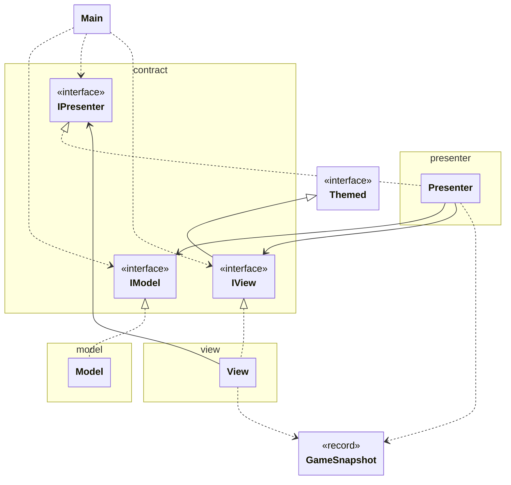
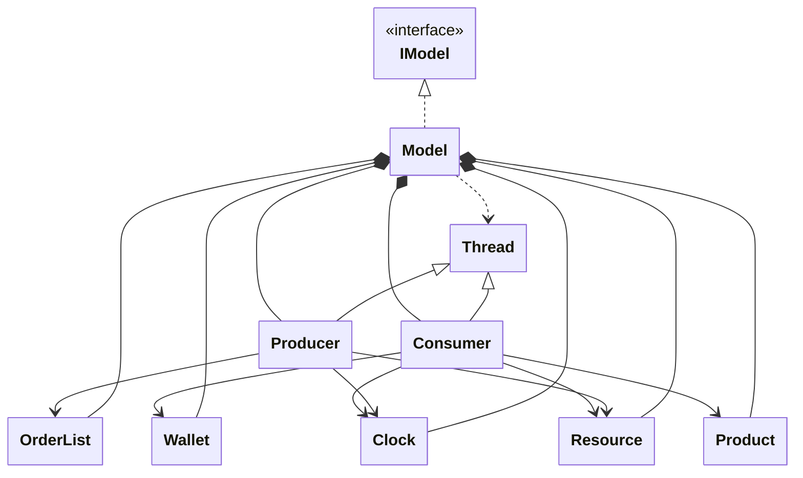
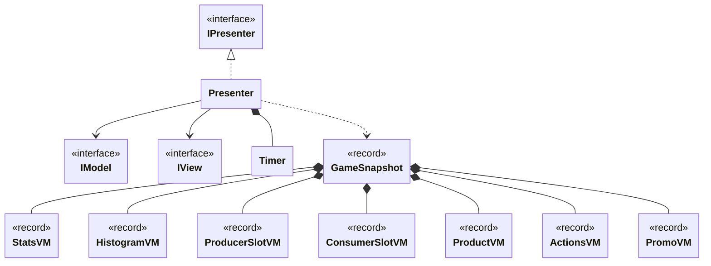
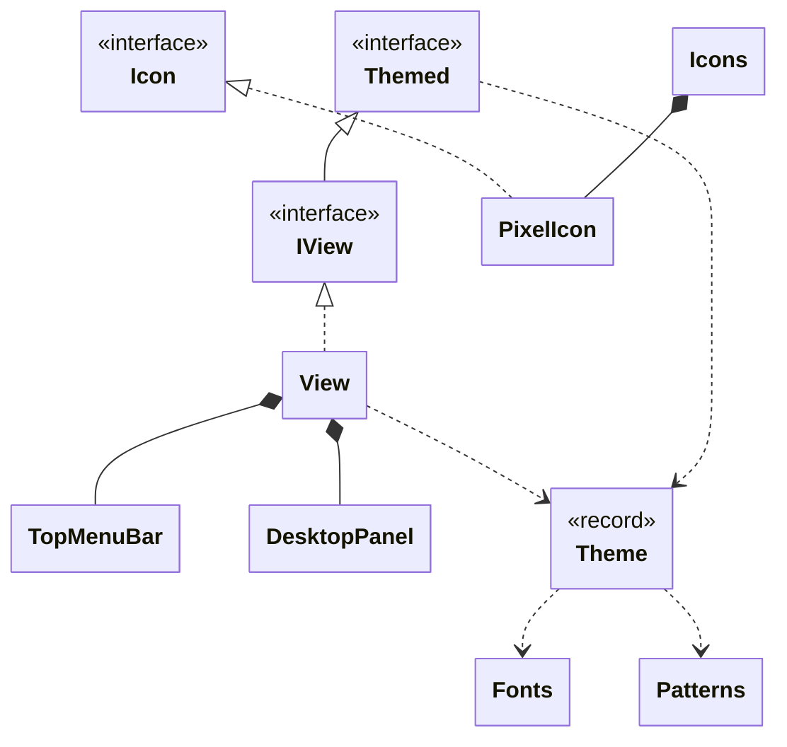
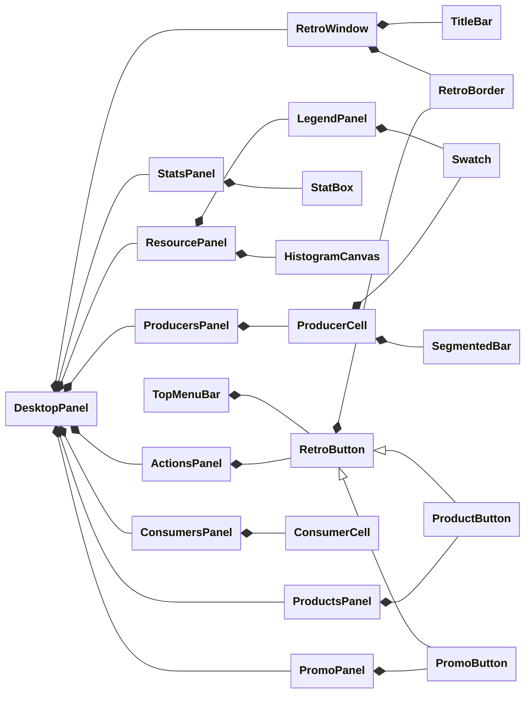
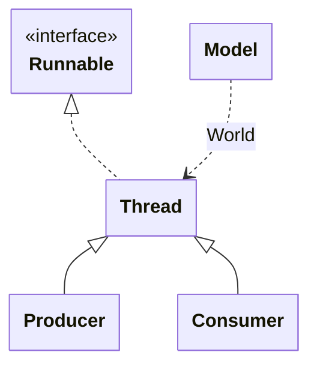
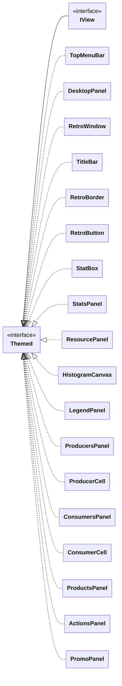

# Unidad 1: Ejercicio 2 (avanzado) - Resource Factory (Java Swing + MVP)

Esta práctica es la versión avanzada de [[U1 - E02 - Productor-consumidor]]. Convierte el simulador en un juego de gestión, **Resource Factory**, pero mantiene la misma base: productores y consumidores como hilos sobre recursos compartidos, y una arquitectura MVP estricta.

El jugador **encarga** productos, los **productores** los fabrican y los dejan en el stock, y los **clientes** llegan, se sientan, consumen una unidad y pagan. Con el dinero se abren productores nuevos, se mejoran, se desbloquean productos y se lanzan promociones.

Lo que ya explica el ejercicio base (MVP, condición de carrera, `synchronized`, `wait`/`notifyAll`, `interrupt`, `javax.swing.Timer`, `record`…) no se repite aquí. Este documento solo cubre **lo nuevo**:
- Conceptos previos
- Resource Factory UML
- Hilos aplicados
- Funcionamiento
- Recorrido por clases
- Notas
![[Pasted image 20261111221946.png]]

La versión completa del proyecto está en [GitHub](ENLACE).

## Conceptos previos

### Dos recursos compartidos en cadena

En el ejercicio base había un solo recurso, el stock. Aquí hay **dos**, y cada unidad pasa por los dos:

| Recurso | Quién añade | Quién retira | Quién espera, y cuándo |
|---|---|---|---|
| `OrderList` (pedidos) | El jugador (EDT) | Los productores | El productor, si no hay pedidos |
| `Resource` (stock) | Los productores | Los consumidores | El productor, si está lleno; el consumidor, si está vacío |

Un productor es **consumidor** de la lista de pedidos y **productor** del stock. Los dos recursos usan el mismo patrón del ejercicio base: métodos `synchronized`, `while (...) wait()` y `notifyAll()`.

El EDT nunca llama a un método que haga `wait()`. Si lo hiciera, la ventana se congelaría hasta que otro hilo lo despertara.

### Un monitor para pausar a todos los hilos

`wait`/`notifyAll` no sirve solo para el stock: sirve para **cualquier condición**. `Clock` lo usa para la pausa:

```
Hilo de trabajo:  clock.awaitRunning() → while (paused) wait()
EDT (Play):       clock.play()         → paused = false; notifyAll()
```

Cada hilo llama a `awaitRunning()` antes de cada paso. Si el juego está en pausa, se bloquea sin gastar CPU; al pulsar *Play*, todos despiertan a la vez.

### Tiempo simulado

Los hilos no duermen el tiempo total de una tarea, sino **pasos cortos** (*ticks*) de 50 o 100 ms. En cada paso suman el tiempo transcurrido multiplicado por la velocidad:

```
dt = TICK_MS / 1000.0 × speed
elapsed += dt
progress = elapsed / total
```

- El `sleep` siempre es el mismo; con velocidad ×2, cada paso cuenta el doble y la tarea acaba antes.
- Como avanzan a pasos, los hilos pueden comprobar la pausa y publicar su **progreso** (de 0 a 1) para las barras de la vista.

### Hilos de vida corta, daemon y join

- **Vida corta**: cada cliente es un hilo que hace **una sola** tarea (sentarse, comer, pagar) y termina. Para saber si un asiento está libre se pregunta `isAlive()`.
- **`setDaemon(true)`**: un hilo *daemon* no impide que la JVM se cierre. Al cerrar la ventana no hay que esperar a ningún productor ni cliente.
- **`join(ms)`**: espera a que un hilo termine, como máximo `ms` milisegundos. Se usa en *New game* para no reutilizar el estado mientras quedan hilos antiguos vivos.

### Records inmutables y copias defensivas

Un `record` es inmutable **solo en apariencia** si guarda un array o una lista: quien tenga la referencia puede cambiar su contenido. Para evitarlo se hacen **copias defensivas** en el **constructor compacto** (el que no repite los parámetros):

```java
import java.util.List;

public record Example(List<String> names, int[] values) {
    public Example {
        names = List.copyOf(names);
        values = values.clone();
    }

    @Override
    public int[] values() { return values.clone(); }
}
```

- `List.copyOf` ya devuelve una lista que no se puede modificar, así que basta con copiarla al crear el record.
- Un array siempre se puede modificar, así que se copia **al entrar y al salir** (sobrescribiendo el *accessor*).

### Callbacks: Runnable, IntConsumer y Consumer\<T\>

Los componentes de la vista **no conocen al presenter**. En su lugar exponen métodos `onX(...)` que reciben «lo que hay que hacer» como una función:

| Tipo | Método | Uso aquí |
|---|---|---|
| `Runnable` | `run()` | Acción sin datos: *Play*, *New producer*… |
| `IntConsumer` | `accept(int)` | Acción con un `int`: comprar el producto `id`, mejorar el productor `slot` |
| `Consumer<T>` | `accept(T)` | Acción con un objeto: aplicar un `Theme` |

`View` los conecta con referencias a métodos: `desktop.onPromo(presenter::onPromo)`.

### Pintar a mano en Swing

| Pieza | Para qué |
|---|---|
| `paintComponent(Graphics g)` | Se sobrescribe para dibujar un componente propio. Swing la llama al repintar. |
| `g.create()` / `dispose()` | Copia del `Graphics` para cambiar color o *composite* sin afectar al resto. |
| `Paint` | Lo que rellena una figura. `Color` es un `Paint`; `TexturePaint` también. |
| `TexturePaint` | Repite una imagen pequeña (*tile*) como un azulejo: tramas, rayas, ajedrez. |
| `Icon` | Interfaz de Swing para iconos: `paintIcon`, `getIconWidth`, `getIconHeight`. |
| `AbstractBorder` | Base para bordes propios: `paintBorder` y `getBorderInsets`. |
| `repaint()` | Pide a Swing que vuelva a pintar el componente en el EDT. |

### Estructura de carpetas

```
e02-advanced-producer-consumer/
├── run.sh                         → compila y ejecuta (añade resources al classpath)
└── src/main/
    ├── java/
    │   ├── main/Main.java         → crea modelo, vista y presenter
    │   ├── contract/              → IModel, IView, IPresenter
    │   ├── model/                 → recursos compartidos, hilos y reglas del juego
    │   ├── presenter/             → Presenter: Timer y traducción modelo → VM
    │   └── view/
    │       ├── View.java
    │       ├── dto/               → GameSnapshot y los ViewModels (records)
    │       ├── theme/             → Theme, Themed, tramas, iconos y fuente
    │       └── components/        → ventanas retro, paneles y componentes pintados
    └── resources/fonts/           → PixelifySans-Regular.ttf
```

**¿Por qué `contract`?** Las tres interfaces van en su propio paquete: así ninguna capa «es dueña» del contrato que usan las otras.

## Resource Factory UML

Hay demasiadas clases para un solo diagrama, así que se dividen por paquete.

| Flecha | Significado |
|---|---|
| `<\|--` | **Hereda** de una clase (o una interfaz extiende otra) |
| `<\|..` | **Implementa** una interfaz |
| `*--` | **Composición**: la crea y es su dueña |
| `-->` | **Guarda una referencia** a otra pieza |
| `..>` | **Usa**, pero no la guarda |

### Visión general: MVP y contratos



`Themed` es del paquete `view.theme` y `GameSnapshot` de `view.dto`.

### Paquete model



`Model ..> Thread` es el hilo `World`: un `Thread` normal que ejecuta un método de `Model`.

### Paquetes presenter y view.dto



### Paquetes view y view.theme



### Paquete view.components



`DesktopPanel` crea cada panel y lo mete dentro de una `RetroWindow`. Casi todos los componentes implementan `Themed`; se ve en su sección.

## Hilos aplicados

| Hilo | Cuántos | Qué hace |
|---|---|---|
| **main** | 1 | Solo llama a `SwingUtilities.invokeLater` y termina. |
| **EDT** (hilo de Swing) | 1 | Crea la ventana, atiende los clics y ejecuta el `Timer` del presenter **cada 16 ms (~60 FPS)**: lee el modelo, construye un `GameSnapshot` y lo pinta. |
| **World** | 1 | Cada 100 ms simulados: llegan clientes a la cola, se sientan, pasa el día, caduca la promoción y se calculan las tasas por segundo. |
| **Producer-N** | 1 a 8 | Coge un pedido, lo fabrica durante su ciclo y deja la unidad en el stock. Vive toda la partida. |
| **Consumer-N** | 0 a 32 a la vez | Un cliente sentado: coge una unidad, come y paga. **Termina** al acabar. |



- `Producer` y `Consumer` **heredan de `Thread`**, como en el ejercicio base.
- `World` no tiene clase propia: es `new Thread(this::worldLoop, "World")`. La referencia `this::worldLoop` cumple la interfaz `Runnable`.
- Todos los hilos del juego son **daemon**.

### Quién toca cada dato compartido

| Dato | Escriben | Leen | Protección |
|---|---|---|---|
| `OrderList` | EDT (`addOrder`), Producer (`takeOrder`) | — | `synchronized` + `wait`/`notifyAll` |
| `Resource` | Producer (`put`), Consumer (`take`) | EDT (copias), World (totales) | `synchronized` + `wait`/`notifyAll` |
| `Clock` | EDT (Play, Pause, ×2) | Todos los hilos de trabajo | `synchronized` + `wait`/`notifyAll` |
| `Wallet` | Consumer (`earn`), EDT (`spend`, promo), World (fin de promo) | EDT | `synchronized` |
| `seats` de `Model` | World (siéntate / libera) | EDT | bloque `synchronized (seats)` |
| Campos de estado de `Model` | World (día, cola, tasas, promo), EDT (inicio de promo, `producerCount`) | EDT, World | `volatile` |
| `level` de `Producer` | EDT (mejora) | Producer | `volatile` |
| `productId`, `progress` | Producer / Consumer | EDT | `volatile` |
| `unlocked` de `Product` | EDT | EDT | `volatile` (por precaución) |

La regla es la misma del ejercicio base: si varios hilos **escriben** y la operación tiene varios pasos, `synchronized`; si **un hilo escribe y otros solo leen**, basta `volatile`.

## Funcionamiento

### El viaje de un pedido

```
Clic en "Bread, $5" (EDT)
  → ProductsPanel → presenter.onBuyProduct(0)
    → Model.orderProduct(0): wallet.spend(5) → orders.addOrder(0) → notifyAll()

Producer-0 (despierta en takeOrder)
  → productId = 0 → produce(): ciclo de 3 s a pasos de 50 ms
    → resource.put(0) → stock + 1 → notifyAll()

World (cada 100 ms)
  → llega un cliente: queue + 1
    → seatConsumers(): asiento libre → new Consumer(...).start()

Consumer-N
  → resource.take() → productId = 0 → eat(): 2 a 5 s
    → wallet.earn(12) → el hilo termina

World (siguiente vuelta)
  → seats[i].isAlive() == false → asiento libre
```

### El viaje de un fotograma

```
Timer (EDT, cada 16 ms)
  → Presenter.buildSnapshot()
    → lee IModel: dinero, día, stock, productores, clientes, precios…
    → traduce cada entidad a su ViewModel (record)
    → bellHeights(): reparte las unidades del stock en una campana
  → View.render(snapshot)
    → TopMenuBar: día y dinero
    → DesktopPanel: reparte cada parte del snapshot a su panel
      → cada componente guarda el dato y llama a repaint()
```

La vista nunca ve un `Producer`, un `Consumer` ni un `Resource`: solo records con números, textos y arrays copiados.

### El viaje de un cambio de tema

```
Clic en Theme › Game Boy (EDT)
  → TopMenuBar: action.accept(Theme.GAME_BOY)
    → View.applyTheme(theme)
      → menuBar.applyTheme(theme)
      → desktop.applyTheme(theme)
        → cada RetroWindow.applyTheme(theme)
          → borde, barra de título y contenido (si es Themed)
            → paneles → celdas, botones, lienzos…
```

El tema no pasa por el presenter: es un asunto **solo de la vista**.

### El hilo World y la demanda

En cada vuelta (100 ms simulados) `worldLoop` hace, en orden:

1. **Llegadas**: descuenta `dt` del temporizador; al llegar a 0, entra un cliente en la cola (máximo 20) y se calcula la próxima llegada.
2. **Asientos**: libera los asientos de clientes que ya terminaron y sienta a los de la cola.
3. **Promoción**: descuenta `dt`; al llegar a 0 el multiplicador de precios vuelve a 1.
4. **Días**: cada 10 s simulados, `day++`.
5. **Tasas**: cada segundo simulado, calcula producción y consumo por segundo a partir de los totales de `Resource`.

La llegada de clientes depende de la **demanda**:

```
demanda  = productores × (1 + 0.10 × (día − 1))      (× 1.5 con promoción)
media    = 2.0 s / max(1, demanda)
llegada  = media × (0.5 … 1.5)                         (aleatorio)
```

- Más productores y más días → más clientes. Con 4 productores el día 1, llega un cliente cada 0,5 s de media.
- El factor aleatorio evita que lleguen todos al mismo ritmo.

### La campana de Gauss del stock

El histograma muestra **cada unidad del stock como un cuadradito** del color de su producto, colocado en 32 columnas con forma de campana. El presenter calcula cuántas unidades van en cada columna en dos pasos.

**1. Pesos gaussianos.** Cada columna recibe un peso según su distancia al centro:

```
centro = (columnas − 1) / 2       sigma = columnas / 6
z      = (c − centro) / sigma     peso  = e^(−z² / 2)
```

Con `sigma = columnas / 6`, casi toda la campana cabe en las columnas (±3 sigma).

**2. Reparto por mayor resto.** Cada columna se lleva `total × peso / suma` unidades, pero eso no es un número entero. Se redondea hacia abajo y las unidades que sobran se dan a las columnas con **mayor parte decimal**. Así la suma es exactamente el total.

Ejemplo con 7 unidades y 5 columnas:

```
pesos       0.056   0.487   1.000   0.487   0.056     (suma 2.086)
exacto      0.188   1.634   3.356   1.634   0.188
truncado    0       1       3       1       0          → 5, faltan 2
restos      .188    .634    .356    .634    .188
+1 al mayor 0       2       3       1       0          (columna 1)
+1 al mayor 0       2       3       2       0          (columna 3) → 7
```

Con el stock lleno (200 unidades) la columna central tiene 15 unidades y las de los extremos, ninguna.

## Recorrido por clases

El programa se construye **de abajo hacia arriba**: cada clase solo usa las que ya se han explicado.

```
Modelo:      Product → Clock → Wallet → OrderList → Resource → Producer → Consumer → IModel → Model
Tema:        Fonts → Patterns → PixelIcon e Icons → Theme → Themed
DTO:         StatsVM, ProductVM, ProducerSlotVM, ConsumerSlotVM, ActionsVM, PromoVM
             → HistogramVM → GameSnapshot
Contratos:   IPresenter → IView
Retro:       RetroBorder → RetroButton → TitleBar → RetroWindow
Pintados:    SegmentedBar y Swatch → ProducerCell → ConsumerCell → HistogramCanvas → LegendPanel
Botones:     ProductButton → PromoButton
Paneles:     StatBox y StatsPanel, ProductsPanel, ProducersPanel, ConsumersPanel,
             ResourcePanel, ActionsPanel, PromoPanel
Ventana:     DesktopPanel → TopMenuBar → View
Presenter:   Presenter
Arranque:    Main
```

---

### Product

Un **producto** del catálogo: nombre, coste de fabricación, precio de venta y si está desbloqueado.

```java
package model;

public class Product {
    private final int id;
    private final String name;
    private final int cost;
    private final int salePrice;
    private final boolean unlockedAtStart;
    private volatile boolean unlocked;

    public Product(int id, String name, int cost, int salePrice, boolean unlocked){
        this.id = id;
        this.name = name;
        this.cost = cost;
        this.salePrice = salePrice;
        this.unlockedAtStart = unlocked;
        this.unlocked = unlocked;
    }

    // ----- Getters -----
    public int getId() { return id; }
    public String getName() { return name; }
    public int getCost() { return cost; }
    public int getSalePrice() { return salePrice; }
    public boolean isUnlocked() { return unlocked; }

    // ----- Unlock -----
    public void unlock() { unlocked = true; }

    public void reset() { unlocked = unlockedAtStart; }
}
```

- Todo es `final` salvo `unlocked`: el catálogo no cambia, solo se desbloquea.
- **`volatile unlocked`**: lo cambia `unlock` y lo leen `Model` y el presenter. Hoy todos corren en el EDT, así que es una precaución por si otro hilo lo leyera.
- `unlockedAtStart` guarda el valor inicial para que `reset()` deje el producto como al empezar una partida nueva.
- `cost` es lo que paga el jugador al encargarlo; `salePrice`, lo que paga el cliente al consumirlo.

---

### Clock

El **reloj compartido**: pausa y velocidad para todos los hilos del juego.

```java
package model;

public class Clock {
    private boolean paused = false;
    private int speed = 1;

    // ----- Controls -----
    public synchronized void play(){
        paused = false;
        speed = 1;
        notifyAll();
    }

    public synchronized void pause(){ paused = true; }

    public synchronized void fastForward () {
        paused = false;
        speed = 2;
        notifyAll();
    }

    // ----- Synchronization -----
    public synchronized void awaitRunning() throws InterruptedException {
        while (paused) {
            wait();
        }
    }

    // ----- Getters -----
    public synchronized int getSpeed(){
        return speed;
    }

    public synchronized boolean isPaused(){
        return paused;
    }
}
```

- **`paused` y `speed` sin `volatile`**: todos sus accesos son `synchronized`, y el cerrojo ya garantiza que se ve el último valor.
- **`awaitRunning()`**: el mismo patrón que `produceWaitNotify` del ejercicio base, pero la condición es la pausa. Lo llaman Producer, Consumer y World antes de cada paso.
- **`play()` y `fastForward()`** hacen `notifyAll()` para despertar a los hilos parados. `pause()` no lo necesita: nadie espera a que el juego se pause.
- **`getSpeed()`** es `synchronized` para leer siempre la velocidad actual. Vale 1 o 2.

---

### Wallet

El **dinero** del jugador y el **multiplicador** de precios de la promoción.

```java
package model;

public class Wallet {
    private int money;
    private double multiplier = 1.0;

    public Wallet(int initialMoney){
        this.money = initialMoney;
    }

    // ----- Transactions -----
    public synchronized void earn(int salePrice){
        money += (int) Math.round(salePrice * multiplier);
    }

    public synchronized boolean spend(int amount){
        if (money < amount){
            return false;
        }
        money -= amount;
        return true;
    }

    // ----- State -----
    public synchronized int getMoney(){ return money; }
    public synchronized void setMultiplier(double multiplier) { this.multiplier = multiplier; }

    public synchronized void reset(int initialMoney){
        money = initialMoney;
        multiplier = 1.0;
    }
}
```

- **`earn`**: la llaman los clientes, muchos a la vez. `money += ...` son tres pasos (leer, sumar, escribir): sin `synchronized` se perderían ventas, como el `+1` del ejercicio base.
- **`spend`**: la comprobación (`money < amount`) y la resta van **en la misma sección crítica**. Si fueran separadas, un cliente podría cobrar entre las dos y esa venta se perdería al escribir la resta.
- Devuelve `boolean`: es la guarda de todas las compras de `Model`. Si no hay dinero, la compra no se hace.
- **`setMultiplier`**: lo pone a 1.5 el EDT al lanzar la promoción y lo vuelve a 1.0 el hilo World al acabar. `earn` lo aplica con `Math.round`.

---

### OrderList

El **primer recurso compartido**: la cola de pedidos del jugador.

```java
package model;

import java.util.ArrayDeque;
import java.util.Deque;

public class OrderList {
    private final Deque<Integer> orders = new ArrayDeque<>();

    // ----- Producer / consumer -----
    public synchronized void addOrder(int productId) {
        orders.addLast(productId);
        notifyAll();
    }

    public synchronized int takeOrder() throws InterruptedException{
        while (orders.isEmpty()) {
            wait();
        }
        return orders.removeFirst();
    }

    // ----- State -----
    public synchronized int size(){
        return orders.size();
    }

    public synchronized void clear(){
        orders.clear();
    }
}
```

- **`ArrayDeque`**: cola FIFO. Se añade al final (`addLast`) y se retira del principio (`removeFirst`): los pedidos se fabrican en orden.
- **Sin capacidad**: `addOrder` nunca espera. Es importante porque la llama el **EDT**, que no debe bloquearse.
- **`takeOrder`**: el productor se bloquea con `while (orders.isEmpty()) wait()` hasta que haya un pedido. Si no hay pedidos, los productores no gastan CPU.
- **`notifyAll()`** en `addOrder` despierta a los productores parados; solo uno se lleva el pedido y el resto vuelve a esperar.

---

### Resource

El **segundo recurso compartido**: el stock, con capacidad máxima y cuenta por producto.

```java
package model;

import java.util.ArrayDeque;
import java.util.Deque;

public class Resource {
    private final int capacity;
    private final Deque<Integer> units = new ArrayDeque<>();
    private final int[] countByProduct;

    private long totalProduced;
    private long totalConsumed;

    public Resource(int capacity, int producCount){
        this.capacity = capacity;
        this.countByProduct = new int[producCount];
    }

    // ----- Producer / consumer -----
    public synchronized void put(int productId) throws InterruptedException {
        while (units.size() >= capacity) {
            wait();
        }
        units.addLast(productId);
        countByProduct[productId]++;
        totalProduced++;
        notifyAll();
    }

    public synchronized int take() throws InterruptedException {
        while (units.isEmpty()) {
            wait();
        }
        int productId = units.removeFirst();
        countByProduct[productId]--;
        totalConsumed++;
        notifyAll();
        return productId;
    }

    public synchronized void clear(){
        units.clear();
        java.util.Arrays.fill(countByProduct, 0);
        totalProduced = 0;
        totalConsumed = 0;
        notifyAll();
    }

    // ----- Snapshot reads -----
    public synchronized int getStock() {
        return units.size();
    }

    public synchronized int[] getUnits() {
        return units.stream().mapToInt(Integer::intValue).toArray();
    }

    public synchronized int[] getCountByProduct() {
        return countByProduct.clone();
    }

    public int getCapacity() {
        return capacity;
    }

    // ----- Statistics -----
    public synchronized long getTotalProduced() {
        return totalProduced;
    }

    public synchronized long getTotalConsumed() {
        return totalConsumed;
    }
}
```

#### Atributos

- `units`: una cola con el **id del producto** de cada unidad, en orden de llegada. El histograma pinta exactamente estas unidades.
- `countByProduct`: cuántas unidades hay de cada producto, para los porcentajes de la leyenda. Se mantiene al día en `put` y `take`, sin recorrer la cola.
- `totalProduced` y `totalConsumed`: contadores para las tasas por segundo del hilo World.
- **Sin `volatile`**: todo acceso a estos campos es `synchronized`. A diferencia del ejercicio base, aquí no hay modo sin sincronizar.

#### `put` y `take`

- `put` espera **mientras el stock está lleno**: el productor se queda bloqueado con la unidad en la mano.
- `take` espera **mientras está vacío**: el cliente se queda sentado esperando.
- Los dos hacen `notifyAll()`: despiertan a productores **y** consumidores, y cada uno vuelve a comprobar su condición en el `while`.

#### Lecturas para el presenter

- `getUnits()` y `getCountByProduct()` devuelven **copias** (`toArray`, `clone`). El presenter recibe una foto coherente del stock y no puede modificar el original.
- `getCapacity()` no es `synchronized`: `capacity` es `final` y nunca cambia.
- `clear()` vacía todo para una partida nueva y hace `notifyAll()` por si algún hilo esperaba.

---

### Producer

Un **hilo productor** con nivel: coge pedidos, los fabrica y los deja en el stock.

```java
package model;

public class Producer extends Thread{
    private static final long TICK_MS = 50;
    private static final double UPGRADE_FACTOR = 0.8;

    private final int slot;
    private final double baseCycleSeconds;
    private final OrderList orders;
    private Resource resource;
    private final Clock clock;

    private volatile int level = 1;
    private volatile int productId = -1;
    private volatile float progress;

    public Producer(int slot, double baseCycleSeconds, OrderList orders, Resource resource, Clock clock) {
        super("Producer-" + slot);
        setDaemon(true);
        this.slot = slot;
        this.baseCycleSeconds = baseCycleSeconds;
        this.orders = orders;
        this.resource = resource;
        this.clock = clock;
    }

    // ----- Thread -----
    @Override
    public void run(){
        try {
            while (!isInterrupted()) {
                productId = orders.takeOrder();
                produce();
                resource.put(productId);
                productId = -1;
                progress = 0;
            }
        } catch (InterruptedException e) {
        }
    }

    private void produce() throws InterruptedException {
        double elapsed = 0;
        progress = 0;
        while (elapsed < getCycleSeconds()) {
            clock.awaitRunning();
            Thread.sleep(TICK_MS);
            elapsed += TICK_MS / 1000.0 * clock.getSpeed();
            progress = (float) Math.min(1.0, elapsed / getCycleSeconds());
        }
    }

    // ----- Upgrades -----
    public void upgrade() {
        level++;
    }

    public double getCycleSeconds(){
        return baseCycleSeconds * Math.pow(UPGRADE_FACTOR, level -1);
    }

    // ----- Getters -----
    public int getSlot() {
        return slot;
    }

    public int getLevel() {
        return level;
    }

    public int getProductId() {
        return productId;
    }

    public float getProgress() {
        return progress;
    }
}
```

#### `run()`

1. `orders.takeOrder()`: espera un pedido (primer recurso compartido).
2. `produce()`: fabrica durante su ciclo.
3. `resource.put(productId)`: deja la unidad (segundo recurso compartido).
4. Vuelve a `productId = -1` (libre) y `progress = 0`.

#### `produce()`

- Avanza a pasos de 50 ms. En cada paso: `awaitRunning()` (pausa), `sleep`, suma el tiempo simulado y publica `progress`.
- Llama a `getCycleSeconds()` **en cada paso**: si el jugador mejora el productor a mitad de fabricación, el cambio se nota enseguida.

#### Nivel y mejora

- **`getCycleSeconds()`**: `base × 0.8^(nivel − 1)`. Cada nivel tarda un 20 % menos: 3 s, 2,4 s, 1,92 s…
- **`upgrade()`**: la llama el EDT. `level++` no es atómico, pero solo escribe un hilo (el EDT), así que basta `volatile` para que el productor vea el nivel nuevo.

#### `volatile`

- `level`: lo escribe el EDT y lo lee el productor.
- `productId` y `progress`: los escribe el productor y los lee el EDT para la vista.

---

### Consumer

Un **cliente**: un hilo de vida corta que coge una unidad, la come y paga.

```java
package model;

import java.util.List;

public class Consumer extends Thread {
    private static final long TICK_MS = 50;

    private final int seat;
    private final double eatSeconds;
    private final Resource resource;
    private final List<Product> products;
    private final Wallet wallet;
    private final Clock clock;

    private volatile int productId = -1;
    private volatile float progress;

    public Consumer(int seat, double eatSeconds, Resource resource, List<Product> products,
                    Wallet wallet, Clock clock) {
        super("Consumer-" + seat);
        setDaemon(true);
        this.seat = seat;
        this.eatSeconds = eatSeconds;
        this.resource = resource;
        this.products = products;
        this.wallet = wallet;
        this.clock = clock;
    }

    // ----- Thread -----
    @Override
    public void run(){
        try {
            clock.awaitRunning();
            productId = resource.take();
            eat();
            wallet.earn(products.get(productId).getSalePrice());
        } catch (InterruptedException e){
        }
    }

    private void eat() throws InterruptedException {
        double elapsed = 0;
        progress = 0;
        while (elapsed < eatSeconds) {
            clock.awaitRunning();
            Thread.sleep(TICK_MS);
            elapsed += TICK_MS / 1000.0 * clock.getSpeed();
            progress = (float) Math.min(1.0, elapsed / eatSeconds);
        }
    }

    // ----- Getters -----
    public int getSeat() { return seat; }
    public boolean isBusy() { return productId >= 0; }
    public int getProductId() { return productId; }
    public float getProgress() { return progress; }
}
```

- **`run()` no tiene bucle**: hace una sola vez su tarea y el hilo termina. El hilo World ve que ya no `isAlive()` y libera el asiento.
- `clock.awaitRunning()` al empezar: un cliente que se sienta durante la pausa no coge nada hasta que se reanude.
- **`resource.take()`**: si no hay stock, el cliente se queda esperando sentado.
- **`eat()`**: igual que `produce()` del productor, pero con una duración aleatoria entre 2 y 5 s que decide el hilo World.
- **`wallet.earn(...)`**: paga el precio de venta del producto. `products` es una lista inmutable (`List.of`), así que se puede leer desde cualquier hilo.
- `isBusy()`: está ocupado desde que tiene una unidad (`productId >= 0`).

---

### IModel

El contrato del modelo, agrupado por responsabilidades.

```java
package contract;

import java.util.List;

import model.Consumer;
import model.Producer;
import model.Product;
import model.Resource;

public interface IModel {
    // ----- Simulation -----
    void start();
    void stop();
    void newGame();
    void play();
    void pause();
    void fastForward();

    // ----- Player commands -----
    boolean orderProduct(int productId);
    boolean newProducer();
    boolean upgradeProducer(int slot);
    boolean unlockNextProduct();
    boolean startPromo();

    // ----- Game state -----
    int getMoney();
    int getDay();
    int getQueue();
    int getPendingOrders();
    double getProductionPerSec();
    double getConsumptionPerSec();

    // ----- Entities -----
    Resource getResource();
    List<Product> getProducts();
    List<Producer> getProducers();
    List<Consumer> getConsumers();

    // ----- Prices -----
    int getNewProducerPrice();
    int getUpgradePrice(int slot);
    int getUnlockPrice();
    int getPromoPrice();
    int getPromoSecondsLeft();
    int getPromoDuration();
}
```

- **Simulation**: arranque, parada, partida nueva, pausa y velocidad.
- **Player commands**: devuelven `boolean`, `true` si la compra se ha hecho.
- **Game state** y **Prices**: datos simples para la vista.
- **Entities**: el presenter recibe las entidades del modelo para leer sus getters. La vista nunca las ve: el presenter las traduce a records.

---

### Model

El **juego completo**: reglas, recursos compartidos, hilos y el bucle del mundo.

```java
package model;

import java.util.ArrayList;
import java.util.Arrays;
import java.util.List;
import java.util.Random;

import contract.IModel;

public class Model implements IModel{
    // ----- Game rules -----
    private static final int SLOTS = 8;
    private static final int SEATS = 32;
    private static final int MAX_QUEUE = 20;
    private static final int CAPACITY = 200;
    private static final int INITIAL_MONEY = 100;

    private static final double PRODUCER_CYCLE_SECONDS = 3.0;
    private static final double MIN_EAT_SECONDS = 2.0;
    private static final double MAX_EAT_SECONDS = 5.0;
    private static final double ARRIVAL_SECONDS = 2.0;
    private static final double DAY_GROWTH = 0.10;
    private static final double DAY_SECONDS = 10.0;

    private static final int PRODUCER_PRICE = 100;
    private static final int UPGRADE_PRICE = 50;
    private static final int UNLOCK_PRICE = 200;
    private static final int PROMO_PRICE = 300;
    private static final int PROMO_SECONDS = 30;
    private static final double PROMO_MULTIPLIER = 1.5;

    private static final long TICK_MS = 100;
    private static final long JOIN_MS = 500;

    // ----- Shared state -----
    private final List<Product> products = List.of(
            new Product(0, "Bread", 5, 12, true),
            new Product(1, "Milk", 8, 18, false),
            new Product(2, "Cheese", 15, 32, false),
            new Product(3, "Apple pie", 30, 60, false),
            new Product(4, "Sushi", 60, 120, false),
            new Product(5, "Truffle", 120, 250, false));

    private final Clock clock = new Clock();
    private final Wallet wallet = new Wallet(INITIAL_MONEY);
    private final OrderList orders = new OrderList();
    private final Resource resource = new Resource(CAPACITY, products.size());

    private final Producer[] slots = new Producer[SLOTS];
    private final Consumer[] seats = new Consumer[SEATS];
    private final Random random = new Random();

    private Thread world;

    private volatile int day = 1;
    private volatile int queue;
    private volatile double promoSecondsLeft;
    private volatile double productionPerSec;
    private volatile double consumptionPerSec;
    private volatile int producerCount;

    // ----- Simulation -----
    @Override
    public void start(){
        openProducer(0);
        world = new Thread(this::worldLoop, "World");
        world.setDaemon(true);
        world.start();
    }

    @Override
    public void stop(){
        if (world != null) world.interrupt();
        for (Producer producer : slots) {
            if (producer != null) producer.interrupt();
        }

        synchronized(seats){
            for (Consumer consumer : seats) {
                if (consumer != null) consumer.interrupt();
            }
        }
    }

    @Override
    public void newGame() {
        stop();
        awaitThreads();

        orders.clear();
        resource.clear();
        wallet.reset(INITIAL_MONEY);
        for (Product product : products) {
            product.reset();
        }
        Arrays.fill(slots, null);
        synchronized (seats) {
            Arrays.fill(seats, null);
        }

        day = 1;
        queue = 0;
        promoSecondsLeft = 0;
        productionPerSec = 0;
        consumptionPerSec = 0;
        producerCount = 0;

        clock.play();
        start();
    }

    private void awaitThreads() {
        List<Thread> threads = new ArrayList<>();
        if (world != null) threads.add(world);
        for (Producer producer : slots) {
            if (producer != null) threads.add(producer);
        }
        synchronized (seats) {
            for (Consumer consumer : seats) {
                if (consumer != null) threads.add(consumer);
            }
        }

        for (Thread thread : threads) {
            try {
                thread.join(JOIN_MS);
            } catch (InterruptedException e) {
                Thread.currentThread().interrupt();
                return;
            }
        }
    }

    @Override
    public void play() { clock.play(); }

    @Override
    public void pause() { clock.pause(); }

    @Override
    public void fastForward() { clock.fastForward(); }

    // ----- World thread: customers arrive, sit down, days pass, rates update -----
    private void worldLoop(){
        double arrivalTimer = nextArrival();
        double dayTimer = 0;
        double rateTimer = 0;
        long lastProduced = 0;
        long lastConsumed = 0;

        try {
            while (!Thread.currentThread().isInterrupted()) {
                clock.awaitRunning();
                Thread.sleep(TICK_MS);
                double dt = TICK_MS / 1000.0 * clock.getSpeed();

                arrivalTimer -= dt;
                if (arrivalTimer <= 0){
                    if (queue < MAX_QUEUE) queue ++;
                    arrivalTimer = nextArrival();
                }

                seatConsumers();

                if (promoSecondsLeft > 0) {
                    promoSecondsLeft = Math.max(0, promoSecondsLeft - dt);
                    if(promoSecondsLeft == 0) wallet.setMultiplier(1.0);
                }

                dayTimer += dt;
                if (dayTimer >= DAY_SECONDS){
                    dayTimer -= DAY_SECONDS;
                    day++;
                }

                rateTimer += dt;

                if(rateTimer >= 1.0){
                    long produced = resource.getTotalProduced();
                    long consumed = resource.getTotalConsumed();

                    productionPerSec = (produced - lastProduced) / rateTimer;
                    consumptionPerSec = (consumed - lastConsumed) / rateTimer;
                    lastProduced = produced;
                    lastConsumed = consumed;
                    rateTimer = 0;
                }
            }
        } catch (InterruptedException e) {
        }
    }

    private double nextArrival() {
        double demand = producerCount * (1 + DAY_GROWTH * (day - 1));
        if (promoSecondsLeft > 0) demand *= PROMO_MULTIPLIER;
        double average = ARRIVAL_SECONDS / Math.max(1, demand);
        return average * (0.5 + random.nextDouble());
    }

    private void seatConsumers() {
        synchronized (seats){
            for (int i = 0; i < seats.length; i++) {
                if (seats[i] != null && !seats[i].isAlive()){
                    seats[i] = null;
                }
                if (seats[i] == null && queue > 0){
                    double eatSeconds = MIN_EAT_SECONDS + random.nextDouble() * (MAX_EAT_SECONDS - MIN_EAT_SECONDS);
                    seats[i] = new Consumer(i, eatSeconds, resource, products, wallet, clock);
                    seats[i].start();
                    queue--;
                }
            }
        }
    }

    // ----- Player commands -----
    @Override
    public boolean orderProduct(int productId){
        Product product = products.get(productId);
        if (!product.isUnlocked() || !wallet.spend(product.getCost())){
            return false;
        }

        orders.addOrder(productId);
        return true;
    }

    @Override
    public boolean newProducer() {
        int slot = firstClosedSlot();
        if (slot < 0 || !wallet.spend(getNewProducerPrice())) {
            return false;
        }

        openProducer(slot);
        return true;
    }

    @Override
    public boolean upgradeProducer(int slot) {
        if (slot < 0 || slot >= SLOTS || slots[slot] == null || !wallet.spend(getUpgradePrice(slot))) {
            return false;
        }
        slots[slot].upgrade();
        return true;
    }

    @Override
    public boolean unlockNextProduct() {
        Product next = nextLockedProduct();
        if (next == null || !wallet.spend(getUnlockPrice())) {
            return false;
        }

        next.unlock();
        return true;
    }

    @Override
    public boolean startPromo() {
        if (promoSecondsLeft > 0 || !wallet.spend(PROMO_PRICE)) {
            return false;
        }

        wallet.setMultiplier(PROMO_MULTIPLIER);
        promoSecondsLeft = PROMO_SECONDS;
        return true;
    }

    // ----- Slots and products helpers -----
    private void openProducer(int slot) {
        slots[slot] = new Producer(slot, PRODUCER_CYCLE_SECONDS, orders, resource, clock);
        slots[slot].start();
        producerCount++;
    }

    private int firstClosedSlot() {
        for (int i = 0; i < slots.length; i++) {
            if (slots[i] == null) return i;
        }
        return -1;
    }

    private int openProducers() {
        int count = 0;
        for (Producer producer : slots) {
            if (producer != null) count++;
        }
        return count;
    }

    private Product nextLockedProduct() {
        for (Product product : products) {
            if (!product.isUnlocked()) return product;
        }
        return null;
    }

    // ----- Game state -----
    @Override
    public int getMoney() {
        return wallet.getMoney();
    }

    @Override
    public int getDay() {
        return day;
    }

    @Override
    public int getQueue() {
        return queue;
    }

    @Override
    public int getPendingOrders() {
        return orders.size();
    }

    @Override
    public double getProductionPerSec() {
        return productionPerSec;
    }

    @Override
    public double getConsumptionPerSec() {
        return consumptionPerSec;
    }

    // ----- Entities -----
    @Override
    public Resource getResource() {
        return resource;
    }

    @Override
    public List<Product> getProducts() {
        return products;
    }

    @Override
    public List<Producer> getProducers() {
        return Arrays.asList(slots.clone());
    }

    @Override
    public List<Consumer> getConsumers() {
        synchronized (seats) {
            List<Consumer> list = new ArrayList<>(SEATS);
            for (Consumer consumer : seats) {
                list.add(consumer != null && consumer.isAlive() ? consumer : null);
            }
            return list;
        }
    }

    // ----- Prices -----
    @Override
    public int getNewProducerPrice() {
        return PRODUCER_PRICE * openProducers();
    }

    @Override
    public int getUpgradePrice(int slot) {
        Producer producer = slots[slot];
        return producer == null ? 0 : UPGRADE_PRICE * producer.getLevel();
    }

    @Override
    public int getUnlockPrice() {
        Product next = nextLockedProduct();
        return next == null ? 0 : UNLOCK_PRICE * next.getId();
    }

    @Override
    public int getPromoPrice() {
        return PROMO_PRICE;
    }

    @Override
    public int getPromoSecondsLeft() {
        return (int) Math.ceil(promoSecondsLeft);
    }

    @Override
    public int getPromoDuration() {
        return PROMO_SECONDS;
    }
}
```

#### Reglas del juego

Todas las constantes están juntas al principio, así se puede ajustar el juego sin buscar números por el código:

| Grupo | Constantes |
|---|---|
| Tamaño | 8 productores (`SLOTS`), 32 asientos (`SEATS`), cola de 20 (`MAX_QUEUE`), stock de 200 (`CAPACITY`), 100 $ iniciales |
| Tiempos | ciclo de 3 s, comer de 2 a 5 s, llegada base 2 s, día de 10 s, +10 % de demanda por día |
| Precios | productor 100 × abiertos, mejora 50 × nivel, desbloqueo 200 × id, promo 300 $ durante 30 s y ×1.5 |
| Hilos | paso de World 100 ms, `join` de 500 ms |

#### Estado compartido

- Los cuatro recursos (`Clock`, `Wallet`, `OrderList`, `Resource`) se crean una vez y se pasan a cada hilo por el constructor.
- `slots`: un array de 8 productores; `null` es un hueco vacío. Solo lo escribe el EDT.
- `seats`: un array de 32 clientes. Lo escriben World (al sentar) y el EDT (al reiniciar), y lo lee el EDT: todos sus accesos van en **`synchronized (seats)`**.
- Campos **`volatile`**: el hilo World escribe `day`, `queue`, las tasas y `promoSecondsLeft`, y el EDT los lee. El EDT escribe `producerCount` y el inicio de `promoSecondsLeft`, y World los lee.

#### `start()`, `stop()` y `newGame()`

- `start()` abre el primer productor y lanza el hilo **World**, *daemon*.
- `stop()` interrumpe World, los productores y los clientes. Los clientes se recorren dentro de `synchronized (seats)`.
- `newGame()`: para todo, **espera** a que los hilos terminen (`awaitThreads`, con `join(500)` por hilo), vacía los recursos, reinicia productos y estado, quita la pausa y vuelve a arrancar.
- `awaitThreads()` copia los hilos a una lista y después hace `join`. Así no tiene el cerrojo de `seats` cogido mientras espera.

#### `worldLoop()`

- Corre en el hilo World. Cada vuelta: pausa, `sleep(100)`, `dt` simulado, y las cinco tareas de [[#El hilo World y la demanda]].
- Las tasas se calculan con la **diferencia** de los totales de `Resource` desde la última medición, dividida por el tiempo transcurrido.

#### `nextArrival()` y `seatConsumers()`

- `nextArrival()` es la fórmula de la demanda.
- `seatConsumers()` recorre los asientos: libera los de clientes muertos (`!isAlive()`) y, mientras haya cola, crea un `Consumer` con un tiempo de comer aleatorio y lo lanza con `start()`.

#### Comandos del jugador

- Todos siguen el mismo esquema: comprobar que la acción tiene sentido y cobrar con `wallet.spend(...)`. Si algo falla, devuelven `false` y no cambian nada.
- `orderProduct` solo encarga productos desbloqueados.
- `upgradeProducer` comprueba que el `slot` es válido y está abierto.
- `startPromo` no deja lanzar otra promo mientras hay una activa.

#### Lecturas

- `getProducers()` devuelve una **copia** del array como lista: el presenter no puede abrir ni cerrar huecos.
- `getConsumers()` copia los asientos dentro del cerrojo y pone `null` en los de clientes que ya han terminado.
- `getPromoSecondsLeft()` redondea hacia arriba (`Math.ceil`): mientras queda algo de promo, nunca muestra 0.

---

### Fonts

Carga la **fuente pixelada** desde los recursos del proyecto.

```java
package view.theme;

import java.awt.Font;
import java.awt.FontFormatException;
import java.io.IOException;
import java.io.InputStream;

public final class Fonts {
    public static final String PIXEL = "/fonts/PixelifySans-Regular.ttf";

    private Fonts() {}

    // ----- Loading -----
    public static Font load(String resource, float size){
        try(InputStream in = Fonts.class.getResourceAsStream(resource)){
            if(in == null) throw new IOException("Font not found: " + resource);
            return Font.createFont(Font.TRUETYPE_FONT, in).deriveFont(size);
        }catch (IOException | FontFormatException e){
            return new Font(Font.MONOSPACED, Font.PLAIN, Math.round(size));
        }
    }
}
```

- **`getResourceAsStream`**: busca el fichero en el *classpath*. Por eso `run.sh` añade `src/main/resources` al ejecutar.
- **`Font.createFont(TRUETYPE_FONT, in)`** lee el `.ttf` y crea una fuente de tamaño 1; **`deriveFont(size)`** la convierte al tamaño pedido.
- Si no encuentra la fuente o está dañada, devuelve una monoespaciada: el juego arranca igualmente.
- `try (InputStream in = ...)`: *try-with-resources*, cierra el fichero al terminar.
- Constructor privado y clase `final`: solo tiene métodos estáticos.

---

### Patterns

Fábrica de **tramas** con `TexturePaint`.

```java
package view.theme;

import java.awt.Color;
import java.awt.Graphics2D;
import java.awt.Rectangle;
import java.awt.TexturePaint;
import java.awt.image.BufferedImage;

public final class Patterns {
    private Patterns() {}

    // ----- Texture factories -----
    public static TexturePaint checker(Color a, Color b, int cell){
        BufferedImage tile = new BufferedImage(cell*2, cell*2, BufferedImage.TYPE_INT_RGB);
        Graphics2D g = tile.createGraphics();
        g.setColor(a);
        g.fillRect(0, 0, cell*2, cell*2);
        g.setColor(b);
        g.fillRect(cell, 0, cell, cell);
        g.fillRect(0, cell, cell, cell);
        g.dispose();

        return new TexturePaint(tile, new Rectangle(0, 0, cell * 2, cell * 2));
    }

    public static  TexturePaint stripes(Color a, Color b, int height){
        BufferedImage tile = new BufferedImage(1, height * 2, BufferedImage.TYPE_INT_RGB);
        Graphics2D g = tile.createGraphics();
        g.setColor(a);
        g.fillRect(0, 0, 1, height);
        g.setColor(b);
        g.fillRect(0, height, 1, height);
        g.dispose();

        return new TexturePaint(tile, new Rectangle(0, 0, 1, height * 2));
    }

    public static TexturePaint diagonal(Color a, Color b, int width){
        int size = width * 2;
        BufferedImage tile = new BufferedImage(size, size, BufferedImage.TYPE_INT_RGB);
        for (int y = 0; y < size; y++){
            for (int x = 0; x < size; x++){
                tile.setRGB(x, y, ((x + y) % size) < width ? a.getRGB() : b.getRGB());
            }
        }

        return new TexturePaint(tile, new Rectangle(0, 0, size, size));
    }
}
```

- Cada método pinta un **azulejo** pequeño en una `BufferedImage` y lo envuelve en un `TexturePaint`, que lo repite al rellenar cualquier figura.
- **`checker`**: ajedrez de celdas de `cell` píxeles. Es el fondo del escritorio y la trama de algunos productos.
- **`stripes`**: rayas horizontales, de un píxel de ancho y `height × 2` de alto. Barra de título y bandas del botón de promoción.
- **`diagonal`**: rayas diagonales píxel a píxel con `setRGB`. Estado deshabilitado de los botones.
- El `Rectangle` del `TexturePaint` fija el tamaño y el origen del azulejo.

---

### PixelIcon e Icons

Iconos de píxeles dibujados a partir de **máscaras de texto**.

```java
package view.theme;

import java.awt.Color;
import java.awt.Component;
import java.awt.Graphics;

import javax.swing.Icon;

public class PixelIcon implements Icon{
    private final String[] mask;
    private final int scale;
    private final Color color;

    public PixelIcon(String[] mask, int scale, Color color){
        this.mask = mask.clone();
        this.scale = scale;
        this.color = color;
    }

    // ----- Icon -----
    @Override
    public void paintIcon(Component c, Graphics g, int x, int y){
        g.setColor(color != null ? color : c.getForeground());

        for (int row = 0; row < mask.length; row++){
            for (int col = 0; col <mask[row].length(); col++){
                if (mask [row].charAt(col) == '#'){
                    g.fillRect(x + col * scale, y + row * scale, scale, scale);
                }
            }
        }
    }

    @Override
    public int getIconWidth(){
        return mask[0].length() * scale;
    }

    @Override
    public int getIconHeight(){
        return mask.length * scale;
    }

    // ----- Variants -----
    public PixelIcon withColor(Color color){
        return new PixelIcon(mask, scale, color);
    }
}
```

```java
package view.theme;

public final class Icons {
    private static final int SCALE = 2;

    private Icons() {}

    // ----- Simulation controls -----
    public static final PixelIcon PLAY = new PixelIcon(new String[] {
            "#....",
            "##...",
            "###..",
            "####.",
            "###..",
            "##...",
            "#...."}, SCALE, null);

    public static final PixelIcon PAUSE = new PixelIcon(new String[] {
            "##.##",
            "##.##",
            "##.##",
            "##.##",
            "##.##",
            "##.##",
            "##.##"}, SCALE, null);

    public static final PixelIcon FAST_FORWARD = new PixelIcon(new String[] {
            "#...#...",
            "##..##..",
            "###.###.",
            "########",
            "###.###.",
            "##..##..",
            "#...#..."}, SCALE, null);

    // ----- Actions -----
    public static final PixelIcon PLUS = new PixelIcon(new String[] {
            "..#..",
            "..#..",
            "#####",
            "..#..",
            "..#.."}, SCALE, null);

    public static final PixelIcon UPGRADE = new PixelIcon(new String[] {
            "..#..",
            ".###.",
            "#####",
            "..#..",
            "..#..",
            "..#.."}, SCALE, null);

    public static final PixelIcon LOCK = new PixelIcon(new String[] {
            ".###.",
            "#...#",
            "#...#",
            "#####",
            "##.##",
            "#####"}, SCALE, null);

    // ----- Scene -----
    public static final PixelIcon PERSON = new PixelIcon(new String[] {
            ".##.",
            ".##.",
            "####",
            "####",
            ".##.",
            ".##.",
            ".#.#"}, SCALE, null);

    public static final PixelIcon MEGAPHONE = new PixelIcon(new String[] {
            "....#...",
            "...##..#",
            "#####...",
            "#####.##",
            "#####...",
            "...##..#",
            "....#..."}, SCALE * 2, null);

    public static final PixelIcon FACTORY = new PixelIcon(new String[] {
            "#.......",
            "#..#..#.",
            "#.##.##.",
            "########",
            "########",
            "##.##.##",
            "########"}, SCALE, null);
}
```

- **`implements Icon`**: Swing puede usar un `PixelIcon` en cualquier `JButton`, `JLabel` o `JMenu`.
- **La máscara**: cada `String` es una fila y cada `#` un píxel pintado. `scale` es el tamaño de cada píxel en pantalla.
- **`color == null`**: pinta con `c.getForeground()`, el color de texto del componente. Así el icono cambia de color con el tema sin hacer nada.
- **`withColor`**: devuelve una copia con color fijo. `ConsumerCell` la usa para pintar al cliente oscuro o apagado.
- `Icons` reúne todos los iconos como constantes: controles, acciones y escena.

---

### Theme

Un **tema**: colores, tramas de producto y fuentes. Hay cuatro predefinidos.

```java
package view.theme;

import java.awt.Color;
import java.awt.Font;
import java.awt.Paint;

public record Theme(
        Color ink,
        Color paper,
        Color deskA,
        Color deskB,
        Color stripeA,
        Color stripeB,
        Color accent,
        Color accentText,
        Color muted,
        Color shadow,
        Color positive,
        Color negative,
        Paint[] productPaints,
        Font uiFont,
        Font numberFont) {

    // ----- Defensive copies -----
    public Theme{
        productPaints = productPaints.clone();
    }

    @Override
    public Paint[] productPaints(){
        return productPaints.clone();
    }

    // ----- Product paints -----
    public Paint productPaint(int productId){
        if(productId < 0 || productId >= productPaints.length) return muted;
        return productPaints[productId];
    }

    // ----- Fonts -----
    private static final Font UI_FONT = Fonts.load(Fonts.PIXEL, 12f);
    private static final Font NUMBER_FONT = Fonts.load(Fonts.PIXEL, 22f);

    // ----- Themes -----
    public static final Theme MAC = new Theme(
            new Color(0x000000), new Color(0xFFFFFF),
            new Color(0xFFFFFF), new Color(0x000000),
            new Color(0x000000), new Color(0xFFFFFF),
            new Color(0x000000), new Color(0xFFFFFF),
            new Color(0x808080), new Color(0x000000),
            new Color(0x000000), new Color(0x000000),
            new Paint[] {
                    new Color(0xF2B705), new Color(0x3A6FD8), new Color(0xF08A24),
                    Patterns.checker(new Color(0xE05A5A), new Color(0xFFFFFF), 2),
                    Patterns.checker(new Color(0x40A0A0), new Color(0xFFFFFF), 2),
                    Patterns.checker(new Color(0x8060B0), new Color(0xFFFFFF), 2)},
            UI_FONT, NUMBER_FONT);

    public static final Theme GAME_BOY = new Theme(
            new Color(0x0F380F), new Color(0x9BBC0F),
            new Color(0x8BAC0F), new Color(0x306230),
            new Color(0x0F380F), new Color(0x9BBC0F),
            new Color(0x0F380F), new Color(0x9BBC0F),
            new Color(0x306230), new Color(0x0F380F),
            new Color(0x0F380F), new Color(0x0F380F),
            new Paint[] {
                    new Color(0x0F380F), new Color(0x306230),
                    Patterns.checker(new Color(0x306230), new Color(0x8BAC0F), 2),
                    Patterns.diagonal(new Color(0x0F380F), new Color(0x9BBC0F), 2),
                    Patterns.checker(new Color(0x9BBC0F), new Color(0x8BAC0F), 2),
                    Patterns.checker(new Color(0x0F380F), new Color(0x8BAC0F), 2)},
            UI_FONT, NUMBER_FONT);

    public static final Theme SNES = new Theme(
            new Color(0x20204A), new Color(0xE8E8F0),
            new Color(0xC8C8D8), new Color(0xE8E8F0),
            new Color(0x5A5AC0), new Color(0xE8E8F0),
            new Color(0x4A3A9A), new Color(0xFFFFFF),
            new Color(0x8A8AA0), new Color(0x20204A),
            new Color(0x20204A), new Color(0x20204A),
            new Paint[] {
                    new Color(0xF2C200), new Color(0x2850C8), new Color(0x2E9A3E),
                    Patterns.checker(new Color(0xE05A5A), new Color(0xFFFFFF), 2),
                    Patterns.checker(new Color(0x7A7AD0), new Color(0xFFFFFF), 2),
                    Patterns.checker(new Color(0x5A4AA0), new Color(0xFFFFFF), 2)},
            UI_FONT, NUMBER_FONT);

    public static final Theme RETRO8 = new Theme(
            new Color(0xE8E8F8), new Color(0x2E2A78),
            new Color(0x3A3690), new Color(0x2E2A78),
            new Color(0x9A96E8), new Color(0x2E2A78),
            new Color(0xB8C860), new Color(0x2E2A78),
            new Color(0x7A76C0), new Color(0x1A1850),
            new Color(0x9CDC70), new Color(0xE87870),
            new Paint[] {
                    new Color(0xB8C060), new Color(0x6AA8B8), new Color(0x8CD07C),
                    Patterns.checker(new Color(0xE08080), new Color(0x2E2A78), 2),
                    Patterns.checker(new Color(0x9AA0D8), new Color(0x2E2A78), 2),
                    Patterns.checker(new Color(0xC08060), new Color(0x2E2A78), 2)},
            UI_FONT, NUMBER_FONT);
}
```

#### Componentes del record

| Campo | Uso |
|---|---|
| `ink`, `paper` | Texto y fondo de las ventanas |
| `deskA`, `deskB` | Ajedrez del escritorio |
| `stripeA`, `stripeB` | Rayas de la barra de título |
| `accent`, `accentText` | Botón pulsado y promoción activa |
| `muted`, `shadow` | Elementos apagados y sombra de los bordes |
| `positive`, `negative` | Colores de las tasas |
| `productPaints` | Un `Paint` por producto: color liso o trama |
| `uiFont`, `numberFont` | Fuente pixelada a 12 y 22 puntos |

#### Detalles

- **`Paint[]` con copia defensiva**: en el constructor compacto y en el accessor. Nadie puede cambiar los colores de un tema.
- **`productPaint(id)`**: devuelve el `Paint` del producto o `muted` si el id no es válido (por ejemplo `-1`, «sin producto»).
- **Orden de los `static`**: las fuentes se declaran **antes** que los temas. Los campos estáticos se inicializan de arriba abajo, y los temas las necesitan.
- **Tramas para productos**: los tres primeros productos son colores lisos y los tres últimos, tramas. En el tema Game Boy, con solo cuatro colores, las tramas permiten distinguir los seis productos.

---

### Themed

La interfaz que **propaga el tema** por todo el árbol de componentes.

```java
package view.theme;

public interface Themed {
    void applyTheme(Theme theme);
}
```

- Un solo método. Cada componente que la implementa aplica el tema a sí mismo y **lo pasa a sus hijos**.
- `IView` la extiende: la ventana entera es `Themed`.



`ProductButton` y `PromoButton` lo heredan de `RetroButton`. `Swatch` y `SegmentedBar` no lo implementan: su dueño les pasa colores ya resueltos.

---

### Los ViewModels

Records simples que el presenter construye y la vista solo lee. Ninguno guarda objetos del modelo.

```java
package view.dto;

public record StatsVM(
    double resourcePerSec,
    double productionPerSec,
    double consumptionPerSec
) {
}
```

```java
package view.dto;

public record ProductVM(
    int id,
    String name,
    int price,
    boolean unlocked
) {
}
```

```java
package view.dto;

public record ProducerSlotVM(
    int index,
    boolean open,
    int productID,
    int level,
    double cycleSeconds,
    float progress
) {
}
```

```java
package view.dto;

public record ConsumerSlotVM(
    int index,
    boolean busy,
    int productID,
    float progress
) {
}
```

```java
package view.dto;

public record ActionsVM(
        int newProducerPrice,
        boolean canAddProducer,
        int upgradePrice,
        int upgradeSlot,
        int nextProductId,
        String nextProductName,
        int nextProductPrice) {
}
```

```java
package view.dto;

public record PromoVM(
    int price,
    boolean available,
    int durationSec
) {
}
```

| Record | Qué describe |
|---|---|
| `StatsVM` | Tasa neta, de producción y de consumo por segundo |
| `ProductVM` | Un botón de producto: nombre, precio de encargo y si está desbloqueado |
| `ProducerSlotVM` | Una celda de productor: si está abierta, qué fabrica, nivel, ciclo y progreso |
| `ConsumerSlotVM` | Un asiento: si está ocupado, qué come y progreso |
| `ActionsVM` | Los tres botones de acciones: precios y si se pueden pulsar |
| `PromoVM` | El botón de promoción: precio, si está disponible y segundos |

Solo tienen tipos inmutables (`int`, `double`, `boolean`, `String`), así que no necesitan copias defensivas.

---

### HistogramVM

Las **columnas del histograma** y los **porcentajes** de la leyenda.

```java
package view.dto;

public record HistogramVM(int[][] columns, int[] percents) {
    // ----- Defensive copies -----
    public HistogramVM{
        columns = copy(columns);
        percents = percents.clone();
    }

    @Override public int[][] columns(){ return copy(columns); }
    @Override public int[] percents(){ return percents.clone(); }

    private static int[][] copy(int [][] source){
        int[][] result = new int[source.length][];
        for(int i = 0; i < source.length; i++){
            result[i] = source[i].clone();
        }

        return result;
    }
}
```

- `columns[c][r]` es el id del producto de la unidad en la columna `c`, fila `r` (desde abajo).
- **Copia profunda**: `int[][]` es un array de arrays. `clone()` solo copiaría el exterior, así que `copy` clona también cada columna.
- Copia al crear y al leer, como en [[#Records inmutables y copias defensivas]].

---

### GameSnapshot

La **foto completa del juego** en un fotograma. El presenter la construye y la vista la reparte entre sus paneles.

```java
package view.dto;

import java.util.List;

public record  GameSnapshot (
    int money,
    int day,
    int stock,
    StatsVM stats,
    HistogramVM histogram,
    List<ProducerSlotVM> producers,
    List<ConsumerSlotVM> consumers,
    int queue,
    List<ProductVM> products,
    ActionsVM actions,
    PromoVM promo
){
    // ----- Defensive copies -----
    public GameSnapshot{
        producers = List.copyOf(producers);
        consumers = List.copyOf(consumers);
        products = List.copyOf(products);
    }
}
```

- Un único objeto por fotograma: `render` recibe todo el estado de una vez, en lugar de una llamada por dato.
- **Constructor compacto** con `List.copyOf`: las listas del snapshot no se pueden modificar.
- Los demás campos son números o records inmutables, así que no necesitan copia.

---

### IPresenter

```java
package contract;

public interface IPresenter {
    // ----- Lifecycle -----
    void start();
    void stop();
    void onNewGame();

    // ----- Simulation controls -----
    void onPlay();
    void onPause();
    void onFastForward();

    // ----- Player actions -----
    void onBuyProduct(int productId);
    void onNewProducer();
    void onUpgradeProducer(int slot);
    void onNewProduct();
    void onPromo();
}
```

- `start()` lo llama `Main`; `stop()`, la ventana al cerrarse.
- El resto son las acciones del jugador. Las llama el EDT a través de los callbacks que conecta `View`.

---

### IView

```java
package contract;

import view.dto.GameSnapshot;
import view.theme.Themed;

public interface IView extends Themed {
    // ----- Wiring -----
    void setPresenter(IPresenter presenter);

    // ----- Display -----
    void showView();
    void render(GameSnapshot snapshot);
    void showMessage(String text);
}
```

- **`extends Themed`**: la vista también se puede tematizar desde fuera.
- **`render(snapshot)`**: el único método de datos. Sustituye a los `showResources(...)` del ejercicio base.
- `showMessage`: un diálogo sencillo.

---

### RetroBorder

Un **borde propio**: marco de color sólido con **sombra dura** abajo a la derecha.

```java
package view.components;

import java.awt.Color;
import java.awt.Component;
import java.awt.Graphics;
import java.awt.Insets;

import javax.swing.border.AbstractBorder;

import view.theme.Theme;
import view.theme.Themed;

public class RetroBorder extends AbstractBorder implements Themed {
    private final int lineWidth;
    private final int shadowOffset;
    private Color ink = Theme.SNES.ink();
    private Color shadow = Theme.SNES.shadow();

    public RetroBorder(int lineWidth, int shadowOffset){
        this.lineWidth = lineWidth;
        this.shadowOffset = shadowOffset;
    }

    // ----- Painting -----
    @Override
    public void paintBorder(Component c, Graphics g, int x, int y, int w, int h) {
        g.setColor(shadow);
        g.fillRect(x + shadowOffset, y + h - shadowOffset, w - shadowOffset, shadowOffset);
        g.fillRect(x + w - shadowOffset, y + shadowOffset, shadowOffset, h - shadowOffset);

        g.setColor(ink);
        int bw = w - shadowOffset;
        int bh = h - shadowOffset;
        g.fillRect(x, y, bw, lineWidth);
        g.fillRect(x, y + bh - lineWidth, bw, lineWidth);
        g.fillRect(x, y, lineWidth, bh);
        g.fillRect(x + bw - lineWidth, y, lineWidth, bh);
    }

    // ----- Insets -----
    @Override
    public Insets getBorderInsets(Component c){
        return new Insets(lineWidth, lineWidth, lineWidth + shadowOffset, lineWidth + shadowOffset);
    }

    @Override
    public Insets getBorderInsets(Component c, Insets insets){
        insets.set(lineWidth, lineWidth, lineWidth + shadowOffset, lineWidth + shadowOffset);
        return insets;
    }

    // ----- Theme -----
    @Override
    public void applyTheme(Theme theme){
        ink = theme.ink();
        shadow = theme.shadow();
    }
}
```

- **`extends AbstractBorder`**: basta con sobrescribir `paintBorder` y `getBorderInsets`.
- **`paintBorder`**: primero la sombra (una franja abajo y otra a la derecha, desplazadas `shadowOffset`), después los cuatro lados del marco con `fillRect`.
- **`getBorderInsets`**: cuánto espacio reserva el borde. Abajo y a la derecha suma la sombra para que el contenido no la pise. Hay dos versiones porque Swing usa las dos.
- Es `Themed`: guarda `ink` y `shadow` y los cambia con el tema. Empieza con los colores de SNES.

---

### RetroButton

Un **`JButton` pintado a mano**, con borde retro y estado deshabilitado tramado.

```java
package view.components;

import javax.swing.JButton;

import java.awt.AlphaComposite;
import java.awt.Graphics;
import java.awt.Graphics2D;

import javax.swing.BorderFactory;
import javax.swing.Icon;

import view.theme.Patterns;
import view.theme.Theme;
import view.theme.Themed;

public class RetroButton extends JButton implements Themed {
    private final RetroBorder border = new RetroBorder (2, 2);
    protected Theme theme = Theme.SNES;

    public RetroButton (String text, Icon icon){
        super(text, icon);

        setContentAreaFilled(false);
        setFocusPainted(false);
        setBorder(BorderFactory.createCompoundBorder(border, BorderFactory.createEmptyBorder(4, 8, 4, 8)));
    }

    // ----- Painting -----
    @Override
    protected void paintComponent(Graphics g){
        Graphics2D g2 = (Graphics2D) g.create();
        boolean pressed = getModel().isArmed() && getModel().isPressed();
        g2.setColor(pressed ? theme.accent() : getBackground());
        g2.fillRect(0, 0, getWidth(), getHeight());
        g2.dispose();

        super.paintComponent(g);

        if (!isEnabled()){
            Graphics2D d = (Graphics2D) g.create();
            paintDisabled(d);
            d.dispose();
        }
    }

    protected void paintDisabled(Graphics2D g){
        g.setComposite(AlphaComposite.getInstance(AlphaComposite.SRC_OVER, 0.35f));
        g.setPaint(Patterns.diagonal(theme.paper(), theme.muted(), 3));
        g.fillRect(0, 0, getWidth(), getHeight());
    }

    // ----- Theme -----
    @Override
    public void applyTheme(Theme theme){
        this.theme = theme;
        border.applyTheme(theme);
        setBackground(theme.paper());
        setForeground(theme.ink());
        setFont(theme.uiFont());
        repaint();
    }
}
```

- **`setContentAreaFilled(false)`**: el Look & Feel no pinta el fondo; lo pinta `paintComponent`.
- **Borde compuesto**: `RetroBorder` por fuera y un margen vacío por dentro.
- **`paintComponent`**:
  1. Fondo: `accent` si está pulsado (`isArmed() && isPressed()`, el ratón sigue encima), si no `getBackground()`.
  2. `super.paintComponent(g)`: Swing pinta el texto y el icono encima.
  3. Si está deshabilitado, `paintDisabled` cubre todo con una trama diagonal.
- **`paintDisabled`**: `AlphaComposite` a 0.35 hace la trama **semitransparente**: el botón se sigue leyendo, pero se ve apagado. Es `protected` para que las subclases puedan cambiarlo.
- `theme` es `protected`: lo usan `ProductButton` y `PromoButton`.

---

### TitleBar

La **barra de título rayada** de cada ventana.

```java
package view.components;

import java.awt.Dimension;
import java.awt.FontMetrics;
import java.awt.Graphics;
import java.awt.Graphics2D;
import java.awt.RenderingHints;

import javax.swing.JComponent;

import view.theme.Patterns;
import view.theme.Theme;
import view.theme.Themed;

public class TitleBar extends JComponent implements Themed {
    private final String title;
    private Theme theme = Theme.SNES;

    public TitleBar(String title) {
        this.title = title;
        setPreferredSize(new Dimension(0, 22));
    }

    // ----- Painting -----
    @Override
    protected void paintComponent(Graphics g) {
        Graphics2D g2 = (Graphics2D) g.create();
        g2.setRenderingHint(RenderingHints.KEY_TEXT_ANTIALIASING, RenderingHints.VALUE_TEXT_ANTIALIAS_OFF);

        g2.setPaint(Patterns.stripes(theme.stripeA(), theme.stripeB(), 2));
        g2.fillRect(0, 0, getWidth(), getHeight());

        g2.setFont(theme.uiFont());
        FontMetrics fm = g2.getFontMetrics();
        int textW = fm.stringWidth(title);
        int boxW = textW + 16;
        int boxX = (getWidth() - boxW) / 2;
        g2.setColor(theme.paper());
        g2.fillRect(boxX, 0, boxW, getHeight());
        g2.setColor(theme.ink());
        g2.drawString(title, boxX + 8, (getHeight() - fm.getHeight()) / 2 + fm.getAscent());

        g2.fillRect(0, getHeight() - 2, getWidth(), 2);
        g2.dispose();
    }

    // ----- Theme -----
    @Override
    public void applyTheme(Theme theme){
        this.theme = theme;
        repaint();
    }
}
```

- Rellena todo con `Patterns.stripes`, y encima una caja del color del papel con el título centrado.
- **`FontMetrics`**: mide el texto (`stringWidth`, `getHeight`, `getAscent`) para centrarlo en horizontal y en vertical.
- **`VALUE_TEXT_ANTIALIAS_OFF`**: sin suavizado; la fuente pixelada se ve nítida.
- Termina con una línea de 2 px abajo, del color de la tinta.
- `setPreferredSize(new Dimension(0, 22))`: solo fija la altura; el ancho lo decide el `BorderLayout` de la ventana.

---

### RetroWindow

Una **ventana falsa** dentro del escritorio: barra de título, borde con sombra y un contenido.

```java
package view.components;

import java.awt.BorderLayout;

import javax.swing.BorderFactory;
import javax.swing.JComponent;
import javax.swing.JPanel;

import view.theme.Theme;
import view.theme.Themed;

public class RetroWindow extends JPanel implements Themed {
    private final RetroBorder border = new RetroBorder(2, 3);
    private final TitleBar titleBar;
    private final JComponent content;

    public RetroWindow(String title, JComponent content){
        super(new BorderLayout());

        this.titleBar = new TitleBar(title);
        this.content = content;

        setBorder(border);
        content.setBorder(BorderFactory.createEmptyBorder(6, 6, 6, 6));
        add(titleBar, BorderLayout.NORTH);
        add(content, BorderLayout.CENTER);
    }

    // ----- Theme -----
    @Override
    public void applyTheme(Theme theme) {
        border.applyTheme(theme);
        titleBar.applyTheme(theme);
        setBackground(theme.paper());
        content.setBackground(theme.paper());
        if(content instanceof Themed themed){
            themed.applyTheme(theme);
        }
        repaint();
    }
}
```

- `BorderLayout`: `TitleBar` al norte y el contenido en el centro.
- Recibe el contenido como `JComponent`: sirve para cualquier panel.
- **`applyTheme`**: tematiza el borde, la barra y el fondo, y **propaga** el tema al contenido si es `Themed`. `content instanceof Themed themed` es *pattern matching*: comprueba el tipo y crea la variable a la vez.

---

### SegmentedBar y Swatch

Dos componentes pequeños pintados a mano: una **barra de progreso por segmentos** y una **muestra de color**.

```java
package view.components;

import java.awt.Dimension;
import java.awt.Graphics;
import java.awt.Graphics2D;
import java.awt.Paint;

import javax.swing.JComponent;

public class SegmentedBar extends JComponent {
    private float progress;
    private Paint fill;
    private final int segment;
    private final int gap;
    private final boolean vertical;

    public SegmentedBar(int segment, int gap, boolean vertical){
        this.segment = segment;
        this.gap = gap;
        this.vertical = vertical;
        setPreferredSize(vertical ? new Dimension(10, 40) : new Dimension(60, 10));
    }

    // ----- Data -----
    public void setProgress(float progress){
        this.progress = Math.max(0f, Math.min(1f, progress));
        repaint();
    }

    public void setFill(Paint fill){
        this.fill = fill;
        repaint();
    }

    // ----- Painting -----
    @Override protected void paintComponent(Graphics g) {
        Graphics2D g2 = (Graphics2D) g.create();
        int length = vertical ? getHeight() : getWidth();
        int thickness = vertical ? getWidth() : getHeight();
        int count = Math.max(1, (length + gap) / (segment + gap));
        int filled = Math.round(progress * count);

        for (int i = 0; i < count; i++) {
            int pos = i * (segment + gap);
            int x = vertical ? 0 : pos;
            int y = vertical ? length - pos - segment : 0;
            int w = vertical ? thickness : segment;
            int h = vertical ? segment : thickness;

            if (i < filled && fill != null) {
                g2.setPaint(fill);
                g2.fillRect(x, y, w, h);
            } else {
                g2.setColor(getBackground());
                g2.drawRect(x, y, w - 1, h - 1);
            }
        }
        g2.dispose();
    }
}
```

```java
package view.components;

import java.awt.Dimension;
import java.awt.Graphics;
import java.awt.Graphics2D;
import java.awt.Paint;

import javax.swing.JComponent;

public class Swatch extends JComponent {
    private Paint paint;

    public Swatch(){
        setPreferredSize(new Dimension(14, 14));
    }

    // ----- Data -----
    public void setPaint(Paint paint){
        this.paint = paint;
        repaint();
    }

    // ----- Painting -----
    @Override
    protected void paintComponent(Graphics g){
        Graphics2D g2 = (Graphics2D) g.create();
        if(paint != null){
            g2.setPaint(paint);
            g2.fillRect(0, 0, getWidth(), getHeight());
        }

        g2.setColor(getBackground());
        g2.drawRect(0, 0, getWidth() - 1, getHeight() - 1);
        g2.dispose();
    }
}
```

#### SegmentedBar

- Calcula cuántos segmentos caben (`count`) y cuántos se rellenan (`filled = progress × count`).
- Los llenos se pintan con el `Paint` del producto; los vacíos, solo con el contorno.
- **`vertical`**: la misma lógica girada; en vertical se llena **de abajo arriba** (`y = length − pos − segment`).
- `setProgress` limita el valor entre 0 y 1.

#### Swatch

- Un cuadrado de 14 × 14 relleno con un `Paint` y con contorno. Se usa en la leyenda y en las celdas de productor.

---

### ProducerCell

La **celda de un productor**: muestra el productor abierto o un hueco vacío, con `CardLayout`.

```java
package view.components;

import java.awt.BorderLayout;
import java.awt.CardLayout;
import java.awt.FlowLayout;

import javax.swing.BorderFactory;
import javax.swing.JLabel;
import javax.swing.JPanel;
import javax.swing.SwingConstants;

import view.dto.ProducerSlotVM;
import view.theme.Icons;
import view.theme.Theme;
import view.theme.Themed;

public class ProducerCell extends JPanel implements Themed {
    public static final String OPEN = "open";
    public static final String EMPTY = "empty";

    private final CardLayout cards = new CardLayout();
    private final RetroBorder border = new RetroBorder(2, 2);

    private final JPanel openCard = new JPanel(new BorderLayout(4, 4));
    private final JPanel header = new JPanel(new FlowLayout(FlowLayout.LEFT, 4, 0));
    private final JLabel idLabel = new JLabel();
    private final JLabel nameLabel = new JLabel();
    private final JLabel timeLabel = new JLabel();
    private final Swatch swatch = new Swatch();
    private final SegmentedBar bar = new SegmentedBar(6, 2, false);

    private final JLabel emptyLabel = new JLabel("Empty", Icons.LOCK, SwingConstants.CENTER);

    private Theme theme = Theme.SNES;
    private ProducerSlotVM slot;

    public ProducerCell(){
        setLayout(cards);
        setBorder(BorderFactory.createCompoundBorder(border, BorderFactory.createEmptyBorder(4, 4, 4, 4)));

        header.setOpaque(false);
        header.add(idLabel);
        header.add(swatch);
        header.add(nameLabel);

        openCard.setOpaque(false);
        openCard.add(header, BorderLayout.NORTH);
        openCard.add(timeLabel, BorderLayout.CENTER);
        openCard.add(bar, BorderLayout.SOUTH);

        emptyLabel.setHorizontalTextPosition(SwingConstants.CENTER);
        emptyLabel.setVerticalTextPosition(SwingConstants.BOTTOM);

        add(openCard, OPEN);
        add(emptyLabel, EMPTY);
        cards.show(this, EMPTY);
    }

    // ----- Data -----
    public void setSlot(ProducerSlotVM slot){
        this.slot = slot;
        if (!slot.open()) {
            cards.show(this, EMPTY);
            return;
        }

        idLabel.setText("#" + (slot.index() + 1));
        nameLabel.setText("Lv " + slot.level());
        timeLabel.setText(String.format("%.1f s", slot.cycleSeconds()));
        swatch.setPaint(theme.productPaint(slot.productID()));
        bar.setFill(theme.productPaint(slot.productID()));
        bar.setProgress(slot.progress());
        cards.show(this, OPEN);
    }

    // ----- Theme -----
    @Override
    public void applyTheme(Theme theme){
        this.theme = theme;
        border.applyTheme(theme);
        setBackground(theme.paper());
        for (JLabel label : new JLabel[] { idLabel, nameLabel, timeLabel, emptyLabel}) {
            label.setForeground(theme.ink());
            label.setFont(theme.uiFont());
        }

        timeLabel.setFont(theme.numberFont());
        emptyLabel.setForeground(theme.muted());
        swatch.setForeground(theme.ink());
        bar.setForeground(theme.muted());
        if(slot != null) setSlot(slot);
        repaint();
    }
}
```

- **`CardLayout`**: apila varios paneles («cartas») y solo enseña uno. `cards.show(this, OPEN)` o `cards.show(this, EMPTY)` cambia de carta sin crear ni quitar componentes.
- **Carta abierta**: cabecera (número, muestra de color, nivel), el tiempo de ciclo en grande y la barra de progreso del color del producto.
- **Carta vacía**: una etiqueta con el candado.
- **`setSlot`** guarda el último `slot`. **`applyTheme`** lo vuelve a aplicar, porque los colores de producto dependen del tema.

---

### ConsumerCell

Un **asiento** pintado entero a mano: el cliente y su barra de progreso.

```java
package view.components;

import javax.swing.JComponent;
import java.awt.Dimension;
import java.awt.Graphics;
import java.awt.Graphics2D;
import java.awt.Paint;

import view.dto.ConsumerSlotVM;
import view.theme.Icons;
import view.theme.PixelIcon;
import view.theme.Theme;
import view.theme.Themed;

public class ConsumerCell extends JComponent implements Themed {
    private static final int BAR_HEIGHT = 4;

    private boolean busy;
    private Paint food;
    private float progress;
    private Theme theme = Theme.SNES;
    private ConsumerSlotVM slot;

    public ConsumerCell(){
        setPreferredSize(new Dimension(24, 30));
    }

    // ----- Data -----
    public void setSlot(ConsumerSlotVM slot){
        this.slot = slot;
        busy = slot.busy();
        food = theme.productPaint(slot.productID());
        progress = slot.progress();
        repaint();
    }

    // ----- Painting -----
    @Override
    protected void paintComponent(Graphics g){
        Graphics2D g2 = (Graphics2D) g.create();

        PixelIcon person = Icons.PERSON.withColor(busy ? theme.ink() : theme.muted());
        int x = (getWidth() - person.getIconWidth()) / 2;
        int y = (getHeight() - BAR_HEIGHT - person.getIconHeight()) / 2;
        person.paintIcon(this, g2, x, y);

        if(busy) {
            int barY = getHeight() - BAR_HEIGHT;
            g2.setColor(theme.muted());
            g2.drawRect(0, barY, getWidth() - 1, BAR_HEIGHT -1);
            g2.setPaint(food);
            g2.fillRect(0, barY, Math.round(getWidth() * progress), BAR_HEIGHT);
        }

        g2.dispose();
    }

    // ----- Theme -----
    @Override
    public void applyTheme(Theme theme){
        this.theme = theme;
        if (slot != null) setSlot(slot);
        repaint();
    }
}
```

- No tiene hijos: todo se dibuja en `paintComponent`.
- El cliente es `Icons.PERSON` con `withColor`: color de tinta si está comiendo, `muted` si no.
- Si está ocupado, una barra de 4 px abajo se rellena con el `Paint` del producto según `progress`.
- Como `ProducerCell`, guarda el último `slot` para recalcular el color al cambiar de tema.

---

### HistogramCanvas

El **lienzo del histograma**: pinta cada unidad del stock como un cuadrado de 8 px.

```java
package view.components;

import java.awt.Dimension;
import java.awt.Graphics;
import java.awt.Graphics2D;

import javax.swing.JComponent;

import view.theme.Theme;
import view.theme.Themed;

public class HistogramCanvas extends JComponent implements Themed {
    private int[][] columns = new int[0][];
    private final int cellSize = 8;
    private final int gap = 2;
    private Theme theme = Theme.SNES;

    public HistogramCanvas(){
        setPreferredSize(new Dimension(0, 0));
    }

    // ----- Data -----
    public void setColumns(int[][] columns){
        this.columns = columns;
        repaint();
    }

    // ----- Painting -----
    @Override
    protected void paintComponent(Graphics g){
        Graphics2D g2 = (Graphics2D) g.create();
        int step = cellSize + gap;
        int baseline = getHeight() - 2;

        int visible = Math.min(columns.length, getWidth() / step);
        int first = columns.length - visible;

        for (int c = 0; c < visible; c++) {
            int[] column = columns[first + c];
            int x = c * step;

            for (int r = 0; r < column.length; r++) {
                int y = baseline - (r + 1) * step;
                if (y < 0) break;
                g2.setPaint(theme.productPaint(column[r]));
                g2.fillRect(x, y, cellSize, cellSize);
            }
        }

        g2.setColor(theme.ink());
        g2.fillRect(0, baseline, getWidth(), 2);
        g2.dispose();
    }

    // ----- Theme -----
    @Override
    public void applyTheme(Theme theme){
        this.theme = theme;
        repaint();
    }
}
```

- Recorre `columns[c][r]` y pinta cada unidad de abajo arriba sobre la línea base, con el `Paint` de su producto.
- **`visible`**: cuántas columnas caben en el ancho. Si no caben todas, pinta solo las **últimas**.
- `if (y < 0) break`: no pinta por encima del borde si la columna es más alta que el lienzo.
- `setPreferredSize(new Dimension(0, 0))`: ocupa el espacio que le dé el `BorderLayout` del panel.

---

### LegendPanel

La **leyenda** del histograma: una muestra de color y un porcentaje por producto.

```java
package view.components;

import java.awt.FlowLayout;
import java.util.ArrayList;
import java.util.List;

import javax.swing.JLabel;
import javax.swing.JPanel;

import view.dto.ProductVM;
import view.theme.Theme;
import view.theme.Themed;

public class LegendPanel extends JPanel implements Themed{
    private final List<Swatch> swatches = new ArrayList<>();
    private final List<JLabel> labels = new ArrayList<>();
    private Theme theme = Theme.SNES;
    private List<ProductVM> products = List.of();

    public LegendPanel() {
        super(new FlowLayout(FlowLayout.LEFT, 6, 2));
    }

    // ----- Data -----
    public void setEntries(List<ProductVM> products, int[] percents) {
        this.products = products;
        if(swatches.size() != products.size()){
            rebuild(products.size());
        }

        for (int i = 0; i < percents.length; i++) {
            ProductVM product = products.get(i);
            int percent = product.id() < percents.length ? percents[product.id()] : 0;
            swatches.get(i).setPaint(theme.productPaint(product.id()));
            labels.get(i).setText(product.name() + " " + percent + "%");
            swatches.get(i).setVisible(product.unlocked());
            labels.get(i).setVisible(product.unlocked());
        }
    }

    // ----- Layout -----
    private void rebuild(int count){
        removeAll();
        swatches.clear();
        labels.clear();
        for (int i = 0; i < count; i++) {
            Swatch swatch = new Swatch();
            JLabel label = new JLabel();
            swatches.add(swatch);
            labels.add(label);
            add(swatch);
            add(label);
        }

        applyTheme(theme);
        revalidate();
    }

    // ----- Theme -----
    public void applyTheme(Theme theme){
        this.theme = theme;
        setBackground(theme.paper());
        for (int i = 0; i < swatches.size(); i++) {
            swatches.get(i).setForeground(theme.ink());
            labels.get(i).setForeground(theme.ink());
            labels.get(i).setFont(theme.uiFont());
            if (i < products.size()){
                swatches.get(i).setPaint(theme.productPaint(products.get(i).id()));
            }
        }
    }
}
```

- **Reconstruye solo cuando hace falta**: `rebuild` (quitar y crear componentes) se ejecuta únicamente si cambia el número de productos. En el resto de fotogramas solo actualiza textos y colores.
  - Crear componentes 60 veces por segundo obligaría a Swing a recalcular el layout en cada fotograma.
- Los productos bloqueados se **ocultan** con `setVisible(false)`; no se quitan.
- `rebuild` llama a `revalidate()` para que el `FlowLayout` recoloque los componentes nuevos.

---

### ProductButton y PromoButton

Dos `RetroButton` con datos propios.

```java
package view.components;

import view.dto.ProductVM;
import view.theme.Icons;
import view.theme.Theme;

public class ProductButton extends RetroButton {
    private ProductVM product;

    public ProductButton(){
        super("", null);
    }

    // ----- Data -----
    public void setProduct(ProductVM product){
        this.product = product;

        if(product.unlocked()){
            setText(String.format("%s, $%,d", product.name(), product.price()));
            setIcon(null);
            setEnabled(true);
        } else {
            setText("Locked");
            setIcon(Icons.LOCK);
            setEnabled(false);
        }
    }

    // ----- Theme -----
    @Override
    public void applyTheme(Theme theme){
        super.applyTheme(theme);
        if(product != null) setProduct(product);
    }
}
```

```java
package view.components;

import java.awt.Graphics;
import java.awt.Graphics2D;
import java.awt.Insets;

import javax.swing.SwingConstants;

import view.dto.PromoVM;
import view.theme.Icons;
import view.theme.Patterns;
import view.theme.Theme;

public class PromoButton extends RetroButton {
    private static final int BAND = 12;
    private PromoVM promo;

    public PromoButton(){
        super("Promo", Icons.MEGAPHONE);
        setHorizontalTextPosition(SwingConstants.CENTER);
        setVerticalTextPosition(SwingConstants.BOTTOM);
        setEnabled(false);
    }

    // ----- Data -----
    public void setPromo(PromoVM promo){
        this.promo = promo;
        setText(String.format("<html><center>Promo  $%,d<br>%d s</center></html>", promo.price(), promo.durationSec()));
        setEnabled(promo.available());
        updateColors();
    }

    // ----- Painting -----
    @Override
    protected void paintComponent(Graphics g) {
        super.paintComponent(g);

        if (isEnabled()) {
            Graphics2D g2 = (Graphics2D) g.create();
            Insets in = getInsets();
            int h = getHeight() - in.top - in.bottom;
            g2.setPaint(Patterns.stripes(theme.accentText(), theme.accent(), 2));
            g2.fillRect(in.left, in.top, BAND, h);
            g2.fillRect(getWidth() - in.right - BAND, in.top, BAND, h);
            g2.dispose();
        }
    }

    // ----- Theme -----
    @Override
    public void applyTheme(Theme theme) {
        super.applyTheme(theme);
        updateColors();
    }

    private void updateColors(){
        boolean on = isEnabled();
        setBackground(on ? theme.accent() : theme.paper());
        setForeground(on ? theme.accentText() : theme.ink());
    }
}
```

#### ProductButton

- Desbloqueado: «nombre, $precio» y activo. Bloqueado: «Locked» con el candado, deshabilitado (y tramado).
- `%,d`: número con separador de miles.

#### PromoButton

- El texto es **HTML** (`<html><center>…<br>…`): un `JButton` admite HTML básico para escribir en dos líneas.
- Icono arriba y texto debajo (`setVerticalTextPosition(BOTTOM)`).
- **`paintComponent`**: después de `super`, pinta dos **bandas rayadas** a los lados si la promoción está disponible.
- **`updateColors`**: disponible → fondo `accent`; no disponible → fondo de papel.

---

### Los paneles

Paneles sencillos: crean sus componentes, reciben su parte del snapshot y propagan el tema. Todos siguen el mismo esquema `set...` / `on...` / `applyTheme`.

```java
package view.components;

import java.awt.GridLayout;

import javax.swing.BorderFactory;
import javax.swing.JLabel;
import javax.swing.JPanel;
import javax.swing.SwingConstants;

import view.theme.Theme;
import view.theme.Themed;

public class StatBox extends JPanel implements Themed{
    private final RetroBorder border = new RetroBorder(2, 3);
    private final JLabel titleLabel;
    private final JLabel valueLabel = new JLabel("-", SwingConstants.CENTER);

    public StatBox(String title){
        super(new GridLayout(2, 1));
        titleLabel = new JLabel(title, SwingConstants.CENTER);
        setBorder(BorderFactory.createCompoundBorder(border, BorderFactory.createEmptyBorder(2, 5, 2, 6)));
        add(titleLabel);
        add(valueLabel);
    }

    // ----- Data -----
    public void setValue(String value) { valueLabel.setText(value); }

    // ----- Theme -----
    @Override
    public void applyTheme(Theme theme){
        border.applyTheme(theme);
        setBackground(theme.paper());
        titleLabel.setForeground(theme.muted());
        titleLabel.setFont(theme.uiFont());
        valueLabel.setForeground(theme.ink());
        valueLabel.setFont(theme.numberFont());
    }
}
```

```java
package view.components;

import java.awt.GridLayout;

import javax.swing.JPanel;

import view.dto.StatsVM;
import view.theme.Theme;
import view.theme.Themed;

public class StatsPanel extends JPanel implements Themed {
    private final StatBox resources = new StatBox("Resource/s");
    private final StatBox production = new StatBox("Production/s");
    private final StatBox consumption = new StatBox("Consumption/s");

    public StatsPanel() {
        super(new GridLayout(1, 3, 12, 0));
        setOpaque(false);
        add(resources);
        add(production);
        add(consumption);
    }

    // ----- Data -----
    public void setStats(StatsVM stats){
        resources.setValue(String.format("%.1f", stats.resourcePerSec()));
        production.setValue(String.format("%.1f", stats.productionPerSec()));
        consumption.setValue(String.format("%.1f", stats.consumptionPerSec()));
    }

    // ----- Theme -----
    @Override
    public void applyTheme(Theme theme) {
        resources.applyTheme(theme);
        production.applyTheme(theme);
        consumption.applyTheme(theme);
    }
}
```

```java
package view.components;

import java.awt.GridLayout;
import java.util.List;
import java.util.function.IntConsumer;

import javax.swing.JPanel;

import view.dto.ProductVM;
import view.theme.Theme;
import view.theme.Themed;

public class ProductsPanel extends JPanel implements Themed {
    private static final int COUNT = 6;

    private final ProductButton[] buttons = new ProductButton[COUNT];
    private final int[] productIDs = new int[COUNT];

    public ProductsPanel(){
        super(new GridLayout(COUNT, 1, 0, 4));

        for (int i = 0; i < buttons.length; i++) {
            buttons[i] = new  ProductButton();
            buttons[i].setEnabled(false);
            add(buttons[i]);
        }
    }

    // ----- Data -----
    public void setProducts(List<ProductVM> products){
        for (int i = 0; i < buttons.length && i < products.size(); i++) {
            productIDs[i] = products.get(i).id();
            buttons[i].setProduct(products.get(i));
        }
    }

    // ----- Events -----
    public void onBuyProduct(IntConsumer action){
        for (int i = 0; i < buttons.length; i++) {
            int index = i;
            buttons[i].addActionListener(e -> action.accept(productIDs[index]));
        }
    }

    // ----- Theme -----
    @Override
    public void applyTheme(Theme theme){
        setBackground(theme.paper());
        for (ProductButton button : buttons) {
            button.applyTheme(theme);
        }
    }
}
```

```java
package view.components;

import java.awt.GridLayout;
import java.util.List;

import javax.swing.JPanel;

import view.dto.ProducerSlotVM;
import view.theme.Theme;
import view.theme.Themed;

public class ProducersPanel extends JPanel implements Themed{
    private static final int ROWS = 2;
    private static final int COLUMNS = 4;

    private final ProducerCell[] cells = new ProducerCell[ROWS * COLUMNS];

    public ProducersPanel(){
        super(new GridLayout(ROWS, COLUMNS, 6, 6));

        for (int i = 0; i < cells.length; i++) {
            cells[i] = new ProducerCell();
            add(cells[i]);
        }
    }

    // ----- Data -----
    public void setSlots(List<ProducerSlotVM> slots) {
        for (int i = 0; i < cells.length && i < slots.size(); i++) {
            cells[i].setSlot(slots.get(i));
        }
    }

    // ----- Theme -----
    @Override
    public void applyTheme(Theme theme){
        setBackground(theme.paper());
        for (ProducerCell cell : cells) {
            cell.applyTheme(theme);
        }
    }
}
```

```java
package view.components;

import java.awt.BorderLayout;
import java.awt.GridLayout;
import java.util.List;

import javax.swing.JLabel;
import javax.swing.JPanel;

import view.dto.ConsumerSlotVM;
import view.theme.Theme;
import view.theme.Themed;

public class ConsumersPanel extends JPanel implements Themed {
    private static final int ROWS = 8;
    private static final int COLUMNS = 4;

    private final JPanel grid = new JPanel(new GridLayout(ROWS, COLUMNS, 4, 4));
    private final ConsumerCell[] cells = new ConsumerCell[ROWS * COLUMNS];

    private final JPanel footer = new JPanel(new BorderLayout());
    private final JLabel seatedLabel = new JLabel();
    private final JLabel queueLabel = new JLabel();

    public ConsumersPanel(){
        super(new BorderLayout(0, 6));

        for (int i = 0; i < cells.length; i++) {
            cells[i] = new ConsumerCell();
            grid.add(cells[i]);
        }

        footer.add(seatedLabel, BorderLayout.WEST);
        footer.add(queueLabel, BorderLayout.EAST);

        add(grid, BorderLayout.CENTER);
        add(footer, BorderLayout.SOUTH);

        setConsumers(List.of(), 0);
    }

    // ----- Data -----
    public void setConsumers(List<ConsumerSlotVM> slots, int queue) {
        int seated = 0;
        for (int i = 0; i < cells.length && i < slots.size(); i++) {
            cells[i].setSlot(slots.get(i));
            if (slots.get(i).busy()) seated++;
        }
        seatedLabel.setText("Seated " + seated + "/" + cells.length);
        queueLabel.setText("Queue " + queue);
    }

    // ----- Theme -----
    @Override
    public void applyTheme(Theme theme) {
        setBackground(theme.paper());
        grid.setBackground(theme.paper());
        footer.setBackground(theme.paper());
        for (ConsumerCell cell : cells) {
            cell.applyTheme(theme);
        }
        for (JLabel label : new JLabel[] {seatedLabel, queueLabel}) {
            label.setForeground(theme.ink());
            label.setFont(theme.uiFont());
        }
    }
}
```

```java
package view.components;

import java.awt.BorderLayout;
import java.util.List;

import javax.swing.JLabel;
import javax.swing.JPanel;

import view.dto.HistogramVM;
import view.dto.ProductVM;
import view.theme.Theme;
import view.theme.Themed;

public class ResourcePanel extends JPanel implements Themed{
    private final JPanel header = new JPanel(new BorderLayout());
    private final JLabel stockLabel = new JLabel();
    private final JLabel rateLabel = new JLabel();
    private final HistogramCanvas canvas = new HistogramCanvas();
    private final LegendPanel legend = new LegendPanel();

    public ResourcePanel() {
        super(new BorderLayout(0,6));

        header.add(stockLabel, BorderLayout.WEST);
        header.add(rateLabel, BorderLayout.EAST);

        add(header, BorderLayout.NORTH);
        add(canvas, BorderLayout.CENTER);
        add(legend, BorderLayout.SOUTH);

        setStock(0, 0);
    }

    // ----- Data -----
    public void setStock(int stock, double ratePerSec){
        stockLabel.setText(String.format("Stock %,d", stock));
        rateLabel.setText(String.format("%+.1f/s", ratePerSec));
    }

    public void setHistogram(HistogramVM histogram, List<ProductVM> products){
        canvas.setColumns(histogram.columns());
        legend.setEntries(products, histogram.percents());
    }

    // ----- Theme -----
    @Override
    public void applyTheme(Theme theme){
        setBackground(theme.paper());
        header.setBackground(theme.paper());
        stockLabel.setForeground(theme.ink());
        stockLabel.setFont(theme.numberFont());
        rateLabel.setForeground(theme.positive());
        rateLabel.setFont(theme.uiFont());
        canvas.applyTheme(theme);
        legend.applyTheme(theme);
    }
}
```

```java
package view.components;

import java.awt.GridBagConstraints;
import java.awt.GridBagLayout;
import java.awt.Insets;
import java.util.function.IntConsumer;

import javax.swing.JPanel;

import view.dto.ActionsVM;
import view.theme.Icons;
import view.theme.Theme;
import view.theme.Themed;

public class ActionsPanel extends JPanel implements Themed {
    private final RetroButton newProducerButton = new RetroButton("New producer", Icons.PLUS);
    private final RetroButton upgradButton = new RetroButton("Upgrade", Icons.UPGRADE);
    private final RetroButton newProductButton = new RetroButton("New product", Icons.PLUS);

    private int upgradeSlot = -1;

    public ActionsPanel() {
        super(new GridBagLayout());

        add(newProducerButton, row(0));
        add(upgradButton, row(1));
        add(newProductButton, row(2));

        newProducerButton.setEnabled(false);
        upgradButton.setEnabled(false);
        newProductButton.setEnabled(false);
    }

    // ----- Layout -----
    private static GridBagConstraints row(int y) {
        GridBagConstraints c = new GridBagConstraints();
        c.gridx = 0;
        c.gridy = y;
        c.weightx = 1.0;
        c.weighty = 1.0;
        c.fill = GridBagConstraints.BOTH;
        c.insets = new Insets(3, 0, 3, 0);
        return c;
    }

    // ----- Data -----
    public void setActions(ActionsVM actions){
        newProducerButton.setText(String.format("New producer $%,d", actions.newProducerPrice()));
        newProducerButton.setEnabled(actions.canAddProducer());

        upgradeSlot = actions.upgradeSlot();

        if(upgradeSlot >= 0){
            upgradButton.setText(String.format("Upgrade #%d $%,d", upgradeSlot + 1, actions.upgradePrice()));
            upgradButton.setEnabled(true);
        } else {
            upgradButton.setText("Upgrade");
            upgradButton.setEnabled(false);
        }

        if(actions.nextProductId() >= 0){
            newProductButton.setText(String.format("New product: %s $%,d", actions.nextProductName(), actions.nextProductPrice()));
            newProductButton.setEnabled(true);
        } else {
            newProductButton.setText("All products unlocked");
            newProductButton.setEnabled(false);
        }
    }

    // ----- Events -----
    public void onNewProducer(Runnable action) { newProducerButton.addActionListener(e -> action.run()); }
    public void onUpgradeProducer(IntConsumer action) { upgradButton.addActionListener(e -> action.accept(upgradeSlot)); }
    public void onNewProduct(Runnable action) { newProductButton.addActionListener(e -> action.run()); }

    // ----- Theme -----
    @Override
    public void applyTheme(Theme theme){
        setBackground(theme.paper());
        newProducerButton.applyTheme(theme);
        upgradButton.applyTheme(theme);
        newProductButton.applyTheme(theme);
    }
}
```

```java
package view.components;

import java.awt.BorderLayout;

import javax.swing.JPanel;

import view.dto.PromoVM;
import view.theme.Theme;
import view.theme.Themed;

public class PromoPanel extends JPanel implements Themed {
    private final PromoButton button = new PromoButton();

    public PromoPanel(){
        super(new BorderLayout());
        add(button, BorderLayout.CENTER);
    }

    // ----- Data -----
    public void setPromo(PromoVM promo) { button.setPromo(promo); }

    // ----- Events -----
    public void onPromo(Runnable action) { button.addActionListener(e -> action.run()); }

    // ----- Theme -----
    public void applyTheme(Theme theme) {
        setBackground(theme.paper());
        button.applyTheme(theme);
    }
}
```

| Panel | Layout | Contenido |
|---|---|---|
| `StatBox` | `GridLayout(2, 1)` | Título pequeño y valor grande, con `RetroBorder` |
| `StatsPanel` | `GridLayout(1, 3)` | Tres `StatBox`: tasa neta, producción y consumo |
| `ProductsPanel` | `GridLayout(6, 1)` | Seis `ProductButton` |
| `ProducersPanel` | `GridLayout(2, 4)` | Ocho `ProducerCell` |
| `ConsumersPanel` | `BorderLayout` + `GridLayout(8, 4)` | 32 `ConsumerCell` y un pie con ocupados y cola |
| `ResourcePanel` | `BorderLayout` | Cabecera (stock y tasa), `HistogramCanvas` y `LegendPanel` |
| `ActionsPanel` | `GridBagLayout` | Tres `RetroButton`: nuevo productor, mejorar, nuevo producto |
| `PromoPanel` | `BorderLayout` | Un `PromoButton` |

- **Callbacks con datos**: `ProductsPanel.onBuyProduct(IntConsumer)` guarda el id de cada botón en `productIDs` y lo pasa al pulsar. `int index = i` es necesario porque una lambda solo puede capturar variables efectivamente finales.
- `ActionsPanel` hace lo mismo con `upgradeSlot`: el botón mejora el productor que indica el último `ActionsVM`.
- Los botones conectan el callback **una sola vez** al arrancar; después solo cambian texto y estado.

---

### DesktopPanel

El **escritorio**: fondo de ajedrez y las seis ventanas colocadas con `GridBagLayout` y pesos.

```java
package view.components;

import java.awt.Dimension;
import java.awt.Graphics;
import java.awt.Graphics2D;
import java.awt.GridBagConstraints;
import java.awt.GridBagLayout;
import java.awt.Insets;
import java.util.List;
import java.util.function.IntConsumer;

import javax.swing.BorderFactory;
import javax.swing.JPanel;

import view.dto.ActionsVM;
import view.dto.ConsumerSlotVM;
import view.dto.HistogramVM;
import view.dto.ProducerSlotVM;
import view.dto.ProductVM;
import view.dto.PromoVM;
import view.dto.StatsVM;
import view.theme.Patterns;
import view.theme.Theme;
import view.theme.Themed;

public class DesktopPanel extends JPanel implements Themed{
    private final ResourcePanel resource = new ResourcePanel();
    private final RetroWindow resourceWindow = new RetroWindow("Resource", resource);

    private final ProducersPanel producers = new ProducersPanel();
    private final RetroWindow producersWindow = new RetroWindow("Producers", producers);

    private final ConsumersPanel consumers = new ConsumersPanel();
    private final RetroWindow consumersWindow = new RetroWindow("Consumers", consumers);

    private final ProductsPanel products = new ProductsPanel();
    private final RetroWindow productsWindow = new RetroWindow("Products", products);

    private final ActionsPanel actions = new ActionsPanel();
    private final RetroWindow actionsWindow = new RetroWindow("Actions", actions);

    private final PromoPanel promo = new PromoPanel();
    private final RetroWindow promoWindow = new RetroWindow("Marketing", promo);

    private final StatsPanel statsPanel = new StatsPanel();

    private Theme theme = Theme.SNES;

    public DesktopPanel() {
        super(new GridBagLayout());
        setBorder(BorderFactory.createEmptyBorder(6, 6, 6, 6));

        add(resourceWindow,  cell(0, 0, 1, 2, 0.3, 0.6));
        add(statsPanel,      cell(1, 0, 1, 1, 0.4, 0.0));
        add(producersWindow, cell(1, 1, 1, 1, 0.4, 0.6));
        add(consumersWindow, cell(2, 0, 1, 2, 0.3, 0.6));
        add(productsWindow,  cell(0, 2, 1, 1, 0.3, 0.4));
        add(actionsWindow,   cell(1, 2, 1, 1, 0.4, 0.4));
        add(promoWindow,     cell(2, 2, 1, 1, 0.3, 0.4));

        for (JPanel panel : new JPanel[] {resourceWindow, producersWindow, consumersWindow, productsWindow, actionsWindow, promoWindow}) {
            panel.setPreferredSize(new Dimension(0,0));
        }

        statsPanel.setPreferredSize(new Dimension(0, 70));
        statsPanel.setOpaque(false);
    }

    // ----- Layout -----
    private static GridBagConstraints cell(int x, int y, int width, int height, double weightX, double weightY){
        GridBagConstraints c = new GridBagConstraints();
        c.gridx = x;
        c.gridy = y;
        c.gridwidth = width;
        c.gridheight = height;
        c.weightx = weightX;
        c.weighty = weightY;
        c.fill = GridBagConstraints.BOTH;
        c.insets = new Insets(6, 6, 6, 6);

        return c;
    }

    // ----- Data -----
    public void setProducers(List<ProducerSlotVM> slots){ producers.setSlots(slots); }
    public void setConsumers(List<ConsumerSlotVM> slots, int queue){ consumers.setConsumers(slots, queue); }
    public void setProducts(List<ProductVM> list) { products.setProducts(list); }
    public void setActions(ActionsVM vm) { actions.setActions(vm); }
    public void setPromo(PromoVM vm) { promo.setPromo(vm); }
    public void setStats(StatsVM vm) { statsPanel.setStats(vm); }
    public void setResource(int stock, double ratePerSec, HistogramVM histogram, List<ProductVM> list) {
        resource.setStock(stock, ratePerSec);
        resource.setHistogram(histogram, list);
    }

    // ----- Events -----
    public void onBuyProduct(IntConsumer action) { products.onBuyProduct(action); }
    public void onNewProducer(Runnable action) { actions.onNewProducer(action); }
    public void onUpgradeProducer(IntConsumer action) { actions.onUpgradeProducer(action); }
    public void onNewProduct(Runnable action) { actions.onNewProduct(action); }
    public void onPromo(Runnable action) { promo.onPromo(action); }

    // ----- Painting -----
    @Override
    protected void paintComponent(Graphics g){
        Graphics2D g2 = (Graphics2D) g.create();
        g2.setPaint(Patterns.checker(theme.deskA(), theme.deskB(), 2));
        g2.fillRect(0, 0, getWidth(), getHeight());
        g2.dispose();
    }

    // ----- Theme -----
    @Override
    public void applyTheme(Theme theme){
        this.theme = theme;
        statsPanel.applyTheme(theme);
        for (RetroWindow window : new RetroWindow[] {resourceWindow, producersWindow,
                consumersWindow, productsWindow, actionsWindow, promoWindow}) {
            window.applyTheme(theme);
        }

        repaint();
    }
}
```

#### Distribución

```
          columna 0 (0.3)     columna 1 (0.4)     columna 2 (0.3)
fila 0    ┌──────────────┐    [ StatsPanel  ]    ┌──────────────┐
          │   Resource   │    ┌─────────────┐    │  Consumers   │
fila 1    │              │    │  Producers  │    │              │
          └──────────────┘    └─────────────┘    └──────────────┘
fila 2    [  Products    ]    [  Actions    ]    [  Marketing   ]
```

- **`cell(x, y, ancho, alto, pesoX, pesoY)`**: crea las restricciones de cada ventana. Resource y Consumers ocupan dos filas (`gridheight = 2`).
- **Pesos**: reparten el espacio sobrante. Las columnas toman 30 %, 40 % y 30 % del ancho; `StatsPanel` tiene peso vertical 0 y mantiene su altura de 70 px.
- **`setPreferredSize(new Dimension(0, 0))`** en las ventanas: sin tamaño preferido, el reparto depende **solo de los pesos** y no del contenido.

#### Fachada

- Los `set...` y `on...` reenvían cada dato o callback al panel correcto. `View` solo habla con `DesktopPanel`, no con los paneles.

#### Fondo

- `paintComponent` rellena todo con `Patterns.checker` del tema.

---

### TopMenuBar

La **barra de menús**: menús, controles de la simulación, día y dinero.

```java
package view.components;

import java.awt.Dimension;
import javax.swing.Box;
import javax.swing.ButtonGroup;
import javax.swing.JLabel;
import javax.swing.JMenu;
import javax.swing.JMenuBar;
import javax.swing.JMenuItem;
import javax.swing.JRadioButtonMenuItem;

import view.theme.Icons;
import view.theme.Theme;
import view.theme.Themed;

import java.util.function.Consumer;

public class TopMenuBar extends JMenuBar implements Themed{
    private final JMenu factoryMenu = new JMenu("Factory");
    private final JMenu filMenu = new JMenu("File");
    private final JMenu simulationMenu = new JMenu("Simulation");
    private final JMenu helpMenu = new JMenu("Help");
    private final JMenu themeMenu = new JMenu("Theme");

    private final JMenuItem newGameItem = new JMenuItem("New game");
    private final JMenuItem exitItem = new JMenuItem("Exit");
    private final JMenuItem playItem = new JMenuItem("Play");
    private final JMenuItem pausItem = new JMenuItem("Pause");
    private final JMenuItem fastFrowardItem = new JMenuItem("Fast Forward");
    private final JMenuItem aboutItem = new JMenuItem("About");

    private final JRadioButtonMenuItem macItem = new JRadioButtonMenuItem("Mac");
    private final JRadioButtonMenuItem gameBoyItem = new JRadioButtonMenuItem("Game Boy");
    private final JRadioButtonMenuItem snesItem = new JRadioButtonMenuItem("SNES", true);
    private final JRadioButtonMenuItem retro8Item = new JRadioButtonMenuItem("8-bit");

    private final RetroButton pauseButton = new RetroButton(null, Icons.PAUSE);
    private final RetroButton playButton = new RetroButton(null, Icons.PLAY);
    private final RetroButton fastForwardButton = new RetroButton(null, Icons.FAST_FORWARD);
    private final JLabel dayLabel = new JLabel();
    private final JLabel moneyLabel = new JLabel();

    public TopMenuBar(){
        factoryMenu.setIcon(Icons.FACTORY);

        filMenu.add(newGameItem);
        filMenu.addSeparator();
        filMenu.add(exitItem);

        simulationMenu.add(playItem);
        simulationMenu.add(pausItem);
        simulationMenu.add(fastFrowardItem);

        helpMenu.add(aboutItem);

        ButtonGroup themeGroup = new ButtonGroup();
        for (JRadioButtonMenuItem item : new JRadioButtonMenuItem[] {macItem, gameBoyItem, snesItem, retro8Item}){
            themeGroup.add(item);
            themeMenu.add(item);
        }

        add(factoryMenu);
        add(filMenu);
        add(simulationMenu);
        add(themeMenu);
        add(helpMenu);

        add(Box.createHorizontalGlue());
        add(pauseButton);
        add(playButton);
        add(fastForwardButton);
        add(Box.createRigidArea(new Dimension(16, 0)));
        add(dayLabel);
        add(Box.createRigidArea(new Dimension(16, 0)));
        add(moneyLabel);
        add(Box.createRigidArea(new Dimension(8, 0)));

        setDay(1);
        setMoney(0);
    }

    // ----- Data -----
    public void setDay(int day){
        dayLabel.setText("Day " + day);
    }

    public void setMoney(int money){
        moneyLabel.setText(String.format("$ %,d", money));
    }

    // ----- Events: simulation controls -----
    public void onPlay(Runnable action){
        playButton.addActionListener(e -> action.run());
        playItem.addActionListener(e -> action.run());
    }

    public void onPause(Runnable action){
        pauseButton.addActionListener(e -> action.run());
        pausItem.addActionListener(e -> action.run());
    }

    public void onFastForward(Runnable action){
        fastForwardButton.addActionListener(e -> action.run());
        fastFrowardItem.addActionListener(e -> action.run());
    }

    // ----- Events: menus -----
    public void onNewGame(Runnable action){
        newGameItem.addActionListener(e -> action.run());
    }

    public void onExit(Runnable action){
        exitItem.addActionListener(e -> action.run());
    }

    public void onAbout(Runnable action){
        aboutItem.addActionListener(e -> action.run());
    }

    public void onThemesSelected(Consumer<Theme> acton){
        macItem.addActionListener(e -> acton.accept(Theme.MAC));
        gameBoyItem.addActionListener(e -> acton.accept(Theme.GAME_BOY));
        snesItem.addActionListener(e -> acton.accept(Theme.SNES));
        retro8Item.addActionListener(e -> acton.accept(Theme.RETRO8));
    }

    // ----- Theme -----
    @Override
    public void applyTheme(Theme theme){
        setBackground(theme.paper());
        for(JMenu menu : new JMenu[] {factoryMenu, filMenu, simulationMenu, themeMenu, helpMenu}) {
            menu.setForeground(theme.ink());
            menu.setFont(theme.uiFont());
        }

        dayLabel.setForeground(theme.ink());
        dayLabel.setFont(theme.uiFont());
        moneyLabel.setForeground(theme.ink());
        moneyLabel.setFont(theme.numberFont());
        pauseButton.applyTheme(theme);
        playButton.applyTheme(theme);
        fastForwardButton.applyTheme(theme);
        repaint();
    }
}
```

- **`JMenuBar`** admite cualquier componente, no solo menús. `Box.createHorizontalGlue()` empuja los botones y las etiquetas a la derecha.
- **Temas**: cuatro `JRadioButtonMenuItem` en un `ButtonGroup`, que deja marcar solo uno.
- **Callbacks**: `onPlay`, `onPause` y `onFastForward` conectan **el botón y el elemento del menú** a la misma acción. `onThemesSelected` recibe un `Consumer<Theme>` y le pasa el tema de cada opción.
- `factoryMenu` solo lleva el icono de la fábrica.

---

### View

La **ventana principal**: une la barra de menús y el escritorio, y reparte el snapshot.

```java
package view;

import java.awt.BorderLayout;
import java.awt.event.WindowAdapter;
import java.awt.event.WindowEvent;
import javax.swing.JFrame;
import javax.swing.JOptionPane;

import contract.IPresenter;
import contract.IView;
import view.components.DesktopPanel;
import view.components.TopMenuBar;
import view.dto.GameSnapshot;
import view.theme.Theme;

public class View extends JFrame implements IView {
    private final TopMenuBar menuBar;
    private final DesktopPanel desktop;
    private IPresenter presenter;

    public View() {
        super("Resource Factory");
        menuBar = new TopMenuBar();
        desktop = new DesktopPanel();

        setJMenuBar(menuBar);
        menuBar.onThemesSelected(this::applyTheme);
        menuBar.onExit(() -> dispatchEvent(new WindowEvent(this, WindowEvent.WINDOW_CLOSING)));
        menuBar.onAbout(() -> showMessage("Resource Factory"));
        add(desktop, BorderLayout.CENTER);
        setDefaultCloseOperation(JFrame.EXIT_ON_CLOSE);
        setSize(1280, 720);
        setLocationRelativeTo(null);
        applyTheme(Theme.SNES);
    }

    // ----- Wiring -----
    @Override
    public void setPresenter(IPresenter presenter) {
        this.presenter = presenter;

        addWindowListener(new WindowAdapter() {
            @Override
            public void windowClosing(WindowEvent e) {
                presenter.stop();
            }
        });
        menuBar.onNewGame(presenter::onNewGame);

        menuBar.onPlay(presenter::onPlay);
        menuBar.onPause(presenter::onPause);
        menuBar.onFastForward(presenter::onFastForward);
        desktop.onBuyProduct(presenter::onBuyProduct);
        desktop.onNewProducer(presenter::onNewProducer);
        desktop.onUpgradeProducer(presenter::onUpgradeProducer);
        desktop.onNewProduct(presenter::onNewProduct);
        desktop.onPromo(presenter::onPromo);
    }

    // ----- Display -----
    @Override
    public void showView() {
        setVisible(true);
    }

    @Override
    public void render(GameSnapshot snapshot) {
        menuBar.setDay(snapshot.day());
        menuBar.setMoney(snapshot.money());
        desktop.setProducers(snapshot.producers());
        desktop.setConsumers(snapshot.consumers(), snapshot.queue());
        desktop.setProducts(snapshot.products());
        desktop.setActions(snapshot.actions());
        desktop.setPromo(snapshot.promo());
        desktop.setStats(snapshot.stats());
        desktop.setResource(snapshot.stock(), snapshot.stats().resourcePerSec(),
                snapshot.histogram(), snapshot.products());
    }

    @Override
    public void showMessage(String text) {
        JOptionPane.showMessageDialog(this, text);
    }

    // ----- Theme -----
    @Override
    public void applyTheme(Theme theme) {
        menuBar.applyTheme(theme);
        desktop.applyTheme(theme);
        repaint();
    }
}
```

#### Constructor

- Conecta los eventos **propios de la vista**, que no pasan por el presenter: cambiar de tema, salir y *About*.
- *Exit* envía un `WINDOW_CLOSING` a la ventana: se cierra igual que con la X, y así también se llama a `presenter.stop()`.
- Aplica el tema SNES al empezar.

#### `setPresenter`

- Conecta cada callback con un método del presenter mediante referencias a métodos (`presenter::onPlay`).
- Añade un `WindowAdapter` que llama a `presenter.stop()` al cerrar la ventana.

#### `render`

- Reparte el snapshot: día y dinero a la barra; el resto a `DesktopPanel`.
- Lo llama el `Timer` del presenter, en el EDT.

#### `applyTheme`

- El inicio de la propagación del tema: `menuBar` y `desktop`, y desde ahí al resto del árbol.

---

### Presenter

El intermediario: conecta las acciones de la vista con el modelo y, ~60 veces por segundo, traduce el modelo a un `GameSnapshot`.

```java
package presenter;

import java.util.ArrayList;
import java.util.List;
import javax.swing.Timer;

import contract.IModel;
import contract.IPresenter;
import contract.IView;
import model.Consumer;
import model.Producer;
import model.Product;
import view.dto.ActionsVM;
import view.dto.ConsumerSlotVM;
import view.dto.GameSnapshot;
import view.dto.HistogramVM;
import view.dto.ProducerSlotVM;
import view.dto.ProductVM;
import view.dto.PromoVM;
import view.dto.StatsVM;

public class Presenter implements IPresenter {
    private static final int REFRESH_MS = 16;
    private static final int HISTOGRAM_COLUMNS = 32;

    private final IModel model;
    private final IView view;
    private final Timer timer;

    public Presenter(IModel model, IView view) {
        this.model = model;
        this.view = view;
        this.timer = new Timer(REFRESH_MS, e -> view.render(buildSnapshot()));
        view.setPresenter(this);
    }

    // ----- Lifecycle -----
    @Override
    public void start() {
        model.start();
        view.render(buildSnapshot());
        view.showView();
        timer.start();
    }

    @Override
    public void stop(){
        timer.stop();
        model.stop();
    }

    @Override
    public void onNewGame() {
        model.newGame();
        view.render(buildSnapshot());
    }

    // ----- View -> Model: simulation controls -----
    @Override
    public void onPlay(){
        model.play();
    }

    @Override
    public void onPause(){
        model.pause();
    }

    @Override
    public void onFastForward(){
        model.fastForward();
    }

    // ----- View -> Model: player actions -----
    @Override
    public void onBuyProduct(int productId){
        model.orderProduct(productId);
    }

    @Override
    public void onNewProducer() {
        model.newProducer();
    }

    @Override
    public void onUpgradeProducer(int slot) {
        model.upgradeProducer(slot);
    }

    @Override
    public void onNewProduct() {
        model.unlockNextProduct();
    }

    @Override
    public void onPromo() {
        model.startPromo();
    }

    // ----- Model -> View -----
    private GameSnapshot buildSnapshot(){
        List<Product> products = model.getProducts();
        double production = model.getProductionPerSec();
        double consumption = model.getConsumptionPerSec();

        return new GameSnapshot(
            model.getMoney(),
            model.getDay(),
            model.getResource().getStock(),
            new StatsVM(production - consumption, production, consumption),
            buildHistogram(products.size()),
            buildProducers(),
            buildConsumers(),
            model.getQueue(),
            buildProducts(products),
            buildActions(products),
            buildPromo());
    }

    private List<ProducerSlotVM> buildProducers() {
        List<ProducerSlotVM> list = new ArrayList<>();
        List<Producer> producers = model.getProducers();
        for (int i = 0; i < producers.size(); i++) {
            Producer p = producers.get(i);
            if( p == null ){
                list.add(new ProducerSlotVM(i, false, -1, 0, 0, 0f));
            } else {
                list.add(new ProducerSlotVM(i, true, p.getProductId(), p.getLevel(), p.getCycleSeconds(), p.getProgress()));
            }
        }
        return list;
    }

    private List<ConsumerSlotVM> buildConsumers() {
        List<ConsumerSlotVM> list = new ArrayList<>();
        List<Consumer> consumers = model.getConsumers();
        for (int i = 0; i < consumers.size(); i++) {
            Consumer c = consumers.get(i);
            if(c == null){
                list.add(new ConsumerSlotVM(i, false, -1, 0f));
            } else {
                list.add(new ConsumerSlotVM(i, c.isBusy(), c.getProductId(), c.getProgress()));
            }
        }
        return list;
    }

    private List<ProductVM> buildProducts(List<Product> products){
        List<ProductVM> list = new ArrayList<>();
        for (Product p : products) {
            list.add(new ProductVM(p.getId(), p.getName(), p.getCost(), p.isUnlocked()));
        }
        return list;
    }

    private ActionsVM buildActions(List<Product> products) {
        int upgradeSlot = -1;
        int lowestLevel = Integer.MAX_VALUE;
        boolean freeSlot = false;
        List<Producer> producers = model.getProducers();
        for (int i = 0; i < producers.size(); i++) {
            Producer p = producers.get(i);
            if (p == null) {
                freeSlot = true;
            } else if (p.getLevel() < lowestLevel) {
                lowestLevel = p.getLevel();
                upgradeSlot = i;
            }
        }
        int upgradePrice = upgradeSlot >= 0 ? model.getUpgradePrice(upgradeSlot) : 0;

        Product next = null;
        for (Product p : products) {
            if (!p.isUnlocked()) {
                next = p;
                break;
            }
        }

        return new ActionsVM(
                model.getNewProducerPrice(), freeSlot,
                upgradePrice, upgradeSlot,
                next == null ? -1 : next.getId(),
                next == null ? "" : next.getName(),
                model.getUnlockPrice());
    }

    private PromoVM buildPromo(){
        int secondsLeft = model.getPromoSecondsLeft();
        boolean active = secondsLeft > 0;
        return new PromoVM(model.getPromoPrice(), !active,
            active ? secondsLeft : model.getPromoDuration());
    }

    // ----- Histogram -----
    private HistogramVM buildHistogram(int producCount){
        int[] units = model.getResource().getUnits();
        int[] counts = model.getResource().getCountByProduct();

        int[] percents = new int[producCount];
        for (int i = 0; i < producCount && i < counts.length; i++) {
            percents[i] = units.length == 0 ? 0 : Math.round(counts[i] * 100f / units.length);
        }

        int[] heights = bellHeights(units.length, HISTOGRAM_COLUMNS);
        int[][] columns = new int[HISTOGRAM_COLUMNS][];
        int next = 0;
        for (int c = 0; c < HISTOGRAM_COLUMNS; c++) {
            columns[c] = new int[heights[c]];
            for (int r = 0; r < heights[c]; r++) {
                columns[c][r] = units[next++];
            }
        }
        return new HistogramVM(columns, percents);
    }

    private static int[] bellHeights(int total, int columns){
        double center = (columns - 1) / 2.0;
        double sigma = columns / 6.0;
        double[] weights = new double[columns];
        double sum = 0;
        for (int c = 0; c < columns; c++) {
            double z = (c - center) / sigma;
            weights[c] = Math.exp(-z * z / 2);
            sum += weights[c];
        }

        int[] heights = new int[columns];
        double[] remainders = new double[columns];
        int assigned = 0;
        for (int c = 0; c < columns; c++) {
            double exact = total * weights[c] / sum;
            heights[c] = (int) exact;
            remainders[c] = exact - heights[c];
            assigned += heights[c];
        }

        while (assigned < total) {
            int best = 0;
            for (int c = 1; c < columns; c++) {
                if (remainders[c] > remainders[best]) best = c;
            }
            heights[best]++;
            remainders[best] = -1;
            assigned++;
        }
        return heights;
    }
}
```

#### Constructor y ciclo de vida

- **`Timer` de 16 ms** (≈ 60 FPS): en cada tic hace `view.render(buildSnapshot())`. Se ejecuta en el EDT, así que puede tocar Swing.
- `start()`: arranca el modelo, pinta el primer fotograma **antes** de mostrar la ventana (para que no aparezca vacía) y arranca el `Timer`.
- `stop()`: para el `Timer` y los hilos.

#### View → Model

- Cada método `on...` llama al método del modelo correspondiente. El presenter ignora el `boolean` que devuelven: si la compra falla, la vista lo verá en el siguiente fotograma.

#### Model → View: `buildSnapshot()`

- Lee los datos simples del modelo y llama a un `build...` por cada parte.
- **`buildProducers` y `buildConsumers`**: un VM por hueco. Un hueco `null` se traduce a un VM «vacío» con `productID = -1`.
- **`buildActions`**: hay un hueco libre si algún productor es `null`. La mejora se ofrece al productor de **menor nivel**. El siguiente producto es el primero bloqueado.
- **`buildPromo`**: si hay promoción activa, el botón no está disponible y muestra los segundos que quedan; si no, muestra la duración total.

#### `buildHistogram()`

1. Copia las unidades y la cuenta por producto del `Resource`.
2. Calcula el porcentaje de cada producto para la leyenda.
3. `bellHeights` decide cuántas unidades van en cada columna.
4. Reparte las unidades **en orden de llegada**: las más antiguas llenan las primeras columnas.

#### `bellHeights()`

- La campana de [[#La campana de Gauss del stock]]: pesos gaussianos, parte entera y reparto de lo que falta a los mayores restos.
- `remainders[best] = -1`: una columna no recibe dos unidades extra.

---

### Main

```java
package main;

import javax.swing.SwingUtilities;

import contract.IModel;
import contract.IPresenter;
import contract.IView;
import model.Model;
import presenter.Presenter;
import view.View;

public class Main {
    // ----- Entry point -----
    public static void main(String[] args) throws InterruptedException {
        SwingUtilities.invokeLater(() -> {
            IModel model = new Model();
            IView view = new View();
            IPresenter presenter = new Presenter(model, view);
            presenter.start();
        });
    }
}
```

- Igual que en el ejercicio base: crea las tres piezas en el EDT y llama a `presenter.start()`.
- A diferencia de la versión base, el juego empieza en cuanto se abre la ventana: no hay botón *Start*.

---
---

## Notas

Puntos incompletos o incoherentes encontrados en el código. **No están corregidos.**

### Código sin usar

- **`IModel.getPendingOrders()`** (y con él `OrderList.size()`): está implementado, pero el presenter nunca lo llama. La vista no muestra cuántos pedidos hay pendientes.
- **`Clock.isPaused()`**, **`Resource.getCapacity()`**, **`Producer.getSlot()`** y **`Consumer.getSeat()`**: no se usan en ningún sitio.
- **`Theme.negative`**: está en los cuatro temas, pero no se usa. `ResourcePanel` pinta la tasa siempre con `positive`, aunque sea negativa.
- **El campo `View.presenter`** se asigna en `setPresenter` pero no se vuelve a leer: los callbacks usan el parámetro.
- **`IView extends Themed`**: el presenter nunca llama a `view.applyTheme(...)`; el tema se cambia solo desde dentro de la vista.
- **`factoryMenu`** no tiene elementos: solo muestra el icono.
- **`ProducerCell.OPEN` y `EMPTY`** son `public`, pero solo se usan dentro de la clase.
- **`Main.main` declara `throws InterruptedException`**, pero nada la lanza.

### Nombres que no coinciden

- **`productId` / `productID`**: el modelo usa `productId`; `ProducerSlotVM`, `ConsumerSlotVM` y `ProductsPanel.productIDs` usan `ID`.
- **`ProductVM.price`** es el coste del encargo (`Product.cost`), no el precio de venta.
- **`ActionsVM.nextProductPrice`** es el precio de **desbloqueo**, no el precio del producto.
- **`PromoVM.durationSec`** guarda los segundos **restantes** si la promoción está activa y la duración total si no.
- **`ProducerCell.nameLabel`** muestra el nivel («Lv 2»), no un nombre.
- **`StatsVM.resourcePerSec`** es la tasa **neta** (producción − consumo), y se muestra dos veces: en `StatsPanel` y en la cabecera de `ResourcePanel`.

### Erratas en identificadores

- `TopMenuBar`: `filMenu`, `pausItem`, `fastFrowardItem` y el parámetro `acton`.
- `ActionsPanel`: `upgradButton`.
- `Resource(int capacity, int producCount)` y `Presenter.buildHistogram(int producCount)`.

### Comportamientos incoherentes

- **New game bloquea el EDT**: el menú *File › New game* está conectado, pero `Model.newGame()` hace `join(500)` sobre cada hilo **desde el EDT**. Normalmente es inmediato, porque los hilos responden enseguida a `interrupt`. Pero si alguno tarda, la ventana se congela hasta 500 ms por hilo (hasta 41 hilos).
- **Asientos ocupados que parecen libres**: un cliente sentado que espera stock en `take()` tiene `productId = -1`, así que `isBusy()` es `false`. Se pinta apagado y no cuenta en «Seated», aunque el asiento está ocupado para `seatConsumers`.
- **Contornos invisibles**: `Swatch` y `SegmentedBar` dibujan el contorno con `getBackground()`, pero `ProducerCell` y `LegendPanel` les cambian el `setForeground(...)`. Como no tienen fondo propio, heredan el del padre (`paper`) y el contorno no se ve.
- **`HistogramCanvas` recorta por la izquierda**: si el lienzo es estrecho, pinta las **últimas** columnas. En una campana sería más lógico centrarla.
- **`LegendPanel.setEntries`** recorre `percents.length` pero indexa `products` y `swatches` con el mismo `i`. Funciona porque los dos tienen 6 elementos; si no, lanzaría una excepción.
- **Dependencias del paquete `contract`**: `IModel` importa `Producer`, `Consumer`, `Product` y `Resource`, e `IView` importa `view.dto` y `view.theme`. El contrato depende de las capas que separa, y el presenter lee directamente objetos `Thread` del modelo.

### Estilo

- `LegendPanel.applyTheme` y `PromoPanel.applyTheme` no llevan `@Override`; el resto sí.
- `Producer.resource` no es `final`, aunque nunca cambia.
- `Resource.clear()` escribe `java.util.Arrays.fill(...)` con el nombre completo en vez de importarlo.
- `HistogramCanvas.cellSize` y `gap` son campos de instancia `final`; por coherencia con el resto serían `private static final`.

### Fuera de `src/`

- `README.md` es la plantilla por defecto de VS Code.
- `bin/Main.class` es un compilado antiguo: `run.sh` compila en `out/`.
