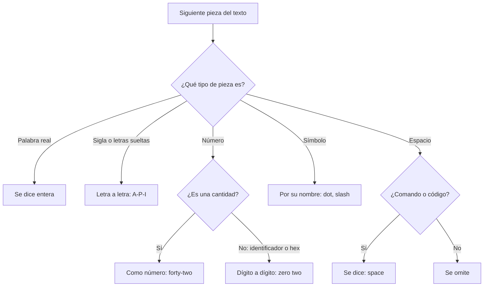
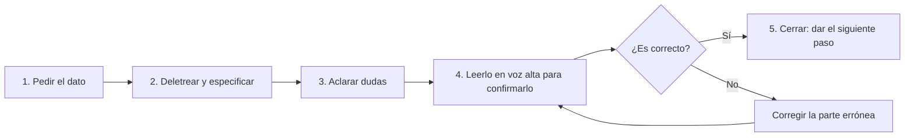

---
tags:
  - ingles
  - dam
unidad: 1
tema: Alfabeto inglés, nombres de los símbolos, deletreo técnico y expresiones para dictar y confirmar datos
---

# Unidad 1. Alfabeto, símbolos y deletreo técnico

> [!summary] Ideas clave
> - Al deletrear se pronuncia el **nombre** de cada letra, que en inglés no coincide con el español. Las más conflictivas son **A, E, I, G, J, W, Y y Z**.
> - Las mayúsculas se indican con *capital* y las letras o cifras repetidas, con *double*.
> - Cada símbolo tiene un nombre fijo; algunos cambian según el contexto (*dot* / *point*) o la variante del inglés (*brackets*, *hash*).
> - *Slash* (`/`) y *backslash* (`\`) son símbolos distintos: las URL usan el primero y las rutas de Windows, el segundo.
> - Deletrear es leer pieza a pieza: palabras completas, siglas letra a letra, números según su función y símbolos por su nombre.
> - Una conversación técnica necesita, además, expresiones para **pedir**, **aclarar**, **especificar** y **confirmar** datos.
> - El alfabeto fonético de la OTAN (*Alfa, Bravo, Charlie…*) resuelve las confusiones entre letras parecidas.
> - Leer los datos en voz alta para que el otro los confirme (*read back*) evita errores que no admiten corrección posterior.

La práctica de esta unidad está en [[01 - Alfabeto, símbolos y deletreo técnico (práctica)|Práctica de la Unidad 1]].

---

## 1. Introducción

En informática es habitual transmitir de viva voz información que no admite errores: direcciones de correo, URL, nombres de servidor, rutas de archivos, contraseñas temporales o comandos. Ocurre en una llamada de soporte, en una reunión en línea o al trabajar en pareja. Para hacerlo bien se necesitan dos competencias:

- **Competencia técnica:** conocer el nombre de las letras y de los símbolos, y las reglas de lectura (apartados 2 a 4).
- **Competencia comunicativa:** disponer de expresiones para pedir que se deletree algo, aclarar dudas, dar indicaciones y confirmar que el dato es correcto (apartado 5).

---

## 2. El alfabeto inglés

### 2.1. Nombre de las letras

> [!note] Definición: *letter name* (nombre de la letra)
> Forma en que se pronuncia una letra cuando se nombra de manera aislada, por ejemplo al deletrear. No debe confundirse con el sonido que esa letra tiene dentro de una palabra.

La pronunciación se indica de forma aproximada con la ortografía española.

| Letra | Suena | Letra | Suena | Letra | Suena |
|---|---|---|---|---|---|
| A | ei | J | yei | S | es |
| B | bi | K | kei | T | ti |
| C | si | L | el | U | iu |
| D | di | M | em | V | vi |
| E | i | N | en | W | dabliu |
| F | ef | O | ou | X | ex |
| G | yi | P | pi | Y | uai |
| H | eich | Q | kiu | Z | zed (BrE) / zi (AmE) |
| I | ai | R | ar | | |

### 2.2. Letras conflictivas

> [!warning] Letras que se confunden con el español
> - **A / E / I:** A = «ei», E = «i», I = «ai». El nombre inglés de cada una se parece al de otra letra española.
> - **G / J:** G = «yi», J = «yei».
> - **W / Y:** W = «dabliu», Y = «uai».
> - **Z:** «zed» en inglés británico y «zi» (*zee*) en inglés americano.

> [!info] Corrección del material
> La hoja de clase atribuye *zed* al inglés americano. Es al revés: *zed* es la forma británica y *zee*, la americana.

### 2.3. Mayúsculas, minúsculas y letras dobles

> [!note] Definición: *capital letter* / *upper case*
> Letra mayúscula. Al deletrear se indica con *capital* antes de la letra: «capital A».

> [!note] Definición: *small letter* / *lower case*
> Letra minúscula. Normalmente no se indica, porque es la forma por defecto.

> [!note] Definición: *double*
> Palabra que se antepone a una letra o cifra que aparece dos veces seguidas: «double S» para *ss*.

> [!note] Definición: *domain name* (nombre de dominio)
> Parte de una dirección de correo o de una web que identifica al proveedor o a la organización: *gmail.com*, *outlook.es*.

> [!tip] Cuándo indicar las mayúsculas
> Solo se mencionan cuando cambian el resultado, como en una contraseña o en una ruta que distingue entre mayúsculas y minúsculas. En las direcciones de correo no son necesarias: la mayoría se escriben en minúscula.

### 2.4. El alfabeto fonético de la OTAN

> [!note] Definición: *NATO phonetic alphabet* (alfabeto fonético de la OTAN)
> Lista de 26 palabras, una por letra, que se usa para deletrear por voz sin ambigüedad. Se creó en 1956 y hoy es el alfabeto fonético universal en comunicaciones militares, civiles y de radioaficionados.

| Letra | Palabra | Letra | Palabra | Letra | Palabra |
|---|---|---|---|---|---|
| A | Alfa | J | Juliett | S | Sierra |
| B | Bravo | K | Kilo | T | Tango |
| C | Charlie | L | Lima | U | Uniform |
| D | Delta | M | Mike | V | Victor |
| E | Echo | N | November | W | Whiskey |
| F | Foxtrot | O | Oscar | X | X-ray |
| G | Golf | P | Papa | Y | Yankee |
| H | Hotel | Q | Quebec | Z | Zulu |
| I | India | R | Romeo | | |

> [!tip] Cuándo usarlo
> No hace falta para cada letra: basta con aplicarlo a las que se pueden confundir (*B / D / P / V*, *M / N*, *S / F*). Se usa con las fórmulas **«B as in Bravo»** o **«B for Bravo»**.

---

## 3. Los símbolos

### 3.1. Nombres de los símbolos

| Categoría | Símbolo | Nombre |
|---|---|---|
| Puntuación | `.` | dot (direcciones) / point (números) |
| Puntuación | `,` | comma |
| Puntuación | `:` | colon |
| Puntuación | `;` | semi-colon |
| Puntuación | `?` | question mark |
| Puntuación | `!` | exclamation mark |
| Puntuación | `" "` | quotation marks (*quotes*) |
| Matemáticos | `+` | plus |
| Matemáticos | `-` | minus |
| Matemáticos | `x` | times / multiply |
| Matemáticos | `÷` | divided by |
| Matemáticos | `=` | equals |
| Matemáticos | `%` | percent |
| Matemáticos | `<` / `>` | less than / greater than |
| Agrupación | `( )` | parentheses (*round brackets* en BrE) |
| Agrupación | `[ ]` | square brackets |
| Agrupación | `{ }` | braces (*curly brackets*) |
| Separadores | `/` | (forward) slash |
| Separadores | `\` | backslash |
| Separadores | `-` | hyphen / dash |
| Separadores | `_` | underscore |
| Separadores | `\|` | pipe |
| Otros | `@` | at (*at sign*) |
| Otros | `&` | ampersand (*and sign*) |
| Otros | `*` | asterisk |
| Otros | `#` | hash (BrE) / hashtag / pound sign (AmE) |

### 3.2. Símbolos con varios nombres

> [!warning] Diferencias entre inglés británico y americano
> - **Brackets:** en inglés británico, *brackets* o *round brackets* son los paréntesis `( )`. En inglés americano, *brackets* son los corchetes `[ ]` y los paréntesis se llaman *parentheses*. Para evitar ambigüedades, conviene decir *parentheses*, *square brackets* y *braces*.
> - **`#`:** en inglés británico se llama *hash*; en americano, *pound sign*, porque en el Reino Unido *pound sign* es `£`.

> [!tip] *Dot* y *point*
> El punto se llama *dot* en direcciones, nombres de dominio y nombres de archivo (*app dot config*). Se llama *point* en los números decimales (*two point five*).

### 3.3. Signos que van en pareja

Los signos de apertura y cierre se nombran con **open / close** o con **left / right**:

| Escrito | Se dice |
|---|---|
| `(` `)` | open parenthesis / close parenthesis |
| `[` `]` | open bracket / close bracket |
| `{` `}` | open brace / close brace |
| `"` `"` | open quotes / close quotes |

Para indicar que un fragmento va dentro de un par de signos se usa *in*: *write it **in** square brackets*, *write it **in** parentheses*.

---

## 4. Deletreo técnico

### 4.1. Concepto

> [!note] Definición: *spelling* (deletreo)
> Acción de decir en voz alta, una por una, las letras, cifras y símbolos que forman un texto. En informática se aplica a direcciones de correo, URL, nombres de servidor, rutas, comandos y código.

### 4.2. Reglas de lectura

El texto se recorre de izquierda a derecha y cada pieza se nombra según su tipo:

1. **Palabra real** → se dice entera: *school*, *orders*, *login*.
2. **Sigla o grupo de letras sin significado** → letra a letra: *api* → A-P-I.
3. **Número que forma parte de un identificador** → dígito a dígito: *02* → zero two.
4. **Número que expresa una cantidad** → como número: *id=42* → forty-two.
5. **Código hexadecimal** → siempre dígito a dígito.
6. **Mayúscula** → solo si importa: *with a capital I*.
7. **Espacio** → solo en comandos y código, donde cambia el resultado: *space*.
8. **Símbolo** → por su nombre (apartado 3). Los símbolos combinados se leen pieza a pieza: `&&` → double ampersand.

> [!example] Aplicación de las reglas
> `srv-db-02.internal.local` → S-R-V (regla 2), hyphen (regla 8), D-B (regla 2), hyphen, zero two (regla 3), dot internal, dot local (reglas 8 y 1).

### 4.3. Letras y cifras repetidas

Dos elementos iguales seguidos se agrupan con *double*, tanto si son letras como si son cifras o símbolos: *double capital F* (`FF`), *double three* (`33`), *double dash* (`--`), *double equals* (`==`).

---

## 5. Expresiones para la conversación

Deletrear correctamente no basta: hay que saber **pedir** el dato, **aclarar** lo que no se ha entendido, **especificar** cómo se escribe y **confirmar** que es correcto. Este intercambio sigue casi siempre el mismo orden:

### 5.1. Pedir que se deletree o se repita

| Expresión | Uso |
|---|---|
| Could you spell that, please? | Pedir que se deletree |
| How do you spell that? | Igual, más directa |
| Could you say that again, please? | Pedir que se repita |
| Could you repeat that more slowly, please? | Pedir que se repita más despacio |
| I'm sorry? / Sorry, I didn't catch that. | No se ha entendido |
| I can't hear you very well. | Problema de audio |

### 5.2. Aclarar una letra, una cifra o un símbolo

| Expresión | Uso |
|---|---|
| Is that B as in Bravo? | Confirmar una letra con el alfabeto OTAN |
| Did you say M or N? | Dudar entre dos letras |
| Is that a hyphen or an underscore? | Dudar entre dos símbolos |
| Is that a forward slash or a backslash? | Igual, en rutas y URL |
| Is that with a capital…? | Preguntar por una mayúscula |
| Is that a zero or the letter O? | Dudar entre cifra y letra |
| Do you mean…? | Comprobar si se ha entendido bien |

### 5.3. Especificar al dictar

| Expresión | Significado |
|---|---|
| all one word | todo junto, en una sola palabra |
| no spaces | sin espacios |
| all in lower case | todo en minúsculas |
| all in capitals / in capital letters | todo en mayúsculas |
| with a capital X | con X mayúscula |
| B for Bravo / B as in Bravo | B de Bravo |
| then… / followed by… | después, a continuación |
| at the end | al final |

### 5.4. Confirmar y corregir

| Expresión | Uso |
|---|---|
| Let me read that back to you. | Anunciar que se va a repetir el dato para confirmarlo |
| Could you read that back to me? | Pedir al otro que lo repita |
| So that's…, right? | Comprobar el dato |
| Yes, that's right. / That's correct. | Confirmar |
| No, it's a backslash, not a forward slash. | Corregir solo la parte errónea |
| Exactly. | Confirmar de forma enfática |

> [!note] Definición: *read back*
> Leer en voz alta un mensaje o un dato a otra persona para que confirme que es correcto.

### 5.5. Dar instrucciones técnicas mientras se dicta

| Expresión | Uso |
|---|---|
| Open a terminal / a browser. | Abrir una aplicación |
| Go to… | Ir a una dirección o menú |
| Type… / Enter… | Escribir un comando o un dato |
| Press Enter. | Pulsar la tecla Intro |
| Copy and paste… | Copiar y pegar |
| The file is in the … folder. | Indicar una ubicación |
| Click on… | Hacer clic en algo |
| Is it working now? | Comprobar el resultado |

> [!tip] *Type* y *enter*
> *Type* significa teclear. *Enter* significa introducir un dato en un campo: *enter your password*. No se dice *introduce* ni *ingress* (véase la [[02 - Gramática de apoyo y errores frecuentes|Unidad 2]]).

### 5.6. Del inglés básico al inglés preciso

| ✘ Formulación pobre o incorrecta | ✔ Formulación precisa |
|---|---|
| What? / Repeat. | Sorry, could you say that again, please? |
| Write it for me. | Could you spell that for me, please? |
| The arroba | at |
| The point (en una dirección) | dot |
| Big A | capital A |
| The little line below | underscore |
| The stick | pipe |
| The line to the left | backslash |
| Put your password. | Enter your password. |
| It is ok? | Is that correct? / So that's…, right? |

---

## 6. Errores frecuentes

> [!danger] *Slash* y *backslash*
> Confundirlos cambia la ruta o la URL y la vuelve inválida. `C:\Users\Admin` se dice con *backslash*; `https://api.shopnow.com/v2` se dice con *slash*.

> [!danger] Leer un código hexadecimal como un número
> `#FF5733` no es «five thousand seven hundred thirty-three», sino «hash, double capital F, five, seven, double three».

> [!warning] Otros errores habituales
> - Pronunciar A, E e I con el nombre español de otra letra (apartado 2.2).
> - Decir *point* en una dirección o un nombre de archivo: debe ser *dot*.
> - Confundir *hyphen* (`-`) con *underscore* (`_`).
> - Decir *hashtag* en un contexto técnico británico: la forma habitual es *hash*.
> - Dar por bueno un dato sin confirmarlo: siempre se lee en voz alta (*read back*).

---

## 7. Ejemplo integrador

Un técnico de soporte indica por teléfono a una usuaria cómo acceder a los registros de un servidor.

> [!example] Llamada de soporte
> **Technician:** Could you open a terminal, please? Your username is **J, underscore, ruiz**, all in lower case.
> **User:** Sorry, is that a hyphen or an underscore?
> **Technician:** An underscore. The server is **S-R-V, hyphen, web, hyphen, zero one, dot lab, dot local**.
> **User:** Let me read that back to you: S-R-V, hyphen, web, hyphen, zero one, dot lab, dot local.
> **Technician:** That's correct. The logs are in **slash, var, slash, log, slash**. Type that and press Enter.
> **User:** Done. I can see the files now.
> **Technician:** Great. Is it working now?

En un solo intercambio se combinan el nombre de las letras y de los símbolos, la lectura de números dígito a dígito, la especificación (*all in lower case*), la aclaración, la confirmación (*read back*) y las instrucciones técnicas.

---

## Bibliografía

- [Unit 1: Email addresses](https://learnenglish.britishcouncil.org/free-resources/business/english-emails/unit-1-email-addresses) (British Council, LearnEnglish)
- [Checking understanding](https://learnenglish.britishcouncil.org/free-resources/speaking/a1/checking-understanding) (British Council, LearnEnglish)
- [NATO phonetic alphabet](https://nato.int/en/about-us/nato-history/history-by-theme/symbols-of-nato/nato-phonetic-alphabet) (OTAN, página oficial)
- [bracket](https://www.oxfordlearnersdictionaries.com/definition/english/bracket) (Oxford Learner's Dictionaries)
- [pound sign](https://www.oxfordlearnersdictionaries.com/definition/english/pound-sign) (Oxford Learner's Dictionaries)
- [read back](https://www.oxfordlearnersdictionaries.com/definition/english/read-back) (Oxford Learner's Dictionaries)
- [zed](https://www.merriam-webster.com/dictionary/zed) (Merriam-Webster Dictionary)
