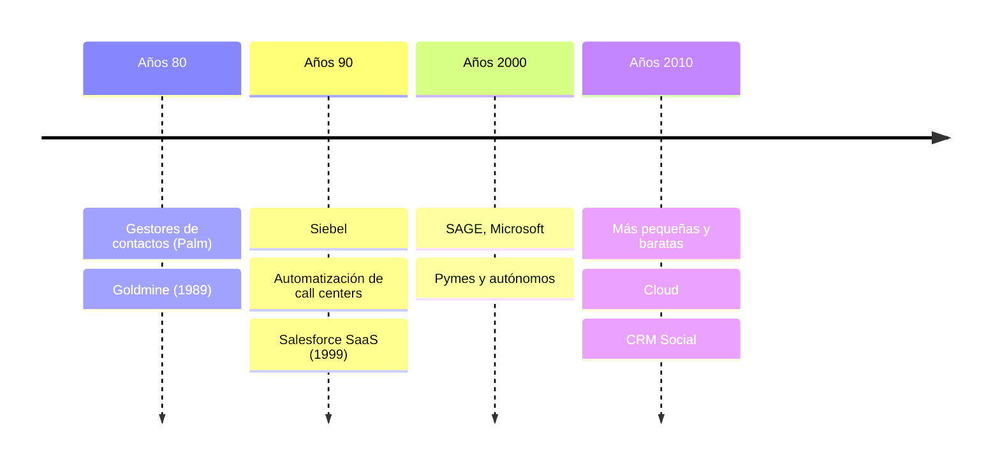
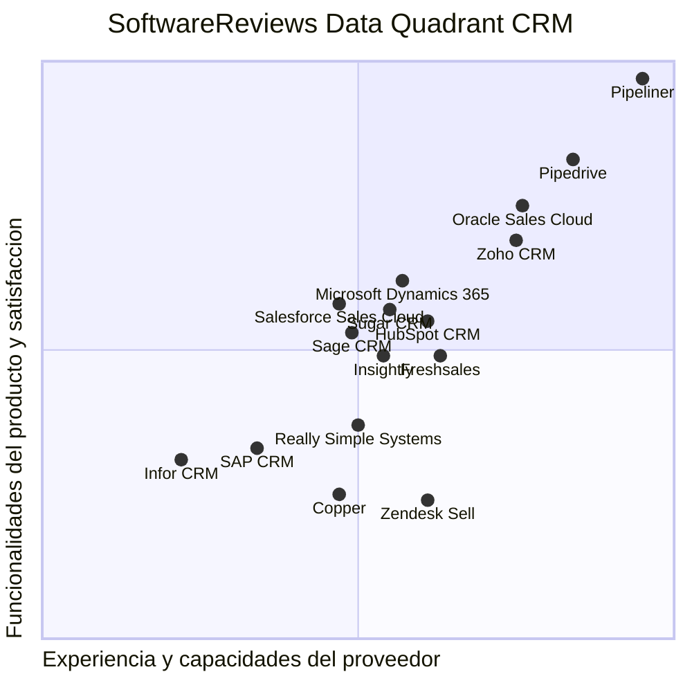
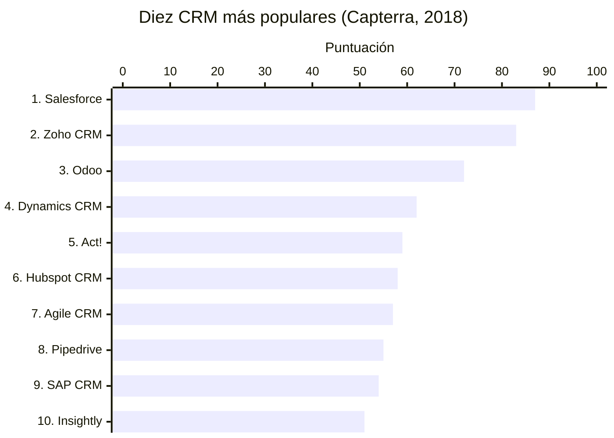

---

tags:

- sistemas-gestion-empresarial
- DAM2 unidad: 4 tema: La fidelización de clientes, concepto, funcionalidades y fabricantes de CRM

---

# Unidad 4. La fidelización de clientes. Concepto de CRM

> [!summary] Ideas clave
> 
> - Conseguir clientes y, sobre todo, mantenerlos es un objetivo fundamental de la gestión empresarial.
> - Mantener un cliente a lo largo de su vida útil es siempre mucho menos costoso que conseguir nuevos.
> - La vital importancia de conseguir clientes y, sobre todo, de mantenerlos explica la aparición de los sistemas de gestión de las relaciones con clientes (CRM).
> - Un CRM es una herramienta de seguimiento, de comunicación y de análisis.
> - Hay una solución para cada negocio, independientemente del tamaño y de su actividad; solo hay que encontrar la que asegura el retorno de la inversión (ROI) apropiado.
> - La diferenciación entre soluciones _Open Source_, semigratuitas y comerciales se ha ido reduciendo en los últimos años.
> - Con un CRM se vende más y mejor.

> [!info] Alcance de la unidad Esta unidad desarrolla el apartado 1.5 del capítulo. La definición de ROI está en el glosario de la [[01 - La gestión empresarial#Glosario|Unidad 1]], y la aparición del CRM en los años 2000, en la [[03 - Un poco de historia|Unidad 3]].

---

## 1.5. La fidelización de clientes. Concepto de CRM

Conseguir clientes y, lo que a la postre se convierte en más importante, mantenerlos es un objetivo fundamental de la gestión empresarial.

> [!note] Definición: Fidelizar Conseguir una venta recurrente en el tiempo, es decir, aplicar estrategias para que el cliente se convierta en habitual.

> [!important] Importancia de la fidelización La importancia de la fidelización estriba en que mantener un cliente a lo largo de su vida útil es siempre mucho menos costoso que conseguir nuevos.

Pero los clientes se han vuelto más exigentes y la oferta se ha globalizado, por lo que es importante conocer sus necesidades y aspirar a satisfacerlas incluso antes de que el cliente sepa de su necesidad.

Por eso, las empresas han evolucionado hacia un planteamiento basado en el cliente y no en el producto, que era el enfoque habitual del siglo pasado.

La visión del comercial con su cartera de clientes y libretas de pedido y, todo lo más, una hoja de cálculo en el caso más informatizado, ha dado paso a otra visión más moderna, englobada en la denominada _automatización de la fuerza de venta_. Esta se basa en la utilización de sistemas apoyados en la movilidad y en el acceso desde cualquier dispositivo, que gestionan todo tipo de interacciones con el cliente con el objetivo de mejorar las relaciones comerciales con él.

> [!note] Definición: Sistema de gestión de las relaciones con el cliente (CRM, _Customer Relationship Management_) _Software_ colaborativo basado en la orientación al cliente que registra toda su información de contacto, pero también, y lo que es más importante, almacena las transacciones de todo tipo mantenidas con él, de tal manera que proporciona una visión global de un ecosistema al que pertenecen los productos, los servicios, los clientes actuales y potenciales y los recursos de la empresa.

Los CRM engloban y centralizan las bases de datos de las interacciones que se tienen con los clientes. Esta centralización de información, accesible en mayor o menor medida por el personal de la empresa en función de sus privilegios, proporciona un conocimiento profundo del cliente y permite establecer fácilmente y de forma personalizada las estrategias comerciales, de _marketing_ y de servicio al cliente que proporcionarán, en definitiva, su fidelización.

Puede decirse que son la evolución inteligente de las hojas de cálculo que gerentes, comerciales y muchos profesionales en general suelen utilizar al comenzar su actividad.

> [!info] Figura 1.4. Pantalla de GoldMine, uno de los primeros CRM La figura muestra la ficha de un contacto en GoldMine (interfaz en inglés), con sus datos de contacto y empresa, las actividades pendientes y el histórico de interacciones.

### 1.5.1. Funcionalidades de un CRM

Un CRM es una herramienta de implementación, normalmente sencilla, dirigida en especial a los departamentos comerciales y de _marketing_ de las empresas, aunque no únicamente a ellos, que maneja:

- la gestión de datos de clientes;
- las oportunidades de venta;
- los presupuestos;
- los ingresos por ventas;
- las campañas publicitarias y de _marketing_.

Las principales funcionalidades de un CRM, sin pretender ser exhaustivos, son las siguientes:

- Recopila y organiza toda la información de contacto de los clientes.
- Permite múltiples clasificaciones de estos: actuales y potenciales y, dentro de cada categoría, clasificaciones por cualquier aspecto (localización, tamaño, sector, etc.).
- Gestiona oportunidades de venta desde el inicio.
- Dispone de plantillas personalizables de _mail_ y de casi cualquier tipo de documento relacionado con el proceso de venta, como presupuestos u órdenes de compra.
- Realiza el seguimiento de las operaciones y del personal de ventas involucrado.
- Dispone de calendario y sistema de avisos para los usuarios.
- Calcula previsiones, obtiene estadísticas y elabora informes.
- Permite personalizar el trato en el servicio de atención al cliente.
- Automatiza el _marketing_.

**Figura 1.5. Evolución del _software_ de CRM.**

> [!important] Las tres facetas del CRM Un CRM es una herramienta de seguimiento, de comunicación y de análisis.

**Seguimiento.** Un CRM permite hacer un seguimiento automatizado de las oportunidades de venta desde la fase de obtención de datos, proporcionando normalmente:

- sistemas de captura automatizada desde ficheros de estructura simple, como «.csv»;
- campos especiales, como fechas de contacto o de marcado de hitos;
- campos para notas amplias;
- histórico de operaciones y comunicaciones;
- recordatorios y avisos;
- archivos adjuntados en las comunicaciones.

**Comunicación.** Usándolo como herramienta básica de comunicación, permite controlar las «conversaciones» en el tiempo, disponer de plantillas de respuesta o de primer contacto tipo y utilizarlo en muchos casos como plataforma de _e-mailing_.

**Análisis.** Y, por supuesto, proporciona información analítica mediante estadísticas e informes por cliente, por tipo de propuesta, por estimación de ventas, etc.

> [!tip] Recuerda Estudiar la tasa de retención de clientes, la cantidad de nuevos clientes referenciados por clientes actuales, la evolución del gasto de cada cliente y el factor de reiteración de las compras, entre otras cosas, permitirá ponderar los beneficios que se están obteniendo después de implementar un CRM, lo que proporcionará el ROI de su implementación.

### 1.5.2. ¿Solo para grandes empresas?

Independientemente de su tamaño y del número de clientes que tenga una empresa, esta debe preocuparse de gestionar sus relaciones con ellos de la mejor forma.

Los gestores actuales ya no tienen la idea preconcebida, vigente hasta hace relativamente poco tiempo, de que los CRM son herramientas complicadas y costosas y que, por tanto, solo las grandes empresas podrían sacarles partido.

Existe en el mercado actual una gran variedad de sistemas CRM para todo tipo de empresas. Un CRM no solo proporciona valor añadido a organizaciones grandes, sino que las pymes y los autónomos también pueden beneficiarse de la automatización de la gestión con sus clientes.

> [!important] Una solución para cada negocio Hay una solución para cada negocio, y lo importante es saber calcular el retorno de la inversión (ROI) para encontrar la apropiada al tamaño y a la actividad de la empresa.

Existen incluso soluciones monousuario.

> [!info] Figura 1.6. Captura de pantalla de ACT!, otro CRM con historia La figura muestra la vista de contactos de ACT! (interfaz en inglés), con el listado de contactos, la ficha personal de uno de ellos y sus datos de contacto.

### 1.5.3. Principales fabricantes

La diferenciación entre soluciones _Open Source_, semigratuitas y comerciales se ha ido reduciendo en los últimos años. Varias de las aplicaciones que en sus inicios tuvieron licencia _Open Source_ han evolucionado:

- hacia una oferta mixta, con versiones sin coste hasta un cierto número de usuarios o que incluyen un número limitado de funcionalidades;
- o, algunas, como OpenBravo, directamente se han convertido en versiones totalmente comerciales.

Las grandes compañías fabricantes de _software_ empresarial, como Microsoft, Oracle, Salesforce o SAP, proporcionan soluciones CRM de forma independiente o como parte integrante de sistemas ERP, sobre los que se trabajará en el próximo capítulo.

De entre las que siguen siendo _Open Source_, aunque la comunidad que las desarrolló puede haber abandonado el mantenimiento y encontrarse en la actualidad bajo el control de empresas que además proporcionan servicios con coste, se pueden mencionar las siguientes:

- SuiteCRM;
- vTiger CRM;
- OroCRM;
- Zurmo.

En la figura 1.7 se muestra un cuadrante de aplicaciones CRM de implantación en el mercado europeo y español. No obstante, se realizará un estudio semejante en el próximo capítulo, cuando se estudien los ERP, pues sus resultados son totalmente aplicables a los CRM.

**Figura 1.7. Cuadrante Mágico CRM. Fuente: SoftwareReviews.**

> [!info] Lectura del diagrama Las posiciones de los productos son aproximadas, medidas sobre la imagen del libro. El eje vertical representa las funcionalidades del producto y la satisfacción (_product features and satisfaction_), y el horizontal, la experiencia y las capacidades del proveedor (_vendor experience and capabilities_).

> [!warning] Posible incoherencia en el material: nombre de la figura El pie de la figura 1.7 la denomina «Cuadrante Mágico», que es el nombre del informe de Gartner (_Magic Quadrant_). La imagen corresponde al _Data Quadrant_ de SoftwareReviews, que es la fuente citada. Se conserva el pie original.

> [!info] Recurso web: información sobre _software_ empresarial
> 
> - SoftwareReviews: https://www.softwarereviews.com
> - Capterra: http://www.capterra.com
> - Technology Evaluation Centers (TEC): https://www3.technologyevaluation.com

La variedad de soluciones es considerable. Sería imposible relacionar los innumerables fabricantes que ofrecen soluciones CRM.

Capterra es una compañía que forma parte de Gartner y que, situada en una posición intermedia entre compradores y proveedores, proporciona una de las mayores fuentes de información y de opiniones verificadas sobre _software_.

Según un informe elaborado por esta empresa en 2018, que recoge, entre otros, datos relativos a clientes y usuarios, las diez marcas más populares son las de la figura 1.8.

**Figura 1.8. Resumen del informe de Capterra.**

> [!info] Datos de la figura Las puntuaciones son las que aparecen junto a cada marca en la figura. Las cifras de detalle de cada marca (clientes, usuarios, reseñas, «me gusta» y seguidores) no son legibles en la imagen del libro y no se reproducen.

---

## Bibliografía

- _Sistemas de gestión empresarial_, capítulo 1, «Introducción a los sistemas de gestión empresarial», apartado 1.5 y figuras 1.4 a 1.8, págs. 24–29 (libro de texto de la asignatura).