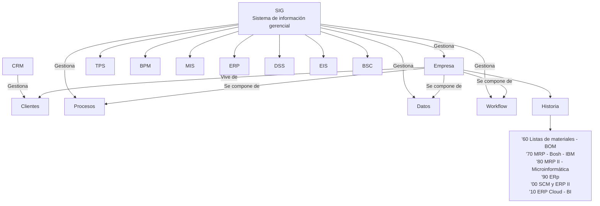

---

tags:

- sistemas-gestion-empresarial
- DAM2 unidad: 1 tema: La gestión empresarial, el objetivo de la empresa y sus procesos, datos y flujo de trabajo

---

# Unidad 1. La gestión empresarial

> [!summary] Ideas clave
> 
> - Un programador debe conocer los conceptos básicos de la actividad empresarial que le permitan participar en el desarrollo de sistemas de gestión empresarial, una de las actividades más demandadas en el mercado laboral actual.
> - La finalidad de la gestión empresarial es conseguir que la empresa sea viable mediante una correcta planificación y un control de los aspectos productivos, comerciales, financieros, logísticos, etc., del negocio.
> - La gestión empresarial es el conjunto de acciones y estrategias que persigue el objetivo de mejorar el funcionamiento general de una empresa.
> - Los beneficios son la razón de existencia de la empresa.
> - Los beneficios se consiguen maximizando ventas, minimizando costes, eliminando tareas innecesarias, agilizando los procesos cotidianos, automatizando tareas, optimizando recursos y, en definitiva, controlando con detalle todos los aspectos de la empresa.
> - Las empresas deben ser competitivas, sostenibles y con un alto nivel de cumplimiento.
> - Los procesos de negocio son conjuntos de tareas relacionadas y ordenadas que proporcionan un producto o servicio, interno o externo; en su nivel elemental reciben el nombre de transacciones.
> - Los tres pilares sobre los que se construye una gestión eficiente de la empresa son los procesos de negocio, los datos y el flujo de la información.

> [!info] Alcance de la unidad Esta unidad recoge, en el orden del libro, los objetivos, el mapa conceptual y el glosario del capítulo, y los apartados 1.1 y 1.2. Los apartados 1.3, 1.4 y 1.5 se desarrollan en la [[02 - Sistemas de información de gestión|Unidad 2]], la [[03 - Un poco de historia|Unidad 3]] y la [[04 - La fidelización de clientes, concepto de CRM|Unidad 4]].

---

## Objetivos

- Entender la función de la empresa en la sociedad actual y la problemática asociada a su gestión.
- Conocer el concepto de sistema de información y las distintas herramientas informáticas que ayudan a la gestión empresarial.
- Establecer el concepto de MIS (_Management Information System_) [SIG o sistemas de información de gestión o gerencial, en español].
- Estudiar la evolución que los sistemas de información de gestión han experimentado desde los años sesenta del siglo pasado.
- Entender la importancia de la gestión de clientes.
- Reconocer las principales soluciones CRM, tanto comerciales como _Open Source_ (de código abierto).

---

## Mapa conceptual

> [!warning] Posible error en el material En el recuadro «Historia» del mapa conceptual aparece «Bosh» en lugar de _Bosch_ (la empresa alemana que se cita en el apartado 1.4) y «ERp» en lugar de _ERP_. Se conserva el texto original en el diagrama.

---

## Glosario

> [!note] Definición: Acrónimo Conjunto de siglas o partes ordenadas de varias palabras que se lee y pronuncia como una palabra.

> [!warning] Posible incoherencia en el material Según esta definición, un acrónimo se pronuncia como una palabra. Sin embargo, a lo largo del capítulo se denominan también acrónimos siglas que se deletrean, como ERP o CRM. Se conserva la definición original.

> [!note] Definición: Cumplimiento (_compliance_) Procedimientos que garantizan la observancia de la normativa interna, así como de la legislación actual y los códigos éticos, por parte de directivos, empleados y demás actores relacionados con una empresa.

> [!note] Definición: _DataMining_ (minería de datos) Conjunto de técnicas y tecnologías orientadas a buscar patrones no evidentes, tendencias y reglas que expliquen el comportamiento de los datos en un contexto determinado en grandes bases de datos.

> [!note] Definición: _DataWarehouse_ (almacén de datos) Almacén de datos que se caracteriza por contener también los metadatos sobre los propios datos: procedencia, periodicidad de refresco, fiabilidad y cálculos realizados para su obtención.

> [!note] Definición: Flujo de trabajo (_workflow_) Automatización regulada de los procesos de la empresa para que la información y las tareas circulen entre los distintos departamentos siguiendo un cierto orden.

> [!note] Definición: KPI (_Key Performance Indicator_) Indicadores clave de desempeño. Indicadores que permiten medir magnitudes de interés.

> [!note] Definición: OLAP (_On-Line Analytics Processing_) Bases de datos multidimensionales orientadas al procesamiento analítico.

> [!warning] Posible error en el material El material desarrolla la sigla como _On-Line Analytics Processing_. La forma habitual es _On-Line Analytical Processing_. Se conserva la forma original.

> [!note] Definición: ROI (_Return On Investment_) Retorno de la inversión. Cálculo del tiempo que se necesita para recuperar lo invertido en un sistema con los beneficios generados por él.

> [!warning] Posible error en el material La definición del material corresponde al plazo de recuperación de la inversión (_payback_). El ROI suele definirse como la relación entre el beneficio obtenido y la inversión realizada. Se conserva la definición original.

> [!note] Definición: Sistemas de información Conjunto de datos convertidos en información mediante procesos y mecanismos automatizados e interrelacionados.

> [!note] Definición: Sostenibilidad Búsqueda del equilibrio entre el crecimiento económico y el cuidado del medio ambiente. Cualidad de satisfacer necesidades actuales sin comprometer a generaciones futuras.

> [!note] Definición: Tecnologías de información y comunicación (TIC) Conjunto de herramientas _hardware_ y _software_ utilizadas para el almacenamiento, tratamiento y transmisión de la información.

> [!note] Definición: Transacción Todo aquello que modifica o genera datos de un sistema de información.

---

## 1.1. Introducción

A lo largo de la vida profesional de un programador, es altamente probable que participe en proyectos relacionados con los sistemas de información-gestión empresarial, ya sea como desarrollador, como soporte técnico o como usuario.

Por eso, es necesario:

- entender la función de la empresa en la sociedad actual y la problemática asociada a su gestión;
- familiarizarse con los sistemas de información y con las distintas herramientas informáticas que ayudan a la gestión empresarial, aplicando las tecnologías de la información y las comunicaciones (TIC) para el tratamiento y la manipulación de la ingente información que se maneja;
- conocer la evolución que han experimentado estos sistemas desde los años sesenta del siglo pasado.

La vital importancia de conseguir clientes y, sobre todo, de mantenerlos explica la aparición de los sistemas de gestión de las relaciones con clientes, más conocidos por sus siglas en inglés, CRM (_Customer Relationship Management_), que ayudan en el día a día de la fuerza comercial de cualquier empresa o negocio.

> [!info] Alcance Los sistemas de información se estudian en la [[02 - Sistemas de información de gestión|Unidad 2]]; su evolución, en la [[03 - Un poco de historia|Unidad 3]], y los CRM, en la [[04 - La fidelización de clientes, concepto de CRM|Unidad 4]].

> [!important] Toma nota La finalidad de la gestión empresarial es conseguir que la empresa sea viable mediante una correcta planificación y un control de los aspectos productivos, comerciales, financieros, logísticos, etc., del negocio.

---

## 1.2. La gestión empresarial

> [!note] Definición: Gestión empresarial Conjunto de acciones y estrategias que persigue el objetivo de _mejorar el funcionamiento general de una empresa_.

Mediante ellas, el personal responsable procura conseguir:

- el necesario aumento de la productividad;
- la mejora de la competitividad;
- el crecimiento de la rentabilidad de la empresa.

### 1.2.1. Objetivo de la empresa

Con sus recursos humanos, materiales y financieros, la empresa genera los productos y servicios que, debidamente comercializados, producen los _beneficios_, que son la razón de su existencia.

Estos beneficios se obtienen mejorando distintos aspectos de la actividad empresarial. Generalmente, se consiguen:

- maximizando ventas;
- minimizando costes;
- eliminando tareas innecesarias;
- agilizando los procesos cotidianos;
- automatizando tareas;
- optimizando recursos.

Y, en definitiva:

- controlando de manera minuciosa todos los detalles de la empresa.

> [!important] Acción combinada La mejor forma de incrementar los beneficios de una empresa es mediante una acción combinada sobre todos los aspectos anteriormente relacionados.

En la actualidad, las empresas no solo deben ser _competitivas_, sino que además deben preocuparse por ser cada vez más _sostenibles_ y conseguir un mayor nivel de cumplimiento normativo (_compliance_).

Por otra parte, es sobradamente sabido que la _eficiencia_ y la _efectividad_ influyen en el diferencial de beneficio.

Por todo ello, en la práctica, hacer crecer los beneficios se convierte en una tarea ardua, que entraña dificultades que dependen de distintos factores.

### 1.2.2. Procesos de negocio, datos y flujo de trabajo

La actividad de una empresa está basada en los llamados _procesos de negocio_.

> [!note] Definición: Proceso de negocio Conjunto de tareas relacionadas y ordenadas que proporcionan un producto o servicio, ya sea interno (para otro departamento de la propia empresa) o externo (para el cliente final).

A menudo, los procesos son _secuenciales_, de tal manera que la salida obtenida de un proceso es el inicio de otro proceso.

Los procesos empresariales pueden descomponerse en otros procesos de menor entidad hasta llegar al nivel que se considere elemental, momento en el que reciben el nombre de _transacciones_.

Por otra parte, los _datos_ que se manejan en el desempeño diario de la actividad principal de una empresa son de un volumen considerable. A lo largo de su existencia, las empresas van acumulando datos obtenidos por los distintos departamentos que las componen:

- los proporcionados por las distintas máquinas empleadas en los procesos de fabricación, si los hubiere;
- los detalles de las transacciones que se realizan en el día a día;
- los datos de contacto con el exterior;
- el histórico de las relaciones con proveedores y clientes;
- la relación de recursos materiales y humanos internos;
- el control del almacén;
- los datos económicos;
- la publicidad y el _marketing_;
- la presencia en la web y en las redes sociales, etc.

Estos datos se pueden y se deben convertir en información vital.

> [!important] Aspectos primordiales El manejo de estos datos y, sobre todo, su tratamiento para la extracción de información relevante, así como la relación entre los distintos departamentos y el intercambio de informaciones entre ellos de forma ordenada y eficiente (flujo del trabajo), son aspectos primordiales para mejorar el funcionamiento de la empresa e incrementar así el beneficio.

---

## Bibliografía

- _Sistemas de gestión empresarial_, capítulo 1, «Introducción a los sistemas de gestión empresarial»: objetivos, mapa conceptual, glosario y apartados 1.1 y 1.2, págs. 13–17 (libro de texto de la asignatura).