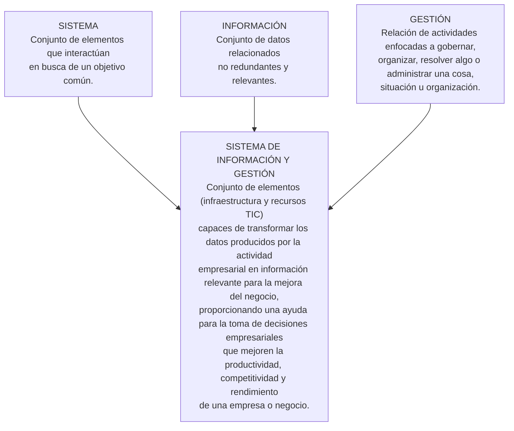
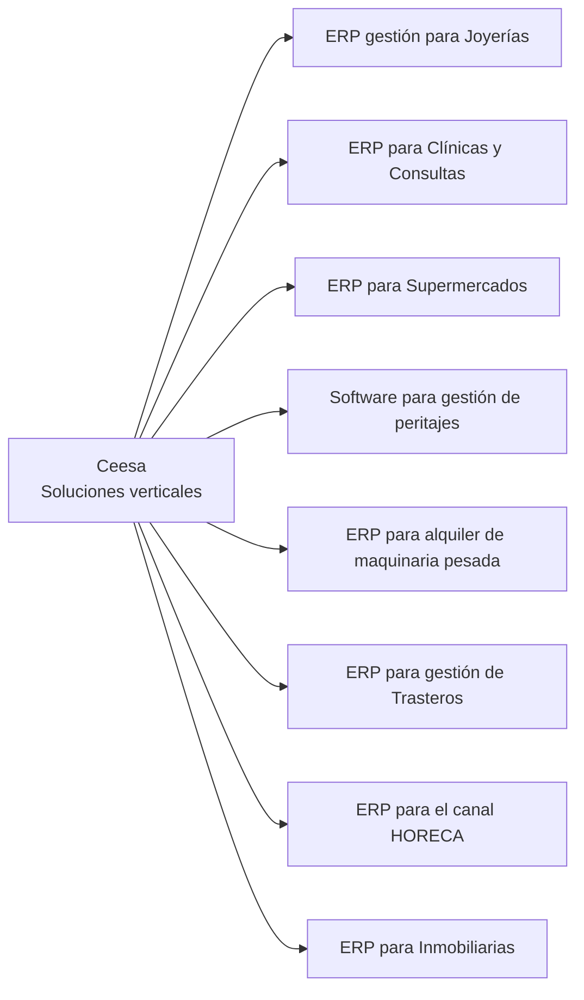

---

tags:

- sistemas-gestion-empresarial
- DAM2 unidad: 2 tema: Sistemas de información de gestión, acrónimos, clasificación y mercados verticales

---

# Unidad 2. Sistemas de información de gestión

> [!summary] Ideas clave
> 
> - Las TIC han proporcionado herramientas cada vez más sofisticadas para la gestión empresarial.
> - Un sistema de información no es solo el conjunto de recursos tecnológicos que lo soporta, sino también la organización de esos recursos y los métodos de obtención de la información necesaria.
> - Un sistema de información empresarial (SIE) o sistema de información gerencial (SIG) es un conjunto de aplicaciones que proporcionan una gestión automatizada del negocio en sentido amplio.
> - Los sistemas de gestión empresarial, en sus numerosas variedades, han contribuido al éxito de los negocios.
> - Existe infinidad de acrónimos relacionados con herramientas de gestión empresarial.
> - Aunque a veces se solapan algunos, los sistemas de información pueden categorizarse en TPS, BPM, MIS, ERP, DSS, EIS y cuadro de mando integral (BSC).
> - Se llaman «soluciones verticales» a las específicamente desarrolladas para un tipo de negocio o mercado en particular.

> [!info] Alcance de la unidad Esta unidad desarrolla el apartado 1.3 del capítulo. Los términos _DataMining_, _DataWarehouse_, KPI, OLAP y sistemas de información están definidos en el glosario de la [[01 - La gestión empresarial#Glosario|Unidad 1]].

---

## 1.3. Sistemas de información de gestión

Una gran variedad de sistemas de información, como la mensajería, los sistemas bancarios, la venta en línea, las bibliotecas de recursos académicos o los sistemas de concertación de citas, son utilizados a diario, de forma casi inconsciente, por un considerable y creciente número de usuarios cada vez más inmersos en el mundo digital.

Como en tantos otros ámbitos, la utilización de las TIC y, en particular, el desarrollo de soluciones tecnológicas:

- para la revisión de los procesos;
- para el control del flujo de trabajo (_workflow_);
- y, sobre todo, para el tratamiento centralizado de todos los datos generados por los distintos departamentos,

ha supuesto un paso fundamental en la gestión de negocios: ha significado la aparición de los _sistemas de información de gestión empresarial_, conjunto de herramientas muy útiles sin las que hoy día sería imposible sobrevivir como negocio.

Se trata de sistemas de información orientados a resolver problemas empresariales.

Suponen la aplicación de soluciones basadas en las TIC a los requerimientos específicos de los negocios. Es decir, están enfocados al negocio y, por tanto, se dicen _empresariales_ o _gerenciales_, y sustentan el gobierno de las organizaciones y empresas.

> [!important] Ten en cuenta Un sistema de información no es solo el conjunto de recursos tecnológicos que lo soporta, sino también la organización de esos recursos y los métodos de obtención de la información necesaria para el correcto funcionamiento del sistema.

> [!note] Definición: Sistema de información empresarial (SIE) o sistema de información gerencial (SIG) Conjunto de aplicaciones que acometen las necesidades de tratamiento simultáneo de la información necesaria para el funcionamiento de la empresa por parte de un grupo de usuarios, y que proporcionan así una gestión automatizada del negocio en sentido amplio.

No se trata solo de aprovechar las aplicaciones de escritorio y de productividad personal, como procesadores de texto, hojas de cálculo y bases de datos más o menos compartidas, sino de desarrollar plataformas de uso simultáneo y común que incluyan los módulos específicos que sostienen todos los aspectos de las necesidades de administración de una empresa.

**Figura 1.1. Definición de SIG como composición de conceptos.**

### 1.3.1. La sopa de letras: MIS, SIG, SIE…

El sector tecnológico utiliza su propia jerga y, intentando simplificar, abusa con frecuencia de la utilización de abreviaturas y acrónimos.

Al intentar entender el entorno, es fácil encontrarse con una primera dificultad: la abrumadora existencia de acrónimos, normalmente en inglés, con su consiguiente adaptación o traducción directa al español, de conceptos que tienen que ver con alguna fase de los procesos empresariales.

> [!tip] Recomendación Es recomendable entender bien lo que el autor consultado expresa con esas siglas, que utilizará a lo largo de su escrito.

A veces se utilizan las siglas MIS (_Management Information System_) para referirse, en general, a estos sistemas de información relacionados con la administración de empresas.

Académicamente, se puede convenir que engloban las distintas herramientas informáticas enfocadas a proporcionar, mediante el tratamiento de datos generados en una actividad empresarial, todo tipo de procesos automatizados, informes, controles, sistemas de aviso, análisis de resultados, etc., de los distintos estamentos de una empresa.

> [!warning] Definiciones y herramientas comerciales En la práctica, las herramientas comercializadas no se corresponden estrictamente con las definiciones, y a veces los departamentos de _marketing_ de los desarrolladores de _software_ empresarial las utilizan en sentido laxo.

> [!note] Definición: MIS (_Management Information System_) Sistemas de información que se alimentan de los datos proporcionados por los distintos procesos propios de la actividad de la empresa, los procesan mediante diversos tratamientos y elaboran información «cocinada», como estadísticas, informes, gráficos, simulaciones, tendencias, etc., que reflejan el funcionamiento corporativo de la organización.

> [!important] Toma nota: Acrónimos En la actualidad es posible encontrar distintos tipos de sistemas de información aplicados a la gestión empresarial en alguno de sus procedimientos, tales como los de la tabla siguiente.

|Sigla|Denominación en inglés|Traducción|
|---|---|---|
|TPS|_Transaction Processing System_|Sistema de procesamiento de transacciones|
|OAS|_Office Automation System_|Sistema de automatización de oficinas|
|MRP|_Material Requirements Planning_|Planificación de los requisitos de material|
|MRPII|_Manufacture Resource Planning_|Planificación de los recursos de fabricación|
|PLM|_Product Lifecycle Management_|Gestión del ciclo de vida de productos|
|SCM|_Supply Chain Management_|Gestión de la cadena de suministro|
|SRM|_Supplier Relationship Management_|Gestión de la relación con proveedores|
|MIS|_Management Information System_|Sistema de información de gestión (SIG)|
|BPM|_Business Process Management_|Administración de procesos de negocio|
|ERP|_Enterprise Resource Planning_|Planificación de recursos empresariales|
|CRM|_Customer Relationship Management_|Gestión de la relación con los clientes|
|POS|_Point Of Sale_|Terminal punto de venta (TPV)|
|CMS|_Content Management System_|Sistema de gestión de contenidos|
|DMS|_Document Management System_|Sistema de gestión documental|
|KMS|_Knowledge Management System_|Sistema de gestión del conocimiento|
|BI|_Business Intelligence_|Inteligencia de negocio|
|DSS|_Decision Support System_|Sistema de apoyo a la toma de decisiones|
|EIS|_Executive Information System_|Sistema de información ejecutiva|
|BSC|_Balanced Score Card_|Cuadro de mando integral|
|GIS|_Geographical Information System_|Sistema de información geográfica|
|Blog|_Weblog_|Bitácora|

> [!warning] Posible error en el material: MRPII La tabla desarrolla MRPII como _Manufacture Resource Planning_, pero el apartado 1.4 del propio libro usa _Manufacturing Resource Planning_, que es la forma habitual. Se conserva la forma original en la tabla.

> [!warning] Posible error en el material: BSC La tabla escribe _Balanced Score Card_, mientras que el apartado 1.3.2 del propio libro usa _Balanced Scorecard_, que es la forma habitual. Se conserva la forma original en la tabla.

En castellano, se habla de sistemas de información gerencial (SIG) o incluso de sistemas de inteligencia empresarial (SIE). Quizá los matices que los diferencian serían objeto de un estudio más avanzado.

> [!warning] Posible incoherencia en el material: SIE Al comienzo del apartado 1.3, SIE se desarrolla como «sistema de información empresarial», y aquí como «sistemas de inteligencia empresarial». Se conservan ambas formas.

### 1.3.2. Una clasificación de los sistemas de gestión empresarial

Es fácil encontrar diferentes clasificaciones de los sistemas de información empresarial. Para verlo en perspectiva respecto a las áreas que cubren, se podría considerar la siguiente clasificación general de los sistemas de información empresarial más destacados, empezando desde su nivel inferior.

#### A) Sistemas de procesamiento de transacciones (TPS)

Son el nivel operacional más bajo. Soportan la rutina diaria del negocio (transacciones comerciales, económicas, existencias, etc.), pero son muy importantes desde el punto de vista de la consistencia y la integridad de estas. Constituyen la base que utilizarán los sistemas de capa superior.

#### B) Sistemas de gestión por procesos de negocio (BPM)

Gestionan los _procesos_ de la organización, es decir, las acciones que deben realizar personas y máquinas de forma ordenada para lograr un determinado objetivo y, en particular, los procesos físicos de producción, generalmente mediante la monitorización de sensores electrónicos.

#### C) Sistemas de información de gestión (MIS)

Como ya se ha comentado, recogen información de diferentes fuentes internas y la procesan para proporcionar informes, estadísticas y proyecciones a futuro que ayuden a la gerencia a tener una visión fidedigna de la situación de una parte de la empresa.

#### D) Sistemas de colaboración empresarial (ERP)

Es un MIS integrado. Son sistemas _integrales_ de información que, en una única base de datos, recogen, procesan y analizan datos de todos los estamentos de la organización empresarial. Proporcionan así información relevante sobre procesos de producción, ventas, logística, recursos humanos, gestión de proyectos, contabilidad y finanzas de la empresa, con el fin de mejorar la gestión empresarial.

Son utilizados por una amplia gama de usuarios que tienen acceso autorizado a la información en función del trabajo que desempeñan.

> [!warning] Posible incoherencia en el material: denominación del ERP Este apartado titula los ERP como «sistemas de colaboración empresarial», mientras que la tabla de acrónimos traduce ERP (_Enterprise Resource Planning_) como «planificación de recursos empresariales». Se conservan ambas denominaciones.

#### E) Sistemas de apoyo a la toma de decisiones (DSS)

Son sistemas interactivos basados en la combinación de los datos para su análisis, que proporcionan un paso más: información organizacional y funciones de _simulación y modelado_ que podrá utilizar el responsable para seleccionar la mejor opción entre varios escenarios.

Es un tipo especial de inteligencia de negocio (BI) que almacena información interna y que, mediante OLAP, _DataWarehouse_ y _DataMining_, facilita la toma de decisiones mediante simulaciones, análisis estadísticos y estudios de tendencia.

> [!example] Ejemplos de decisiones apoyadas por un DSS Gestión de tráfico, aprobación de créditos y diagnósticos médicos.

#### F) Sistemas de información ejecutiva (EIS)

Proporcionan, generalmente en formato gráfico e intuitivo, acceso con distintos niveles de detalle a la información interna y también a la proporcionada por _fuentes externas_. Ayudan en la _toma de decisiones estratégicas_ que afectan a toda la organización mediante la elaboración de informes, consultas y listados de las distintas áreas de la empresa de forma consolidada.

#### G) Cuadro de mando integral (BSC)

El BSC, _Balanced Scorecard_ o _Dashboard_ (cuadro de mando), es la herramienta de control que monitoriza el grado de consecución de los objetivos de los distintos departamentos o áreas de negocio de una empresa.

Lo hace mediante el establecimiento de _indicadores_, conocidos como KPI (_Key Performance Indicators_), organizados normalmente en cuatro tipos:

- financiero;
- conocimiento del cliente;
- procesos internos;
- aprendizaje y crecimiento.

Están más orientados a la monitorización de indicadores que al análisis meticuloso de la información.

> [!warning] Posible incoherencia en el material: BSC y _dashboard_ El material equipara _Balanced Scorecard_ y _Dashboard_, pero su propia traducción los distingue: «cuadro de mando integral» frente a «cuadro de mando». Se conserva el texto original.

> [!info] Para saber más Se podrían considerar otros sistemas, tales como los sistemas expertos basados en la inteligencia artificial (IA) o los sistemas de ayuda a decisiones de grupo (GDSS).

### 1.3.3. Los mercados verticales

En un campo tan heterogéneo como la actividad empresarial, existen también las llamadas _soluciones verticales_.

> [!note] Definición: Soluciones verticales Soluciones específicamente desarrolladas para un tipo de negocio o mercado en particular.

A diferencia del _software_ horizontal, generalista, y sin llegar a ser un _software_ a medida, suelen constituir la solución para sectores específicos, como pueden ser el agrícola, el inmobiliario, el industrial, los despachos profesionales, etc.

Son productos normalmente desarrollados a partir de la experiencia en el sector, y en ocasiones participan asociaciones sectoriales en su elaboración, por lo que incluyen las mejores prácticas y los indicadores propios del negocio.

**Figura 1.2. Página web de un proveedor de soluciones verticales: Ceesa.**

---

## Bibliografía

- _Sistemas de gestión empresarial_, capítulo 1, «Introducción a los sistemas de gestión empresarial», apartado 1.3 y figuras 1.1 y 1.2, págs. 17–21 (libro de texto de la asignatura).