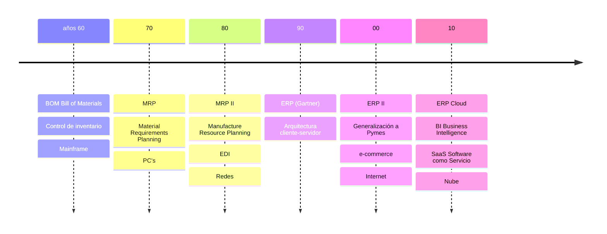

---

tags:

- sistemas-gestion-empresarial
- DAM2 unidad: 3 tema: Evolución de los sistemas de información empresarial desde los años sesenta

---

# Unidad 3. Un poco de historia

> [!summary] Ideas clave
> 
> - Al comparar estudios históricos pueden advertirse diferencias de décadas, debidas al desfase entre la expansión de los desarrollos tecnológicos en EE. UU. y su aparición en Europa y en España.
> - En los años sesenta se establecieron, heredados de los sistemas militares, los conceptos de gestión automatizada; aplicaciones como BOM o IMC se adaptaron al mundo empresarial.
> - Los MRP, basados en el BOM, calculaban el material necesario, lo comparaban con el almacén y determinaban cuándo abastecerse.
> - Los MRP II integraron los MRP con componentes financieros.
> - Los ERP aparecieron en los noventa sobre arquitecturas cliente-servidor, con una fuente de información centralizada común a todos.
> - En los 2000 aparecieron el SCM, el ERP II, el CRM y el PLM, y el uso de los ERP se universalizó.
> - Desde 2010, el _Cloud Computing_ y el SaaS permiten disponer de toda la gestión empresarial con un dispositivo y un navegador.
> - La evolución experimentada desde los años sesenta ha llevado a estos sistemas a jugar un rol estratégico en la gestión de empresas.

> [!info] Alcance de la unidad Esta unidad desarrolla el apartado 1.4 del capítulo. Los sistemas citados (MRP, ERP, SCM, CRM, BI, DSS, EIS…) se definen en la [[02 - Sistemas de información de gestión|Unidad 2]], y el CRM se estudia en la [[04 - La fidelización de clientes, concepto de CRM|Unidad 4]].

---

## 1.4. Un poco de historia

A menudo, al comparar estudios históricos, se pueden advertir diferencias de décadas según el autor y las fuentes utilizadas. Eso se debe, normalmente, al desfase que solía y suele producirse entre la expansión de los desarrollos tecnológicos en EE. UU. y su aparición y despliegue en Europa y, en particular, en España.

A mediados del siglo pasado, las empresas utilizaban procesos de gestión manuales y poco automatizados.

Heredados de los sistemas militares, en la década de los sesenta se establecieron los conceptos de gestión automatizada y se empezaron a utilizar las herramientas de planificación en el ámbito comercial. Aplicaciones básicas como los gestores de listas de materiales, BOM (_Bill of Materials_), o IMC (_Inventory Management Control_, control de gestión de inventario) fueron adaptadas desde el mundo militar al empresarial.

En esta época se fundan numerosas empresas dedicadas al desarrollo de _software_ que, en una versión básica, se incluía con la venta del _hardware_. Los distintos departamentos empezaron a utilizar un _software_ específico para desarrollar sus funciones dentro de la empresa.

Además de la ya mencionada, las primeras áreas funcionales del negocio informatizadas fueron la de contabilidad, la financiera y la de almacén.

**Figura 1.3. Evolución temporal de los sistemas de información empresarial.**

> [!warning] Posible incoherencia en el material: los PC en los años setenta La figura 1.3 sitúa los PC en los años setenta, pero el texto de este mismo apartado sitúa la aparición de las primeras computadoras personales (IBM PC) en los años ochenta. Se conserva la figura original.

> [!warning] Posible error en el material: MRP II en la figura La figura 1.3 desarrolla MRP II como _Manufacture Resource Planning_, mientras que el texto usa _Manufacturing Resource Planning_, que es la forma habitual. Se conserva la forma original en la figura.

A finales de esta década y principios de los setenta aparecieron los primeros sistemas de planificación de la producción o planificación de las necesidades materiales, MRP (_Material Requirement Planning_). Era _software_ que se ejecutaba en _mainframes_, sistemas propietarios tipo IBM S36, u ordenadores «mini» tipo DEC (_Digital Equipment Corporation_) con sistema operativo VAX/VMS…, naciendo un mercado dominado por IBM. El primero de los MRP se atribuye a la empresa alemana Bosch unos años antes.

> [!warning] Posible error en el material: equipos citados El IBM System/36 se anunció en 1983, y el VAX-11/780, con su sistema operativo VMS, se presentó en 1977. Ambos son posteriores a la época que describe el texto (finales de los sesenta y principios de los setenta). Se conserva el texto original.

> [!warning] Posible discrepancia con otras fuentes: el primer MRP El material atribuye el primer MRP a Bosch. Otras fuentes lo atribuyen a Black & Decker, en 1964. Se conserva el texto original.

Los MRP, basados en el BOM, utilizaban los ordenadores para resolver el mayor problema con el que se encontraban las empresas con procesos de fabricación en etapas:

1. calcular el material que se necesita;
2. compararlo con lo que se tenía en el almacén;
3. obtener así cuándo se debía abastecer.

Posteriormente, en los años ochenta, la revolución de la microinformática, con la aparición de las primeras computadoras personales (IBM PC), provocó que más empresas de menor tamaño empezaran a utilizarlas para administrar su negocio.

Los MRP evolucionaron a los MRP II, siglas que ahora se correspondían con _Manufacturing Resource Planning_, y que incluían también la gestión de los costes de la materia prima, de la mano de obra, los logísticos, etc. Es decir, integraron los MRP con componentes financieros.

A partir de entonces se empezaron a utilizar sistemas informáticos para mecanizar las tareas de algunos departamentos de forma independiente:

- se instalaba un sistema de contabilidad;
- a veces, un programa de facturación que complementaba al contable;
- después se añadía un programa de nóminas;
- casi siempre, alguno específico aplicado al proceso de fabricación o de la prestación de servicios realizada.

Así hasta que se empezó a buscar la integración de los distintos sistemas y a constatar la necesidad de conectar los PC, apareciendo la estructura cliente-servidor.

Los fabricantes de _software_ empezaron entonces a proporcionar aplicaciones que permitían a varios usuarios acceder a los datos de forma simultánea. Así aparecieron los ERP en la década de los noventa, añadiendo:

- la gestión de la fabricación;
- la gestión de las relaciones con proveedores y clientes;
- la gestión de los recursos;
- de forma incipiente, la inteligencia de negocio.

> [!important] La idea base del ERP La idea base consistió en utilizar una _fuente de información centralizada_ común a todos. De esa manera, los datos se introducían una sola vez en el sistema y estaban disponibles para el resto de los integrantes de la organización: una única base de datos y la posibilidad de extraer, de forma regulada, la información contenida en función de las necesidades y privilegios de cada usuario.

Fue durante esta era cuando los primeros sistemas de planificación de recursos empresariales, ERP (_Enterprise Resource Planning_), se desarrollaron y ejecutaron en arquitecturas cliente-servidor.

> [!note] Definición: Sistema ERP Una aplicación de _software_ estructurada en módulos que se complementan y que utilizan una base de datos centralizada, y que se puede utilizar para gestionar todo el negocio de una empresa.

Se trataba de organizar el trabajo mediante una planificación previa de las necesidades de recursos, el control del consumo de los mismos y la gestión por procesos. Durante mucho tiempo, y enfocado a grandes empresas, fue un mercado liderado por la alemana SAP.

> [!info] Sabías que… Los 2000 son la década de la expansión del comercio electrónico (_e-commerce_), es decir, la comercialización de productos y servicios utilizando únicamente las TIC en un espacio digital sin un contacto físico, ya sea entre empresas (B2B, _Business to Business_) o al cliente final (B2C, _Business to Customer_).

> [!warning] Posible error en el material: B2C El material desarrolla B2C como _Business to Customer_. La forma habitual es _Business to Consumer_. Se conserva la forma original.

La evolución empresarial en la década de los 2000 hacia la externalización de las operaciones en las que la empresa no está especializada provoca la necesidad de coordinación con el exterior. Aparece así el concepto de sistemas de gestión de la cadena de suministro, o SCM (_Supply Chain Management_), es decir, la gestión del intercambio de información electrónica (EDI, _Electronic Data Interchange_) entre los sistemas de gestión, generalmente distintos, de las empresas y sus proveedores. En consecuencia, aparece también el ERP II, que añade estas funcionalidades al ERP clásico.

Aparecen conceptos como:

- CRM (_Customer Relationship Management_), para administrar las relaciones con los clientes;
- PLM (_Product Lifecycle Management_), que proporciona la gestión de la información técnica del producto fabricado a lo largo de todo su ciclo de vida.

Por otra parte, la explosión de las TIC y su adopción cada vez más generalizada por parte de las pequeñas empresas universaliza la utilización de los ERP, y aparecen soluciones adaptadas a cualquier tamaño de organización.

A partir de la década de 2010, la aparición de conceptos como el _Cloud Computing_ (computación en la nube) y el SaaS (_Software as a Service_, _software_ como servicio) permite una explosión de crecimiento, pues basta un dispositivo y un navegador para disponer de todas las funcionalidades relativas a la gestión empresarial que se desee, independientemente del tamaño de la empresa.

> [!important] Rol estratégico actual Actualmente, y englobados de nuevo bajo el nombre de ERP, todos estos sistemas han pasado de tener una función meramente operativa a jugar un rol estratégico como sistemas de ayuda a la gerencia de las empresas y soporte fundamental para la toma de decisiones, tanto operativas como estratégicas, dando paso a la aparición de los conceptos de BI, DSS y EIS.

---

## Bibliografía

- _Sistemas de gestión empresarial_, capítulo 1, «Introducción a los sistemas de gestión empresarial», apartado 1.4 y figura 1.3, págs. 22–24 (libro de texto de la asignatura).